# Six open decisions, with a picture and the measured effect of each option (2026-11-18)

The owner asked for renders and for the effects of each option before he assesses the decisions listed after the fingering switch (build notes, "Fingering order switched"; [docs/09](../../docs/09-kernel-and-decisions-challenged.md) section 8). **Nothing was decided or changed here.** No preset, rule, limit or test changed; the bodies below are test builds under their own names.

Every body is the seed body P4 at 80 cm³ unless it says P0, in the Asian fingering order, labium offset −0.2 mm, built with `tools/geometry_check_variant.py` and measured on the STL read back from disk. Reports: `addon_checks/<id>.md`; pictures: `addon_renders/<id>/`. Sheets: `python Analizes_ocarinas/Decisions_2026-11-18/sheet_decisions.py`.

> **Superseded in part on 2026-11-19.** Rule version 3 replaced three of these: the shelf of decision 2 (the roof is cut square; the ellipse cut stays), the pipe angle of decision 3 (+8° against the body) and the standing neck of decision 6 (a cone neck at the pipe's angle, and the voicing 30° around the body). Decisions 1, 4 and 5 stand. Record: [Neck_volume.md](../Neck_volume/Neck_volume.md), section 9.
>
> **Outcome, later on 2026-11-18.** The owner: "I agree with the decisions, just the 6. Swap it to standing 15 degree." Recommendations 1 to 5 were taken and the neck stands 15° off the body. All of it was applied the same day; see [Outcome](#outcome-what-was-decided-and-applied) at the end. Sections 1 to 6 are kept as the owner saw them. Their option bodies were built before the decisions became the rule, so the commands in the table below no longer rebuild the same bodies: a setting that a command does not name now comes from `[voicing_rules]`.

Common settings, called BASE below: `stub_style=neck window_cut=ellipse pocket_blend_radius_mm=12`.

| Body | Settings added to the preset | Result |
| --- | --- | --- |
| `P4-80-el-d-fan` | none: the Stage 2 body (fan cut, box stub), copied for the pictures | passes |
| `P4-80-el-d-p3` | BASE `cone_widen_mm=3 shelf_angle_deg=40` | passes |
| `P4-80-el-d-p1` | BASE `cone_widen_mm=4 shelf_angle_deg=50` | passes |
| `P4-80-el-d-p3-m25` | P3 and `windway_pitch_deg=-2.5` | passes |
| `P4-80-el-d-p3-m25-s10` | the same and `sub1_slide_mm=10` | passes |
| `P4-80-el-d-p3-m25-h3` | P3, −2.5°, and the kernel rule `windway_taper_ratio` 2.5 instead of 1.3 (set in memory for this build; the parameter file was not touched) | passes; voicing hash `9da2fb953aae` instead of `617b869f0b10` |
| `P4-80-el-d-p3-stand` | P3 and `stub_pitch_deg=15 windway_pitch_deg=5` | **fails `voicing_keepouts`**: 1266 vertices above the 45° flare. A picture body |
| `P0-65-el-d-p3-m25`, `P0-95-el-d-p3-m25` | P3 and −2.5° on the smallest and the largest ladder body | pass |
| `P0-95-el-d-p3-m20`, `P0-95-el-d-p3-lvl` | P3 at −2.0° and level, 95 cm³ | pass |

"Passes" means no unexpected failure; the pad-limit failures of the thumbs and the two warnings of P4 are as on the Stage 2 body.

## 1. The left subhole slide: 9.5 mm or 10 mm

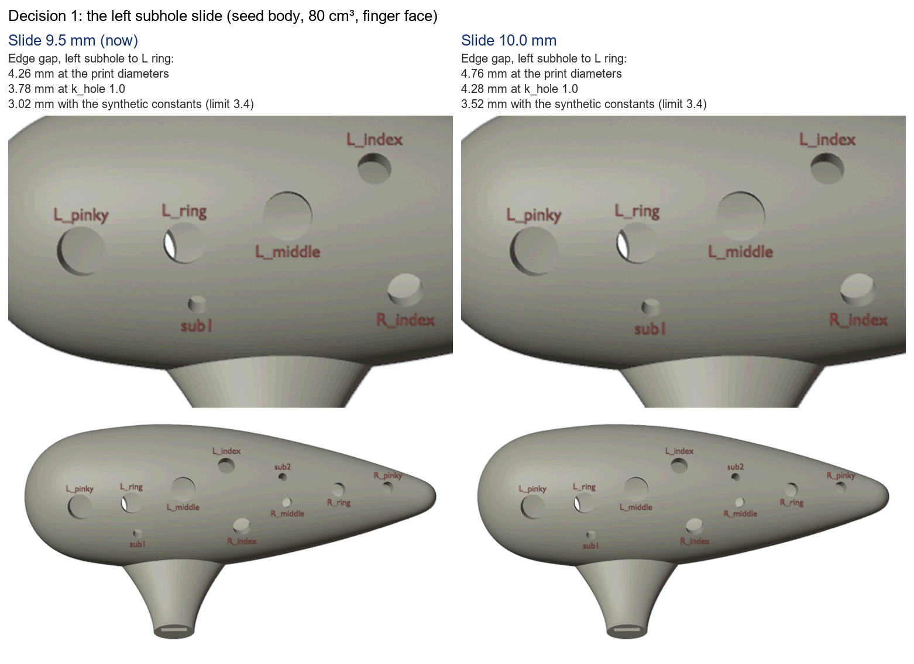

Edge gap between the left subhole and L ring (limit 3.4 mm), computed from the layout:

| Body | Slide | Print diameters | k_hole 1.0 | Synthetic constants (Stage 3) |
| --- | --- | --- | --- | --- |
| P1 | 9.5 / 10.0 / 10.3 mm | 4.26 / 4.76 / 5.06 | 3.78 / 4.28 / 4.58 | 3.55 / 4.05 / 4.35 |
| P2 | 9.5 / 10.0 / 10.3 mm | 4.26 / 4.76 / 5.06 | 3.78 / 4.28 / 4.58 | **3.34** / 3.84 / 4.14 |
| P4 | 9.5 / 10.0 / 10.3 mm | 4.26 / 4.76 / 5.06 | 3.78 / 4.28 / 4.58 | **3.02** / 3.52 / 3.82 |

The subhole stays straight forward of L ring (0° off the hand line's normal) at every slide. The soft check accepts 7 to 11 mm. The two professional alto C instruments have 10.3 and 10.6 mm. The built body with 10 mm has the same two warnings as the one with 9.5 mm.

## 2. The window cut: ellipse P3 or P1

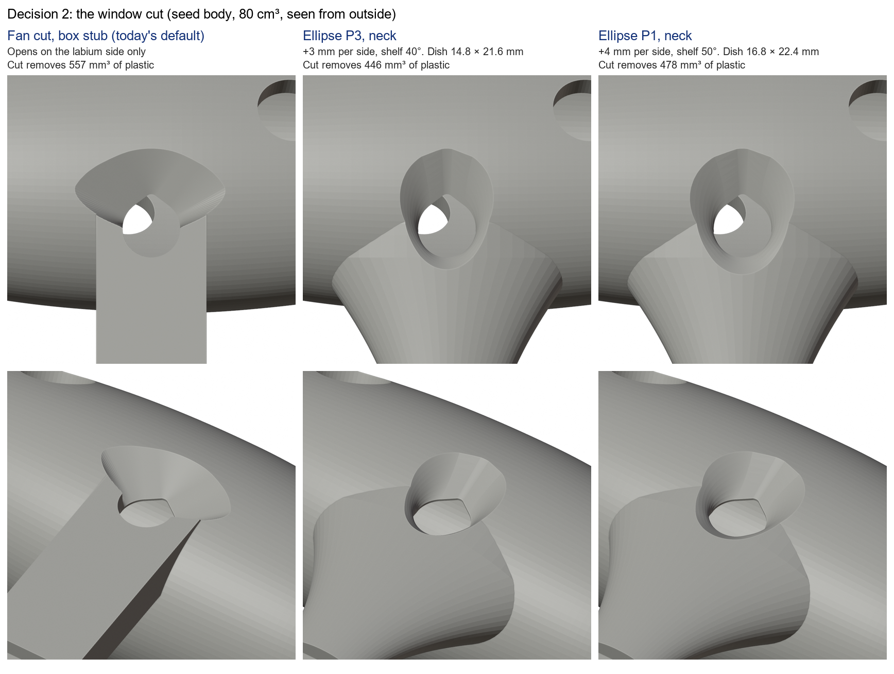

| | Fan (today) | Ellipse P3 | Ellipse P1 |
| --- | --- | --- | --- |
| Opening per side at the skin | on the labium side only | 3 mm | 4 mm |
| Dish at the skin | about 25 mm across | 14.8 × 21.6 mm | 16.8 × 22.4 mm |
| Side wall against the normal | – | about 37° | about 45° |
| Shelf above the windway exit | none (vertical) | 40° | 50° |
| Plastic the cut removes | 557 mm³ | 446 mm³ | 478 mm³ |
| Window area, measured / record | 62.84 / 62.84 | 62.87 / 62.84 mm² | 62.92 / 62.84 mm² |
| A4 against the fan cut, duct estimate | 0 | about −36 cents | about −24 cents |

The last row is the estimate of [kernel_vs_references.md](../Kernel_challenge/kernel_vs_references.md) section 3 with the volumes measured here. It overstates the size of the effect; it says the two ellipse settings differ from each other by roughly a third of what either differs from the fan.

## 3. The tilt of the windway

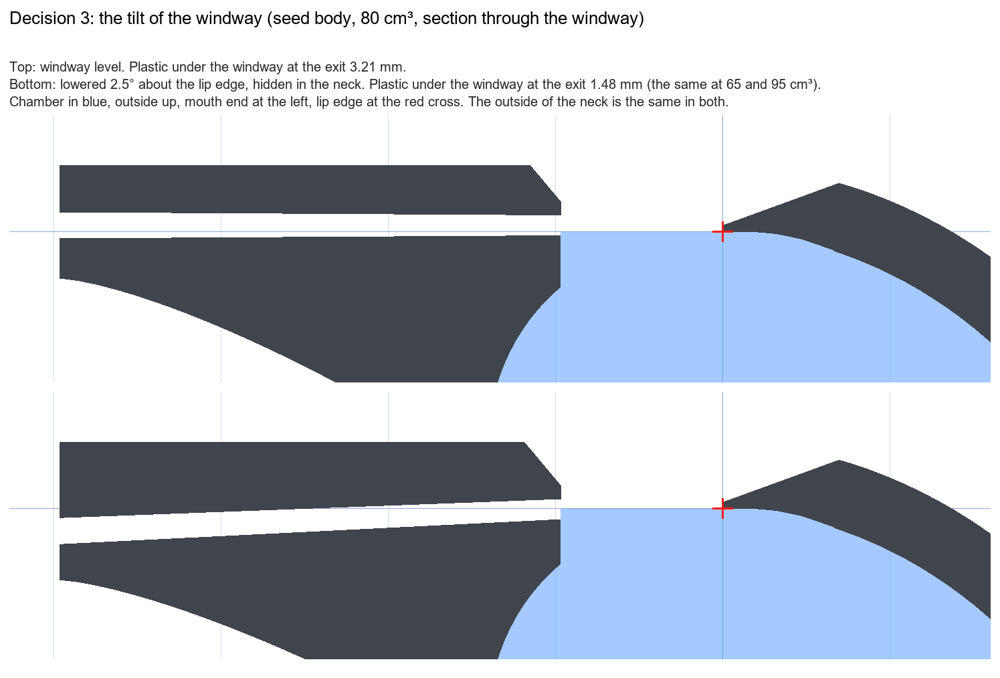

Plastic under the windway floor at the exit (the owner's minimum is 1.2 mm; the check fails under 0.8 mm):

| Body | Level | 2.0° | 2.5° |
| --- | --- | --- | --- |
| P0-65 | – | – | 1.48 mm |
| P4-80 | 3.21 mm | – | 1.48 mm |
| P0-95 | 2.22 mm | 1.83 mm | 1.48 mm |

Earlier builds on P4-80: 1.29 mm at 2.7°, 1.05 mm at 3°. At 2.5° the exit moves 0.42 mm toward the chamber and the mouth end 1.73 mm; the outside of the neck does not change.

## 4. The height of the windway at the mouth end

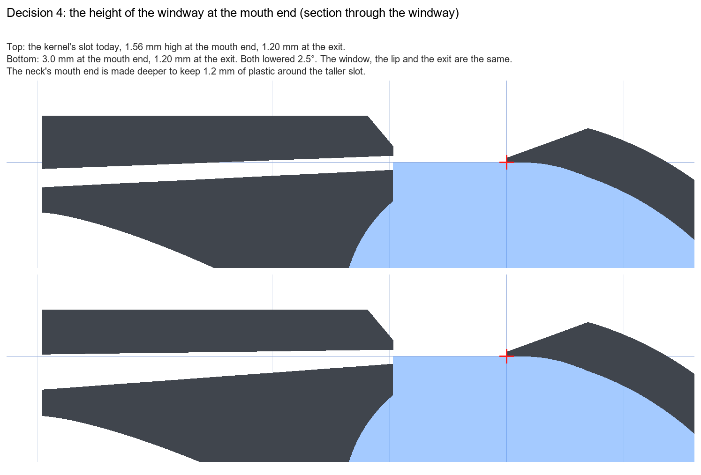

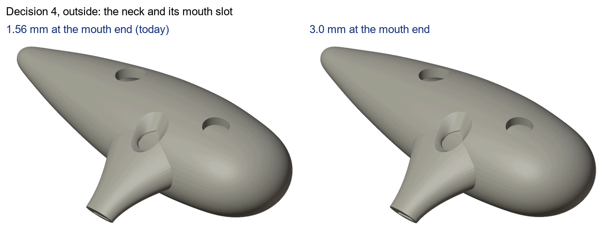

| | 1.56 mm (today) | 3.0 mm |
| --- | --- | --- |
| Slot, mouth end → exit | 1.56 → 1.20 mm | 3.00 → 1.20 mm |
| Air in the windway | 370 mm³ | 561 mm³ |
| Plastic under the windway at the exit, at 2.5° | 1.48 mm | 1.47 mm |
| Window, lip, ramp, exit | as the record | as the record |
| Laminar loss in the slot at a 15 m/s jet | 47 Pa (36 % of the jet's) | 19 Pa (15 %) |
| Voicing hash | `617b869f0b10` | `9da2fb953aae` |

## 5. The hash and the stub set

No picture: this is a rule change and two builds that do not exist yet. Today the hash covers the window, the wall, the slot and the lip; it does not cover the cut, the shelf, the tilt or the pocket blend. A Stage 1 stub is about 30 g of PLA.

## 6. The stance of the neck

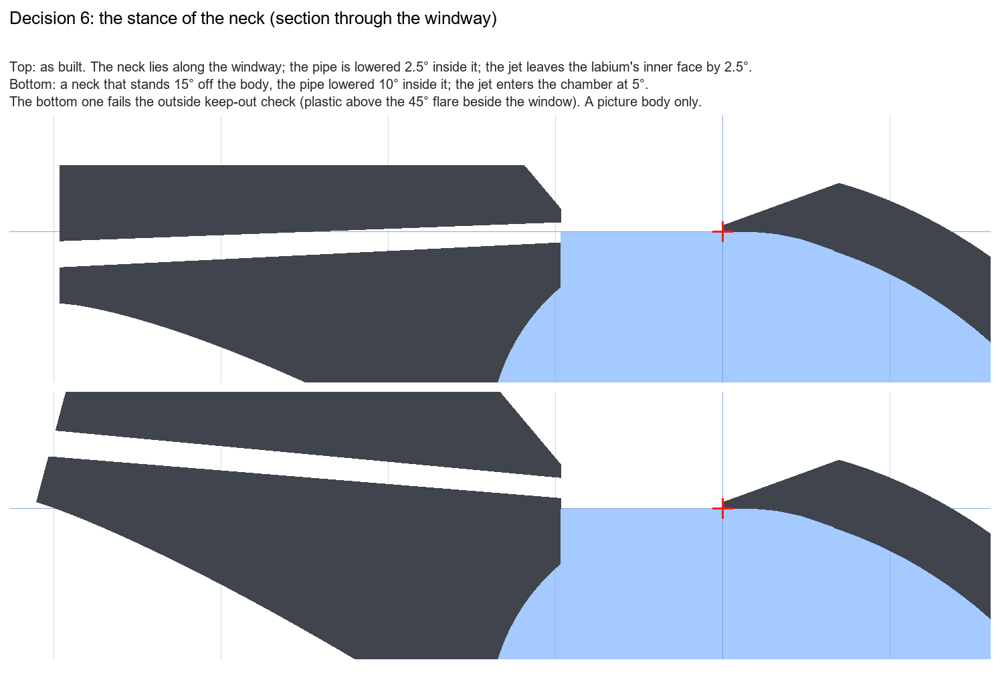

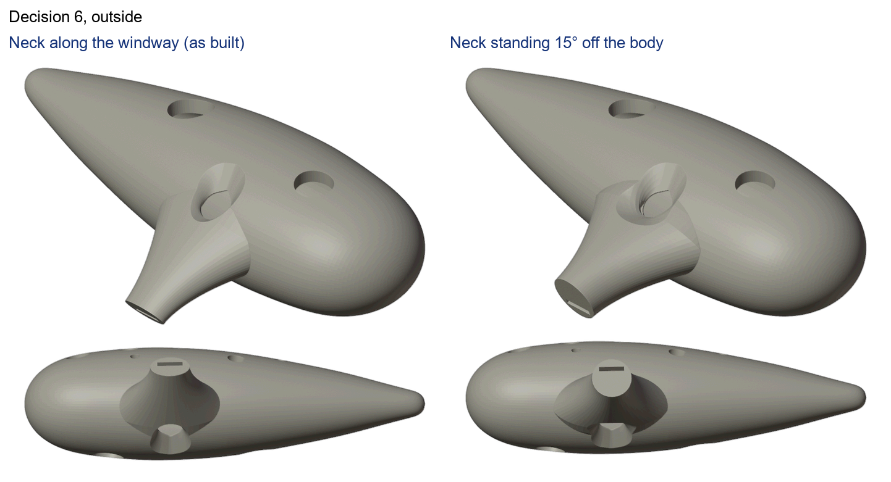

| | Along the windway (as built), pipe lowered 2.5° | Standing 15°, pipe lowered 10° inside it |
| --- | --- | --- |
| Jet against the labium's inner face | leaves it by 2.5° | enters the chamber at 5° |
| Plastic under the windway at the exit | 1.48 mm | 4.45 mm |
| Outside keep-out (45° flare beside the window) | 0 vertices above it | **1266 vertices above it: fails** |
| Plastic of the body | 55.2 cm³ | 58.2 cm³ |
| Neck against the plane of the body | in it | 15° out of it |

## Outcome: what was decided and applied

The owner, 2026-11-18: "I agree with the decisions, just the 6. Swap it to standing 15 degree."

| # | Decision | Taken | Applied as |
| --- | --- | --- | --- |
| 1 | Left subhole slide | 10 mm | `sub1_slide_mm = 10.0` in presets P1 to P4 |
| 2 | Window cut | Ellipse P3 | `[voicing_rules]` `window_cut = "ellipse"`, `cut_widen_mm = 3.0`, `shelf_angle_deg = 40.0` |
| 3 | Tilt | 2.5°, agreed for the neck along the body | See "The open point" below: `windway_pitch_deg = 5.0` |
| 4 | Mouth end of the windway | 3.0 mm | `windway_taper_ratio = 2.5` |
| 5 | Hash and stubs | Yes | The build is in the voicing record and in its hash; stubs V-a (the build) and V-af (plain) |
| 6 | Stance of the neck | **Standing 15°** (the owner's choice; I had recommended the neck along the body) | `stub_style = "neck"`, `stub_pitch_deg = 15.0` |

`[voicing_rules]` was rule version 2 (version 3 since 2026-11-19, see the note at the top), and the three stages were regenerated. The record of the change is in the build notes, "Owner decisions applied (2026-11-18)".

### What was built

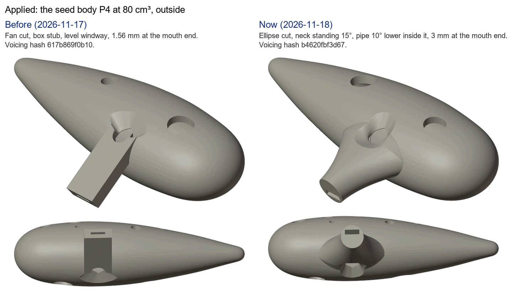

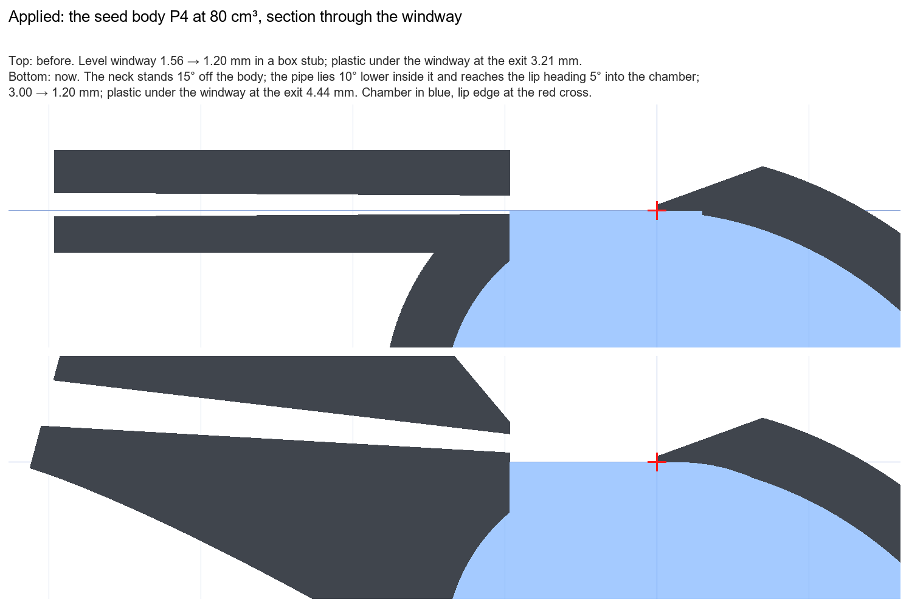

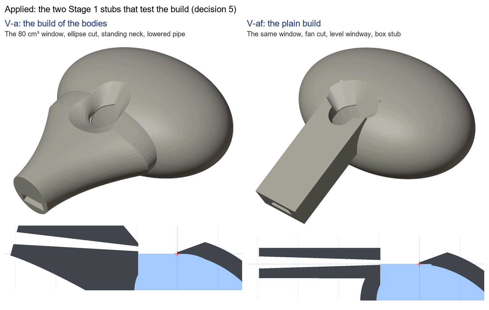

Measured on the Stage 2 seed body P4-80 (STL read back from disk), against the Stage 2 body of 2026-11-17:

| | 2026-11-17 | Now |
| --- | --- | --- |
| Voicing hash | `617b869f0b10` | `b4620fbf3d67` |
| Window, measured area / record | 62.83 / 62.84 mm² | 62.83 / 62.84 mm² |
| Windway, mouth end → exit | 1.56 → 1.20 mm | 3.00 → 1.20 mm |
| Jet against the labium's inner face | along it | enters the chamber at 5° |
| Plastic under the windway at the exit | 3.21 mm | 4.44 mm |
| Mouth end of the mouthpiece, width × depth | 16.8 × 6.8 mm (box) | 13.8 × 15.0 mm (neck) |
| Outside keep-out | nothing above the outer face | the neck is 41.5° steep seen from the window rim; the limit is the 45° flare |
| Edge gap, left subhole to L ring (print diameters) | 4.26 mm | 4.76 mm |
| Plastic of the body | 52.9 cm³ | 58.3 cm³ |
| Checks | no unexpected failure | no unexpected failure |

Stage results: Stage 1 6 of 7 with no unexpected failure (the optional 3 mm wall stub V-a3 fails its outside keep-out by 2°); Stage 2 8 of 8 with no unexpected failure; Stage 3 from the synthetic constants 7 of 7 with no unexpected failure, for the first time (the 10 mm slide).

### Two things the standing neck changed in the other decisions

**The outside keep-out check.** The rule is a 45° flare around the window. The check used to count everything above the outer face of the window, which was the same thing while the mouthpiece ended there. A standing neck rises behind the window, so the option body of section 6 failed with 1266 vertices. The check now measures the flare itself: a point h above the outer face is inside the flare when it is closer than h to the window outline. The limit did not change. The neck is 41.5° steep seen from the rim, 3.5° inside the limit.

**The open point: the angle of the pipe.** The 2.5° of decision 3 was the pipe against a neck that lies along the body. Inside a neck that stands 15° there are three ways to read it:

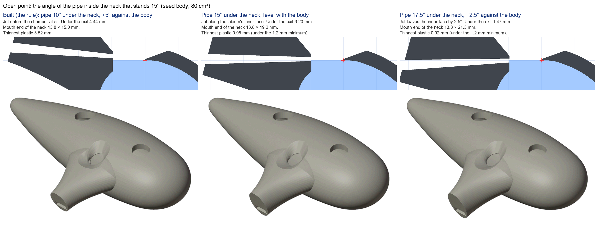

| Pipe | Against the body | Jet at the lip | Under the exit | Mouth end of the neck | Checks |
| --- | --- | --- | --- | --- | --- |
| 10° under the neck (**built: the body the owner chose from the picture**) | +5° | enters the chamber at 5° | 4.44 mm | 13.8 × 15.0 mm | no unexpected failure; thinnest plastic 3.52 mm |
| 15° under the neck | 0° | along the labium's inner face | 3.20 mm | 13.8 × 19.2 mm | no unexpected failure, but the thinnest plastic is 0.95 mm, under the 1.2 mm minimum |
| 17.5° under the neck | −2.5° | leaves the inner face by 2.5° | 1.47 mm | 13.8 × 21.3 mm | no unexpected failure, but the thinnest plastic is 0.92 mm, under the 1.2 mm minimum |

The lower the pipe goes inside the standing neck, the deeper the mouth end has to be to keep 1.2 mm of plastic around the pipe. The angle is one number in `[voicing_rules]` and it is hashed, so it has to be settled before the stubs are printed.

### A defect found on the way, and fixed

The pocket blend (the curve that replaces the small step behind the labium) had been tried on the seed body only. With the blend on every body, the first regeneration showed that on a strongly curved chamber its skirt never met the chamber wall: it cut a step of about 2 mm into the wall at its rim, and on P2-80 it left 0.06 mm of plastic between the pocket and the chamber (1.4 to 3.5 mm on the stubs). No check failed, because the wall check judged the plain wall only. The blend now ends where it meets the chamber wall, in every direction, and two checks cover it (`pocket_blend`, and `wall_thickness` fails under 0.4 mm of plastic). Thinnest plastic after the fix: 2.45 to 2.65 mm on the stubs, 2.81 to 4.00 mm on the Stage 2 bodies (P2-80: 2.94 mm).
