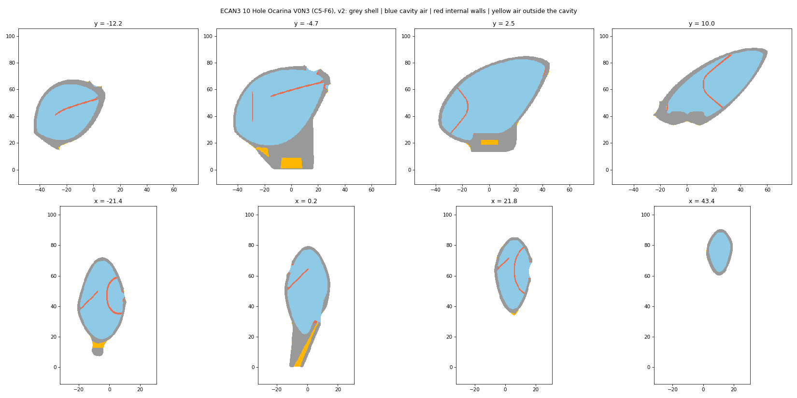
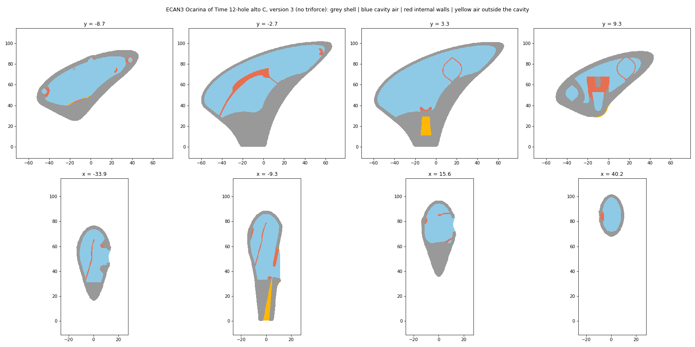
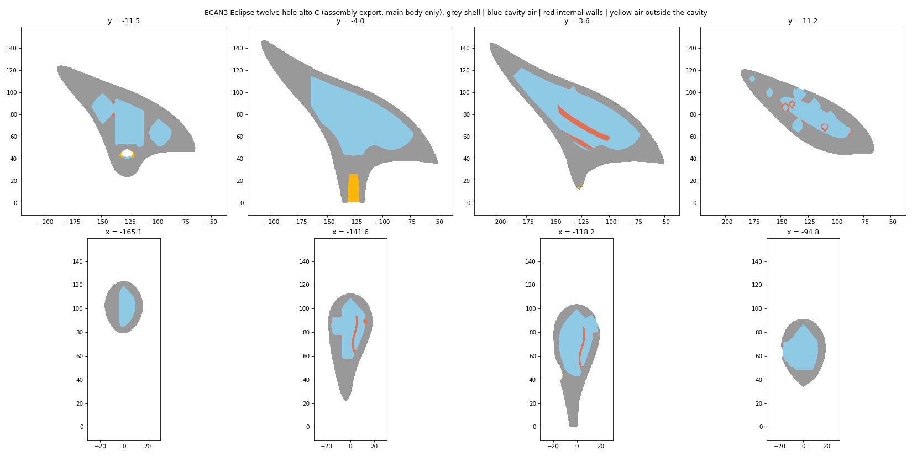

# ECAN3 experimental alto C ocarinas: chamber shape, internal walls and volume bypassing

This is a separate research track from the parametric add-on. It measures three published, printable, maker-tuned ocarinas by **E.CAN3 / ECAN3**, which use non-standard internal geometry (internal walls, fins, pockets and inward tubes). The aim is to find out what that geometry does acoustically, and whether it is a technique the parametric design can adopt for FDM.

- Method, validation and limits: [METHOD.md](METHOD.md)
- Per-model raw reports: [output/v0n3/report.md](output/v0n3/report.md), [output/oot/report.md](output/oot/report.md), [output/eclipse/report.md](output/eclipse/report.md)
- Cross-model table: [output/summary.md](output/summary.md)
- Input files and licences: [models/README.md](models/README.md) (the STLs are not committed)

Reproduce:

```bash
python Analizes_ocarinas/ECAN3_experimental/tools/analyze_model.py v0n3
```

```bash
python Analizes_ocarinas/ECAN3_experimental/tools/analyze_model.py oot
```

```bash
python Analizes_ocarinas/ECAN3_experimental/tools/analyze_model.py eclipse
```

```bash
python Analizes_ocarinas/ECAN3_experimental/tools/summarize.py
```

```bash
python -m unittest discover -s Analizes_ocarinas/ECAN3_experimental/tools -v
```

---

## 1. Sources and the hypothesis being tested

**Pure Ocarinas, "How chamber shape affects an ocarina's range"** ([link](https://pureocarinas.com/ocarina-chamber-shape-range-chamber-volume-bypassing), Robert Hickman, presented as a personal hypothesis):

- A tone hole cannot usefully be larger than the chamber's internal diameter at that point. Beyond that, the chamber limits the pitch.
- **Volume bypassing**: when a hole is nearly as wide as the bore, the oscillating air enters and leaves through that hole, and the air beyond it takes little part. The effective volume then shrinks as more holes open, so high notes drive less air mass and sound cleaner, like a smaller ocarina.
- This happens naturally in high-aspect (long, narrow) soprano chambers. For bigger instruments he proposes **sub-volumes** attached to the main chamber, each with a hole at its base that bypasses it when opened, folded inside a normal outer shape. His prototype enclosed a bass ocarina's two thumb holes in a "trunk" open at one end.
- He reports no measurements. The prototype is described as "primitive". He says that sub-volumes did not produce the unwanted extra resonances he had feared, and that more testing is needed.

**The Ocarina Network, "On the physics of the ocarina: what is the influence of the voicing on the pitch?"** ([thread](https://theocarinanetwork.com/on-the-physics-of-the-ocarina-what-is-the-influenc-t24283.html), Oct 2019):

- The Helmholtz formula is only approximate for ocarinas. A larger voicing area raises the base pitch at the same volume, and the windway area mainly sets loudness.
- Blocking off the tail of a small ocarina (making it a closed side volume) raises the pitch and helps the upper notes.
- Thick walls and undercutting add a little volume. The effect is small but not zero.
- The thread does not discuss bypassing or internal walls, and it has no measurements.

**ECAN3's own statement** (MakerWorld pages of the OOT and Eclipse models, read 2026-11-15): "The internal design helps to reduce airy high notes (better sound, no acute bend)". Both are tuned A4–F6 with standard 12-hole fingering, and A4 needs low pressure with more pressure as holes open. Print settings for the OOT: 0.4 mm nozzle, 2 walls, 0.2 mm layers, 20 % gyroid infill, printed standing on the mouthpiece, no supports. Per the user, ECAN3 credits the two sources above. The V0N3 page (Printables) could not be read: it is behind a bot check.

**What "the walls help the high notes" can mean physically**, and what this analysis can test:

| Mechanism | Prediction | Testable here? |
| --- | --- | --- |
| A. **Displacement**: wall plastic removes air volume | Uniform pitch rise, −8.6 cents per +1 % of volume, the same on every note | Yes: wall volume |
| B. **Bypass / partition**: walls create sub-volumes or narrow passages, so the air taking part depends on the fingering | Fingering-dependent shift; V_eff falls as holes open; holes placed where the chamber is narrow (d/Ø → 1) | Yes: cell network, placement metrics |
| C. **Mode control**: walls stiffen or reshape the chamber so the first cavity (standing-wave) mode moves away from the top notes | First cavity mode / F6 changes | Yes: network eigenmodes |
| D. **Jet / tone**: "airy" high notes and "acute bend" come from the jet–labium drive (breath curve, overblowing margin), not from the passive resonance | Not visible in a passive model | No: needs recordings and a manometer (Phase 1 of the main plan) |

---

## 2. The three instruments and their internal geometry

All three are single watertight shells, exported standing on the mouthpiece. The window is on the thumb face in all three.

| | V0N3 10-hole | OOT 12-hole | Eclipse 12-hole |
| --- | --- | --- | --- |
| Range | C5–F6 | A4–F6 | A4–F6 |
| Outside, mm | 112 × 41 × 94 | 129 × 32 × 103 | 163 × 39 × 148 |
| Plastic (solid), cm³ | 31.5 | 58.5 | 125.2 (most of it decorative solid crescent; the air chamber is 77.0 cm³, §3) |
| Shell at the holes | 1.6 mm, uniform | 3.9 mm (2 walls + infill); 2.4 mm at the lens holes | 1.6 mm at plain holes |
| Window | triangular slot, ~12 mm wide at the windway exit, ~5.5 mm to the labium; 68 mm² outer aperture | in a recess above the mouthpiece (aperture not measurable as a bore) | 47 mm² outer aperture |
| **Free internal walls** | diagonal free fin under the left hand; curved **cover walls over both thumb holes** (each thumb opens into a shallow pocket); the tail narrows into a **tail pocket** (9.9 cm³ behind a 326 mm² neck) that holds R_ring, R_pinky and R_thumb | **mid-plane septum** rising from the voicing and ending free near the top, giving a back pocket that holds the left thumb | **septum parallel to the finger face**, giving a shallow front channel that five finger holes open into |
| **Hole tubes / bosses** | none | left thumb chimney 1.5–14.5 mm (inward tube); lens-shaped tube on the right thumb; small boss on sub_L | **inward tubes about 8 mm long on six low-note holes**: sub_L, sub_R, R_pinky, R_ring, R_middle, L_pinky (6.2 mm) |
| Hole shapes | round | lens-shaped L_ring, L_index, thumbs | round |

Figures (generated): faces with hole names, `images/<model>_faces.png`; label slices (shell, air, walls), `images/<model>_labels.png`; sub-volumes, `images/<model>_subvolumes.png`; network mode shapes, `images/<model>_modes.png`.





## 3. Volumes

| mm³ | V0N3 | OOT | Eclipse |
| --- | --- | --- | --- |
| Cavity air (ball-capped) | 67,666 | 63,402 | 76,801 |
| + hole cap correction | 191 | 358 | 222 |
| **V0, air capped at the outer rims** (kernel convention) | **67,857** | **63,761** | **77,023** |
| of which closed chimneys / tubes | 535 | 1,838 | 1,472 |
| Free internal walls (septa, fins, covers) | 1,906 | 1,715 | 2,725 |
| Hole tube / boss walls | 0 | 146 | 411 |
| Voicing structure inside the chamber | 33 | 547 | 16 |
| **Gross chamber (V0 + free walls + tubes)** | **69,763** | **65,622** | **80,160** |
| Wall displacement, % of gross | 2.7 % | 2.8 % | 3.9 % |

**Check against your Blender number.** The 10-hole inner chamber measured 66,784.2 mm³ in Blender. This analysis gives 67,857 mm³ capped at the outer rims (+1.6 %) and 67,322 mm³ without the closed chimneys (+0.8 %). Your "simple booleans" volume is therefore the air chamber, not the gross chamber with the walls (69,763). The remaining 0.8 % is within what a hand-built boolean cap and the voxel cap can differ by. (Your exported STL is empty, so the two caps could not be compared directly.)

**Against the kernel baseline.** The OOT's fitted window conductance (4.04 mm) and volume (63.8 cm³) almost equal the repo's 12-hole baseline (η_wG_w = 3.92 mm, V0 = 61.85 cm³). The window efficiency implied by the measured window apertures is **η_w = 0.86 (V0N3) and 0.89 (Eclipse)**, which supports the kernel prior of 0.90 (doc 03 §6.1, R11). The V0N3 is a large-voicing 10-hole: window area / V0^(2/3) is 0.041, against 0.024 in the kernel baseline. That is why its C5 chamber (68 cm³) is as big as a 12-hole's.

## 4. Holes and where the walls sit relative to them

Full tables are in the per-model reports. Ratio = measured G (k 0.8) divided by the G the single-volume kernel needs for that step. d/Ø = hole diameter divided by the largest ball that fits in the chamber within 10 mm of the hole.

| Pattern | V0N3 | OOT | Eclipse |
| --- | --- | --- | --- |
| Largest holes sit where the walls make the chamber narrow (d/Ø ≥ 0.7) | R_thumb 0.93, L_index 0.78, L_thumb 0.73 (local Ø 11–12 mm) | L_thumb 0.94, R_thumb 0.72, L_middle 0.70, L_ring 0.68, L_index 0.68 | L_ring 0.77, R_index 0.77 (front channel, Ø 10–11 mm) |
| Low-note holes in wide chamber | d/Ø 0.21–0.27 | sub_R 0.10, R_middle 0.22 | inside tubes |
| Thumb-hole treatment | both under cover walls (pockets) | back pocket + 8.4 mm tube (L), lens tube (R) | none: open chamber, Ø 20 mm |
| Holes larger than single-volume theory needs (ratio > 1.3) | L_middle 1.62, R_thumb 1.83, R_middle 1.47 | R_thumb **2.23**, L_middle 1.42, R_middle 1.41 | R_index 1.92, L_middle 1.90, R_thumb 1.35 |

**Inward tubes are the repo's rule R6, implemented.** Each Eclipse tube holds the same small conductance in a much bigger bore than a plain 1.6 mm wall would allow. The kernel equivalents (same G, t = 1.6 mm, k = 0.8):

| Hole | With tube | Same G in a plain 1.6 mm wall |
| --- | --- | --- |
| sub_R | 3.28 mm | 1.75 mm |
| sub_L | 4.25 mm | 2.35 mm |
| R_pinky | 5.05 mm | 2.9 mm |
| R_middle | 5.06 mm | 2.9 mm |
| R_ring | 6.84 mm | 4.2 mm |
| L_pinky | 6.10 mm | 4.0 mm |

That is the "inward tubular boss" fix doc 03 §6.2 proposes for subholes below 3 mm. It also lowers each hole's sensitivity to print error, because cents per 0.1 mm falls as the bore grows.

**The septa run alongside the finger face, not across the chamber.** Only the OOT septum lengthens the air path from the window to the holes: its right-hand holes are 60–96 mm away through the air against 33–77 mm in a straight line. In the V0N3 and the Eclipse, the air path is no longer than the straight line.

## 5. Acoustic results

### 5.1 Two calibration facts that transfer to the main kernel

- **The end-correction coefficient fitted from the ECAN3 CAD is k = 0.90–1.05** (kernel fit) and 0.94–1.02 (network fit), against the prior 0.80. With k = 0.8, all three designs play 48–117 cents RMS sharp. The fitted k absorbs finger shading, hole–hole interaction and his printer's hole shrinkage. **For CAD-dimensioned FDM holes, use k ≈ 1.0 as the Phase 2 prior.**
- **η_w ≈ 0.86–0.89** for the two windows that could be measured (see §3).

### 5.2 Single volume vs cell network (window fitted to the lowest note, k fitted per model)

| RMS cents over the scale | V0N3 | OOT | Eclipse |
| --- | --- | --- | --- |
| Single-volume kernel | 28 | 32 | 43 |
| Cell network (geometry resolved) | 27 | **20** | **35** |

The network is better where there are pockets and tubes, and it gains most on the notes those holes control:

| Note | Kernel | Network |
| --- | --- | --- |
| OOT F6 (right thumb, lens tube) | +59 | +19 |
| OOT D5 | −67 | −28 |
| Eclipse D5 | −37 | −13 |
| Eclipse F6 | −52 | −26 |

It is no better on the V0N3, whose cover walls are thin and whose pockets have wide mouths. Residuals common to all three (G5 sharp, E6 flat) are not explained by either model. The thumb order is a suspect, but swapping it helps only the V0N3 (RMS 28 → 24) and not the other two. Finger shading, which is not modelled, is the other suspect.

### 5.3 Is there volume bypassing?

**Not in the Pure Ocarinas sense, at the passive-resonance level.**

- **Participation ratio** (1 = the whole chamber at one pressure): 0.965–0.998 over every fingering of all three.
- **Bypassed air** (below half the bulk pressure): at most 1.9 % of the volume (V0N3 F6) and 1.4 % for OOT. Eclipse: 0 %.
- **Sub-volumes exist only at the 8 mm gap level**, and their necks are wide: V0N3 tail pocket 9.9 cm³ through 326 mm²; OOT back pocket 26.8 cm³ through 920 mm²; Eclipse front channel 7.7 cm³ through 1,314 mm².

Why it cannot be large at alto size: for a pocket to be bypassed when its hole opens, the neck conductance G_p must be well below the hole's, say G_p ≲ G_h/3. While the hole is closed, the pocket's own resonance c/2π·√(G_p/V_s) must also stay above the scale, say ≥ 1.5 × F6. With G_h ≈ 8 mm (a thumb hole), those two conditions give **V_s ≲ 2 cm³**, about 3 % of V0. A bypass pocket that works and does not mistune is therefore inherently small, so its pitch leverage is about 3 % of volume (≈ 25 cents). ECAN3's pockets are 10–40 times bigger and wide-mouthed, so they behave as part of the main chamber.

### 5.4 What the internal walls do to the tuning

Two separate effects (walls-removed counterfactual: only the free walls are turned into air; same holes, tubes, voicing and window):

| Cents, walls present minus removed | V0N3 | OOT | Eclipse |
| --- | --- | --- | --- |
| A. Displacement alone (single volume), every note | +24 | +23 | +30 |
| Network, lowest note | +4 | −46 | −8 |
| Network, low/mid notes | +3 … +15 | −25 … +13 | −9 … +18 |
| Network, top notes | D6 −10, E6 −23, **F6 −43** | D6 −20, **F6 −63** | C6 −21, D6 −21, F6 −3 |

- **Displacement** is real and uniform: 2.7–3.9 % of the gross chamber, about +8.6 cents per 1 %. It is a free volume trim that leaves the outside unchanged.
- **The walls also add inertance**: the air has to flow around them to reach the openings. This cancels most of the displacement at the low notes and **flattens the top notes by 20–65 cents** relative to a wall-free chamber with the same holes. In the passive model the walls therefore *compress* the top of the scale; they do not extend it.
- This matches the oversized top holes in §4. ECAN3's top holes (R_thumb, L_middle, R_index) are 1.35–2.23 × what single-volume theory needs, which is what tuning the top notes up again against that extra inertance would require.
- At OOT's lowest note the septum sits between the voicing and the bulk, so its inertance also flattens A4 (−46 cents). This is not a top-note effect.

### 5.5 Cavity (standing-wave) modes

| | V0N3 | OOT | Eclipse |
| --- | --- | --- | --- |
| First cavity mode, all holes closed | 1,645 Hz | 1,507 Hz | 1,867 Hz |
| ÷ F6 | 1.18 | **1.08** | 1.34 |

The OOT and V0N3 sit below the repo's 1.3 rule (R9), yet both are popular designs tuned to F6. Eclipse's compact faceted chamber, inside a solid decorative crescent, clears it. Whether the walls move these modes is not yet computed (see §7).

## 6. Answers

1. **Volume of the non-standard chambers:** 64–77 cm³ of air (V0, kernel convention), 66–80 cm³ gross. Internal walls displace 1.9–3.1 cm³ (2.7–3.9 %). Your Blender number is the air chamber, matching to 0.8–1.6 %.
2. **Does wall displacement raise the volume or tune the high notes?** Displacement *reduces* the air volume and raises **every** note by the same 23–30 cents; it does not single out the high notes. The fingering-dependent effect of the walls comes from inertance, and in these three designs it **flattens** the top notes by up to 20–65 cents. The designer compensates with larger top holes.
3. **Is ECAN3's geometry volume bypassing?** Not measurably at the passive level: at least 96.5 % participation everywhere. What it does measurably is (a) move holes to narrow spots (d/Ø 0.7–0.94), (b) **lengthen the low-note chimneys with inward tubes** so small-conductance holes become large, robust bores, and (c) add local inertance at specific holes, which only the network model captures (OOT RMS 32 → 20 cents).
4. **"Reduces airy high notes, no acute bend"** is a claim about the jet–labium drive (mechanism D): breath curve, Strouhal number and overblowing margin. A passive model cannot confirm or refute it. Plausible links to test: the top holes are larger (§4), so the window is a smaller share of the top-note conductance; and the Eclipse's cavity-mode margin is high.

## 7. FDM-compatible design assumptions to carry into later experiments

These are hypotheses for coupons and test prints, kept out of the main add-on for now:

| ID | Assumption | Evidence |
| --- | --- | --- |
| X1 | k ≈ 1.0 (0.90–1.05) and η_w ≈ 0.87 are the priors for CAD-dimensioned FDM holes and printed windows | §5.1 |
| X2 | Give low-conductance holes (subholes, D5–F5 holes) an **inward tube of about 6–8 mm**, so the bore is ≥ 3 mm. Count the tube as chimney (t in G, A·t in V0 when closed) | Eclipse ×6, OOT bosses; doc 03 R6 |
| X3 | Treat free internal walls as a **volume trim** (+8.6 cents per 1 % displaced). Any wall that lengthens the path from the bulk to a top-note hole flattens it by tens of cents: size those holes with the network model, not the single-volume kernel | §5.4 |
| X4 | Partitions parallel to the finger face (septa) with mouths ≥ 300 mm² keep participation ≥ 0.96. No mistuning pocket resonances appear in range: closed-hole modes start at 1.08–1.34 × F6 | §5.3, §5.5 |
| X5 | A genuine bypass pocket at alto size must be **≲ 2 cm³ with a neck conductance ≲ G_hole/3**. Its pitch leverage is about 25 cents. Test it as a coupon before relying on it | §5.3 |
| X6 | The outside can be decoupled from the chamber with solid decorative mass, as the Eclipse does (a compact faceted cavity of 77 cm³ of air inside 125 cm³ of solid plastic) | §2 |
| X7 | Elongated chambers with a cavity-mode margin of 1.08–1.18 × F6 are evidently playable to F6, so R9's 1.3 may be conservative. Confirm with recordings first | §5.5 |

## 8. Open items and next tests

- **Recordings.** Pitch, spectrum and overblow margin of printed OOT and Eclipse (and the V0N3) on a manometer-controlled breath, to test mechanism D and to split the G5 / E6 residuals into finger shading and fingering.
- **Cavity modes with and without walls**, using the same network (a few lines in `analyze_model.py`), to test mechanism C directly.
- **Bypass coupon**: an alto chamber with a 1.5–2 cm³ pocket behind one thumb hole, neck sized to G_hole/3. Compare it with the same body without the pocket.
- **Tube coupon**: subhole with 1.6 mm wall vs an 8 mm inward tube at equal G. Compare pitch scatter across 3 prints.
- **Thumb order.** Confirm against ECAN3's chart image (the pages only say "standard 12-hole fingering").
- The V0N3 Printables page (behind a bot check) may contain the explicit source credits; paste its text to add them here.

## 9. How this fits the unified plan (experimental track)

This work is an **experimental side track** of [docs/02 · Unified plan](../../docs/02-unified-plan.md). It changes nothing in the kernel, the parameter file or the add-on plan. Its results enter the main line only through the plan's own gates, as priors and as coupon ideas.

### 9.1 Where it touches each phase

| Plan item | What this track contributes | Status |
| --- | --- | --- |
| **Phase 1 · References** (extract the air domain, measure V0, holes, chimneys, L_int; derive η_w and k) | The voxel pipeline is that extraction, automated. Three references are done on paper: V0, hole areas, ray-measured chimneys, walls, sub-volumes, cavity-mode margin. On paper, the Phase 1 gate (one η_w and one k within 30 cents) passes for V0N3 (28), passes for OOT only with the network model (32 → 20) and fails for the Eclipse (43 / 35). | Desk part done. Recordings missing, so the gate is not passed. |
| **A1 · η_w prior 0.5–1.0** | ECAN3's tuned designs imply η_w ≈ 0.86–0.89, the upper half of the prior and close to `params` (0.90). | Weak evidence: it assumes the CAD is in tune. Phase 2 still decides. |
| **`k_end` = 0.80** (theory 0.785–0.85) | The fitted k is 0.90–1.05, above the theoretical range. The excess most likely absorbs finger shading, hole–hole interaction and print offsets. | Use k ≈ 1.0 as the Phase 2 starting value; let the stepped fingerprint fit (A7) set it. |
| **A4 / R6 · subholes on inward bosses** | The Eclipse already does it: about 8 mm inward tubes on six low-note holes, bores 3.3–4.3 mm instead of 1.8–2.4 mm (X2). | Independent maker evidence for R6. Test on the Phase 2 calibration body. |
| **Bottom line #4 · volume-trim plug** | Free internal walls are a design-time volume trim: +8.6 cents per 1 % displaced (X3). They complement the plug, which stays adjustable after printing; a wall does not. | Idea only. |
| **A2 / R9 · L_int ≤ 75 mm, cavity mode ≥ 1.3 × F6** | The network gives the first cavity mode directly. ECAN3's OOT plays (by its author's account) at 1.08 × F6 (X7). | Keep R9 until recordings confirm. The network can act as a cheap check before Tier 2 FEM. |
| **Q6 · compact or long and narrow (bypassing)** | No passive bypass in three elongated, walled designs: participation ≥ 0.965 everywhere. A real bypass pocket must be ≲ 2 cm³ (X5), and the "less airy high notes" claim is a jet question. | Compact stays the default for Phase 3. Bypass becomes a coupon after Phase 3b, as Q6 already says. |
| **Phase 4 · add-on** (live volume, chimney ray-cast, pre-export checks) | The ray-median chimney measurement and the V0 capping convention are tested here on three real meshes. The cell network is a candidate "Tier 1.5" check for chambers with walls or L_int > 75 mm. | Not promoted. Gate in §9.3. |
| **Phase 5 · stylised shell** | This is where walls, pockets and inward tubes would actually be used. X1–X7 are the starting hypotheses. | Later. |

### 9.2 Next steps, in plan order

None of these block the main line.

1. **Now (desk, cheap):**
   - Compute the cavity modes with and without the free walls (mechanism C). This takes a few lines in `analyze_model.py`.
   - Confirm the thumb order against ECAN3's fingering chart.
   - Run `analyze_model.py` on any further reference STLs chosen for Phase 1 (the plan asks for 3–4). Each new model needs only a `config/models.toml` entry.
2. **With Phase 1 prints:** print and record the V0N3, the OOT and the Eclipse as personal test prints, with three takes per fingering and a manometer. This gives real η_w, k and breath curves, separates the G5 / E6 residuals into finger shading and fingering, and tests mechanism D (airy high notes, overblow margin). Their voicing geometry is not reused (Q5, licences).
3. **With Phase 2:** make the calibration body's inward-boss hole an 8 mm inward tube (X2), next to a plain hole of equal G. Its scatter across the three identical prints tells whether tubes make small-conductance holes more repeatable.
4. **After Phase 3b (Q6):** reprint the Phase 3a/3b body with one change at a time:
   - a 1.5–2 cm³ pocket behind one thumb hole, neck at G_hole/3 (X5);
   - a free wall displacing about 2 % of the chamber (X3);
   - a septum that lengthens the path to a top-note hole.
   
   The network predicts each change before printing, so the prints test the model as well as the idea.
5. **Phase 4/5 decision:** promote or drop the cell network (§9.3).

### 9.3 Promotion gate

Nothing moves from `Analizes_ocarinas/ECAN3_experimental/` into `kernel/`, `params/` or the add-on until both of these hold:

- the network predicts the step-4 coupons within 10 cents of their recordings;
- it agrees with Tier 2 FEM within 10 cents on the same geometry.

Until then, X1–X7 stay hypotheses, and the kernel's single-volume model remains the design tool for Phases 2–3.
