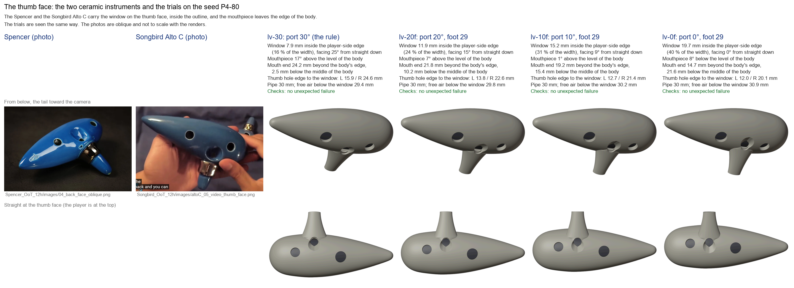
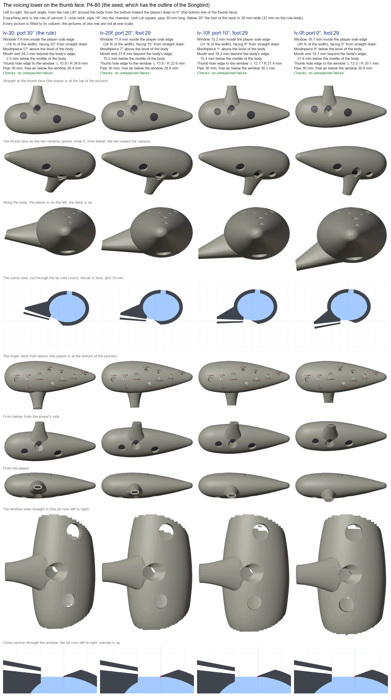
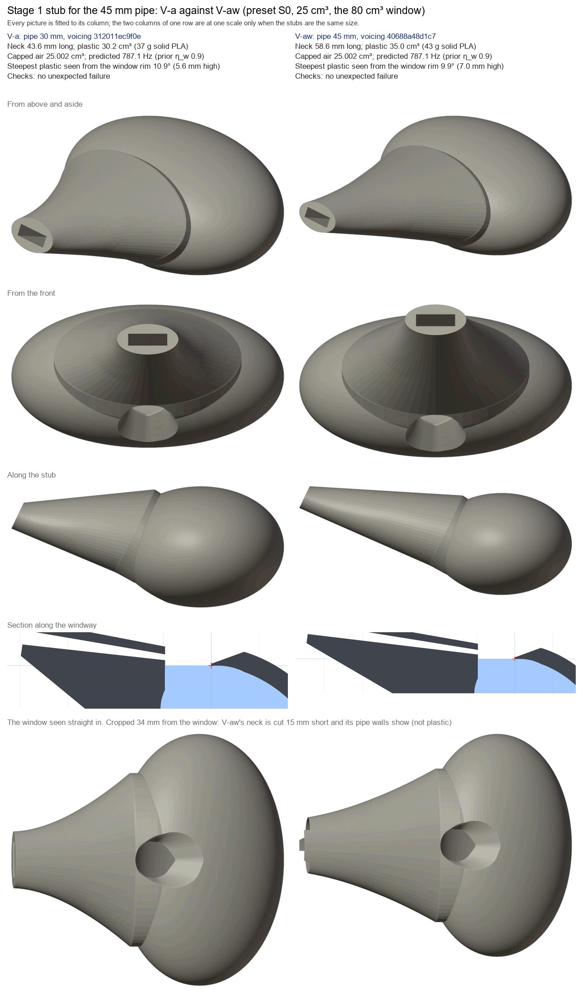

# The voicing lower on the thumb face: trials (2026-11-19)

**Status: trials and pictures on an experiment branch. No rule, no preset and no file of the add-on was changed.** Every trial is a preset value overridden for one build. Nothing was printed or played. Series 1 (sections 3 to 7) turned the voicing from 30° down to 0°. Series 2 (section 8) followed the owner's Spencer pictures: a finer bracket, the longer pipe, a wider dish, a fatter neck and a round mouthpiece tip. Section 9 is the Stage 1 stub of the 45 mm pipe. The owner's decisions of 2026-11-19 (port 10°, the low mouthpiece, the 45 mm pipe, the thumb holes on the template, no partitions) are listed in the [handover](../../Experimental_lower_voicing_handover.md), section 2.

**Where this lives.** Branch `low-voicing-experiment`, in its own checkout (`.claude/worktrees/low-voicing`). It was cut from `shell-edit-prototype` at `45b3486` and carries a copy of that branch's uncommitted work as it stood on 2026-11-19 at about 01:15 (kept as `refs/snapshots/low-voicing-base`). A second session was changing the main checkout at the time (rule version 3: cone neck, pipe +8°, square roof, port 30°), so the trials were built on a frozen copy. One kernel test fails in that copy (`test_changes_when_a_rule_constant_changes`); it belongs to the rule change that was in progress, and nothing here depends on it.

## 1. What was asked, and how I read it

The owner, 2026-11-19:

> "from the shell edit prototype branch i want you to test a different aproach, in this case i want to experiment with placing the voicing lower in the body like show on the back/thumb face of the spencer and songbird, adjust run experimental test for this aproach and report back with renders findings and if any of the researched thery would frown uppon on this aproach"

**My reading:** "lower in the body" is the position around the body. On both ceramic instruments the window lies on the thumb face, inside the outline, and the mouthpiece leaves the edge of the body. The add-on puts the voicing on the lower player-side quadrant and stands the neck on that quadrant. So the trials turn the voicing port from 30° (the rule) toward the bottom line of the thumb face.

**The other possible reading, not built:** "lower" as *deeper*: the window at the bottom of a deep recess, as the Songbird's 28 mm cone and the Spencer's scoop show. That is a matter of the outer shell (a thicker wall around the window and a wider dish), and it does not move the voicing. If that was meant, section 7 says what it would take.

## 2. What the two thumb faces show

From the reports of the two instruments ([Spencer](../Spencer_OoT_12h/Spencer_OoT_12h.md) section 5, [Songbird](../Songbird_OoT_12h/Songbird_OoT_12h.md) section 7, [docs/07](../../docs/07-windway-and-body-shape.md) section 3.3). Both rest on one oblique photo each.

| | Spencer | Songbird Alto C | ECAN3 models (CAD) | Add-on, the rule (P4-80) |
| --- | --- | --- | --- | --- |
| The window | On the thumb face, on the mouthpiece axis; its middle about 16 to 20 mm inside the player-side edge of a 57 mm body (28 to 35 % of the width), rough | On the thumb face, at the root of the mouthpiece, at the bottom of a round recess 28 mm across; its place across the body cannot be measured | The windway ends 7 to 11 mm inside the outline | Middle 7.9 mm inside the edge (16 %); the windway ends 3.5 mm inside |
| The mouthpiece | Leaves the edge; drops toward the thumb face | Leaves the edge; close to the plane of the body; its tip 0.28 of the body length beyond the edge (39 mm at the seed's size) | – | Stands on the lower quadrant, 17° above the level of the body; its end 24 mm beyond the edge |
| The left thumb hole | About 49 mm from the window along the body (rough) | About 25 mm from the window along the body | – | 21 mm from the window along the body |

The two bulb models the owner gave on 2026-11-18 ("Ocarina 12", "Deluxe") are a second family: their mouthpieces climb 12° and 19° toward the deck ([Neck_volume.md](../Neck_volume/Neck_volume.md) section 7.1). The rule of 2026-11-19 follows them. The approach tested here follows the ceramic pair. **The two families disagree on the stance of the mouthpiece** (section 5, row 11).

## 3. The trials

Script: [low_voicing_trials.py](low_voicing_trials.py). Two bodies at 80 cm³: P4, the seed, whose outline is the Songbird's, and P1, the teardrop. Every trial is built as `tools/geometry_check_variant.py` builds a variant, and every check runs on the STL file read back from disk. Reports: `addon_checks/P4-80-lv-*.md` and `addon_checks/P1-80-lv-*.md`; the usual pictures: `addon_renders/<the same names>/`.

| What changes | Values |
| --- | --- |
| `port_angle_deg`: where the voicing sits around the body, from the bottom toward the player | 30 (the rule), 20, 10, 0. The port is moved to the nearest vertex of the chamber mesh, so the bodies were built at 30.9°, 19.7°, 11.2° and 0° |
| `neck_foot_width_mm`: the foot of the neck where it meets the body (trials named `…f`) | P4: 29 mm against its own 32 mm. P1: 34 mm against the rule's 42 mm |
| `windway_length_mm` (trials named `…fw`, P4 only) | 45 mm against the rule's 30 mm. It is a voicing rule: another length is another voicing hash |
| Everything else | The rule of version 3: cone neck, pipe +8° into the chamber, roof cut square, ellipse cut, pocket blend |

**The voicing itself is the same solid in every trial.** Window 62.83 mm² against 62.84, lip 0.400 mm, ramp 20.00°, one voicing hash (`312011ec9f0e`; the 45 mm pipe has `40688a48d1c7`). Only its place on the body moves.

### 3.1 The pictures

The thumb face beside the two photos:



The four port angles laid on one body, with the Spencer's window and the Songbird's mouthpiece length marked:


Every view of the four port angles on the seed:



The teardrop: [sheet_low_voicing_P1.png](sheet_low_voicing_P1.png), [sheet_sections_overlay_P1.png](sheet_sections_overlay_P1.png). The foot of the neck: [sheet_foot_P4.png](sheet_foot_P4.png). The longer pipe: [sheet_long_pipe_P4.png](sheet_long_pipe_P4.png).

### 3.2 The numbers on the seed P4-80

The full tables of both bodies are in [tables.md](tables.md), written by [table_low_voicing.py](table_low_voicing.py).

| Trial | Port | Foot | Pipe | Window inside the player-side edge | Mouthpiece against the level of the body | Mouth end beyond the body's edge | Mouth end below the middle of the body | L / R thumb hole edge to the window | Checks |
| --- | --- | --- | --- | --- | --- | --- | --- | --- | --- |
| `lv-30` | 30° | 32 mm | 30 mm | 7.9 mm (16 %) | 17° above | 24.2 mm | 2.5 mm | 15.9 / 24.6 mm | passes |
| `lv-20` | 20° | 32 mm | 30 mm | 11.9 mm (24 %) | 7° above | 21.8 mm | 10.2 mm | 13.8 / 22.6 mm | **fails `hole_to_voicing`** |
| `lv-20f` | 20° | 29 mm | 30 mm | 11.9 mm (24 %) | 7° above | 21.8 mm | 10.2 mm | 13.8 / 22.6 mm | passes |
| `lv-20fw` | 20° | 29 mm | 45 mm | 11.9 mm (24 %) | 7° above | 36.7 mm | 8.3 mm | 13.8 / 22.6 mm | passes |
| `lv-10` | 10° | 32 mm | 30 mm | 15.2 mm (31 %) | 1° above | 19.2 mm | 15.4 mm | 12.7 / 21.4 mm | **fails `hole_to_voicing`** |
| `lv-10f` | 10° | 29 mm | 30 mm | 15.2 mm (31 %) | 1° above | 19.2 mm | 15.4 mm | 12.7 / 21.4 mm | passes |
| `lv-10fw` | 10° | 29 mm | 45 mm | 15.2 mm (31 %) | 1° above | 34.2 mm | 15.2 mm | 12.7 / 21.4 mm | passes |
| `lv-0` | 0° | 32 mm | 30 mm | 19.7 mm (40 %) | 8° below | 14.7 mm | 21.6 mm | 12.0 / 20.1 mm | **fails `hole_to_voicing`** |
| `lv-0f` | 0° | 29 mm | 30 mm | 19.7 mm (40 %) | 8° below | 14.7 mm | 21.6 mm | 12.0 / 20.1 mm | passes |

"Passes" means no unexpected failure: the two thumb holes above the pad limit, which the notes expect on every P4 body, and P4's two soft warnings (`ergo_finger_pitch`, `ergo_hole_lean_side`) are the same in every trial. The teardrop behaves the same way: `lv-30` passes, the three lower angles fail `hole_to_voicing` with the rule's 42 mm foot and pass with 34 mm.

## 4. Findings

1. **It builds, and it needs no new code.** The port angle is one value of the body. From 30° down to 0° the chamber, the window, the lip, the ramp, the pocket blend (125 of 125 directions meet the chamber wall) and the first cavity mode (1.361 × F6 on P4, 1.632 on P1) do not change.
2. **The only check that fails is the left thumb hole against the foot of the neck, and it fails by 0.2 mm.** The check wants 0.5 mm between a hole edge and the box around the neck; with the seed's 32 mm foot the left thumb hole has 0.3 mm at 20°, 10° and 0° (1.7 mm at 30°). A foot of 29 mm gives 1.8 mm. That width is the proportion of both ceramic necks (0.21 of the body length). On the teardrop the rule's 42 mm foot reaches the left thumb hole at 20° and both thumb holes at 10° and 0°; 34 mm clears them by 2.8 mm or more.
3. **The ceramic look is reached between 20° and 10°.** There the middle of the window lies 24 to 31 % of the width inside the edge (Spencer: 28 to 35 %, rough), the windway ends 7.3 to 10.4 mm inside the outline (ECAN3: 7 to 11 mm), the window sits between the two thumb holes, and the mouthpiece runs 7° above the body's level down to level with it.
4. **0° goes past both instruments.** The window is on the thumb-hole line, the mouthpiece points 8° below the body's level, its end is under the bottom line of the body, and the neck hangs 5.6 mm below the body's lowest point.
5. **The price is the mouthpiece.** With the rule's 30 mm pipe its end stands 24 mm beyond the body's edge at 30°, 22 mm at 20°, 19 mm at 10° and 15 mm at 0°. The Songbird's proportion is 39 mm at this size. The end also sinks: from 2.5 mm below the middle of the body to 10, 15 and 22 mm below it. So the body rises in front of the player's face as the voicing goes down.
6. **A 45 mm pipe gives the mouthpiece back.** 36.7 mm beyond the edge at 20° and 34.2 mm at 10°. At 20° it also lifts the mouth end by 2 mm, because that pipe still climbs. Both bodies pass every check. The cost is in section 5, row 7.
7. **The thumb holes come closer to the window.** On the seed the left thumb hole edge is 15.9 mm from the window at 30° and 12.0 mm at 0°; the right one 24.6 and 20.1 mm. The rule is 10 mm. On the teardrop the nearest is 16.5 mm.
8. **The shell-edit build works with it** ([shell_edit_low.py](shell_edit_low.py), on `lv-10f`). The unedited base finishes as the one-step body, to the same plastic volume (54.1957 cm³). The sculpted base (longer tail, boss, groove, relief, neck 20 % thicker) finishes in 3 sizing rounds with no unexpected failure and the two soft warnings that the same edits give on the rule body.
9. **One check reads low, and it is the check.** The capped air measured on the finished mesh reads 79.91 cm³ at 30°, 79.80 at 20°, 79.76 at 10° and 79.77 at 0° on the seed (limit 79.60), while the air mesh built beside the body is 80.01 cm³ in every trial. The measurement leaves out a box around the voicing that reaches 26.6 mm along the body on each side of the window. A thumb hole beside the window has part of its own air inside that box: 0.12, 0.23, 0.27 and 0.27 cm³ by [capped_air_cap_box.py](capped_air_cap_box.py), against differences of 0.11, 0.21, 0.25 and 0.24 cm³. **The rule body P4-80 has this already (−0.12 %).** Before a lower port becomes a rule, the box should be made as narrow as the cut it covers.

## 5. What the researched theory says

| # | Source | What it says | What the low voicing does | Verdict |
| --- | --- | --- | --- | --- |
| 1 | The kernel; Paley 2015 ([docs/01](../../docs/01-source-review.md) section 4) | Pitch comes from the volume and the conductances. Where an opening sits is not in the model | Nothing: one voicing hash, one window, one volume at every port angle | **No objection.** A Stage 1 stub measures the same voicing for every port angle |
| 2 | Heuer #3 and #8: "the drop", "body too flat" (docs/01 section 5.4) | The wall under the airway exit is upright or tilted back; the floor must not run close under the lip | Free air below the window grows from 29.4 to 30.9 mm. The chamber wall under the lip is flatter (radius along the jet 22.6 → 27.0 mm), so the upright wall under the exit is 1.9 mm instead of 2.6 mm; behind it the wall still tilts back | **No objection.** Heuer gives no number |
| 3 | Heuer #4 and #8: "you don't want to get this one too close to the voicing because it'll affect the sound"; the 10 mm rule | Holes stay away from the window | The two largest holes, which open for D6 and E6, move toward the window: 15.9 → 12.0 mm and 24.6 → 20.1 mm on the seed | **Caution.** Inside the rule; the margin over it falls from 5.9 to 2.0 mm |
| 4 | US 7,799,980, by the Spencer's maker ([record](../Patent_US7799980/US7799980_partitions.md)) | The tone weakens from the note where the first thumb hole opens. His cure is a partial wall between the window and each thumb hole, to shield the voicing from the large open holes | It moves the window toward both thumb holes. The Spencer has this arrangement *with* the partitions, and the left thumb hole about 49 mm away. The add-on has no partitions (parked by the owner) | **This is the source that frowns.** It names the direction, not a distance |
| 5 | The 45° keep-out outside the window; Pure Ocarinas on shading (docs/01 section 5) | Nothing may stand inside the 45° flare around the window; a finger near an opening flattens it | The plastic does not change: the neck stands 11° steep seen from the rim at every port angle. The hands do. The left hand comes from the far side, so the left thumb lies across the thumb face while it closes its hole. With the window on that face the thumb lies beside it for every note up to C6 and leaves at D6 | **Caution, and it is my inference.** No source gives a distance for a thumb beside a window, and the kernel has no term for it |
| 6 | The Songbird's mouthpiece, 0.28 of the body length beyond the edge (docs/07 section 3.3); Pure Ocarinas: the right hand reaches over from the player's side | The mouthpiece must leave room for the face and the right hand | The mouth end comes 24 → 15 mm from the body's edge and sinks 2.5 → 22 mm below its middle | **Frowned upon with the 30 mm pipe**, more the lower the port. Answered by a longer pipe (row 7) |
| 7 | Heuer #8: an airway of "one to two to three inches … is a good place to start"; measured references 30 to 40 mm ([docs/09](../../docs/09-kernel-and-decisions-challenged.md) section 6.5) | The pipe may be longer | 45 mm is inside Heuer's range and above every measured reference. It is a new voicing hash, so it needs its own Stage 1 stub. By the estimate of docs/09 the laminar loss in the slot rises from 19 to 29 Pa at a 15 m/s jet (15 % → 22 % of the jet's pressure); a mouth end of about 4.1 mm instead of 3.0 mm brings it back to 19 Pa | **Allowed, at a price in breath.** The owner parked the longer pipe for later; this approach leans on it |
| 8 | The cavity-mode check (docs/06 section 3.10) | The first cavity mode stays above 1.3 × F6 | 1.361 at every port angle on the seed | **No objection** |
| 9 | The jet against the lip (docs/09 section 3.1) | The jet should reach the lip heading into the chamber (the owner's sample and the NBN: 16°) | +8° at every port angle, as in the rule: the pipe turns with the voicing | **No objection** |
| 10 | The test plan (docs/04, D10); position factors per hole and shape | The first Stage 2 print freezes the layout, and the fitted factor of a hole belongs to that body | The port angle is a value of every Stage 2 body, and the thumb holes are the holes nearest the window | **A deadline, not an objection:** choose the port angle before Stage 2 is printed. The Stage 1 stubs do not depend on it |
| 11 | The two bulb models of 2026-11-18 (Neck_volume.md section 7.1) | Their pipes climb 12° and 19° toward the deck; the owner chose the thrown-back voicing after them | The rule has 15° to 17°. The low voicing has 7° at 20°, 1° at 10° and −8° at 0° | **The owner's own references disagree.** The rule follows the bulb models, this approach the ceramic pair |

What no source in the repository covers: how a window that faces straight down behaves against one that faces 25° toward the player; where condensation runs in a pipe that lies level; how the print orientation changes when the pipe lies in the plane of the body.

## 6. What I would take from it

1. **If the ceramic thumb face is the aim, the working range is 10° to 20°, with the slimmer foot.** `lv-20f` keeps more mouthpiece and more distance to the thumb holes. `lv-10f` has the level mouthpiece and the window further inside.
2. **0° has no reference behind it and the least room at the mouth.** I would not take it further.
3. **The 30 mm pipe is short for this approach.** At 10° the mouth end is 19 mm from the body and 15 mm below its middle. A longer pipe is the parked experiment; the two questions belong together.
4. **The open risk is acoustic, and a body must answer it:** the thumb holes near the window, and the thumb beside it. A stub has no thumb holes. The cheapest test is one Stage 2 body printed at two port angles.
5. **The choice is the owner's**, between the stance of the bulb models (the rule) and the thumb face of the ceramic pair.

## 7. What was not built, and limits

- **A deep recess around the window.** The voicing keeps its 4 mm wall and its ellipse cut (3 mm per side). The Songbird's cone is 28 mm across over a wall of perhaps 8 mm. That needs a thicker shell around the window and a cut that follows it; neither exists.
- **A moved thumb hole.** The holes are where the template puts them. The foot of the neck was slimmed instead.
- **A mouthpiece at the middle of the body's edge.** With a straight pipe under a 4 mm wall the jet enters by at most +8°, so the pipe leaves the window almost along the body's surface. A mouthpiece that starts higher needs a thicker wall at the window or a bent pipe.
- **Other bodies.** P0, P2 and P3 were not built. P1 was built with the plain sweep and the slimmer foot, and in series 2 with the two composites.
- **The Spencer's 28 to 35 % and the left-thumb distances of both instruments come from one oblique photo each.** They place the references somewhere between 20° and 10°, not at a number.
- **Pictures and geometry checks.** Nothing here says how the sound changes. Rows 3 to 5 of section 5 name risks that only a played body can size.
- The neck of every trial is the cone neck of rule version 3 with its 24.5 mm depth at the body. At low port angles it is a wedge from the pipe up to the body's flank; nobody has shaped it for this position.
- The 45 mm pipe keeps the 3.0 mm mouth end and the neck's proportions.
- The thinnest plastic of the finished body is 1.19 to 1.29 mm in the seed's trials and 1.21 to 1.39 mm in the teardrop's. The rule body itself (`lv-30`) has 1.19 mm, and so has `lv-10fw`. The owner's minimum around the pipe is 1.2 mm. The port angle does not move this number; the neck does.

## 8. Series 2: after the owner's Spencer pictures

The owner, later on 2026-11-19, with four pictures of a Spencer:

> "lets further study this aproach, look at this images for the spencer, the voicing is considerably lower, and pointing almost straight up like the 10 degree one, analize the following pictures and run tests with this aproach"

This settles the reading of section 1: "lower" is the position around the body. The four pictures are measured in [the handover](../../Experimental_lower_voicing_handover.md), section 4. They place the Spencer's window 30 to 33 % of the width inside the player-side edge, show a long round mouthpiece cone (about 35 mm beyond the shoulder at a 29 mm foot), a dish that runs on beyond the lip, the thumb holes 35 to 40 mm from the window, and partitions inside.

### 8.1 The trials

All on the seed P4-80 with the 29 mm foot; the composites also on P1-80 (foot 34 mm). Names as in `TRIALS` of [low_voicing_trials.py](low_voicing_trials.py).

| Trial | What changes against `lv-10f` | Hashed? | What it answers |
| --- | --- | --- | --- |
| `lv-15f`, `lv-5f` | `port_angle_deg` 15 or 5 | no | A bracket around the Spencer's 30 to 33 % |
| `lv-5fw` | port 5, pipe 45 mm | yes (`40688a48d1c7`) | The mouthpiece length at the deeper position |
| `lv-10fd` | `cone_widen_mm = 8` (the record's `cut_widen_mm`; rule 3 mm, the owner's "P3") | yes (`516c4a7d665a`) | A wider dish |
| `lv-10fn` | `neck_base_depth_mm = 29` (rule 2.78 × window width = 24.5 mm) | no | A fatter foot of the neck |
| `lv-10fwdn` | pipe 45 mm, dish 8 mm, foot 29 mm deep | yes (`13e7f53d5150`) | The composite nearest the Spencer look |
| `lv-10fwdnr` | the composite and `neck_floor_mm = 8.6` (rule 2.4 mm): the mouth end as deep as it is wide | yes (as `lv-10fwdn`; the floor itself is not hashed) | The round mouthpiece tip of the tray picture |

The seven bodies of the plan were built twice: once in the earlier session (15:25 to 15:31) and again here from the restored `TRIALS` rows. The two builds agree to the last stored digit (0 differences in 182 to 189 values per trial). `lv-10fwdnr` was added in this session.

### 8.2 The pictures


### 8.3 The numbers

| Trial | Port as built | Window inside the player-side edge | Mouthpiece against the level of the body | Mouth end beyond the body's edge | Mouth end (pipe) below the middle of the body | Neck below the body's lowest point | L / R thumb hole edge to the window | Plastic | Checks |
| --- | --- | --- | --- | --- | --- | --- | --- | --- | --- |
| `lv-15f` | 14.1° | 14.1 mm (29 %) | 3° above | 20.1 mm | 13.7 mm | 0 | 13.0 / 21.7 mm | 54.3 cm³ | passes |
| `lv-10f` (series 1) | 11.2° | 15.2 mm (31 %) | 1° above | 19.2 mm | 15.4 mm | 0 | 12.7 / 21.4 mm | 54.2 cm³ | passes |
| `lv-5f` | 5.6° | 17.4 mm (35 %) | 4° below | 17.1 mm | 18.6 mm | 2.6 mm | 12.2 / 20.7 mm | 54.1 cm³ | passes |
| `lv-5fw` | 5.6° | 17.4 mm (35 %) | 4° below | 32.0 mm | 19.6 mm | 3.5 mm | 12.2 / 20.7 mm | 57.3 cm³ | passes |
| `lv-10fd` | 11.2° | 15.2 mm (31 %) | 1° above | 19.2 mm | 15.4 mm | 0 | 12.7 / 21.4 mm | 54.1 cm³ | passes |
| `lv-10fn` | 11.2° | 15.2 mm (31 %) | 1° above | 19.2 mm | 15.4 mm | 0 | 12.7 / 21.4 mm | 54.6 cm³ | passes |
| `lv-10fwdn` | 11.2° | 15.2 mm (31 %) | 1° above | 34.2 mm | 15.2 mm | 0 | 12.7 / 21.4 mm | 58.3 cm³ | passes |
| `lv-10fwdnr` | 11.2° | 15.2 mm (31 %) | 1° above | 34.2 mm | 15.2 mm (the tip's outside: 12.0 mm) | 0 | 12.7 / 21.4 mm | 60.0 cm³ | passes |
| P1 `lv-10fwdn` | 11.2° | 18.2 mm (32 % of 57 mm) | 0° | 31.1 mm | 17.2 mm | 0 | 17.6 / 18.1 mm | 54.5 cm³ | passes |
| P1 `lv-10fwdnr` | 11.2° | 18.2 mm (32 % of 57 mm) | 0° | 31.1 mm | 17.2 mm (the tip's outside: 14.0 mm) | 0 | 17.6 / 18.1 mm | 56.2 cm³ | passes |

"Passes" as in section 3.2. The full tables are in [tables.md](tables.md).

### 8.4 Findings

1. **Every body of series 2 passes, on both bodies.** No unexpected failure; the same soft warnings as the rule body (two on P4, four on P1). The voicing solid does not change: window 62.83 mm², the first cavity mode 1.361 × F6 on P4 (1.631 on P1), the steepest plastic seen from the window rim 11° (10° with the 45 mm pipe).
2. **The bracket is coarse, and 10° is inside the Spencer.** The port moves to the nearest vertex of the chamber mesh, which has 128 segments around the section: a step of 2.8°. Asked 15, 10 and 5°, the bodies were built at 14.1°, 11.2° and 5.6°, with the window 29, 31 and 35 % of the width inside the edge. The Spencer's 30 to 33 % lies between 11.2° and the next step, 8.4° (not built; about 33 % between the two). So the trial called "10°" already sits in the Spencer's range; 14.1° falls just short of it and 5.6° goes past it.
3. **5° carries the costs of 0°.** The mouthpiece points 4° below the level of the body, its end is 18.6 mm below the middle, and the neck hangs 2.6 mm below the body's lowest point (3.5 mm with the 45 mm pipe). The useful range ends above 5°.
4. **The 45 mm pipe gives the Spencer's mouthpiece length.** At 10° the mouth end stands 34.2 mm beyond the edge (Spencer, from the tray: about 35 mm; Songbird proportion: 39 mm). It does not lift it: the pipe is level at 10°, so its end stays 15 mm below the middle of the body.
5. **The wider dish builds, but it grows the wrong way.** `cone_widen_mm` moves only the sides of the ellipse cut, across the jet. With 8 mm the dish is 24.8 mm wide and still 19.5 mm long (rule: 14.8 × 19.5 mm). Along the jet the rule's dish already runs from the windway exit to the end of the labium ramp, 9.9 mm beyond the lip, and not at all toward the mouthpiece (the roof is cut square). That is the Spencer's arrangement too: its window sits at the mouthpiece end of the dish (the handover's comparison, "3 mm beyond the window on each side", left out the reach along the jet). What the Spencer has more is size: about 28 × 20 mm at the 57 mm width the handover uses for scale, longer than wide like ours, and about 1.4 times larger both ways. The 8 mm cut takes 527 mm³ instead of 427 mm³ and moves nothing else (window area, lip, keep-out). The width is hashed, so it would need its own Stage 1 stub. A longer dish beyond the lip needs either a shallower ramp (the record's 20°, an acoustic value) or a new setting in `voicing_geo.py` that carries the rim on past the end of the ramp.
6. **The deeper foot hardly shows.** From 24.5 to 29 mm the neck's middle line turns from 26° to 30° against the body and the body gains 0.4 cm³. In the pictures it is hard to tell from `lv-10f`.
7. **The composite passes on both bodies** and adds about 4 cm³ of plastic (58.3 on P4, 54.5 on P1). It is the nearest to the Spencer outside, except for the mouthpiece's height and the round tip.
8. **The round tip lifts the mouthpiece by 3 mm, not to the middle.** With `neck_floor_mm = 8.6` the mouth end is 13.8 × 13.8 mm instead of 13.8 × 7.6, with the pipe along its thumb-face side, as the tray picture suggests. The pipe does not move. The middle of the tip's outside, measured on the finished STL by [tip_centre.py](tip_centre.py), rises from 15.1 to 12.0 mm below the body's middle on P4 (17.1 to 14.0 mm on P1); the body is 39 mm thick there. The neck's middle line turns from 23° to 19° against the body, and in the section through the lip the neck reads as a tube instead of a wedge. It costs 1.7 cm³ of plastic (60.0 on P4, 56.2 on P1). It is not hashed, every check passes, and the thinnest plastic is 1.24 mm on P4 and 1.22 mm on P1. To bring the tip's middle up to the body's middle this way, the tip would have to be about 38 mm deep, as thick as the body itself.
9. **The mouthpiece cannot stand at mid-thickness while the window stays this far around, with a straight pipe.** This is my own geometry, not a source. The pipe leaves the window along the body's surface and enters the chamber at +8°. At 11.2° the window faces 9° from straight down. A straight pipe whose mouth end were at the middle of the body would have to climb about 15 mm over its 30 to 45 mm, some 20 to 30° above level. The jet would then run down onto the window from outside the chamber instead of into it. The window's position and the mouthpiece's height are tied together by the straight pipe: the rule's 30° has the mouth end 2.5 mm below the middle, 10° has it 15 mm below. Only the outside of the neck can rise (finding 8), or the pipe would have to bend, which no rule allows. What the Spencer does here cannot be read from the pictures.
10. **What series 2 does not touch.** The left thumb hole stays 12.2 to 13.0 mm from the window on the seed. Heuer's and the patent's cautions (section 5, rows 3 and 4) stand exactly as after series 1. The capped-air reading stays low for the reason in finding 9 of section 4 (79.75 to 79.77 cm³ on the seed; the built air is 80.01).

### 8.5 What only the owner or new code can answer

- ~~**The thumb holes 35 to 40 mm from the window, as on the Spencer.** The positions are template constants in `ocarina_addon/holes_layout.py`; moving them changes the hand layout and the hole sizes.~~ **The owner, 2026-11-19: "Keep the template".** The thumb holes stay where they are (12.7 / 21.4 mm from the window on the seed at 10°). The caution of section 5, rows 3 and 4, stays open.
- ~~**Partitions between the thumb holes and the window.** The add-on has none; the owner set them aside on 2026-11-18. A desk check exists in `Analizes_ocarinas/Patent_US7799980/partition_check.py`.~~ **The owner, 2026-11-19, asked whether partitions should be an add-on feature: "no".** With the thumb holes kept on the template, the caution of section 5, rows 3 and 4, can only be sized on a played body.
- ~~**The longer pipe (45 mm).** Parked by the owner; this approach leans on it, and it needs its own Stage 1 stub.~~ **Un-parked by the owner for this approach, 2026-11-19: "Yes, un-park it".** Its stub is `V-aw` (section 9).
- **A longer dish beyond the lip.** New code in `voicing_geo.py`, or a shallower ramp (finding 5). A dish about 1.4 times the rule's both ways (sides +2.6 mm, rim about 8 mm further beyond the lip) is the Spencer's proportion.
- **A bent pipe** to raise the mouthpiece (finding 9). A change to the voicing rule.

### 8.6 What I would take from series 2

1. **10° (built 11.2°) is the position**, as the owner saw. 15° is just short of the Spencer and 5° already hangs the neck below the body.
2. **The nearest outside to the Spencer is `lv-10fwdnr`**: the 45 mm pipe, the round tip and the 29 mm foot. The 8 mm dish in it widens the wrong way and can be left out until a longer dish exists (finding 5).
3. **The mouthpiece will stay low.** With the window this far around, the tip's middle sits 12 mm below the body's middle at best (finding 9). If the owner wants the mouthpiece at mid-body, that needs a bent pipe, which no rule allows. Otherwise the port has to go back toward 30°. **The owner's answer, 2026-11-19: "Yes, keep 10°".** The low mouthpiece is accepted and there is no bent pipe. Port 10° is the experiment's position, not a rule.
4. **Series 2 answers none of the acoustic risks.** The thumb holes beside the window (Heuer; the patent) are still the open question, and only a played body can size it.

## 9. The Stage 1 stub for the 45 mm pipe (V-aw)

The owner, 2026-11-19, asked whether to un-park the 45 mm pipe for this approach: "Yes, un-park it". The same day they kept the port at 10° and accepted the low mouthpiece ("Yes, keep 10°", section 8.6).

A pipe of another length is another voicing, so it needs its own stub. [stub_long_pipe.py](stub_long_pipe.py) builds it exactly as `ocarina_addon/headless.py -- stage1` builds V-a: preset S0, 25 cm³ of capped air, the 80 cm³ window, the build of rule version 3, no holes. The only change is `[voicing_rules] windway_length_mm = 45`. A stub has no port angle, so one stub serves every port angle of the approach. The round tip (`neck_floor_mm`) is outside the hash and is left out.

V-a was built again beside it as a check. It has the voicing hash of the main checkout's V-a (`312011ec9f0e`), the same 72814 triangles, and the same plastic and capped air to 0.00001 cm³. 4015 triangles come out in another order, so the files are not byte for byte equal.



| Stub | Pipe | Voicing hash | Neck | Plastic (solid PLA) | Capped air | Predicted pitch (prior η_w 0.9) | Steepest plastic seen from the window rim | Checks |
| --- | --- | --- | --- | --- | --- | --- | --- | --- |
| V-a | 30 mm | `312011ec9f0e` | 43.6 mm | 30.2 cm³ (37 g) | 25.002 cm³ | 787.1 Hz | 10.9° (5.6 mm high) | 14 pass (one more line is information), no warning |
| V-aw | 45 mm | `40688a48d1c7` | 58.6 mm | 35.0 cm³ (43 g) | 25.002 cm³ | 787.1 Hz | 9.9° (7.0 mm high) | 14 pass (one more line is information), no warning |

Reports: `addon_checks/V-aw.md` and [stubs/V-a.md](stubs/V-a.md); numbers of both in [stubs/stubs.json](stubs/stubs.json). Blank measurement file: `addon_out/lv-stubs/V-aw/V-aw_measurement.toml`, read by `tools/stub_eta_w.py` once it is filled. `addon_out/` is not in git, as for every stub.

1. **V-aw builds and passes every check of a stub**, as V-a does. It needs 6 g more PLA.
2. **The kernel predicts the same pitch for both, by construction.** Its stub pitch is c/(2π)·√(η_w·G_w/V), and G_w comes from the window alone. The pipe length is not in the model.
3. **So the print of the pair answers what the kernel cannot.** If V-aw sounds where V-a does, η_w·G_w does not depend on the pipe length, and the calibration of the 30 mm voicing carries over. If it does not, the 45 mm voicing needs its own η_w. The pair also shows whether the 45 mm pipe speaks with the 3.0 mm mouth end, and how much harder it blows. By the estimate in section 5, row 7, the laminar loss in the slot rises from 19 to 29 Pa at a 15 m/s jet. A 4.1 mm mouth end would bring it back to 19 Pa. That stub was not built, because the 3.0 mm mouth end is the owner's decision 4 of 2026-11-18.
4. **The window picture of V-aw shows a block at the mouth end that is not plastic.** That picture keeps only the faces within 34 mm of the window. V-a's mouth end lies at 34.8 mm and V-aw's at 49.8 mm, so on V-aw the crop cuts the neck 15 mm short and the pipe's inner walls show past the cut. The uncropped views and the STL have a clean mouth end.

**Not done, because the owner did not ask for a rule:** putting 45 mm in `[voicing_rules]` of `params/alto_c_12hole.toml`, a V-aw recipe in `ocarina_addon/stub.py`, regenerating Stages 1 to 3, and `python kernel/synthetic.py --write-examples` (the synthetic calibration is keyed by the voicing hash; without it Stage 3 quietly re-solves the "printed" windows). If the approach becomes the rule, those four go together. The owner would also have to say whether the 45 mm pipe is for every body or only for the low-voicing bodies.

## Reproduce

```bash
"C:\Program Files\Blender Foundation\Blender 5.1\blender.exe" -b --factory-startup --python Analizes_ocarinas/Low_voicing/low_voicing_trials.py
```

```bash
"C:\Program Files\Blender Foundation\Blender 5.1\blender.exe" -b --factory-startup --python Analizes_ocarinas/Low_voicing/shell_edit_low.py -- --port 10 --only plain sculpt
```

```bash
python Analizes_ocarinas/Low_voicing/sheet_low_voicing.py
```

```bash
python Analizes_ocarinas/Low_voicing/sheet_sections_overlay.py
```

```bash
python Analizes_ocarinas/Low_voicing/sheet_series2.py
```

```bash
python Analizes_ocarinas/Low_voicing/tip_centre.py
```

```bash
"C:\Program Files\Blender Foundation\Blender 5.1\blender.exe" -b --factory-startup --python Analizes_ocarinas/Low_voicing/stub_long_pipe.py
```

```bash
python Analizes_ocarinas/Low_voicing/sheet_stub_long_pipe.py
```

```bash
python Analizes_ocarinas/Low_voicing/table_low_voicing.py > Analizes_ocarinas/Low_voicing/tables.md
```

```bash
python Analizes_ocarinas/Low_voicing/capped_air_cap_box.py
```

One trial takes about 65 s. `--only P4` or `--only P4:lv-10f,P1:lv-0f` builds a part of the set.
