# The voicing lower on the thumb face: trials (2026-11-19)

**Status: trials and pictures on an experiment branch. No rule, no preset and no file of the add-on was changed.** Every trial is a preset value overridden for one build. Nothing was printed or played. Series 1 (sections 3 to 7) turned the voicing from 30° down to 0°. Series 2 (section 8) followed the owner's Spencer pictures: a finer bracket, the longer pipe, a wider dish, a fatter neck and a round mouthpiece tip. Section 9 is the Stage 1 stub of the 45 mm pipe. The owner's decisions of 2026-11-19 (port 10°, the low mouthpiece, the 45 mm pipe, the thumb holes on the template, no partitions) are listed in the [handover](../../Experimental_lower_voicing_handover.md), section 2.

**Where this lives.** Branch `low-voicing-experiment`, in its own checkout (`.claude/worktrees/low-voicing`). It was cut from `shell-edit-prototype` at `45b3486` and carries a copy of that branch's uncommitted work as it stood on 2026-11-19 at about 01:15 (kept as `refs/snapshots/low-voicing-base`). A second session was changing the main checkout at the time (rule version 3: cone neck, pipe +8°, square roof, port 30°), so the trials were built on a frozen copy. One kernel test fails in that copy (`test_changes_when_a_rule_constant_changes`); it belongs to the rule change that was in progress, and nothing here depends on it.

## 1. What was asked, and how I read it

The owner, 2026-11-19:

> "from the shell edit prototype branch i want you to test a different aproach, in this case i want to experiment with placing the voicing lower in the body like show on the back/thumb face of the spencer and songbird, adjust run experimental test for this aproach and report back with renders findings and if any of the researched thery would frown uppon on this aproach"

**My reading:** "lower in the body" is the position around the body. On both ceramic instruments the window lies on the thumb face, inside the outline, and the mouthpiece leaves the edge of the body. The add-on puts the voicing on the lower player-side quadrant and stands the neck on that quadrant. So the trials turn the voicing port from 30° (the rule) toward the bottom line of the thumb face.

**The other possible reading, not built:** "lower" as *deeper*: the window at the bottom of a deep recess, as the Songbird's 28 mm cone and the Spencer's scoop show. That is a matter of the outer shell (a thicker wall around the window and a wider dish), and it does not move the voicing. If that was meant, section 7 says what it would take.

## 2. What the two thumb faces show

From the reports of the two instruments ([Spencer](../Spencer_OoT_12h/Spencer_OoT_12h.md) section 5, [Songbird](../Songbird_OoT_12h/Songbird_OoT_12h.md) section 7, [docs/07](../../docs/07-windway-and-body-shape.md) section 3.3). Both rest on one oblique photo each.

| | Spencer | Songbird Alto C | ECAN3 models (CAD) | Add-on, the rule (P4-80) |
| --- | --- | --- | --- | --- |
| The window | On the thumb face, on the mouthpiece axis; its middle about 16 to 20 mm inside the player-side edge of a 57 mm body (28 to 35 % of the width), rough | On the thumb face, at the root of the mouthpiece, at the bottom of a round recess 28 mm across; its place across the body cannot be measured | The windway ends 7 to 11 mm inside the outline | Middle 7.9 mm inside the edge (16 %); the windway ends 3.5 mm inside |
| The mouthpiece | Leaves the edge; drops toward the thumb face | Leaves the edge; close to the plane of the body; its tip 0.28 of the body length beyond the edge (39 mm at the seed's size) | – | Stands on the lower quadrant, 17° above the level of the body; its end 24 mm beyond the edge |
| The left thumb hole | About 49 mm from the window along the body (rough) | About 25 mm from the window along the body | – | 21 mm from the window along the body |

The two bulb models the owner gave on 2026-11-18 ("Ocarina 12", "Deluxe") are a second family: their mouthpieces climb 12° and 19° toward the deck ([Neck_volume.md](../Neck_volume/Neck_volume.md) section 7.1). The rule of 2026-11-19 follows them. The approach tested here follows the ceramic pair. **The two families disagree on the stance of the mouthpiece** (section 5, row 11).

## 3. The trials

Script: [low_voicing_trials.py](low_voicing_trials.py). Two bodies at 80 cm³: P4, the seed, whose outline is the Songbird's, and P1, the teardrop. Every trial is built as `tools/geometry_check_variant.py` builds a variant, and every check runs on the STL file read back from disk. Reports: `addon_checks/P4-80-lv-*.md` and `addon_checks/P1-80-lv-*.md`; the usual pictures: `addon_renders/<the same names>/`.

| What changes | Values |
| --- | --- |
| `port_angle_deg`: where the voicing sits around the body, from the bottom toward the player | 30 (the rule), 20, 10, 0. The port is moved to the nearest vertex of the chamber mesh, so the bodies were built at 30.9°, 19.7°, 11.2° and 0° |
| `neck_foot_width_mm`: the foot of the neck where it meets the body (trials named `…f`) | P4: 29 mm against its own 32 mm. P1: 34 mm against the rule's 42 mm |
| `windway_length_mm` (trials named `…fw`, P4 only) | 45 mm against the rule's 30 mm. It is a voicing rule: another length is another voicing hash |
| Everything else | The rule of version 3: cone neck, pipe +8° into the chamber, roof cut square, ellipse cut, pocket blend |

**The voicing itself is the same solid in every trial.** Window 62.83 mm² against 62.84, lip 0.400 mm, ramp 20.00°, one voicing hash (`312011ec9f0e`; the 45 mm pipe has `40688a48d1c7`). Only its place on the body moves.

### 3.1 The pictures

The thumb face beside the two photos:


The four port angles laid on one body, with the Spencer's window and the Songbird's mouthpiece length marked:

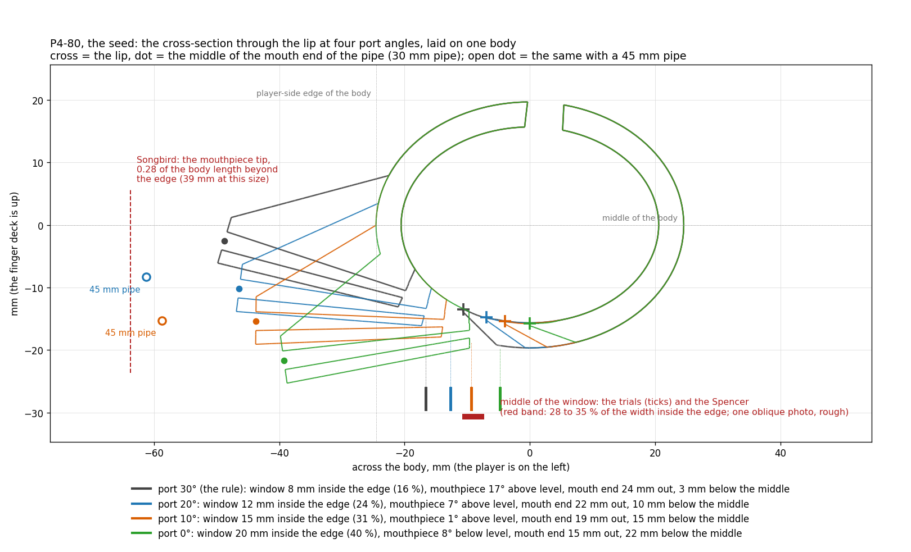

Every view of the four port angles on the seed:


The teardrop: [sheet_low_voicing_P1.png](sheet_low_voicing_P1.png), [sheet_sections_overlay_P1.png](sheet_sections_overlay_P1.png). The foot of the neck: [sheet_foot_P4.png](sheet_foot_P4.png). The longer pipe: [sheet_long_pipe_P4.png](sheet_long_pipe_P4.png).

### 3.2 The numbers on the seed P4-80

The full tables of both bodies are in [tables.md](tables.md), written by [table_low_voicing.py](table_low_voicing.py).

| Trial | Port | Foot | Pipe | Window inside the player-side edge | Mouthpiece against the level of the body | Mouth end beyond the body's edge | Mouth end below the middle of the body | L / R thumb hole edge to the window | Checks |
| --- | --- | --- | --- | --- | --- | --- | --- | --- | --- |
| `lv-30` | 30° | 32 mm | 30 mm | 7.9 mm (16 %) | 17° above | 24.2 mm | 2.5 mm | 15.9 / 24.6 mm | passes |
| `lv-20` | 20° | 32 mm | 30 mm | 11.9 mm (24 %) | 7° above | 21.8 mm | 10.2 mm | 13.8 / 22.6 mm | **fails `hole_to_voicing`** |
| `lv-20f` | 20° | 29 mm | 30 mm | 11.9 mm (24 %) | 7° above | 21.8 mm | 10.2 mm | 13.8 / 22.6 mm | passes |
| `lv-20fw` | 20° | 29 mm | 45 mm | 11.9 mm (24 %) | 7° above | 36.7 mm | 8.3 mm | 13.8 / 22.6 mm | passes |
| `lv-10` | 10° | 32 mm | 30 mm | 15.2 mm (31 %) | 1° above | 19.2 mm | 15.4 mm | 12.7 / 21.4 mm | **fails `hole_to_voicing`** |
| `lv-10f` | 10° | 29 mm | 30 mm | 15.2 mm (31 %) | 1° above | 19.2 mm | 15.4 mm | 12.7 / 21.4 mm | passes |
| `lv-10fw` | 10° | 29 mm | 45 mm | 15.2 mm (31 %) | 1° above | 34.2 mm | 15.2 mm | 12.7 / 21.4 mm | passes |
| `lv-0` | 0° | 32 mm | 30 mm | 19.7 mm (40 %) | 8° below | 14.7 mm | 21.6 mm | 12.0 / 20.1 mm | **fails `hole_to_voicing`** |
| `lv-0f` | 0° | 29 mm | 30 mm | 19.7 mm (40 %) | 8° below | 14.7 mm | 21.6 mm | 12.0 / 20.1 mm | passes |

"Passes" means no unexpected failure: the two thumb holes above the pad limit, which the notes expect on every P4 body, and P4's two soft warnings (`ergo_finger_pitch`, `ergo_hole_lean_side`) are the same in every trial. The teardrop behaves the same way: `lv-30` passes, the three lower angles fail `hole_to_voicing` with the rule's 42 mm foot and pass with 34 mm.

## 4. Findings

1. **It builds, and it needs no new code.** The port angle is one value of the body. From 30° down to 0° the chamber, the window, the lip, the ramp, the pocket blend (125 of 125 directions meet the chamber wall) and the first cavity mode (1.361 × F6 on P4, 1.632 on P1) do not change.
2. **The only check that fails is the left thumb hole against the foot of the neck, and it fails by 0.2 mm.** The check wants 0.5 mm between a hole edge and the box around the neck; with the seed's 32 mm foot the left thumb hole has 0.3 mm at 20°, 10° and 0° (1.7 mm at 30°). A foot of 29 mm gives 1.8 mm. That width is the proportion of both ceramic necks (0.21 of the body length). On the teardrop the rule's 42 mm foot reaches the left thumb hole at 20° and both thumb holes at 10° and 0°; 34 mm clears them by 2.8 mm or more.
3. **The ceramic look is reached between 20° and 10°.** There the middle of the window lies 24 to 31 % of the width inside the edge (Spencer: 28 to 35 %, rough), the windway ends 7.3 to 10.4 mm inside the outline (ECAN3: 7 to 11 mm), the window sits between the two thumb holes, and the mouthpiece runs 7° above the body's level down to level with it.
4. **0° goes past both instruments.** The window is on the thumb-hole line, the mouthpiece points 8° below the body's level, its end is under the bottom line of the body, and the neck hangs 5.6 mm below the body's lowest point.
5. **The price is the mouthpiece.** With the rule's 30 mm pipe its end stands 24 mm beyond the body's edge at 30°, 22 mm at 20°, 19 mm at 10° and 15 mm at 0°. The Songbird's proportion is 39 mm at this size. The end also sinks: from 2.5 mm below the middle of the body to 10, 15 and 22 mm below it. So the body rises in front of the player's face as the voicing goes down.
6. **A 45 mm pipe gives the mouthpiece back.** 36.7 mm beyond the edge at 20° and 34.2 mm at 10°. At 20° it also lifts the mouth end by 2 mm, because that pipe still climbs. Both bodies pass every check. The cost is in section 5, row 7.
7. **The thumb holes come closer to the window.** On the seed the left thumb hole edge is 15.9 mm from the window at 30° and 12.0 mm at 0°; the right one 24.6 and 20.1 mm. The rule is 10 mm. On the teardrop the nearest is 16.5 mm.
8. **The shell-edit build works with it** ([shell_edit_low.py](shell_edit_low.py), on `lv-10f`). The unedited base finishes as the one-step body, to the same plastic volume (54.1957 cm³). The sculpted base (longer tail, boss, groove, relief, neck 20 % thicker) finishes in 3 sizing rounds with no unexpected failure and the two soft warnings that the same edits give on the rule body.
9. **One check reads low, and it is the check.** The capped air measured on the finished mesh reads 79.91 cm³ at 30°, 79.80 at 20°, 79.76 at 10° and 79.77 at 0° on the seed (limit 79.60), while the air mesh built beside the body is 80.01 cm³ in every trial. The measurement leaves out a box around the voicing that reaches 26.6 mm along the body on each side of the window. A thumb hole beside the window has part of its own air inside that box: 0.12, 0.23, 0.27 and 0.27 cm³ by [capped_air_cap_box.py](capped_air_cap_box.py), against differences of 0.11, 0.21, 0.25 and 0.24 cm³. **The rule body P4-80 has this already (−0.12 %).** Before a lower port becomes a rule, the box should be made as narrow as the cut it covers.

## 5. What the researched theory says

| # | Source | What it says | What the low voicing does | Verdict |
| --- | --- | --- | --- | --- |
| 1 | The kernel; Paley 2015 ([docs/01](../../docs/01-source-review.md) section 4) | Pitch comes from the volume and the conductances. Where an opening sits is not in the model | Nothing: one voicing hash, one window, one volume at every port angle | **No objection.** A Stage 1 stub measures the same voicing for every port angle |
| 2 | Heuer #3 and #8: "the drop", "body too flat" (docs/01 section 5.4) | The wall under the airway exit is upright or tilted back; the floor must not run close under the lip | Free air below the window grows from 29.4 to 30.9 mm. The chamber wall under the lip is flatter (radius along the jet 22.6 → 27.0 mm), so the upright wall under the exit is 1.9 mm instead of 2.6 mm; behind it the wall still tilts back | **No objection.** Heuer gives no number |
| 3 | Heuer #4 and #8: "you don't want to get this one too close to the voicing because it'll affect the sound"; the 10 mm rule | Holes stay away from the window | The two largest holes, which open for D6 and E6, move toward the window: 15.9 → 12.0 mm and 24.6 → 20.1 mm on the seed | **Caution.** Inside the rule; the margin over it falls from 5.9 to 2.0 mm |
| 4 | US 7,799,980, by the Spencer's maker ([record](../Patent_US7799980/US7799980_partitions.md)) | The tone weakens from the note where the first thumb hole opens. His cure is a partial wall between the window and each thumb hole, to shield the voicing from the large open holes | It moves the window toward both thumb holes. The Spencer has this arrangement *with* the partitions, and the left thumb hole about 49 mm away. The add-on has no partitions (parked by the owner) | **This is the source that frowns.** It names the direction, not a distance |
| 5 | The 45° keep-out outside the window; Pure Ocarinas on shading (docs/01 section 5) | Nothing may stand inside the 45° flare around the window; a finger near an opening flattens it | The plastic does not change: the neck stands 11° steep seen from the rim at every port angle. The hands do. The left hand comes from the far side, so the left thumb lies across the thumb face while it closes its hole. With the window on that face the thumb lies beside it for every note up to C6 and leaves at D6 | **Caution, and it is my inference.** No source gives a distance for a thumb beside a window, and the kernel has no term for it |
| 6 | The Songbird's mouthpiece, 0.28 of the body length beyond the edge (docs/07 section 3.3); Pure Ocarinas: the right hand reaches over from the player's side | The mouthpiece must leave room for the face and the right hand | The mouth end comes 24 → 15 mm from the body's edge and sinks 2.5 → 22 mm below its middle | **Frowned upon with the 30 mm pipe**, more the lower the port. Answered by a longer pipe (row 7) |
| 7 | Heuer #8: an airway of "one to two to three inches … is a good place to start"; measured references 30 to 40 mm ([docs/09](../../docs/09-kernel-and-decisions-challenged.md) section 6.5) | The pipe may be longer | 45 mm is inside Heuer's range and above every measured reference. It is a new voicing hash, so it needs its own Stage 1 stub. By the estimate of docs/09 the laminar loss in the slot rises from 19 to 29 Pa at a 15 m/s jet (15 % → 22 % of the jet's pressure); a mouth end of about 4.1 mm instead of 3.0 mm brings it back to 19 Pa | **Allowed, at a price in breath.** The owner parked the longer pipe for later; this approach leans on it |
| 8 | The cavity-mode check (docs/06 section 3.10) | The first cavity mode stays above 1.3 × F6 | 1.361 at every port angle on the seed | **No objection** |
| 9 | The jet against the lip (docs/09 section 3.1) | The jet should reach the lip heading into the chamber (the owner's sample and the NBN: 16°) | +8° at every port angle, as in the rule: the pipe turns with the voicing | **No objection** |
| 10 | The test plan (docs/04, D10); position factors per hole and shape | The first Stage 2 print freezes the layout, and the fitted factor of a hole belongs to that body | The port angle is a value of every Stage 2 body, and the thumb holes are the holes nearest the window | **A deadline, not an objection:** choose the port angle before Stage 2 is printed. The Stage 1 stubs do not depend on it |
| 11 | The two bulb models of 2026-11-18 (Neck_volume.md section 7.1) | Their pipes climb 12° and 19° toward the deck; the owner chose the thrown-back voicing after them | The rule has 15° to 17°. The low voicing has 7° at 20°, 1° at 10° and −8° at 0° | **The owner's own references disagree.** The rule follows the bulb models, this approach the ceramic pair |

What no source in the repository covers: how a window that faces straight down behaves against one that faces 25° toward the player; where condensation runs in a pipe that lies level; how the print orientation changes when the pipe lies in the plane of the body.

## 6. What I would take from it

1. **If the ceramic thumb face is the aim, the working range is 10° to 20°, with the slimmer foot.** `lv-20f` keeps more mouthpiece and more distance to the thumb holes. `lv-10f` has the level mouthpiece and the window further inside.
2. **0° has no reference behind it and the least room at the mouth.** I would not take it further.
3. **The 30 mm pipe is short for this approach.** At 10° the mouth end is 19 mm from the body and 15 mm below its middle. A longer pipe is the parked experiment; the two questions belong together.
4. **The open risk is acoustic, and a body must answer it:** the thumb holes near the window, and the thumb beside it. A stub has no thumb holes. The cheapest test is one Stage 2 body printed at two port angles.
5. **The choice is the owner's**, between the stance of the bulb models (the rule) and the thumb face of the ceramic pair.

## 7. What was not built, and limits

- **A deep recess around the window.** The voicing keeps its 4 mm wall and its ellipse cut (3 mm per side). The Songbird's cone is 28 mm across over a wall of perhaps 8 mm. That needs a thicker shell around the window and a cut that follows it; neither exists.
- **A moved thumb hole.** The holes are where the template puts them. The foot of the neck was slimmed instead.
- **A mouthpiece at the middle of the body's edge.** With a straight pipe under a 4 mm wall the jet enters by at most +8°, so the pipe leaves the window almost along the body's surface. A mouthpiece that starts higher needs a thicker wall at the window or a bent pipe.
- **Other bodies.** P0, P2 and P3 were not built. P1 was built with the plain sweep and the slimmer foot, and in series 2 with the two composites.
- **The Spencer's 28 to 35 % and the left-thumb distances of both instruments come from one oblique photo each.** They place the references somewhere between 20° and 10°, not at a number.
- **Pictures and geometry checks.** Nothing here says how the sound changes. Rows 3 to 5 of section 5 name risks that only a played body can size.
- The neck of every trial is the cone neck of rule version 3 with its 24.5 mm depth at the body. At low port angles it is a wedge from the pipe up to the body's flank; nobody has shaped it for this position.
- The 45 mm pipe keeps the 3.0 mm mouth end and the neck's proportions.
- The thinnest plastic of the finished body is 1.19 to 1.29 mm in the seed's trials and 1.21 to 1.39 mm in the teardrop's. The rule body itself (`lv-30`) has 1.19 mm, and so has `lv-10fw`. The owner's minimum around the pipe is 1.2 mm. The port angle does not move this number; the neck does.

## 8. Series 2: after the owner's Spencer pictures

The owner, later on 2026-11-19, with four pictures of a Spencer:

> "lets further study this aproach, look at this images for the spencer, the voicing is considerably lower, and pointing almost straight up like the 10 degree one, analize the following pictures and run tests with this aproach"

This settles the reading of section 1: "lower" is the position around the body. The four pictures are measured in [the handover](../../Experimental_lower_voicing_handover.md), section 4. They place the Spencer's window 30 to 33 % of the width inside the player-side edge, show a long round mouthpiece cone (about 35 mm beyond the shoulder at a 29 mm foot), a dish that runs on beyond the lip, the thumb holes 35 to 40 mm from the window, and partitions inside.

### 8.1 The trials

All on the seed P4-80 with the 29 mm foot; the composites also on P1-80 (foot 34 mm). Names as in `TRIALS` of [low_voicing_trials.py](low_voicing_trials.py).

| Trial | What changes against `lv-10f` | Hashed? | What it answers |
| --- | --- | --- | --- |
| `lv-15f`, `lv-5f` | `port_angle_deg` 15 or 5 | no | A bracket around the Spencer's 30 to 33 % |
| `lv-5fw` | port 5, pipe 45 mm | yes (`40688a48d1c7`) | The mouthpiece length at the deeper position |
| `lv-10fd` | `cone_widen_mm = 8` (the record's `cut_widen_mm`; rule 3 mm, the owner's "P3") | yes (`516c4a7d665a`) | A wider dish |
| `lv-10fn` | `neck_base_depth_mm = 29` (rule 2.78 × window width = 24.5 mm) | no | A fatter foot of the neck |
| `lv-10fwdn` | pipe 45 mm, dish 8 mm, foot 29 mm deep | yes (`13e7f53d5150`) | The composite nearest the Spencer look |
| `lv-10fwdnr` | the composite and `neck_floor_mm = 8.6` (rule 2.4 mm): the mouth end as deep as it is wide | yes (as `lv-10fwdn`; the floor itself is not hashed) | The round mouthpiece tip of the tray picture |

The seven bodies of the plan were built twice: once in the earlier session (15:25 to 15:31) and again here from the restored `TRIALS` rows. The two builds agree to the last stored digit (0 differences in 182 to 189 values per trial). `lv-10fwdnr` was added in this session.

### 8.2 The pictures

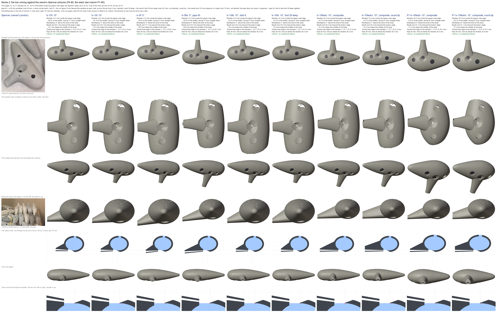

### 8.3 The numbers

| Trial | Port as built | Window inside the player-side edge | Mouthpiece against the level of the body | Mouth end beyond the body's edge | Mouth end (pipe) below the middle of the body | Neck below the body's lowest point | L / R thumb hole edge to the window | Plastic | Checks |
| --- | --- | --- | --- | --- | --- | --- | --- | --- | --- |
| `lv-15f` | 14.1° | 14.1 mm (29 %) | 3° above | 20.1 mm | 13.7 mm | 0 | 13.0 / 21.7 mm | 54.3 cm³ | passes |
| `lv-10f` (series 1) | 11.2° | 15.2 mm (31 %) | 1° above | 19.2 mm | 15.4 mm | 0 | 12.7 / 21.4 mm | 54.2 cm³ | passes |
| `lv-5f` | 5.6° | 17.4 mm (35 %) | 4° below | 17.1 mm | 18.6 mm | 2.6 mm | 12.2 / 20.7 mm | 54.1 cm³ | passes |
| `lv-5fw` | 5.6° | 17.4 mm (35 %) | 4° below | 32.0 mm | 19.6 mm | 3.5 mm | 12.2 / 20.7 mm | 57.3 cm³ | passes |
| `lv-10fd` | 11.2° | 15.2 mm (31 %) | 1° above | 19.2 mm | 15.4 mm | 0 | 12.7 / 21.4 mm | 54.1 cm³ | passes |
| `lv-10fn` | 11.2° | 15.2 mm (31 %) | 1° above | 19.2 mm | 15.4 mm | 0 | 12.7 / 21.4 mm | 54.6 cm³ | passes |
| `lv-10fwdn` | 11.2° | 15.2 mm (31 %) | 1° above | 34.2 mm | 15.2 mm | 0 | 12.7 / 21.4 mm | 58.3 cm³ | passes |
| `lv-10fwdnr` | 11.2° | 15.2 mm (31 %) | 1° above | 34.2 mm | 15.2 mm (the tip's outside: 12.0 mm) | 0 | 12.7 / 21.4 mm | 60.0 cm³ | passes |
| P1 `lv-10fwdn` | 11.2° | 18.2 mm (32 % of 57 mm) | 0° | 31.1 mm | 17.2 mm | 0 | 17.6 / 18.1 mm | 54.5 cm³ | passes |
| P1 `lv-10fwdnr` | 11.2° | 18.2 mm (32 % of 57 mm) | 0° | 31.1 mm | 17.2 mm (the tip's outside: 14.0 mm) | 0 | 17.6 / 18.1 mm | 56.2 cm³ | passes |

"Passes" as in section 3.2. The full tables are in [tables.md](tables.md).

### 8.4 Findings

1. **Every body of series 2 passes, on both bodies.** No unexpected failure; the same soft warnings as the rule body (two on P4, four on P1). The voicing solid does not change: window 62.83 mm², the first cavity mode 1.361 × F6 on P4 (1.631 on P1), the steepest plastic seen from the window rim 11° (10° with the 45 mm pipe).
2. **The bracket is coarse, and 10° is inside the Spencer.** The port moves to the nearest vertex of the chamber mesh, which has 128 segments around the section: a step of 2.8°. Asked 15, 10 and 5°, the bodies were built at 14.1°, 11.2° and 5.6°, with the window 29, 31 and 35 % of the width inside the edge. The Spencer's 30 to 33 % lies between 11.2° and the next step, 8.4° (not built; about 33 % between the two). So the trial called "10°" already sits in the Spencer's range; 14.1° falls just short of it and 5.6° goes past it.
3. **5° carries the costs of 0°.** The mouthpiece points 4° below the level of the body, its end is 18.6 mm below the middle, and the neck hangs 2.6 mm below the body's lowest point (3.5 mm with the 45 mm pipe). The useful range ends above 5°.
4. **The 45 mm pipe gives the Spencer's mouthpiece length.** At 10° the mouth end stands 34.2 mm beyond the edge (Spencer, from the tray: about 35 mm; Songbird proportion: 39 mm). It does not lift it: the pipe is level at 10°, so its end stays 15 mm below the middle of the body.
5. **The wider dish builds, but it grows the wrong way.** `cone_widen_mm` moves only the sides of the ellipse cut, across the jet. With 8 mm the dish is 24.8 mm wide and still 19.5 mm long (rule: 14.8 × 19.5 mm). Along the jet the rule's dish already runs from the windway exit to the end of the labium ramp, 9.9 mm beyond the lip, and not at all toward the mouthpiece (the roof is cut square). That is the Spencer's arrangement too: its window sits at the mouthpiece end of the dish (the handover's comparison, "3 mm beyond the window on each side", left out the reach along the jet). What the Spencer has more is size: about 28 × 20 mm at the 57 mm width the handover uses for scale, longer than wide like ours, and about 1.4 times larger both ways. The 8 mm cut takes 527 mm³ instead of 427 mm³ and moves nothing else (window area, lip, keep-out). The width is hashed, so it would need its own Stage 1 stub. A longer dish beyond the lip needs either a shallower ramp (the record's 20°, an acoustic value) or a new setting in `voicing_geo.py` that carries the rim on past the end of the ramp.
6. **The deeper foot hardly shows.** From 24.5 to 29 mm the neck's middle line turns from 26° to 30° against the body and the body gains 0.4 cm³. In the pictures it is hard to tell from `lv-10f`.
7. **The composite passes on both bodies** and adds about 4 cm³ of plastic (58.3 on P4, 54.5 on P1). It is the nearest to the Spencer outside, except for the mouthpiece's height and the round tip.
8. **The round tip lifts the mouthpiece by 3 mm, not to the middle.** With `neck_floor_mm = 8.6` the mouth end is 13.8 × 13.8 mm instead of 13.8 × 7.6, with the pipe along its thumb-face side, as the tray picture suggests. The pipe does not move. The middle of the tip's outside, measured on the finished STL by [tip_centre.py](tip_centre.py), rises from 15.1 to 12.0 mm below the body's middle on P4 (17.1 to 14.0 mm on P1); the body is 39 mm thick there. The neck's middle line turns from 23° to 19° against the body, and in the section through the lip the neck reads as a tube instead of a wedge. It costs 1.7 cm³ of plastic (60.0 on P4, 56.2 on P1). It is not hashed, every check passes, and the thinnest plastic is 1.24 mm on P4 and 1.22 mm on P1. To bring the tip's middle up to the body's middle this way, the tip would have to be about 38 mm deep, as thick as the body itself.
9. **The mouthpiece cannot stand at mid-thickness while the window stays this far around, with a straight pipe.** This is my own geometry, not a source. The pipe leaves the window along the body's surface and enters the chamber at +8°. At 11.2° the window faces 9° from straight down. A straight pipe whose mouth end were at the middle of the body would have to climb about 15 mm over its 30 to 45 mm, some 20 to 30° above level. The jet would then run down onto the window from outside the chamber instead of into it. The window's position and the mouthpiece's height are tied together by the straight pipe: the rule's 30° has the mouth end 2.5 mm below the middle, 10° has it 15 mm below. Only the outside of the neck can rise (finding 8), or the pipe would have to bend, which no rule allows. What the Spencer does here cannot be read from the pictures.
10. **What series 2 does not touch.** The left thumb hole stays 12.2 to 13.0 mm from the window on the seed. Heuer's and the patent's cautions (section 5, rows 3 and 4) stand exactly as after series 1. The capped-air reading stays low for the reason in finding 9 of section 4 (79.75 to 79.77 cm³ on the seed; the built air is 80.01).

### 8.5 What only the owner or new code can answer

- ~~**The thumb holes 35 to 40 mm from the window, as on the Spencer.** The positions are template constants in `ocarina_addon/holes_layout.py`; moving them changes the hand layout and the hole sizes.~~ **The owner, 2026-11-19: "Keep the template".** The thumb holes stay where they are (12.7 / 21.4 mm from the window on the seed at 10°). The caution of section 5, rows 3 and 4, stays open.
- ~~**Partitions between the thumb holes and the window.** The add-on has none; the owner set them aside on 2026-11-18. A desk check exists in `Analizes_ocarinas/Patent_US7799980/partition_check.py`.~~ **The owner, 2026-11-19, asked whether partitions should be an add-on feature: "no".** With the thumb holes kept on the template, the caution of section 5, rows 3 and 4, can only be sized on a played body.
- ~~**The longer pipe (45 mm).** Parked by the owner; this approach leans on it, and it needs its own Stage 1 stub.~~ **Un-parked by the owner for this approach, 2026-11-19: "Yes, un-park it".** Its stub is `V-aw` (section 9).
- **A longer dish beyond the lip.** New code in `voicing_geo.py`, or a shallower ramp (finding 5). A dish about 1.4 times the rule's both ways (sides +2.6 mm, rim about 8 mm further beyond the lip) is the Spencer's proportion.
- **A bent pipe** to raise the mouthpiece (finding 9). A change to the voicing rule.

### 8.6 What I would take from series 2

1. **10° (built 11.2°) is the position**, as the owner saw. 15° is just short of the Spencer and 5° already hangs the neck below the body.
2. **The nearest outside to the Spencer is `lv-10fwdnr`**: the 45 mm pipe, the round tip and the 29 mm foot. The 8 mm dish in it widens the wrong way and can be left out until a longer dish exists (finding 5).
3. **The mouthpiece will stay low.** With the window this far around, the tip's middle sits 12 mm below the body's middle at best (finding 9). If the owner wants the mouthpiece at mid-body, that needs a bent pipe, which no rule allows. Otherwise the port has to go back toward 30°. **The owner's answer, 2026-11-19: "Yes, keep 10°".** The low mouthpiece is accepted and there is no bent pipe. Port 10° is the experiment's position, not a rule.
4. **Series 2 answers none of the acoustic risks.** The thumb holes beside the window (Heuer; the patent) are still the open question, and only a played body can size it.

## 9. The Stage 1 stub for the 45 mm pipe (V-aw)

The owner, 2026-11-19, asked whether to un-park the 45 mm pipe for this approach: "Yes, un-park it". The same day they kept the port at 10° and accepted the low mouthpiece ("Yes, keep 10°", section 8.6).

A pipe of another length is another voicing, so it needs its own stub. [stub_long_pipe.py](stub_long_pipe.py) builds it exactly as `ocarina_addon/headless.py -- stage1` builds V-a: preset S0, 25 cm³ of capped air, the 80 cm³ window, the build of rule version 3, no holes. The only change is `[voicing_rules] windway_length_mm = 45`. A stub has no port angle, so one stub serves every port angle of the approach. The round tip (`neck_floor_mm`) is outside the hash and is left out.

V-a was built again beside it as a check. It has the voicing hash of the main checkout's V-a (`312011ec9f0e`), the same 72814 triangles, and the same plastic and capped air to 0.00001 cm³. 4015 triangles come out in another order, so the files are not byte for byte equal.


| Stub | Pipe | Voicing hash | Neck | Plastic (solid PLA) | Capped air | Predicted pitch (prior η_w 0.9) | Steepest plastic seen from the window rim | Checks |
| --- | --- | --- | --- | --- | --- | --- | --- | --- |
| V-a | 30 mm | `312011ec9f0e` | 43.6 mm | 30.2 cm³ (37 g) | 25.002 cm³ | 787.1 Hz | 10.9° (5.6 mm high) | 14 pass (one more line is information), no warning |
| V-aw | 45 mm | `40688a48d1c7` | 58.6 mm | 35.0 cm³ (43 g) | 25.002 cm³ | 787.1 Hz | 9.9° (7.0 mm high) | 14 pass (one more line is information), no warning |

Reports: `addon_checks/V-aw.md` and [stubs/V-a.md](stubs/V-a.md); numbers of both in [stubs/stubs.json](stubs/stubs.json). Blank measurement file: `addon_out/lv-stubs/V-aw/V-aw_measurement.toml`, read by `tools/stub_eta_w.py` once it is filled. `addon_out/` is not in git, as for every stub.

1. **V-aw builds and passes every check of a stub**, as V-a does. It needs 6 g more PLA.
2. **The kernel predicts the same pitch for both, by construction.** Its stub pitch is c/(2π)·√(η_w·G_w/V), and G_w comes from the window alone. The pipe length is not in the model.
3. **So the print of the pair answers what the kernel cannot.** If V-aw sounds where V-a does, η_w·G_w does not depend on the pipe length, and the calibration of the 30 mm voicing carries over. If it does not, the 45 mm voicing needs its own η_w. The pair also shows whether the 45 mm pipe speaks with the 3.0 mm mouth end, and how much harder it blows. By the estimate in section 5, row 7, the laminar loss in the slot rises from 19 to 29 Pa at a 15 m/s jet. A 4.1 mm mouth end would bring it back to 19 Pa. That stub was not built, because the 3.0 mm mouth end is the owner's decision 4 of 2026-11-18.
4. **The window picture of V-aw shows a block at the mouth end that is not plastic.** That picture keeps only the faces within 34 mm of the window. V-a's mouth end lies at 34.8 mm and V-aw's at 49.8 mm, so on V-aw the crop cuts the neck 15 mm short and the pipe's inner walls show past the cut. The uncropped views and the STL have a clean mouth end.

**Not done, because the owner did not ask for a rule:** putting 45 mm in `[voicing_rules]` of `params/alto_c_12hole.toml`, a V-aw recipe in `ocarina_addon/stub.py`, regenerating Stages 1 to 3, and `python kernel/synthetic.py --write-examples` (the synthetic calibration is keyed by the voicing hash; without it Stage 3 quietly re-solves the "printed" windows). If the approach becomes the rule, those four go together. The owner would also have to say whether the 45 mm pipe is for every body or only for the low-voicing bodies.

## 10. Series 3, first part: the base, the foot of the neck, and the inner walls (2026-11-20)

The plan is [Plan_series3_balance_necks_blends.md](Plan_series3_balance_necks_blends.md). The owner answered it on 2026-11-19 (their words): "no printed tests on this experiment yet first we need to refine the implementation and implement the inner wall due to the closenes to the thumb holes, 3. yes the inner pocked must blend, 4. aprove this for further testing, 5. i believe this has not been explores". On 2026-11-20 they said "Yes, start" to step 0 and the first pass of the inner walls. This section is those two. Stages R (outside), A, B and C of the plan are not started.

26 bodies were built: 11 for the base, 14 with inner walls (9 on P4, 5 on P1) and one more smooth twin at port 30°. **Every one passes with no unexpected failure.** Nothing was printed. All numbers are in [tables_s3.md](tables_s3.md).

### 10.1 The base of series 3

Series 1 and 2 were built on a copy of the main checkout of 2026-11-19, about 01:15. Series 3 is built on a new copy, taken on 2026-11-20 at 01:02 (`refs/snapshots/low-voicing-base-s3`): rule version 3 finished, `hole_to_voicing` measures the plastic of the neck at each hole rim, and the preset key `neck_foot_width_mm` is gone (the foot is given with the prototype setting `neck_base_width_mm`, not hashed). No add-on file of this checkout differs from that copy. The numbers of series 1 and 2 were not rebuilt; where a body exists in both, the geometry agrees (the control: mouth end 34.2 mm beyond the edge, 15.2 mm below the middle, the first cavity mode 1.361 × F6 on P4 and 1.631 on P1).

Series 3 has its own script, [series3_trials.py](series3_trials.py), which reuses the build and the pictures of `low_voicing_trials.py` and writes to `trials_s3/`, `images_s3/` and `series3_trials.json`.

### 10.2 The foot of the neck: the 29 mm limit of series 1 was not real

| Body | Foot of the neck | Plastic of the neck beside a thumb hole rim | The old check's box distance (left hole) | Check |
| --- | --- | --- | --- | --- |
| P4, port 10°, pipe 45 mm | 42.3 mm (the rule) | 0.00 mm | −4.9 mm | passes |
| P4 | 38, 34, 32, 29 mm | 0.00 mm | −2.7, −0.7, +0.3, +1.8 mm | passes |
| P1, port 10°, pipe 45 mm | 42.3 mm (the rule) | 0.00 mm | −0.4 mm | passes |
| P1 | 38, 34 mm | 0.00 mm | +1.8, +3.8 mm | passes |

1. **With the corrected check the rule's own foot passes at port 10° on both bodies.** No plastic of the neck stands beside either thumb hole rim, at any foot width from 29 to 42.3 mm.
2. **The failures of series 1 came from the old check.** It measured the distance from the hole to a box as wide as the foot along the whole neck. The neck is that wide only at its foot, so the box "touched" a hole the neck was nowhere near. Findings 2 of section 4 and the "29 mm (P4) / 34 mm (P1)" foot of the handover fall with it. The slim foot is now a choice of look, not a need.
3. **So the necks and blends of the plan have more room than the plan assumed:** at least the rule's 42.3 mm on both bodies. How much more was not tried; stage B of the plan starts from here.
4. **The control of series 3 is `s3-fwr`:** port 10°, pipe 45 mm, the round 13.8 mm mouth end, the foot 29 mm (P4) or 34 mm (P1) wide and 29 mm deep, and the rule's dish (not the 8 mm dish of `lv-10fwdnr`). Plastic 60.1 cm³ on P4, 56.3 cm³ on P1.

### 10.3 The room for an inner wall

Measured on the control, along the body from the lip (the window is 8.8 mm wide along the body, because the jet runs across it):

| Body | The pocket's flat part | The pocket's skirt ends (it adds less than 0.5 mm² to the section) | Left thumb hole | Right thumb hole | Room, left / right |
| --- | --- | --- | --- | --- | --- |
| P4 | −5.9 to +5.9 mm | about −12.5 and +12.5 mm | −26.5 to −15.8 mm (⌀ 10.8) | +23.1 to +35.8 mm (⌀ 12.7) | **3.3 mm** / 10.6 mm |
| P1 | −5.9 to +5.9 mm | about −12.6 and +12.5 mm | −30.0 to −19.3 mm | +19.0 to +31.7 mm | 6.7 mm / 6.5 mm |

1. **The inner pocket already blends.** The 12 mm pocket blend of the rule meets the chamber wall in 125 of 125 directions on every body of series 3; its skirt runs 6.6 mm beyond the pocket's flat part along the body. The inside pictures now show it (row 1 of the sheets).
2. **On the seed there are 3.3 mm between the end of that skirt and the left thumb hole.** A 2.4 mm wall fits there in one place only, with 0.8 mm to the hole's rim, and its fillet on the hole's side has to be small (0.6 mm). On the right, and on both sides of P1, there is room for a 2.4 mm wall with 2 mm fillets.

### 10.4 How a wall is made

[inner_walls.py](inner_walls.py) is experiment code beside the trials, not part of the add-on. It hooks into the build from outside, so the add-on files stay those of the copy.

- A wall is a slab across the body, standing on the thumb-face side of the chamber up to a level top edge. The top edge is a half round. Where the slab meets the chamber wall, or the skirt of the pocket, a fillet strip follows the meeting line.
- The slab and its strip are **taken out of the air before the air is cut out of the shell**. The outside, the voicing solids and the holes are made as before; the voicing hash does not change (`40688a48d1c7`).
- The walls take air, so the chamber is solved again, larger, until the walled air holds its target (4 rounds; the built capped air is 80.010 cm³ against 80.000, as on a body without walls).
- Settings (preset keys, all optional): `inner_wall_x_mm` (the place of each wall along the body), `inner_wall_height` (top edge as a share of the section's height), `inner_wall_thickness_mm`, `inner_wall_fillet_mm`.
- It also measures what was built: the wall against each thumb hole rim, against the window and the pocket, the share of the section it blocks, and the air it takes.

Two faults met on the way, both mine and both fixed: the first fillet strip folded over itself, because the cut of the chamber mesh has points that lie almost on each other and the strip took its directions from them (1 230 self-crossings on the first body; the meeting line is now resampled every 1 mm); and a fillet that meets the wall exactly tangent leaves slivers, so it now ends 0.05 mm under the wall.

### 10.5 The trials

Control `s3-fwr`. A wall stands "near its thumb hole" (the patent: nearer the hole than the window): its face 2.5 mm from the rim, or 0.8 mm on P4's left. Wall 2.4 mm thick, fillet 2 mm, unless the row says otherwise.

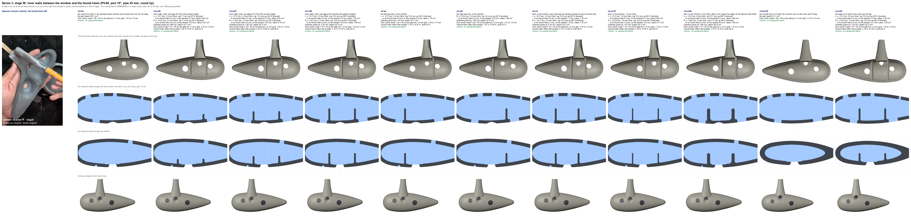

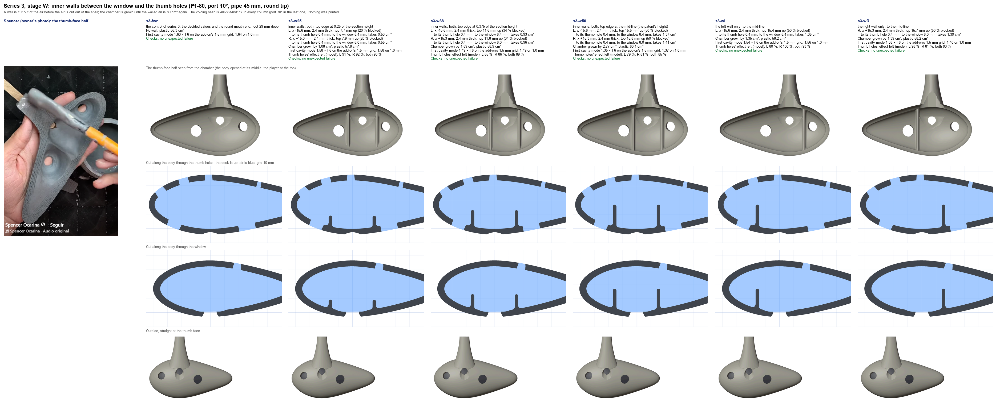

| Trial | Walls | Section blocked | P4: first cavity mode ÷ F6 | P4: thumb holes' effect left (L / R / both) | P1: first cavity mode ÷ F6 | P1: thumb holes' effect left | Plastic P4 / P1 |
| --- | --- | --- | --- | --- | --- | --- | --- |
| `s3-fwr` | none (control) | 0 | 1.37 | 100 % | 1.64 | 100 % | 60.1 / 56.3 cm³ |
| `s3-w25` | both, top edge at 0.25 of the height (7 to 8 mm) | 20 % | 1.32 | 89 / 91 / 92 % | 1.58 | 91 / 92 / 93 % | 61.3 / 57.8 |
| `s3-w38` | both, at 0.375 (11 to 12 mm) | 34 % | 1.24 | 81 / 84 / 86 % | 1.49 | 85 / 86 / 89 % | 62.2 / 58.9 |
| `s3-w50` | both, to the mid-line (14.5 to 15.8 mm): the patent's height | 50 % | 1.16 | 76 / 79 / 84 % | 1.37 | 79 / 81 / 85 % | 63.3 / 60.1 |
| `s3-wL` | the left only, to the mid-line | 50 % | 1.26 | 78 / 97 / 92 % | 1.56 | 80 / 100 / 93 % | 61.7 / 58.2 |
| `s3-wR` | the right only, to the mid-line | 50 % | 1.21 | 97 / 78 / 91 % | 1.40 | 98 / 81 / 93 % | 61.6 / 58.2 |
| `s3-wf` | both, to the mid-line, near the window instead | 50 % | 1.16 | 73 / 85 / 86 % | – | – | 63.3 |
| `s3-wt16` | both, 1.6 mm thick | 50 % | 1.16 | 78 / 78 / 85 % | – | – | 62.2 |
| `s3-wt40` | both, 4 mm thick, fillet 4 mm | 50 % | 1.14 | 79 / 79 / 86 % | – | – | 65.6 |
| `s3-w30` | the walls of `s3-w50` on the rule's port 30° (twin `s3-fwr30`: 1.37) | 50 % | 1.16 | 76 / 78 / 84 % | – | – | 64.3 |

The cavity mode and the thumb holes' effect are from [walls_desk_model.py](walls_desk_model.py) on a 1.0 mm grid ([walls_desk_model.md](walls_desk_model.md)); the add-on's own check, on 1.5 mm, reads 0.00 to 0.02 lower on the walled bodies. "Effect left" is the method of the patent record: one or both thumb holes open, the window closed, no end corrections; it compares a walled body with its smooth twin and is not a note of the instrument.

### 10.6 Findings

1. **The walls build, and every existing check passes on all 17 walled or control bodies.** The lip (0.400 mm), the ramp, the window area, the pocket blend and the wall of the body measure as on the control.
2. **The cost is the first cavity mode, and on the seed it is high.** To the mid-line (the patent's and the Spencer's height) the seed P4 falls from 1.37 to 1.16 × F6: below the add-on's comfortable margin of 1.3, above its hard limit of 1.0. This is the band where the add-on asks for a finer solve. The patent record's model body gave the same size of drop (1.48 to 1.24). Only the lowest wall (`s3-w25`, 20 % blocked) keeps the seed at 1.3. The teardrop P1 starts at 1.64 and keeps 1.37 even to the mid-line.
3. **A wall weakens the thumb hole behind it, by 9 to 24 %.** To the mid-line the hole keeps 76 to 81 % of its effect; at 0.25 of the height, 89 to 92 %. The Spencer model of the patent record lost less (10 %), because its walls stand further from the holes. The holes of these bodies were **not** made larger for it: the kernel does not know the walls. On a print, the notes with a thumb open would come out flat by an amount this model cannot give as cents.
4. **One wall costs about half.** The left wall alone leaves the right thumb hole untouched (97 to 100 %) and costs less mode (P4 1.26, P1 1.56). The right wall alone costs more mode than the left one (P4 1.21, P1 1.40), because it stands nearer the middle of the chamber's length.
5. **Thickness hardly matters to the acoustics; height does.** 1.6, 2.4 and 4 mm give 1.16, 1.16 and 1.14 on P4. Thickness costs plastic and air (the chamber grows by 1.5, 2.3 and 4.0 cm³) and, on P4's left, room.
6. **On the seed the left wall has exactly one place.** Moved toward the window (`s3-wf`) its face reaches the rim of the left thumb hole (0.00 mm). At 4 mm thick (`s3-wt40`) it stands 1.7 mm from the pocket's flat part and takes 8 mm³ out of the pocket's own air. The 2.4 mm wall at −13.7 mm keeps 4.8 mm to the pocket's flat part and 6.2 mm to the window, and takes under 1 mm³ of the pocket's skirt.
7. **The fillet ends 0.4 mm from the thumb hole's rim** on every wall as built (by construction: 0.3 mm was the margin). That is close: the hole's inner edge has the fillet rising right beside it. A margin of 1.5 mm would shorten the fillet on the hole's side to about 1 mm on P1 and to nothing on P4's left.
8. **The walls are a property of the hole layout, not of the low voicing.** On the rule's port 30° the same walls cost the same (1.16, 76 / 78 / 84 %). The low voicing is only the reason to want them.
9. **Against the Spencer half-shell picture.** Its "walls" are broad, round ridges between three scooped pockets, roughly as wide at the foot as a thumb hole (about 10 to 12 mm, read by eye), and each thumb hole sits at the bottom of a funnel. Ours are thin slabs with a small fillet. `s3-wt40` is the nearest, and on the seed there is no room for it on the left. A ridge of that kind is the same thing as a chamber with pockets, which is a different cavity shape, not a wall added to this one.
10. **None of this tests what the walls are for.** The patent's claim is about the tone of the top notes when the large holes open. No tool here models that. The desk model sizes the cost only.

### 10.7 What I would take from it, and what is the owner's to say

1. **For the seed P4, a low wall or one wall.** `s3-w25` (both, 20 % blocked) keeps the cavity mode at 1.3 and 89 to 92 % of the thumb holes. `s3-wL` (the left only, to the mid-line) puts the full-height wall where the window is closest and leaves the right hole alone, at 1.26. Both walls to the mid-line (1.16) I would not carry forward on the seed without the finer solve the add-on asks for in that band.
2. **For P1, both walls to the mid-line are affordable** (1.37).
3. **The thumb holes behind a wall should be sized for it** before any print, or the comparison print will mostly show flat thumb notes. That needs a correction factor in the sizing for a hole behind a wall. It is new work and not in the plan yet.
4. **Open for the owner:** the height (0.25, 0.375 or the mid-line), one wall or two, and whether the thin slab is what was meant or the broad ridge of the Spencer picture (finding 9).

### 10.8 Not done

- The print look (overhang of a wall inside the closed chamber) of the plan's section 8.3: no print orientation is fixed in the add-on, so nothing was measured. A slab standing on the thumb face with a half-round top prints without support only if the body is printed standing on its tail or its player-side edge.
- The walls on the shortlisted outsides (second pass), and on P0, P2 and P3.
- The add-on's own cavity-mode check runs on a 1.5 mm grid; a 1.6 mm wall is thinner than a cell there. The desk model's 1.0 mm grid was used for the table.
- Stages R (the outside of the mouthpiece), A, B and C of the plan.

## 11. Series 3, second part: the owner's Blender reference, its stance, the blend and a smooth inside (2026-11-20)

The owner, 2026-11-20, after section 10 (their words): "carry both low walls, also for visual balance the height of the thumb holes"; "analyze the following model, this one achieves a slightly simillar shape to the one we want with the lower voicing without the intenral geometry"; "analyze their if our test catch this as off tune models and take notes of the positives"; "fine tune the approach to achieve the smooth neck and lowered voicing we mentioned with the new references, you are allowed to try new approaches, my decisions fall second in this experiment just keep as priority taking into account the tests and the extensive research as well as the visual and smoothness"; "take special attention to the thicker shell part"; "explore ways to keep the internal cavity smoothness take another look at the clay internals rather than the chart drawings". They also offered to sculpt references in Blender.

26 more bodies were built (52 in series 3 so far). **Every one passes with no unexpected failure.** Nothing was printed. Numbers: [tables_s3.md](tables_s3.md). The model's own analysis: [ref_oot_blend/](ref_oot_blend/README.md).

### 11.1 The reference model

"Ocarina of time Blender.blend" and its STL export. Three objects: the body (a subdivision surface), its chamber and its windway, joined by Booleans. It is a third-party file of unknown source and is not in git. It is **not** the ECAN3 Ocarina of Time that the repository analysed before. All sizes below are at the size of the file unless a line says "at alto size" (× 0.75, see 11.2).

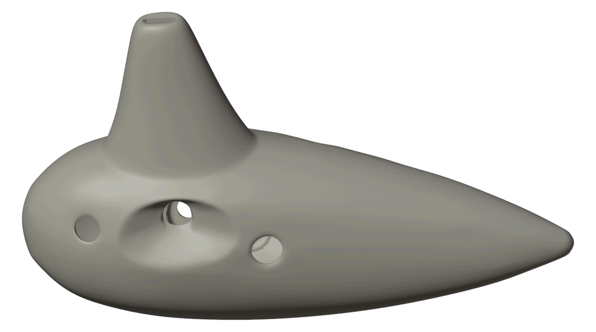

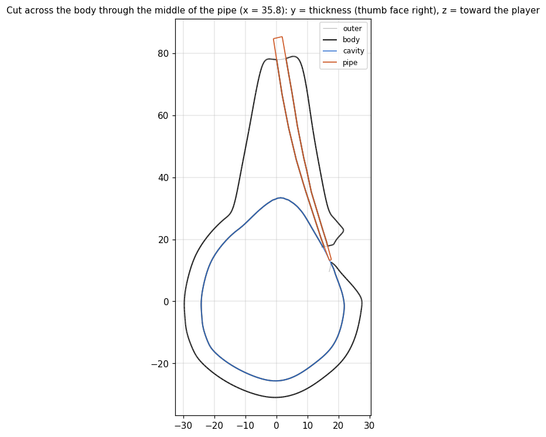

| Part | The reference | At alto size (× 0.75) | Our control `s3-fwr` |
| --- | --- | --- | --- |
| Body | 175 mm long, 58 mm thick, 62 mm wide; nearly round in section | 131 × 43 × 47 mm | 140 × 39 × 49 mm (P4) |
| Air | 191.5 cm³ | 81 cm³ | 80 cm³ |
| Plastic | 136 cm³ | 57 cm³ | 60 cm³ |
| Wall | 5.3 mm, even over the whole body | 4.0 mm | 4.0 mm |
| Wall at a hole | 1.3 to 2.3 mm: the chamber is hollowed toward each hole from inside, over a patch 15 to 18 mm across | 1.0 to 1.7 mm | 4.0 mm (the full wall) |
| Walls inside | none | – | none |
| Window | about 9 mm along the body × 9.7 mm along the jet, 71 mm² | 6.8 × 7.3 mm, 40 mm² | 8.8 × 9.7 mm, 62.8 mm² |
| Where the window is | on the thumb face; its wall faces 23° from straight down | – | 9° (port 10°); 15° at port 20° |
| Lip | where a wide dish on the outside breaks through the chamber wall: a wedge of 12 to 16° at the middle of the window | – | a 20° ramp cut through a 4 mm wall |
| Dish | one smooth scoop on the thumb face around the window, about 35 × 24 mm read from the render (the automatic measure, 70 × 24 mm, also takes in the dimples of the two thumb holes) | about 26 × 18 mm | 19.5 × 14.8 mm |
| Pipe | 73.5 mm long, **curved** (10° to the player's axis at the mouth end, 18° at the exit); 10.6 × 3.0 mm at the mouth end, 8.0 × 1.3 mm at the exit | 55 mm; 0.95 mm high at the exit | 45 mm, straight; 3.0 mm at the mouth end |
| Pipe against the chamber wall | 4° into the chamber; the jet runs almost along the wall, and the lip is 0.2 mm inside its axis | – | 8° (the rule) |
| Mouthpiece | points at the player, **at the middle of the thickness** (its tip 2 to 3 mm to the thumb-face side of the middle); 48 mm long above the body line | 36 mm | 15.2 mm below the middle |
| Root of the mouthpiece | 58 × 31 mm at the body line, 17 × 13 mm at the tip; a long hollow sweep toward the tail, a tight one toward the bulb | 44 × 23 mm, tip 13 × 10 mm | a cone pushed into the body, 29 × 29 mm, tip 13.8 mm |
| Chamber under the mouthpiece | follows the root: the chamber bulges about 7 mm toward the player there | – | does not |
| Thumb holes | 12.0 and 8.8 mm; centres 31 and 29 mm from the window's | 23 and 22 mm | edges 12.7 and 21.4 mm from the window |

**The positives, as I read them:**

1. **How it gets the low voicing and a mouthpiece at mid-body at once.** The window sits where the chamber wall has already turned 23° toward the player, the pipe runs almost along that wall (4° into the chamber, not 8°), and it is long. A pipe that follows the wall climbs toward the middle of the body as it goes back to the player. Section 8.4, finding 9, said a straight pipe could not reach mid-body; that was true for a pipe at +8° and 30 to 45 mm at port 10°. It is not true at port 20°, +4° and 55 mm (11.3).
2. **The blend is the shape of the neck itself.** There is no fillet between a cone and a body: the neck is a bell whose foot is a third of the body's length, and the body's outline runs into it.
3. **The voicing cut is one smooth dish**, and the lip is what the dish leaves of the chamber wall. No pocket is needed inside, because the jet runs along the wall.
4. **The thick wall is not thick at the holes.** The wall is 5.3 mm (4.0 mm at alto size, ours), but each hole is hollowed from inside to a chimney of 1.3 to 2.3 mm. This is the same thing the clay shows (the funnels of the Spencer half shell). It is what lets a thick, smooth shell keep short chimneys.
5. **The chamber is smooth**: nothing stands in it.

### 11.2 Do our tests see it as in tune?

[tune_test.py](ref_oot_blend/tune_test.py) and [any_order.py](ref_oot_blend/any_order.py); nothing is fitted to a note.

| Test | The reference | ECAN3 Ocarina of Time | ECAN3 Eclipse |
| --- | --- | --- | --- |
| Lowest note at the size of the file (kernel, η_w 0.9, k 0.66 to 1.0) | 297 to 350 Hz: D4 to F4, **4 to 7 semitones below A4** | – (its window has no simple aperture) | 407 to 474 Hz: about A4 |
| Size at which the lowest note is A4 | × 0.67 to 0.79 (59 to 96 cm³ of air) | – | × 0.93 to 1.08 |
| The 13 notes, one common shift taken out, the window's size left free, Asian order | **109 to 111 cents** rms (F6 −187, G5 +179, E6 −174) | 34 to 44 | 54 to 61 |
| The same with ANY order of opening the twelve holes | **83 to 86 cents** rms | 19 to 22 | 29 to 33 |
| First cavity mode ÷ top note, if it were an alto C at the size of the file | 1.16 (about 1.5 to 1.7 against its own lower scale) | 1.08 | 1.34 |

1. **Yes, the tests catch it.** By the kernel, no window and no order of opening turns its twelve holes into a 13-note scale closer than 83 cents rms. The two instruments their designer tuned come to 19 to 33 cents under the same freedom. The right index hole is far too large for its place and the thumb holes and the left pinky are too small.
2. **And it is not an alto C at the size of the file.** Its air is 2.4 times ours. Scaled by about 0.75 it has our 80 cm³ and our 4.0 mm wall, which is unlikely to be chance: I take the file to be drawn about a third too large, or meant for a lower instrument.
3. **What this does not say.** "Playable" and "in tune" are different things; a body with this window and chamber will sound, and the owner did not say it was tuned. The kernel was fitted to plain cylindrical holes; these are funnels, and their size and depth are the least certain numbers here. The verdict is about the scale, not about the voicing, which is what the owner pointed to.
4. **So the shape is taken from it, not the holes.**

### 11.3 The stance of the reference with settings the add-on has

Stage `ref` of [series3_trials.py](series3_trials.py). No new code: the port angle, the pipe's angle into the chamber (`windway_pitch_deg`, the rule: 8) and its length.

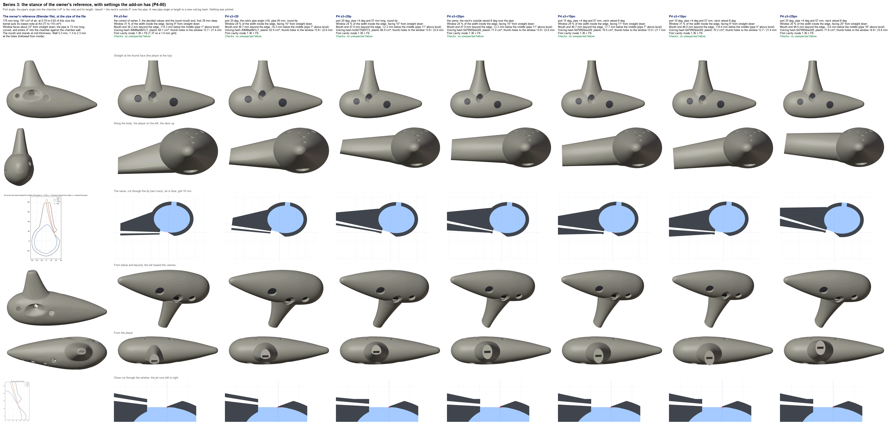

| Trial (P4) | Port | Pipe | Window inside the edge | Window faces | Mouth end beyond the edge | **Mouth end below the middle of the body** | Checks |
| --- | --- | --- | --- | --- | --- | --- | --- |
| `s3-fwr` (control) | 10° | +8°, 45 mm | 31 % | 9° | 34.2 mm | 15.2 mm | passes |
| `s3-r20` | 20° | +8°, 45 mm | 24 % | 15° | 36.7 mm | 8.3 mm | passes |
| **`s3-r20p`** | 20° | **+4°, 57 mm** | 24 % | 15° | 47.9 mm | **2.2 mm** | passes |
| `s3-r20pn` | 20° | +4°, 57 mm, neck raised 8° | 24 % | 15° | 47.9 mm | 2.2 mm (the mouth end becomes 13.8 × 20.3 mm) | passes |
| `s3-r15pn` | 15° | +4°, 57 mm, raised | 29 % | 11° | 46.7 mm | 7.7 mm | passes |
| `s3-r10pn` | 10° | +4°, 57 mm, raised | 31 % | 9° | 46.0 mm | 10.4 mm | passes |
| `s3-r25pn` | 25° | +4°, 57 mm, raised | 20 % | 20° | 48.5 mm | 3.6 mm **above** | passes |

1. **Port 20°, pipe +4° and 57 mm puts the mouthpiece at the middle of the body** (2.2 mm below it), with the pipe rising 11° toward the player and the window still on the thumb face (24 % of the width inside the edge; the reference's wall faces 23°, ours 15°). On P1 the same settings put the mouth end 4.8 mm below the middle, with the window 26 % inside the edge, and pass.
2. **The raised neck (approved for testing on 2026-11-19) is not needed and looks worse.** Once the pipe itself reaches mid-body, raising the outside only makes the mouth end 20 mm deep with 8.7 mm of plastic over the pipe.
3. **This reopens two things the owner had settled, and I say so plainly:** port 10° ("Yes, keep 10°") and the 45 mm pipe. At 10° the best is 10.4 mm below the middle. The owner wrote on 2026-11-20 that their decisions fall second in this experiment; the choice between 10° with a low mouthpiece and 20° with a mouthpiece at mid-body is still theirs, and the sheet shows both.
4. **Cost: a new voicing.** +4° and 57 mm change the hash (`bc6b77560773`), so this pipe needs its own Stage 1 stub, as the 45 mm pipe did. The mouth end stands 48 mm beyond the edge, more than the Spencer's 35 mm; 50 mm of pipe would bring it to about 41 mm and lower the mouth end by about 1.3 mm.
5. **The left thumb hole is no further from the window** (13.8 mm at 20° against 12.7 mm at 10°).

### 11.4 The blend between the neck and the body

[blend_fillet.py](blend_fillet.py): experiment code, hooked into the build from outside. A ball is rolled over the joined outside of the body and the neck; where it cannot reach, plastic is added. It adds nothing on convex surfaces, nothing on a hole's rim, nothing inside the keep-out of the window, and it does not touch the voicing hash. The chamber, the holes and the voicing are then cut out of the blended outside by the add-on as always.

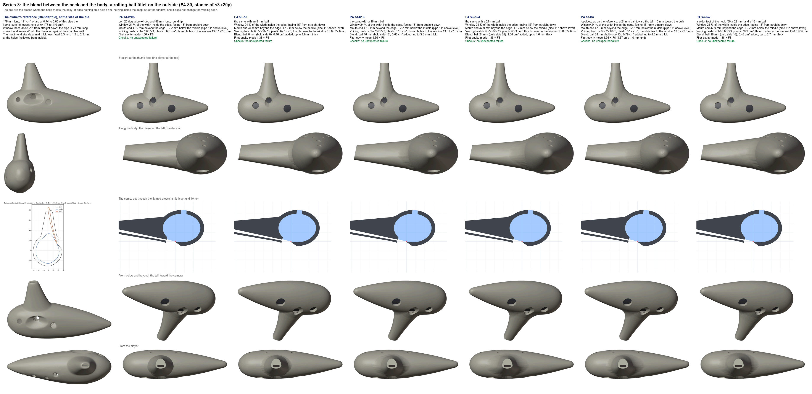

| Trial (P4, stance of `s3-r20p`) | Ball | Plastic added | Thickest | Checks |
| --- | --- | --- | --- | --- |
| `s3-r20p` | none | – | – | passes |
| `s3-b8` | 8 mm | 0.16 cm³ | 1.8 mm | passes |
| `s3-b16` | 16 mm | 0.65 cm³ | 3.5 mm | passes |
| `s3-b24` | 24 mm | 1.36 cm³ | 4.6 mm | passes |
| **`s3-ba`** | **24 mm toward the tail, 10 mm toward the bulb** | 0.79 cm³ | 4.5 mm | passes |
| `s3-bw` | 16 mm, on a wider foot (50 × 32 mm) | 0.46 cm³ | 2.7 mm | passes |

1. **A ball of 16 to 24 mm gives the look of the reference**: the neck grows out of the body, and the crease is gone. 8 mm hardly shows, because the cone meets the body at a wide angle.
2. **The lopsided root (`s3-ba`) is the reference's own shape**: a long sweep toward the tail and a tight curve toward the bulb. This is the "root fuller on one side" the owner said had not been explored. It costs under 1 cm³ of plastic.
3. **Where the ball would reach a hole, it leaves a round dimple.** At port 20° the root of the neck comes near the left ring hole on the deck. The first build put plastic on that rim and the add-on's own guard refused it (the hole removed 199 mm³ where 160 was expected). The blend now keeps 1.2 mm off every rim. No plastic of the neck or the blend stands beside a thumb hole rim on any body.
4. **Limits.** The fillet is made on a 0.4 or 0.6 mm grid and smoothed; its surface is fine for a print but not exact. It is not yet a setting of the add-on.

### 11.5 A smooth inside: the ridge field

The clay again, read for its surfaces: [Spencer report](../Spencer_OoT_12h/Spencer_OoT_12h.md), section 7.4. The thumb-face half is a thick wall with scooped pockets; the ridges are what the scoop left. The slab walls of section 10 are the opposite: thin walls with pieces added.

The ridge field of [inner_walls.py](inner_walls.py) is one smooth height field of plastic on the thumb-face wall. A funnel is left around each thumb hole (the hole's rim keeps 1 mm of flat land, so its chimney stays the kernel's 4 mm), and the voicing's pocket with its whole skirt is kept free. Sides rise over 3 or 5 mm, tops are round, and nothing meets the wall at a sharp corner. The chamber is grown until the air is 80 cm³ again.

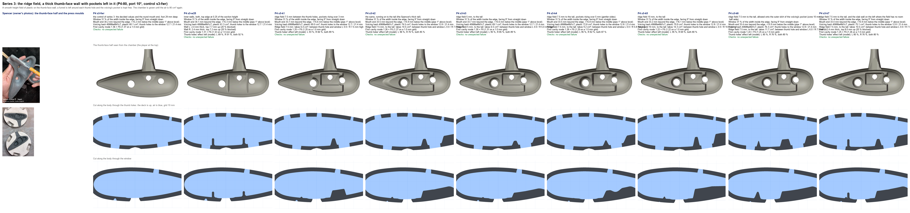

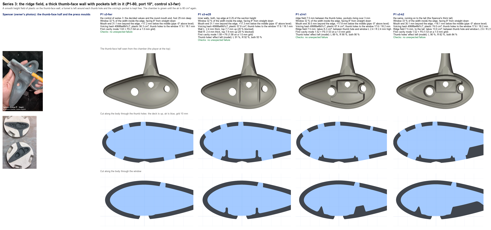

| Trial | Field | P4: height it reaches between thumb hole and window (L / R) | P4: first cavity mode ÷ F6 | P4: plastic | P1: between (L / R) | P1: mode |
| --- | --- | --- | --- | --- | --- | --- |
| `s3-fwr` | none | – | 1.36 | 60.1 cm³ | – | 1.63 |
| `s3-w25` (slab walls, section 10) | – | 7.7 / 7.2 mm | 1.31 | 61.3 | 7.7 / 7.9 mm | 1.58 |
| `s3-k1` | 7.5 mm, between the thumb holes | **0.0** / 7.5 mm | 1.25 | 69.0 | 2.4 / 2.4 mm | 1.52 |
| `s3-k2` | 7.5 mm, on to the tail | 0.0 / 7.5 | 1.26 | 74.5 | 2.6 / 2.5 | 1.52 |
| `s3-k3` | 5 mm, to the tail | 0.0 / 5.0 | 1.30 | 69.1 | – | – |
| `s3-k4` | 7.5 mm, gentler sides (5 mm) | 0.0 / 5.8 | 1.28 | 72.8 | – | – |
| `s3-k5` | 10 mm, to the tail | 0.0 / 10.0 | 1.22 | 79.9 | – | – |
| `s3-k6` | 7.5 mm, allowed onto the outer skirt of the voicing's pocket | 6.0 / 7.5 | 1.24 | 76.3 | – | – |
| `s3-k7` | 7.5 mm, and the slab wall on the left | slab 8.0 / 7.5 | 1.25 | 75.1 | – | – |

1. **The field builds and is smooth, and every check passes.** The inside pictures show what the clay shows: broad ridges, round funnels, no slab.
2. **A smooth ridge needs room, and our thumb holes do not give it.** A ridge 7.5 mm high with sides that rise over 3 mm needs about 7 mm between the voicing's pocket and the thumb hole's funnel. The seed P4 has 3.3 mm on the left: **no ridge forms there at all** (0.0 mm). P1 has 6.5 mm on each side and gets ridges of 2.5 mm. Only P4's right side has room for the full height. The Spencer has its thumb holes 35 to 40 mm from the window; ours are 12.7 and 21.4 mm.
3. **Ways around it, each with a cost:** let the field stand on the outer skirt of the pocket (`s3-k6`: 6.0 mm on the left, 3.8 mm from the window; the skirt adds almost no air there, but it is the voicing's own surface); keep a slab on the left only (`s3-k7`); or move the left thumb hole about 5 mm away from the window, which the owner ruled out on 2026-11-19 ("Keep the template") and which changes the hand layout and the tuning. I did not build the third.
4. **It costs plastic and size.** The field takes 6 to 14 cm³ of air; the chamber grows by as much and the body with it (plastic 69 to 80 cm³ against 60).
5. **A thick tail helps the cavity mode a little; less than on the Spencer model.** `s3-k2` (to the tail) reads 1.26 against 1.25 for `s3-k1`. The field fades out where the chamber is under 18 mm high, so the last third of the tail is not solid. A solid tail was worth +0.14 on the Spencer model (Spencer report 7.3); a field that runs further into the tail is worth trying.
6. **"The height of the thumb holes."** I read the owner's note as: the walls as high as the thumb holes' funnels are deep, so that the two read as one relief. In the ridge field they are the same by construction. If something else was meant (for example where the thumb holes sit across the body), it is not done.

### 11.6 The candidates

The stance of `s3-r20p` (port 20°, pipe +4°, 57 mm, round tip), the lopsided blend of `s3-ba`, and the inside either way.

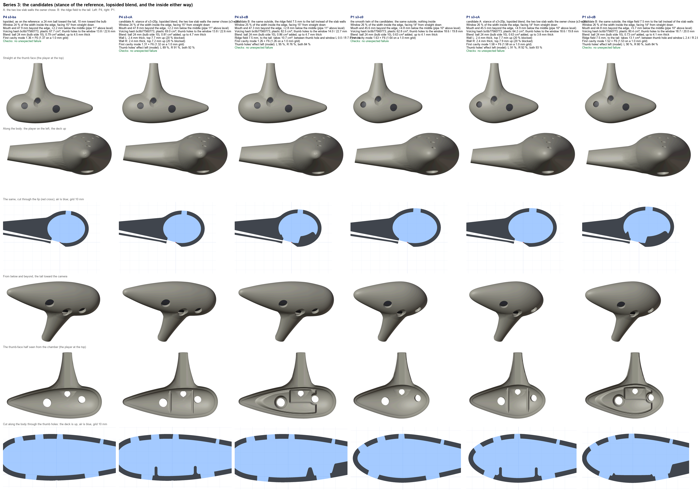

| Candidate | Inside | P4: first cavity mode ÷ F6 | P4: plastic | P1: first cavity mode ÷ F6 | P1: plastic | Checks |
| --- | --- | --- | --- | --- | --- | --- |
| `s3-ba` / `s3-c0` | nothing (the reference has nothing) | 1.36 | 67.7 cm³ | 1.63 | 62.8 cm³ | pass |
| **`s3-cA`** | the two low slab walls the owner chose (`s3-w25`) | 1.31 | 69.0 cm³ | 1.58 | 64.2 cm³ | pass |
| `s3-cB` | the ridge field 7.5 mm to the tail | 1.26 | 82.5 cm³ | 1.52 | 80.4 cm³ | pass |

The thumb holes' effect left, by the desk model of section 10, is in [tables_s3.md](tables_s3.md) (last table): on P4 the low walls leave 89 / 91 / 92 % (left thumb / right thumb / both) and the ridge field 95 / 76 / 84 %; on P1 91 / 92 / 93 % and 90 / 80 / 84 %. The ridge field leaves the left hole almost untouched because no ridge forms beside it, and costs the right hole more because its ridge is broad.

### 11.7 What I would take from it

1. **Outside: `s3-ba`.** Port 20°, pipe +4° and 55 to 57 mm, the cone neck with a round tip, and the lopsided blend. It has the reference's stance and most of its look, with the add-on's own voicing cut and every check passing.
2. **Inside: the low slab walls (`s3-cA`) for now**, as the owner chose. The smooth ridge field is the better-looking inside and the one the clay has, but on our hole layout it cannot stand where it is wanted most, between the left thumb hole and the window, and it costs 13 cm³ more plastic. It becomes the better choice only if the left thumb hole may move, or the pocket's skirt may be shared.
3. **The reference has no walls at all, and the same thumb-hole distances as ours.** If it plays well, that is a point for trying the smooth body (`s3-ba`) beside the walled one before deciding the walls are needed. Only a print can say.
4. **Not copied from the reference:** its hole sizes (11.2), its 1.3 mm windway exit (ours is the rule's), and its bent pipe.

### 11.8 Ways not yet tried, in the order I would try them

1. **The thick wall with short chimneys**, the reference's and the clay's own answer: a wall of 5 to 6 mm everywhere, hollowed from inside around every hole. The kernel sizes each hole for the chimney it is given, so this is a change of two parameters and a new inside surface, not of the model. It would make the outside dish deeper and smoother at the same lip, and give the ridge field something to stand in.
2. **The chamber following the root of the neck** (the reference's bulge under the mouthpiece): the cavity must be solved again; the first cavity mode may gain.
3. **The voicing cut as one dish through a thicker wall**, with the jet along the wall and no pocket inside. This is a new voicing: new solids, a new hash, its own stub.
4. **A curved pipe.** The reference bends 8° over its length. Ruled out by the owner on 2026-11-19; the straight pipe at +4° already reaches mid-body.
5. **A bell foot for the neck** as a setting, so that the blend needs no voxel step.

### 11.9 References the owner could sculpt

The owner offered. In order of use to the work:

1. **The outside of the body with its neck, as one closed mesh**, at alto size (about 150 mm long), no holes, no voicing: the shell-edit build already cuts the chamber, the holes and the voicing out of such a mesh, so it can be checked the same day. The reference's body at × 0.75 is nearly that; a version with the owner's own outline would replace my reading of "smooth".
2. **The thumb-face half as the clay has it**: where the pockets and ridges should be, how high and how round, on our hole positions (the two thumb holes and the window can be marked from `s3-ba`).
3. **The dish**: its outline and depth on the thumb face.

## 12. Series 3, third part: the voicing shoulder, and a file for the owner's sculpt (2026-11-20)

The owner, 2026-11-20, after section 11 (their words): "I approve the 20 degree sugestion, the testing is sound and the blending and chimney aproach now seems solid, if the voicing, volume and hole sizes stand this looks like a better aproach also the voicing cut out is solid"; "on the other hand the new other attempt on internal geometry fall way out of the references and the cutout relies to heavily on neck blend, both the third party 3d model and the spencer have a shell that accommodates the voicing within the shell and from there extends the windway an neck, seems that it has some extra volume around the voicing area, explore ways to heave this be readly added to the volumes we have when selecting to work with the lowered voicing, then generate a simple blender file and instructions for the sculpt you want me to test".

What follows from it:

| The owner's word | What it settles |
| --- | --- |
| Port 20° approved | The stance of `s3-r20p` (port 20°, pipe +4°, 57 mm) is the experiment's stance. Port 10° and the 45 mm pipe are superseded for this approach. Still not a rule |
| The blend and the voicing cut are solid | `s3-ba`'s blend and the rule's cut stay |
| The "chimney approach" seems solid | The thick wall hollowed to short chimneys at the holes (11.8, point 1). **It is not built yet**; it is the next thing to build |
| The inner geometry attempt is far from the references | The ridge field of 11.5 is dropped. The two low slab walls the owner chose (`s3-w25`) stay as the inside until they say otherwise |
| The cut relies too heavily on the neck blend; the references hold the voicing inside the shell | This section |

19 more bodies were asked of the build. 15 were built: 14 pass, and one, the comparison body P3 without a shoulder, fails two checks (12.2, finding 3). 4 were refused by one of the build's own guards (finding 4). Nothing was printed. Numbers: [tables_s3.md](tables_s3.md).

### 12.1 What "the voicing inside the shell" is, and how it is added

On both references the body itself reaches further toward the player at the station of the mouthpiece, chamber and wall together (11.1: the chamber of the Blender reference bulges about 7 mm there; the Spencer tray picture shows the same swelling on the unfired bodies). The section there is an egg with its narrow end toward the player. The window lies on the thumb-face flank of the egg, inside the body's outline; the pipe and the neck leave from its crown. Our bodies have one section from end to end, and everything toward the player is a neck pushed into it. That is why the window and its dish sit in the foot of the neck, and why the blend had to do so much.

[voicing_shoulder.py](voicing_shoulder.py) adds that swelling to any of the bodies, as one more term in the formula of the chamber's surface: around the station of the port, the player-side half of each section is made wider by up to a given height, over a given length toward the tail and toward the bulb. The wall and the outside follow, because they are the chamber moved outward. The port, the frame of the voicing, the hole layout, the kernel's sizing and every check then see the new body, and the chamber is still scaled to hold its 80 cm³ (the rest of the body becomes about 2 % smaller).

It is experiment code hooked in from outside. No add-on file is changed, and a body without the setting is built exactly as before. In the add-on proper it would be one term in `cavity_math.Cavity.raw_point` and the same term in the node group that draws the chamber, switched on with the low voicing.

| Setting (preset key) | Meaning | Default |
| --- | --- | --- |
| `voicing_shoulder_mm` | how far the player-side edge of the chamber moves out at the port's station | none |
| `voicing_shoulder_tail_mm`, `voicing_shoulder_bulb_mm` | how far it runs along the body, each way (lopsided, as on the reference) | 30, 20 |
| `voicing_shoulder_power` | 1 = an egg; above 1 the flanks are straighter and the crown narrower | 1.3 |

### 12.2 The trials

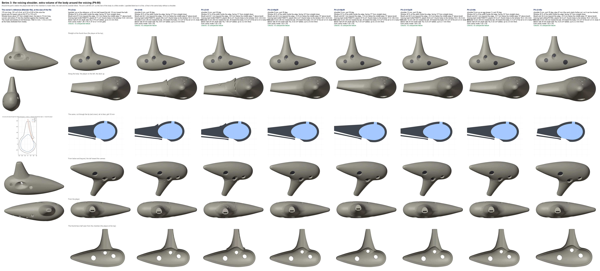

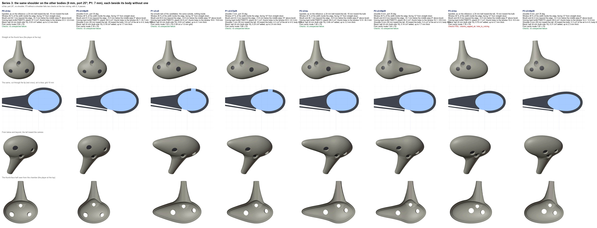

Seed P4, with the stance of `s3-r20p` and the lopsided blend of `s3-ba`:

| Trial | Shoulder | Port | Pipe | Body width at the window | Window inside the edge | Mouth end beyond the edge | Mouth end below the middle | L / R thumb hole to the window | First cavity mode ÷ F6 | Plastic |
| --- | --- | --- | --- | --- | --- | --- | --- | --- | --- | --- |
| `s3-ba` | none | 20° | 57 mm | 49.1 mm | 11.9 mm (24 %) | 47.9 mm | 2.2 mm | 13.8 / 22.6 mm | 1.36 | 67.7 cm³ |
| `s3-h6` | 6 mm | 20° | 57 | 54.5 | 16.4 mm (30 %) | 44.1 | 5.6 | 14.3 / 23.2 | 1.40 | 66.2 |
| `s3-h9` | 9 mm | 20° | 57 | 57.2 | 18.6 mm (33 %) | 42.1 | 6.9 | 14.6 / 23.5 | 1.42 | 66.5 |
| **`s3-h9p25`** | 9 mm | **25°** | 57 | 57.2 | 15.9 mm (28 %) | 44.2 | 2.8 | 16.0 / 24.9 | 1.42 | 66.4 |
| `s3-h9p30` | 9 mm | 30° | 57 | 57.2 | 13.2 mm (23 %) | 46.1 | 1.6 above | 17.6 / 26.4 | 1.42 | 67.9 |
| `s3-h12p25` | 12 mm | 25° | 57 | 59.9 | 17.9 mm (30 %) | 42.5 | 4.2 | 16.5 / 25.3 | 1.44 | 65.8 |
| `s3-h9e` | 9 mm, egg (power 1) | 25° | 57 | 57.1 | 15.0 mm (26 %) | 45.1 | 2.7 | 16.5 / 25.3 | 1.42 | 67.0 |
| **`s3-h9s`** | 9 mm | 25° | **47 mm** | 57.2 | 15.9 mm (28 %) | **34.4** | 4.5 | 16.0 / 24.9 | 1.42 | **62.3** |

The same shoulder on the other bodies, each beside its body without one (`s3-ba` / `s3-c0`: port 20°, no shoulder):

| Body | Without a shoulder: thumb holes to the window; cavity mode; result | With the shoulder (9 mm, port 25°; P1: 7 mm): thumb holes; cavity mode; result |
| --- | --- | --- |
| P0 | 23.3 / 22.4 mm; 2.09; passes | 26.7 / 25.7 mm; 2.18; passes |
| P1 | 18.6 / 19.8 mm; 1.63; passes | 7 mm: 20.5 / 22.3 mm; 1.68; passes. 9 mm: refused |
| P2 | 12.9 / 26.3 mm; 1.40; passes | 16.1 / 29.0 mm; 1.44; passes |
| P3 | 10.4 / **8.5** mm; 1.76; **fails** `hole_to_voicing` and `volume_capped_air` | 14.2 / 12.0 mm; 1.82; **passes** |
| P4 | 13.8 / 22.6 mm; 1.36; passes | 16.0 / 24.9 mm; 1.42; passes |

1. **It does what the references do.** The window sits further inside the body's outline (15.9 mm against 11.9 mm on the seed), the cut through the lip is an egg, the chamber follows the root of the neck, and the neck is shorter because it starts further out. The inside pictures show the chamber swelling toward the neck, as on the Blender reference.
2. **It helps the numbers on every body.** The first cavity mode rises by 0.04 to 0.09 (extra section at the middle of the chamber's length), and with the port at 25° both thumb holes are 2 to 4 mm further from the window. Part of that distance is the port angle and part the shoulder: at the same port (20°) the shoulder alone gives 0.8 mm.
3. **On P3 it is the difference between failing and passing.** Without it, P3 at the low voicing has its right thumb hole 8.5 mm from the window, touching the ramp of the lip. With it, P3 passes every check.
4. **Its limit on P1.** The 9 mm shoulder holds 5 cm³, so the rest of the body shrinks by 2.2 %. On the teardrop that puts the right pinky hole on the pointed tail where the wall curves too tightly: the hole's cut removes 58.7 mm³ where 54.4 ± 3.2 is expected, and the build refuses it (with or without the blend; I checked both). 5 and 7 mm pass. So the height is a value of each body, like the foot of the neck was.
5. **The shoulder wants the port a little further round: 25°, not 20°.** At 20° the crown of the shoulder rises above the flank of the neck and leaves a ragged notch where they meet (visible on `s3-h6` and `s3-h9`; the checks pass, the look does not). At 25° the join is clean, the mouth end is 2.8 mm below the middle, and the window is 28 % of the width inside the edge and faces 14° from straight down. That is the stance the owner approved at 20° without a shoulder (24 %, 15°), on a wider body. I name it because the approved number was 20.
6. **The pipe can be shorter again.** With the neck starting further out, 47 mm of pipe puts the mouth end 34.4 mm beyond the body (the Spencer: about 35 mm) and saves 4 cm³ of plastic (`s3-h9s`). The mouth end is then 4.5 mm below the middle. It is another voicing hash (`e052a79176fe`).
7. **The blend has less to do.** On `s3-h9p25` the same ball adds 0.32 cm³, against 0.79 cm³ without a shoulder. The body carries the transition, which is what the owner asked for.
8. **What it does not do yet.** The dish is still the rule's cut through a 4 mm wall; the references cut one deep dish through a thicker shell. That comes with the thick wall and short chimneys (11.8, point 1), which is not built.

### 12.3 The file for the owner's sculpt

[sculpt/OCA_sculpt_base.blend](sculpt/OCA_sculpt_base.blend), with [sculpt/Sculpt_instructions.md](sculpt/Sculpt_instructions.md). Made by [sculpt/make_sculpt_file.py](sculpt/make_sculpt_file.py); only our own geometry is in it.

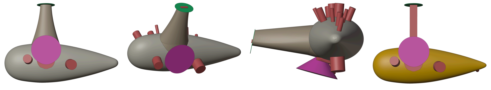

- **Two bases of the seed P4**, each in its own collection: A, the approved stance on the plain body (`s3-r20p`); B, the same with the shoulder of `s3-h9s` (hidden when the file opens).
- **In each:** the solid shell with no holes and the solid neck (to sculpt), the chamber, the surface of the least wall (1.32 mm), the keep-out over the window, a ring at the mouth end, and the cutters that are not applied (the pipe, the window with its dish, the inner pocket, the twelve holes), as separate objects.
- **A live preview** of the cut result (Boolean modifiers on a copy; hidden, because it is slow).
- **An empty that places the owner's Blender reference** at alto size on our body, lip on lip, if they append it. The reference itself is not in the file.
- **The way back is tested.** [sculpt/finish_sculpt.py](sculpt/finish_sculpt.py) finishes an instrument from whatever is left in the file and measures the sculpt against its base. Run on the untouched file, base A comes out as the body of `s3-r20p` to the last digit of its plastic volume (66.9416 cm³), and base B passes too.

What I ask the owner to sculpt, in order: the volume around the voicing; where and how the neck leaves the body; the neck itself; the surface around the window; and, as an option, a copy of the chamber showing where the air should follow.

## Reproduce

```bash
"C:\Program Files\Blender Foundation\Blender 5.1\blender.exe" -b --factory-startup --python Analizes_ocarinas/Low_voicing/low_voicing_trials.py
```

```bash
"C:\Program Files\Blender Foundation\Blender 5.1\blender.exe" -b --factory-startup --python Analizes_ocarinas/Low_voicing/shell_edit_low.py -- --port 10 --only plain sculpt
```

```bash
python Analizes_ocarinas/Low_voicing/sheet_low_voicing.py
```

```bash
python Analizes_ocarinas/Low_voicing/sheet_sections_overlay.py
```

```bash
python Analizes_ocarinas/Low_voicing/sheet_series2.py
```

```bash
python Analizes_ocarinas/Low_voicing/tip_centre.py
```

```bash
"C:\Program Files\Blender Foundation\Blender 5.1\blender.exe" -b --factory-startup --python Analizes_ocarinas/Low_voicing/stub_long_pipe.py
```

```bash
python Analizes_ocarinas/Low_voicing/sheet_stub_long_pipe.py
```

```bash
python Analizes_ocarinas/Low_voicing/table_low_voicing.py > Analizes_ocarinas/Low_voicing/tables.md
```

```bash
python Analizes_ocarinas/Low_voicing/capped_air_cap_box.py
```

One trial takes about 65 s. `--only P4` or `--only P4:lv-10f,P1:lv-0f` builds a part of the set.

Series 3 (section 10):

```bash
"C:\Program Files\Blender Foundation\Blender 5.1\blender.exe" -b --factory-startup --python Analizes_ocarinas/Low_voicing/series3_trials.py -- --group base
```

```bash
"C:\Program Files\Blender Foundation\Blender 5.1\blender.exe" -b --factory-startup --python Analizes_ocarinas/Low_voicing/series3_trials.py -- --group walls
```

```bash
python Analizes_ocarinas/Low_voicing/walls_desk_model.py
```

```bash
python Analizes_ocarinas/Low_voicing/table_series3.py > Analizes_ocarinas/Low_voicing/tables_s3.md
```

```bash
python Analizes_ocarinas/Low_voicing/sheet_series3_walls.py
```

`--only P4:s3-w50,P1` builds a part of the set. A walled body takes 70 to 130 s, the desk model about 90 s a body on its 1.0 mm grid.

Series 3, second part (section 11):

```bash
python Analizes_ocarinas/Low_voicing/ref_oot_blend/run_analysis.py
```

```bash
python Analizes_ocarinas/Low_voicing/ref_oot_blend/measure_ref.py
```

```bash
python Analizes_ocarinas/Low_voicing/ref_oot_blend/lip_scan.py
```

```bash
python Analizes_ocarinas/Low_voicing/ref_oot_blend/tune_test.py
```

```bash
python Analizes_ocarinas/Low_voicing/ref_oot_blend/any_order.py
```

```bash
"C:\Program Files\Blender Foundation\Blender 5.1\blender.exe" -b --factory-startup --python Analizes_ocarinas/Low_voicing/series3_trials.py -- --group ref
```

```bash
python Analizes_ocarinas/Low_voicing/sheet_series3.py
```

The other groups of `series3_trials.py` are `blend`, `ridge` and `cand`. The reference's model files are not in git: `ref_oot_blend/README.md` says how to put them back. A blended body takes 85 to 125 s (the fillet is made by the system Python, which needs scipy, trimesh and scikit-image).

Series 3, third part (section 12):

```bash
"C:\Program Files\Blender Foundation\Blender 5.1\blender.exe" -b --factory-startup --python Analizes_ocarinas/Low_voicing/series3_trials.py -- --group shoulder
```

```bash
"C:\Program Files\Blender Foundation\Blender 5.1\blender.exe" -b --factory-startup --python Analizes_ocarinas/Low_voicing/sculpt/make_sculpt_file.py
```

Two builds side by side are fine (each blend has its own work files). `Sculpt_instructions.md` has the command that finishes a sculpt.

## 13. The owner's draft of 2026-11-24: a slim cone neck, tilted, turned and moved against the pipe

The owner saved a draft into the sculpt file (kept as [sculpt/OCA_sculpt_owner_draft_2026-11-24.blend](sculpt/OCA_sculpt_owner_draft_2026-11-24.blend)): on base A, with our neck hidden, a cone and a flattened cylinder. The owner's words: "what i want is for the continuous shape to be kept if posible, my findig confirm this ight be better kept on tandem with the neck, however angling the neck should also be posible without tilting the internal cut to a small degree for ergonomics, also shifting slightly the postion of the neck ofset".

**What the draft measures.** The cone is straight and round: 25.4 mm across where it meets the body, 15.2 mm at a loop cut placed at our mouth-end ring (57 mm out), half angle 5.1°. Its axis is level, 7 mm below the middle of the body, while our pipe climbs about 10° toward the mouth end; so the pipe runs diagonally inside it (near the thumb side at the body, near the deck side at the mouth end). The flattened cylinder is 18.7 × 11.3 mm, around the voicing, from the cone's base to 8.5 mm past the lip; nearly all of it is inside the plain shell. As drawn, the pipe's upper corners come 0.4 mm out of the cone at the mouth end.

**How I read it** (my reading, not confirmed): the body keeps its plain continuous shape (no bulge of the chamber), and the volume around the voicing belongs to the neck, which runs into the body as one form. The neck's outside may stand at a small angle to the pipe.

**What was built** ([tandem_neck.py](tandem_neck.py), outside the add-on): the add-on's cone neck with a 25.4 mm round foot, straight sides and a 15.2 mm round mouth end; its rings are then sheared about a line 3 mm before the windway's exit. Keys: `neck_tilt_deg` (toward the thumb face), `neck_yaw_deg` (sideways), `neck_offset_mm` (sideways as a whole), `neck_tail_mm` (how far it runs past the lip). The mouth end stays in its plane, so the pipe's cutter, the window and the voicing hash (`bc6b77560773`, that of `s3-r20p`) are the same in every trial. The plastic left around the pipe is measured; under 1.2 mm the build is refused.

| Trial (P4, port 20°) | What | Mouth end's outside moves | Plastic | Result |
| --- | --- | --- | --- | --- |
| `s3-ba` | the neck before the draft: 42 mm foot, lopsided blend | – | 67.7 cm³ | passes |
| `s3-t0` | the cone along the pipe | 0 | 64.0 cm³ | passes |
| `s3-t4` | tilted 4° | 3.8 mm to the thumb face | 64.0 cm³ | passes |
| `s3-t6` | tilted 6° | 5.7 mm | 64.1 cm³ | passes |
| `s3-t10` | tilted 10° as drawn; needs a 19.2 mm mouth end | 9.5 mm | 67.5 cm³ | passes |
| `s3-t6b` / `s3-t6l` | 6° with an 8 mm ball / the lopsided blend | 5.7 mm | 64.4 / 65.6 cm³ | pass |
| `s3-t6yt` / `s3-t6yb` | 6° and turned 3° to the tail / the bulb; mouth end 20 mm across | 2.8 mm sideways | 66.0 cm³ | pass |
| `s3-t6o` | 6° and moved 2.5 mm to the tail; mouth end 19 mm across | 2.5 mm sideways | 65.6 cm³ | passes |
| `s3-t6h` | 6°, running 8.5 mm past the lip (the flat tube) | 5.7 mm | 64.1 cm³ | passes; no visible change, the tube is inside the shell |
| `s3-t6s` | 6° with a 5 mm shoulder of the chamber, port 25° | 5.7 mm | 63.5 cm³ | passes; cavity mode 1.40 against 1.36 |

`s3-t6` on the other bodies: P0, P1 and P2 pass. P3 fails `hole_to_voicing` and `volume_capped_air`, exactly as it does with the old neck at port 20° (`s3-ba`): that is the port angle on P3, not the neck.

**What limits the angle.** The pipe is straight, so an angled outside means an uneven wall. With the draft's 15.2 mm mouth end and a 57 mm pipe the tilt can be 6° (1.25 mm left at the pipe's deck-side corners; 7° leaves 0.74 mm and is refused). Each further degree needs about 1 mm more at the mouth end: 10° needs 19.2 mm. Sideways is the same sum: 3° needs a mouth end 20 mm across. A shorter pipe allows more angle for the same mouth end. A tilt hinged on the exit plane itself left six surface points inside the 45° flare at the window's back edge (the first build of `s3-t6` failed `voicing_keepouts`); with the hinge 3 mm back it passes.

**What it does not change.** The cavity mode (1.36), the thumb-hole distances (13.8 / 22.6 mm) and the window are those of `s3-r20p`: the cone is outside only. The slim foot saves 3 to 4 cm³ of plastic against the 42 mm foot. The chamber shoulder of section 12 still raises the cavity mode and the thumb-hole distances, and it can be combined (`s3-t6s`), but it is the one thing here that breaks the continuous body.

Sheets: [sheet_s3_tandem_P4.png](sheet_s3_tandem_P4.png), [sheet_s3_tandem_turn_P4.png](sheet_s3_tandem_turn_P4.png), [sheet_s3_tandem_presets.png](sheet_s3_tandem_presets.png).

Not done: nothing printed; the sculpt file was not regenerated with the cone neck; the thick wall with short chimneys is still not built; which way "angling for ergonomics" should go (down, sideways, how much) is the owner's to say.

    blender -b --factory-startup --python Analizes_ocarinas/Low_voicing/series3_trials.py -- --group tandem
    python Analizes_ocarinas/Low_voicing/sheet_series3.py

## 14. Which approach works best at this voicing height, and the uneven wall (2026-11-24/25, seed P4 only)

The owner chose the cone tilted 6° with the slim tip ("tilt 6 slimp tip looks best"), and asked: "explore in this iterations wich of the aproachs works bst for this voicing height not limited to the one i provided you last, for optimization sake limit yourself to the seed volume, and consider having uneven thickness in a test with the volume shifted to the front so the face holes are less thick and there is more play on the back". Two pictures came with it: a game render and a blue ceramic Ocarina of Time, whose window sits in a deep hollow of a thick thumb-face wall.

**The uneven wall** ([uneven_wall.py](uneven_wall.py), outside the add-on). The chamber is not touched. The outside is drawn nearer to it on the deck and further from it on the thumb face, smoothly, with the rule's 4 mm at the sides. The body is finished by the add-on's shell-edit build, which measures the wall at every hole and sizes each hole again for it. Around the window the extra thickness falls away as a smooth dish (9 mm of land, steepest slope about 31°); without it the thick wall stands inside the 45° flare (`s3-u2n` fails `voicing_keepouts`). The control `s3-u0` (even wall, built this way) is the same body as `s3-t6`: 64.1 cm³ of plastic.

All rows: P4-80, port 20°, cone neck tilted 6°, voicing hash `bc6b77560773`.

| Trial | Wall deck / thumb face | Deck holes | Thumb holes L / R | Thumb hole edge to window L / R | Inward tubes | Cavity mode ÷ F6 | Plastic | Result |
| --- | --- | --- | --- | --- | --- | --- | --- | --- |
| `s3-u0` | 4 / 4 mm | 3.1 to 8.6 mm | 10.8 / 12.7 mm | 13.8 / 22.6 mm | sub2 3 mm | 1.36 | 64.1 cm³ | passes |
| `s3-u1` | 3 / 5 | 3.0 to 8.0 | 11.3 / 13.3 | 13.5 / 22.3 | sub2 4 mm | 1.36 | 63.9 | passes |
| `s3-u6` | 3 / 6 | 3.0 to 8.0 | 11.8 / 13.8 | 13.3 / 22.1 | sub2 4 mm | 1.36 | 69.0 | passes |
| `s3-u7` | 3 / 7 | 3.1 to 8.0 | 12.3 / 14.2 | 13.1 / 21.9 | sub2 4 mm | 1.36 | 74.1 | fails `volume_capped_air` (−0.57 %, limit 0.5 %) |
| `s3-u2` | 2.5 / 6 | 3.0 to 7.7 | 11.8 / 13.8 | 13.3 / 22.1 | sub1 0.5, sub2 4.5, R_middle 0.5 mm | 1.36 | 66.5 | fails `inward_tubes` (two tubes 1.7 mm apart) |
| `s3-u3` | 2 / 7 | 3.0 to 7.4 | 12.3 / 14.2 | 13.1 / 21.9 | sub1 1, sub2 5, R_middle 1 mm | 1.36 | 69.2 | fails both |
| `s3-u4` | 4 / 6 (thick back only) | 3.1 to 8.6 | 11.8 / 13.7 | 13.3 / 22.1 | sub2 3 mm | 1.36 | 74.1 | passes |
| `s3-u5` | 2.5 / 4 (thin deck only) | 3.0 to 7.7 | 10.8 / 12.8 | 13.8 / 22.6 | as `s3-u2` | 1.36 | 56.5 | fails `inward_tubes` |
| `s3-u6s` | 3 / 6, chamber shoulder 5 mm, port 25° | 3.0 to 8.0 | 11.8 / 13.8 | 14.9 / 23.7 | sub2 4 mm | 1.40 | 68.4 | passes |
| `s3-u6w` | 3 / 6, two low inner walls | 3.0 to 8.0 | 11.8 / 13.8 | 13.3 / 22.1 | sub2 4 mm | 1.31 | 70.2 | passes |
| `s3-t6w` | 4 / 4, two low inner walls | 3.1 to 8.6 | 10.8 / 12.7 | 13.8 / 22.6 | sub2 3 mm | 1.31 | 65.3 | passes |

**What the tests say.**

- *Thin deck.* Each hole on the deck gets smaller with a shorter chimney: the largest goes from 8.6 mm to 8.0 mm at 3 mm of wall. The smallest holes cannot shrink below 3 mm, so they get an inward tube instead; at 2.5 mm of deck wall three holes need one and two of the tubes crowd each other. **3 mm is the least deck wall that passes on the seed.**
- *Thick back.* Each millimetre added on the thumb face makes the thumb holes about 0.5 mm larger, brings their edges 0.25 mm nearer the window and adds about 5 cm³ of plastic. At 7 mm the air-volume check fails: the long chimneys of the thumb holes take the capped air 0.57 % under 80 cm³. **6 mm is the most that passes.**
- *The cavity mode does not move* with the wall (1.36): the chamber is the same. Only the chamber shoulder raises it (1.40), and the inner walls lower it (1.31).
- *What the thick back buys* is not in the numbers: the window sits in a hollow of the wall as on the ceramic, and the foot of the neck is buried 2 mm deeper in the body, so the neck reads more as growing out of the shell. On the numbers alone it is a cost.

**Ranking for this voicing height, by the tests** (my judgement):

1. `s3-u6s` (3 / 6 mm wall, 5 mm shoulder, port 25°): the only one that improves the cavity mode and the thumb-hole distances while passing everything. It breaks the continuous body, which the owner wants kept.
2. `s3-u1` (3 / 5 mm): passes, the deck holes are smaller, the window is in a shallow hollow, and it costs no plastic. The mildest uneven wall.
3. `s3-u6` (3 / 6 mm): the same with a deeper hollow, for 5 cm³ of plastic and thumb holes 1 mm larger.
4. `s3-u0` / `s3-t6` (even wall): the control. Nothing wrong with it; no hollow around the window.
5. The inner walls (`s3-t6w`, `s3-u6w`): pass, but cost cavity mode and thumb-hole strength (section 10) and gain nothing here.

Not done: only the seed; the hole sizes for walls other than 4 mm are from the kernel and "no test print has measured" them (the add-on's own warning); the thick wall hollowed from inside at each hole (short chimneys, as on the owner's Blender reference) is still not built, and it is the one way to have a thick back without larger thumb holes; nothing printed.

Sheets: [sheet_s3_uneven_P4.png](sheet_s3_uneven_P4.png), [sheet_s3_approaches_P4.png](sheet_s3_approaches_P4.png).

    blender -b --factory-startup --python Analizes_ocarinas/Low_voicing/series3_trials.py -- --group uneven

### 14.1 The dish reshaped after the owner's look (2026-11-25)

The owner chose the 3 / 5 mm wall ("carry forward 3/5 mm wall") and marked a fault on a picture: on `s3-u1`, `s3-u6` and `s3-u7` "the round cut goes above the voicing height and leaves an uneven finish", "the cut gies above and around the neck and shoulder". The round dish reached the body above the voicing and ringed the foot of the neck.

Changed in [uneven_wall.py](uneven_wall.py): the dish is round only on the labium's side of the window. Toward the player it runs on as a channel whose floor is 7.5 mm half wide, narrower than the neck's foot (12.7 mm half wide), so the neck covers it and the body above the voicing keeps its full wall. The shell's mesh is split once (every triangle in four), because on the chamber's own grid the dish walls came out in steps. `s3-u1` and `s3-u6` were built again and pass every check, with the same hole sizes and plastic as before. The other rows of the table above (`s3-u7`, `s3-u2`, `s3-u3`, `s3-u4`, `s3-u6s`, `s3-u6w`) still show the round dish; their numbers do not depend on it.

**Carried forward on the seed:** port 20°, pipe +4° and 57 mm, cone neck 25.4 → 15.2 mm tilted 6°, wall 3 mm on the deck and 5 mm on the thumb face, the reshaped dish (`s3-u1`). Not a rule.

### 14.2 The dish ends at the window's upper edge (2026-11-25)

The channel under the neck of 14.1 was still wrong. The owner: "the dish should not cut above the upper of the voicing window, that is what is causing the bad finish". Changed in [uneven_wall.py](uneven_wall.py): there is no hollow at all above the line of the window's upper edge (the edge on the player's side). The hollow begins on that line and is whole 2 mm per mm of extra wall further toward the labium; toward the labium and the sides it keeps the round shape of before. The body above the voicing and around the foot of the neck keeps its full wall.

`s3-u1` (3 / 5 mm) and `s3-u6` (3 / 6 mm) were built again and pass every check, the 45° keep-out of the window included. Numbers as before: `s3-u1` thumb holes 11.3 / 13.3 mm, their edges 13.5 / 22.3 mm from the window, cavity mode 1.36, plastic 63.9 cm³. The faces still seen above the window in the pictures are the neck's own flat and the window cutter's flare, as on the even wall (`s3-u0`); they are not the dish.

One build of each failed `cavity_mode_computed` in between ("no Python with numpy and scipy was found"): the run had been interrupted. The same build run again passes.


### 14.3 The dish dropped; the window's ramp as an oval scoop (2026-11-25)

The owner, with a game render and the blue ceramic again: "drop the dish just work on the window ramp shape to mirror this or the spencer". On both pictures the window stands at the neck's end of one long oval scoop that runs away from the neck; there is no ring around the window.

- **No hollow at all (`s3-v0`).** With 1 mm of extra wall the add-on's own window cut reaches through it (its cutters go 1 mm above the outer face), and every check passes: nothing stands inside the 45° flare. The window then sits in the round cone of the add-on's cut. So the dish was never needed at 3 / 5 mm; it was needed from 6 mm on.
- **The oval ramp scoop (`s3-v1`, `s3-v3`, `s3-v2`).** Key `wall_ramp_oval_mm = [length, width]` in [uneven_wall.py](uneven_wall.py). The oval begins on the line of the window's upper edge and runs toward the labium. Inside it the extra wall rises smoothly from nothing on its middle to all of it at its rim; nothing is taken above the window's upper edge, and the wall is never thinner than the rule's 4 mm. The window, the labium and the add-on's ramp are not touched: the voicing hash is `bc6b77560773` and the window area 62.8 mm² in every row.

| Trial (P4, port 20°, cone neck tilted 6°) | Wall deck / thumb face | Around the window | Thumb holes | Plastic | Result |
| --- | --- | --- | --- | --- | --- |
| `s3-v0` | 3 / 5 mm | nothing: the add-on's cut only | 11.3 / 13.3 mm | 64.0 cm³ | passes |
| `s3-v1` | 3 / 5 | oval scoop 22 × 17 mm, 1 mm deep | 11.3 / 13.3 | 64.0 | passes |
| `s3-v3` | 3 / 5 | oval scoop 28 × 18 mm, 1 mm deep | 11.3 / 13.3 | 63.9 | passes |
| `s3-v2` | 3 / 6 | oval scoop 22 × 17 mm, 2 mm deep | 11.8 / 13.8 | 69.2 | passes |

At 3 / 5 mm the scoop is only 1 mm deep, so it reads as a soft oval; the references' scoop is deeper because their wall is thicker there (the Blender reference: 5.3 mm at file size against 1.3 to 2.3 mm at the holes). A deeper scoop needs the 6 mm back (`s3-v2`), which costs 5 cm³ of plastic and thumb holes 0.5 mm larger, or the short chimneys at the thumb holes, which are not built.

Sheet: [sheet_s3_ramp_P4.png](sheet_s3_ramp_P4.png). **Carried forward: `s3-v1`** (3 / 5 mm wall, oval ramp scoop), with `s3-v0` as the plain fallback; the owner has not yet seen either.
