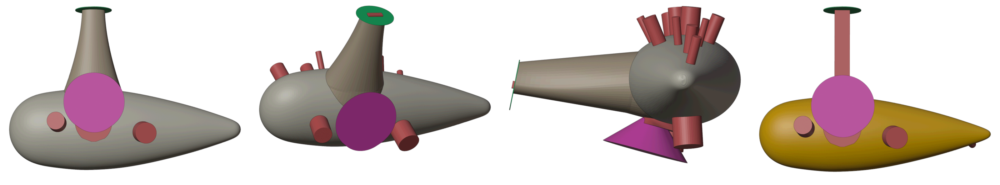

# Sculpt instructions: the outside of the low-voicing body

For the owner, 2026-11-20. File: [OCA_sculpt_base.blend](OCA_sculpt_base.blend) (Blender 5.1, millimetres). Made by [make_sculpt_file.py](make_sculpt_file.py); a text block called `README` inside the file repeats the short version of this page.

## 1. What I need from the sculpt, and why

The add-on can build the stance (window on the thumb face, mouthpiece at the middle of the body) and it can round the join between the neck and the body. What it cannot do yet is what you named: **a body that holds the voicing inside its own shell, with the pipe and the neck growing out from there**. I have one formula for that (the "voicing shoulder", base B in the file), but it is my reading of two references, not your eye. A sculpt of yours is a shape I can measure and turn into settings.

In order of use to me:

1. **The volume around the voicing.** How far the body should reach toward the player at the window, how long that swelling is along the body, and whether it leans toward the tail or the bulb. This is the thing I most need.
2. **Where the neck leaves the body, and how.** The sweep toward the tail, the curve toward the bulb, and where on the body's thickness the root sits.
3. **The neck itself:** its thickness along its length and at the mouth end.
4. **The surface around the window** on the thumb face, outside the pink keep-out: how the body falls toward the dish.
5. *Optional:* **the inside.** If the air should follow the outside somewhere (under the mouthpiece, as on your Blender reference), duplicate the blue chamber object, name the copy `chamber_wish` and sculpt that. I will measure it; it is not cut as it is.

## 2. What is in the file



Two bases of the seed P4 at 80 cm³, each in its own collection. Sculpt **one** of them.

| Collection | What it is |
| --- | --- |
| **A – approved stance, plain body** (visible) | Port 20°, pipe +4° into the chamber and 57 mm long, the plain body with a cone neck stuck onto it. This is the body of trial `s3-r20p`. Start here if you want to add the volume yourself |
| **B – the same with my voicing shoulder** (hidden; switch it on in the outliner) | The body already swells 9 mm toward the player around the voicing (chamber and wall together), port 25°, pipe 47 mm. Start here if my shoulder is close and you would rather correct it than build it |

In each collection:

| Object | Colour | What to do with it |
| --- | --- | --- |
| `OCA_P4-80-sculptA_shell` | clay | **Sculpt.** The solid outside of the body: no holes, not hollow |
| `OCA_P4-80-sculptA_neck` | brown | **Sculpt.** The solid neck. You may join it into the shell (select the neck, then the shell, Ctrl+J) and sculpt the join as one surface |
| `…_chamber` | blue wire | The air. Leave it; it is solved again for 80 cm³ when the body is finished |
| `A_limit_least_wall_1.32mm` | orange wire | The chamber plus the least wall. **Stay outside it everywhere** |
| `A_keepout_window_flare` | pink wire | The 45° flare over the window. **No plastic inside it** |
| `A_mouth_end_ring` | green | Where the pipe ends. **The neck must still end at this ring**, with the pipe's opening in its end face |
| `A_cut_pipe`, `A_cut_window_and_dish`, `A_cut_hole_…` | red wire | What will be cut: the pipe, the window with its dish and the twelve holes. Not applied, and not for you to apply |
| `A_inner_pocket_of_the_voicing` | blue wire | The small pocket inside, under the window. For reference |
| `A_PREVIEW_cut_result (slow)` | grey, hidden | The shell and the neck with everything cut out, live. Switch it on in the outliner (the screen icon) to look, and off again before you sculpt. It takes a few seconds to update. If you joined the neck into the shell, switch off its `+ neck` modifier |
| `REFERENCE_goes_here` | an empty at the scene's top level | To see your Blender reference in place at alto size (0.75 of its file): File › Append its `Ocarina Body`, select it, shift-select this empty, Ctrl+P › Object (Without Inverse) |

The window is 9.65 × 8.8 mm, on the thumb face, at the origin of the scene. The thumb face is down (−Z), the player is at −Y, the tail at +X.

## 3. How to work

1. Open the file and **save it under a new name at once** in the same folder: `OCA_sculpt_v1.blend`.
2. Pick base A or B. Hide the other collection.
3. The shell is a plain grid of 16 000 points, coarse near the two ends. Before sculpting, give it even faces: Sculpt Mode › Remesh with a voxel size of about **0.6 mm**, or use Dyntopo. The neck the same. Any mesh is fine as long as it stays one closed solid.
4. Sculpt. Grab, Inflate, Clay Strips and Smooth are enough. Turn on X-ray or wireframe now and then to see the orange limit and the pink keep-out.
5. Look at the preview when you want to see the instrument.
6. Save. For a second idea, save again as `v2`. Two or three rough variants help me more than one finished one.

## 4. The few rules

| Rule | Why |
| --- | --- |
| Do not move, rotate or scale the objects; sculpt them where they are | The chamber, the window and the holes are placed in the scene's coordinates |
| Keep the mouth end at the green ring | The pipe keeps its length. A longer or shorter neck would close the pipe or leave it open on the side |
| Nothing inside the pink flare, and leave the flat face around the window alone for about 3 mm | The window, the lip and the dish are cut by the add-on and checked. This is the voicing that the stub prints test |
| Stay outside the orange surface | Less than 1.32 mm of plastic over the air does not print as a wall |
| Do not apply the red cutters, and do not hollow the shell | The add-on cuts them, and it must measure the wall you left at each hole first |
| Plastic over a hole is allowed | The add-on measures the wall you left there and makes that hole larger to keep its note. A thick boss right at a rim is reported, not refused |
| One closed solid per object, no loose pieces, no holes in the mesh | It is refused otherwise, with the reason |

Everything else is yours: the outline, the thickness, relief, the tail, the body's section.

## 5. What happens with your file

Tell me the file's name. I run [finish_sculpt.py](finish_sculpt.py) on it:

```bash
"C:\Program Files\Blender Foundation\Blender 5.1\blender.exe" -b --factory-startup --disable-autoexec Analizes_ocarinas/Low_voicing/sculpt/OCA_sculpt_v1.blend --python Analizes_ocarinas/Low_voicing/sculpt/finish_sculpt.py -- --base A --tag v1
```

It finishes a real instrument from your outside (the chamber solved for 80 cm³, the holes sized for the walls you left, the window and the pipe cut), runs every check on the STL, and measures your sculpt against its base: where plastic was added and how much. From that I fit the shoulder and the blend so the add-on can make your shape on any of the bodies, and I show you the fitted body beside your sculpt.

I ran this on the untouched file: base A finishes as the same body as trial `s3-r20p`, to the last digit of its plastic volume, with no unexpected failure. So whatever differs afterwards is your sculpt.

## 6. What the file does not let you change

- **The window, the lip, the dish and the pipe.** They are the voicing. If you want another dish, sculpt the surface around it and tell me; the dish itself is a setting.
- **Where the holes are.** The red cylinders show them. If a hole is in the way of the shape you want, leave the shape and say so; moving a hole is a change of the hand layout.
- **The air.** Sculpt `chamber_wish` (section 1, point 5) to show me where it should go.
