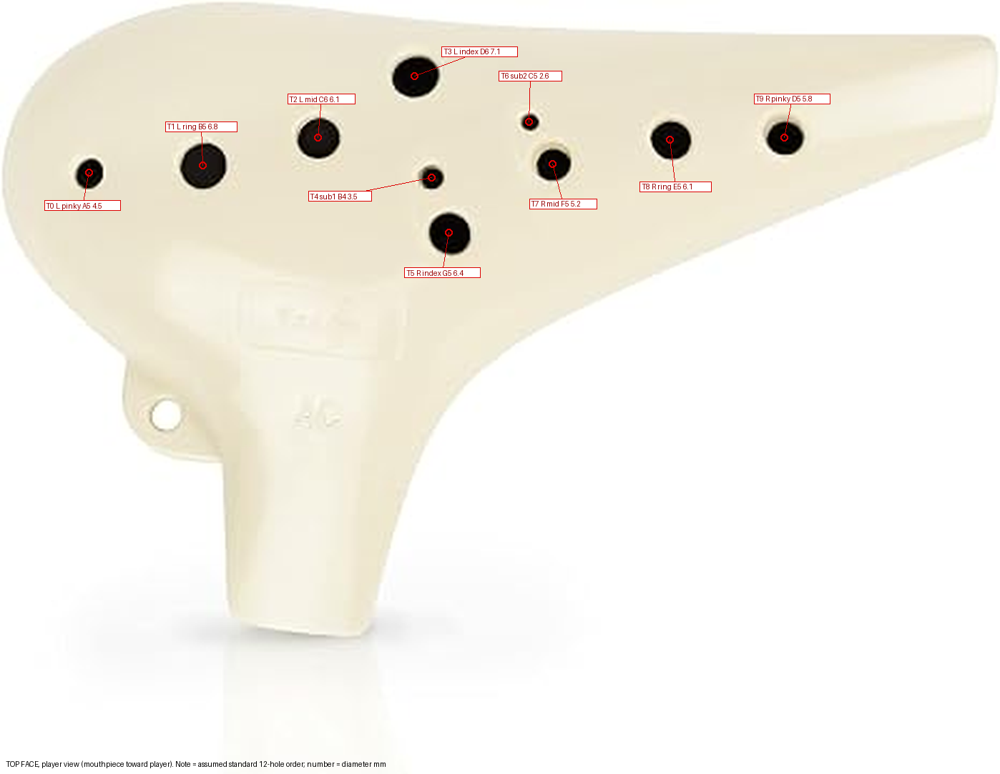
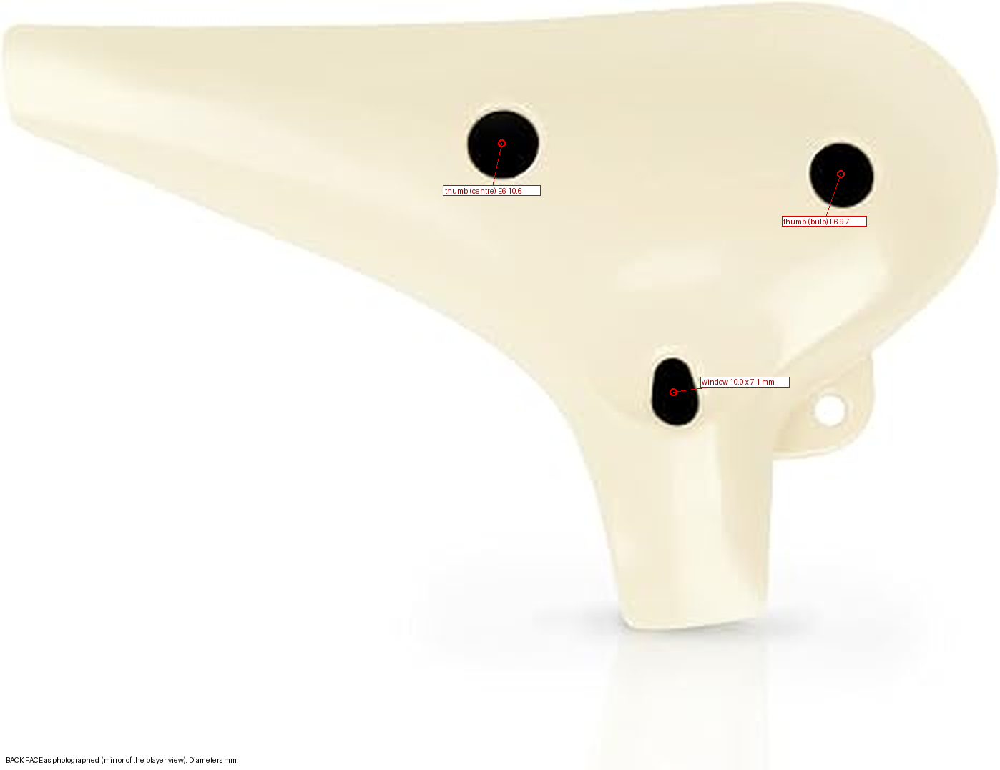

# Miracle AO10-AC: 12-hole alto C (plastic), photo analysis

This is a reference instrument: a well-rated, maker-tuned injection-moulded plastic 12-hole alto C with the drop-down mouthpiece, catalogue code **AO10-AC**. It was analysed from product and video photos only (no calipers, no recorded scale), to pull out hole sizes, hole positions, voicing geometry and the tuning those imply, and to compare them with this repo's kernel and baseline ([`params/alto_c_12hole.toml`](../../params/alto_c_12hole.toml), [doc 03](../../docs/03-parametric-findings.md)).

Reproduce every number with:

```bash
python Analizes_ocarinas/Miracle_M/measure_miracle_m.py
```

The raw output is in [`measure_output.txt`](measure_output.txt).

**Confidence key:** **M** = measured from pixels (±0.3 mm on diameters, ±2 % on scale). **D** = derived through the kernel (inherits the kernel assumptions: k = 0.80, 27 °C, uniform 3 mm walls). **A** = assumption (orientation, finger assignment).

---

## 1. Source images

| File | What it shows | Used for |
| --- | --- | --- |
| [01_catalog_dimensions_AO10-AC.png](images/01_catalog_dimensions_AO10-AC.png) | Catalogue sketch: W ≈ 150 mm, D ≈ 95 mm | Scale |
| [02_video_held_top_face.png](images/02_video_held_top_face.png) | Maker holding it, top face toward the camera | Orientation check |
| [03_product_labeled_overview.jpg](images/03_product_labeled_overview.jpg) | Labelled overview: finger holes, tail, ring, mouthpiece | Windway entrance, tail shape |
| [04_top_face_front_view.jpg](images/04_top_face_front_view.jpg) | Top face, near-orthographic | **10 top holes, outline** |
| [05_back_face_window_closeup.jpg](images/05_back_face_window_closeup.jpg) | Window seen at a grazing angle | Window orientation (windway exit vs labium) |
| [06_back_face_front_view.jpg](images/06_back_face_front_view.jpg) | Back face, near-orthographic | **Thumb holes and window** |
| [07_video_playing_grip.png](images/07_video_playing_grip.png) | Playing grip | Which hand sits on which end |
| [08_annotated_top_face.png](images/08_annotated_top_face.png) | Generated: hole IDs, assumed fingers and notes, diameters | — |
| [09_annotated_back_face.png](images/09_annotated_back_face.png) | Generated: thumbs and window | — |




## 2. Method and scale

- Images 04 and 06 are near-orthographic product shots at the same scale. Their silhouette boxes are 462 × 300 px and 461 × 297 px.
- The catalogue's 150 mm length gives 0.3250 mm/px. The catalogue's 95 mm height gives 0.3183 mm/px. They differ by 2.1 % (both are marked "approx."), so the mean, **0.3216 mm/px**, is used. Every size below carries about ±2 % from this.
- Holes are dark connected regions. The diameter is read at the half-intensity edge (grey 125), using the **major axis**: a circle seen at a tilt, or sitting on a curved surface, images as an ellipse whose long axis is the true diameter. The area-equivalent diameter, 0.1–0.5 mm smaller, is in the output file as a lower bound.
- Pixel quantisation plus JPEG blur is about ±1 px, or **±0.3 mm** on every diameter. That is ±5 % on a 6 mm hole and ±12 % on the 2.6 mm subhole.

**Coordinate frame** (used throughout): the player's view of the top face, mouthpiece pointing at the player. x runs from the **bulb end** (player's left) toward the tail tip (player's right). y runs down from the topmost edge of the outline (the side away from the player). Back-face features are mirrored into this frame.

## 3. Overall geometry

| Item | Value | Conf. |
| --- | --- | --- |
| Overall length (bulb end to tail tip) | 150 mm (catalogue) | catalogue |
| Overall height (top edge to mouthpiece lip) | 95 mm (catalogue); 95.5 mm measured | catalogue / M |
| Top-view silhouette area, including mouthpiece and ring | 57.2 cm² | M |
| Mouthpiece stub | about 24 mm wide at the lip, about 28 mm at the root; axis at x ≈ 46 mm; drops about 35 mm below the body | M (±1.5 mm, highlights) |
| Hanging ring | beside the stub on the bulb side, x ≈ 24 mm | M |
| Body thickness | **not visible in any photo**. Volume and outline suggest about 27–33 mm outside at the bulb. | D (weak) |

Planform (top face; from image 04). Between x 30 and 50 mm the bottom edge is the mouthpiece.

| x mm | 10 | 20 | 30–50 | 60 | 70 | 80 | 90 | 100 | 110 | 120 | 130 | 140 |
| --- | --- | --- | --- | --- | --- | --- | --- | --- | --- | --- | --- | --- |
| top edge y | 7.1 | 2.3 | 0.3–1.3 | 2.6 | 3.2 | 3.9 | 4.2 | 4.5 | 4.8 | 4.8 | 4.8 | 4.8 |
| bottom edge y | 45.7 | 64.3 | stub | 74.0 | 56.0 | 48.6 | 43.7 | 39.6 | 35.4 | 31.2 | 26.7 | 22.8 |
| body width | 38.6 | 62.1 | — | 71.4 | 52.7 | 44.7 | 39.6 | 35.1 | 30.6 | 26.4 | 21.9 | 18.0 |

The top edge is almost straight. The bulb is about 60–70 mm wide. The tail tapers almost linearly from 45 mm wide at x = 80 to 18 mm at x = 140, and ends in a closed, blunt cone (image 03, "Tail").

## 4. Holes

### 4.1 Hand assignment (A)

- Image 07 shows the tail to the player's right and the hands on the bulb side to the player's left. Image 02 is consistent with this (top face held up, tail at the camera's left). So **left hand = bulb, right hand = tail**.
- In each hand the fingers run pinky → index toward the centre, the usual cradle grip.
- Opening order is the standard Asian 12-hole linear fingering, the same one the repo uses: A4 all closed → sub1 → sub2 → R pinky → R ring → R middle → R index → L pinky → L ring → L middle → L index → thumb → thumb (F6).
- Which thumb opens first is not visible. The larger thumb (centre, 10.6 mm) is taken to open E6, the whole step. The other order fits about 2 cents worse, so the data cannot separate the two.
- A brute-force search over all 8! orders of the main holes (scratch check, not in the script) also cannot pick a clearly better order. The best order fits 71 c rms against about 100 c for this one, and it mixes the hands in a way no fingering chart uses. The standard assignment is therefore kept.

### 4.2 Measured holes (M) with assigned notes (A)

The "cents per +0.1 mm" column is the kernel sensitivity at the note where the hole opens. It shows how much a 0.1 mm photo error matters for that note.

| # | Opens | Finger | ID | x mm | y mm | **d mm** | d area-eq. | ¢ per +0.1 mm |
| --- | --- | --- | --- | --- | --- | --- | --- | --- |
| 1 | B4 | subhole 1 | T4 | 64.4 | 26.3 | **3.5** | 3.4 | +9.1 |
| 2 | C5 | subhole 2 | T6 | 79.0 | 17.9 | **2.6** | 2.5 | +7.0 |
| 3 | D5 | R pinky | T9 | 117.2 | 20.3 | **5.8** | 5.3 | +6.3 |
| 4 | E5 | R ring | T8 | 100.1 | 20.6 | **6.1** | 5.8 | +4.8 |
| 5 | F5 | R middle | T7 | 82.5 | 24.3 | **5.2** | 4.9 | +3.9 |
| 6 | G5 | R index | T5 | 67.0 | 34.6 | **6.4** | 6.2 | +3.4 |
| 7 | A5 | L pinky | T0 | 13.0 | 25.6 | **4.5** | 4.3 | +2.8 |
| 8 | B5 | L ring | T1 | 30.1 | 24.4 | **6.8** | 6.8 | +2.6 |
| 9 | C6 | L middle | T2 | 47.3 | 20.3 | **6.1** | 6.1 | +2.3 |
| 10 | D6 | L index | T3 | 61.8 | 11.1 | **7.1** | 6.5 | +2.1 |
| 11 | E6 | thumb (centre, back) | Bc | 74.0 | 21.2 | **10.6** | 10.5 | +1.8 |
| 12 | F6 | thumb (bulb, back) | Bb | 23.2 | 25.8 | **9.7** | 9.7 | +1.6 |

Layout notes:

- **Finger pitch** (centre to centre along x): left hand 17.1 / 17.2 / 14.5 mm, right hand 15.5 / 17.6 / 17.1 mm. The two indexes sit almost on one vertical line (x 62 and 67) but 23.5 mm apart in y: L index up toward the far edge, R index down toward the player.
- **Subhole 1** sits between the two index holes (x 64, y 26). **Subhole 2** sits just above and toward the bulb from R middle (x 79, y 18), 7 mm centre to centre from it.
- The **thumbs** lie under the left pinky/ring region (x 23) and under the right index / R middle region (x 74).
- **Smallest edge-to-edge gaps:** T4–T5 about 3.7 mm, T6–T7 about 3.4 mm. Both are below the repo's 1-diameter rule (`hole_edge_spacing_d = 1.0` in the params file), so the maker clearly allows tighter spacing next to subholes.
- All top holes measure within 2.6–7.1 mm. The spread is **much narrower** than the lumped model asks for (§6.3).

## 5. Voicing

| Item | Value | Conf. |
| --- | --- | --- |
| Window location | **back (thumb) face**, right at the root of the mouthpiece stub | M |
| Window shape | **teardrop / egg**: narrow end away from the mouthpiece, broad end toward it | M |
| Window length (along the jet) | **10.0 mm** (dark opening) | M ±0.3 |
| Window max width | **7.1 mm**, at 61 % of the length from the narrow end | M ±0.3 |
| Width at 15 % / 85 % of the length (from the narrow end) | 4.8 / 5.8 mm | M |
| Window area | **56.3 mm²** (d_eq 8.47 mm) | M ±6 % |
| Jet direction | from the broad end (mouthpiece side) toward the narrow end. In image 05 the windway exit slit is visible on the stub side of the opening, so the **labium is at the narrow end**. | M / A |
| Window centre | x = 48.3 mm (2 mm toward the tail from the stub axis, i.e. on the axis within error); 58.5 mm below the top edge | M |
| Labium end / windway end of window | 53.4 / 63.0 mm below the top edge | M |
| Windway length (mouthpiece lip to window) | **≈ 30–32 mm** (32.5 mm to the broad end of the dark opening is an upper bound) | M |
| Windway entrance | rectangular slot ≈ 9 mm wide × 2.5–3 mm high (image 03 inset, perspective) | rough |
| Windway exit height | **not measurable** from photos | — |

Readings against the repo's references:

- **Heuer alto band** (fired, mm): 8.13 X · 8.89 soft · 9.65 medium · 10.41 loud · 11.18 X. At 10.0 mm this window sits **between medium and loud** (W/W_soft = 1.12; p/p_medium ≈ 1.07 at fixed Strouhal).
- **Strouhal at A4**, using the repo's assumed p(A4) = 150 Pa: U = 16.0 m/s, so St = f·W/U = **0.27**, inside the 0.2–0.3 low-note band.
- **Window area / V0^(2/3)** = 56.3 / 81 800^(2/3) = **0.030**, against the repo baseline's 0.0236. The maker's voicing is about 27 % larger relative to its chamber.
- If the exit height is Heuer's 1.14 mm or the repo's 1.20 mm, W/h = 8.3–8.8, inside the plan's 7–10 band.

## 6. Acoustic back-analysis (D)

### 6.1 Window efficiency from the range identity

Doc 03, Identity 1: Σ G_i / (η_w G_w) is fixed by the scale. With chimney volume it is 8.91 for A4..F6. All twelve measured holes are known, so η_w follows directly, without knowing the chamber volume:

| Walls (holes and window) | Σ G_meas | G_w | **Implied η_w** |
| --- | --- | --- | --- |
| 2.5 mm | 49.2 mm | 6.07 mm | 0.91 |
| 3.0 mm | 46.3 mm | 5.76 mm | **0.90** |
| 3.5 mm | 43.7 mm | 5.48 mm | 0.89 |

The result hardly depends on the wall thickness. **η_w ≈ 0.90 independently confirms the repo's prior** (`eta_w = 0.90`). The ±0.3 mm diameter uncertainty moves it by about ±0.08.

### 6.2 Chamber volume

With η_w = 0.90 and G_w = 5.76 mm, A4 needs **V0 ≈ 82 cm³** of capped air. A free least-squares fit of V0 and η_wG_w to the whole scale gives 87–93 cm³. That fit is pulled around by the per-hole mismatch in §6.3, so the 82 cm³ value is preferred. It matches the maker report the repo already cites (70–80 cm³ with a 35–40 mm² teardrop, scaled up to this 56 mm² window). This 82 cm³ is about 32 % more air than the repo baseline's 61.9 cm³, which follows from the bigger window.

### 6.3 Ideal kernel holes against the maker's holes (η_w = 0.90, V0 = 81.8 cm³, 3 mm walls)

| # | Opens | Finger | x mm | Measured d | Kernel-ideal d | G_meas / G_ideal |
| --- | --- | --- | --- | --- | --- | --- |
| 1 | B4 | sub 1 | 64 | 3.54 | 3.05 | 1.25 |
| 2 | C5 | sub 2 | 79 | 2.57 | 2.20 | 1.29 |
| 3 | D5 | R pinky | 117 | 5.79 | 3.83 | **1.81** |
| 4 | E5 | R ring | 100 | 6.11 | 4.48 | **1.55** |
| 5 | F5 | R middle | 82 | 5.15 | 3.16 | **2.06** |
| 6 | G5 | R index | 67 | 6.43 | 5.70 | 1.18 |
| 7 | A5 | L pinky | 13 | 4.50 | 6.73 | **0.57** |
| 8 | B5 | L ring | 30 | 6.75 | 7.97 | 0.80 |
| 9 | C6 | L middle | 47 | 6.11 | 5.43 | 1.18 |
| 10 | D6 | L index | 62 | 7.08 | 10.35 | **0.61** |
| 11 | E6 | thumb (centre) | 74 | 10.61 | 12.35 | 0.83 |
| 12 | F6 | thumb (bulb) | 23 | 9.65 | 8.19 | 1.24 |

Plugging the measured holes straight into the lumped model gives a scale with **about 100 c rms error**. For this mapping the misfit runs from +170 c (F5) to −137 c (E6), and the brute-force best order still leaves 71 c rms. Photo error (±0.3 mm, about 2–9 c per 0.1 mm) cannot explain errors this large. The maker's instrument is in tune, so the **lumped single-chamber model is missing something real** on this body. The pattern:

1. **Subholes: close to the model.** Both are about 1.25–1.3× the ideal conductance (about +0.4 mm in diameter). Their size ratio, 2.57/3.54 = 0.73, equals the kernel's 0.72 exactly. The semitone/whole-step rule (Identity 3) holds.
2. **Right-hand holes on the tail: 1.2–2.1× too big**, and the factor grows toward the tail tip: R index (x 67) 1.18 → R ring (x 100) 1.55 → R pinky (x 117) 1.81. R middle is the outlier at 2.06. This is what you would expect if the narrow tail adds its own air column (an inertance) in series with each tail hole, so a tail hole needs more area for the same effect. The lumped model, which ignores hole position, cannot represent this.
3. **The upper notes need less than the model.** L index (D6, 0.61), L ring (0.80) and the E6 thumb (0.83) are all well under ideal. These notes are 1.2–1.4 kHz, close to the cavity's first internal mode for a 150 mm body (c/2L ≈ 1.2–1.4 kHz for an internal length of 125–140 mm). Near that mode the lumped model under-predicts pitch. It is also where a maker's breath curve, with high notes blown harder and therefore sharper, lets holes be smaller.
4. **L pinky (A5, 0.57)** is the clearest single outlier. It sits at the extreme bulb end, where a longitudinal pressure antinode would make a hole unusually effective. The hole is also on the most curved part of the shell, so its photo diameter is the least certain (13 × 14 px, foreshortened).

## 7. Comparison with the repo baseline

| Quantity | Repo baseline (pre-calibration) | Miracle AO10-AC | Reading |
| --- | --- | --- | --- |
| Window L × W | 8.9 × 6.0 mm teardrop | **10.0 × 7.1 mm teardrop** | +12 % length; between medium and loud |
| Window area | 37.0 mm² | **56.3 mm²** | +52 % |
| Window location | on the top face (implicit) | **back face, at the stub root** | layout choice; acoustically neutral in the lumped model |
| η_w | 0.90 (prior) | **0.90 (implied)** | prior confirmed |
| V0 | 61.9 cm³ | **≈ 82 cm³** | follows the larger window |
| Window area / V0^(2/3) | 0.0236 | **0.030** | maker voices relatively larger |
| Windway length | 30 mm | **≈ 30–32 mm** | matches |
| Subholes | 2.56 / 1.86 mm | **3.5 / 2.6 mm** | maker's are above the 3 mm print floor only for sub 1; sub 2 at 2.6 mm works on a proven instrument |
| Main holes | 2.6–8.4 mm, strongly graded | **4.5–7.1 mm, nearly uniform** | position effects (§6.3) |
| Thumbs | 9.9 / 6.7 mm | **10.6 / 9.7 mm** | F6 thumb much bigger than lumped theory |
| Range ratio Σ G / η_w G_w | 8.94 | **8.9** (by construction of §6.1) | Identity 1 holds on a real instrument |

## 8. Takeaways for the parametric design

1. **Keep η_w = 0.90 as the prior.** A proven instrument lands on it through the range identity, and that test needs no volume measurement.
2. **A larger window is proven to work for a 12-hole alto C.** A 10 × 7 mm teardrop (about 56 mm²) on about 82 cm³ plays the full A4..F6 range in a maker product. Add it to the window coupon sweep as an upper anchor beside 8.9 / 9.3 / 9.65 mm. Note the maker's choice: narrow end at the labium, broad end at the windway exit.
3. **A sub-3 mm subhole is acceptable.** Subhole 2 is 2.6 mm on a well-rated instrument. The `hole_min_d_mm = 3.0` constraint can be relaxed for subholes, or kept, with an inward boss (doc 03 §6.2) only where a print coupon fails.
4. **Hole position matters on a tailed body.** Holes in the narrow tail are worth less, and the top notes need less conductance than lumped theory. If the kernel sizes holes for a shape like this one, it needs a position factor per hole (calibrate G_eff/G per region on the calibration print), or the layout has to keep tuning-critical holes out of the narrow tail. A chamber closer to an egg, with no long tail, keeps the lumped model honest.
5. **Planform reference for the Blender shell:** straight top edge, 60–70 mm bulb, 150 mm long, tail tapering 45 → 18 mm over the last 60 mm, mouthpiece stub about 24–28 mm wide at x ≈ 46 mm, window on the stub axis on the back face.

## 9. What would firm this up

Measurements on the physical instrument, in order of value:

1. **Record the scale** (tuner app, A4..F6, light and firm breath). This turns §6 from an inference into a calibration.
2. **Calipers:** every hole diameter (±0.05 mm), wall thickness at each hole and at the window, window length and width, windway exit height and width, body thickness at the bulb and along the tail.
3. **Water fill of the chamber** (tape the holes, fill through the windway, weigh): the true V0 for checking the 82 cm³ estimate.
4. **Confirm the fingering chart** shipped with it: thumb order, and which finger covers each subhole.
