# The neck volume: the owner's sample, two bulb models, three rounds of trial necks, and the rule (2026-11-18 and 19)

**Status: decided and applied on 2026-11-19.** The owner chose trial `tb-d1`; it is rule version 3 of the voicing and every stage body was regenerated with it (section 9). Sections 1 to 8 are the trials that led there, kept as they were written, with corrections marked where section 9 found them wrong.

Sections 1 to 6 are the first round (the sample, and a neck whose top line follows the pipe). **Section 7 is the second round**: the owner's two bulb models, the top of the window cut without the shelf, and the voicing turned so that the neck is thrown back. **Section 8 is the third round**: the owner chose `tb-f` with the square roof, and the neck was adjusted toward the Deluxe. **Section 9 is the rule.**

## 1. What the owner saw

The owner, 2026-11-18, about the neck of the rules (decision 6 of that day, [decisions.md](../Decisions_2026-11-18/decisions.md)):

> "the current one cuts too much of the upper neck like it trying to voice upwards and the neck is tilted with the windway which goes against my decisions of using it to hide the tilt, review again the example stl, run experiments on that and provide the renders"

Both points are true of the body the add-on builds today, and both have one cause, which is an error of mine in reading the sample (section 3).

## 2. The sample, measured again in the frame of its own window

`ocarina-body+neck+wind cut.stl` on the owner's Desktop (read there, not copied). Script: [sample_frame.py](sample_frame.py). The frame is the add-on's voicing frame: the plane of the flat face inside the body is the window face, the origin is where the centre line of the wind cut meets that plane (the lip), the jet runs along x.

| Item | Measured now | In the note of 2026-11-17 ([Window_cutout.md](../Window_cutout/Window_cutout.md) section 10.1) |
| --- | --- | --- |
| Pipe against the window face | **17.65°** (roof 19.5°, floor 15.9°: the pipe tapers) | 16° |
| **Top line of the neck** against the window face | **20.1°: parallel to the roof of the pipe within 1°** | not measured |
| Plastic over the roof of the pipe, on the centre line | **2.1 to 2.5 mm, the same from the mouth end to the exit** | not measured |
| Least plastic at a corner of the pipe | 1.00 to 1.15 mm | "1.0 to 1.2 mm along the pipe" (the same thing) |
| Plastic under the floor of the pipe | 5 mm at the mouth end, growing to 21 mm at the body | not measured |
| Middle line of the neck against the window face | **35°**, so 17.6° above the pipe | "the neck stands about 27° off that face", pipe 10.6° below the neck's axis |
| Where the top line of the neck ends | It runs into the outer face of the body about 5 mm before the lip. **Nothing of the neck stands above the window** | not measured |
| Wall of the body at the window | 5.3 mm | "about 5.5 mm" |
| End of the wind cut (with its 3 mm extension) | 9.6 mm before the lip, measured along the pipe: the window length of the rules (9.65 mm) | – |

So in the sample **the hidden tilt is on the body side of the pipe.** Seen from the side, the top of the neck is a straight line that follows the pipe with about 2 mm of plastic. All of the neck's volume, the bell, hangs under the pipe and fills the gap to the round body. The neck as a whole stands 35° while the pipe stands 17.65°, and the eye reads the 35°.

## 3. What the add-on builds today, and where it went wrong

I took "the pipe lies about 10° lower than the neck" from the sample and applied it between the pipe and the neck's **top line**. In the sample that angle is between the pipe and the neck's **middle line**; the top line is parallel to the pipe.

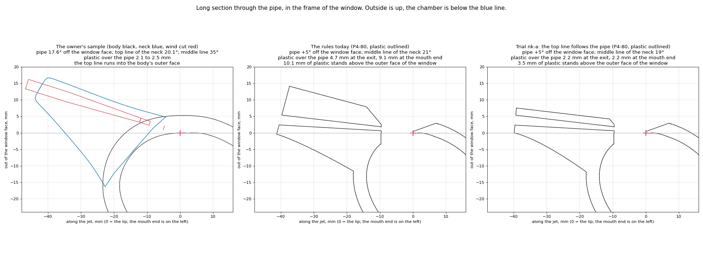

The result on the body of the rules (P4-80, trial `now`):

- The top line of the neck stands 15° and the pipe 5°, both turning about the lip. So a wedge of plastic lies over the pipe: **4.7 mm at the exit, 9.1 mm at the mouth end**.
- That wedge stands **10.1 mm above the outer face of the window**, 41.5° steep seen from the window rim (the keep-out limit is 45°).
- The window cut has to dig through it: it removes **679 mm³**. The same cut on a neck that lies level removes 446 mm³. This is the deep funnel in the pictures: the window opens upward through the neck.
- The mouth end is 13.8 × 15.0 mm with the slot at its bottom edge.

## 4. The trials

Script: [neck_trials.py](neck_trials.py). Every trial is the seed body P4 at 80 cm³, built as `tools/geometry_check_variant.py` builds a variant; every check runs on the STL read back from disk. Reports: `addon_checks/P4-80-nk-*.md`. The chamber, the window, the lip, the ramp and the cut (ellipse "P3") are those of the rules in every trial.

The new setting `neck_cover_mm` makes the top line of the neck follow the pipe with that much plastic over its roof (2.2 mm in every trial, the sample's figure), never lower than the outer face of the window. The bell is as before, under the pipe.

| Trial | Settings | Plastic over the pipe, exit / mouth end | Above the outer face | The window cut removes | Mouth end | Foot at the body | Middle line of the neck | Checks |
| --- | --- | --- | --- | --- | --- | --- | --- | --- |
| `now` | the rules | 4.7 / 9.1 mm | 10.1 mm, 41.5° | 679 mm³ | 13.8 × 15.0 mm | 42.3 × 21.1 mm | 21° | no unexpected failure |
| `nk-a` | `neck_cover_mm=2.2 stub_pitch_deg=5` | 2.2 / 2.2 mm | 3.5 mm, 9° | 435 mm³ | 13.8 × 7.6 mm | 42.3 × 21.1 mm | 19° | no unexpected failure |
| `nk-slim` | as nk-a, foot 32 × 16 mm | 2.2 / 2.2 mm | 3.5 mm, 9° | 433 mm³ | 13.8 × 7.6 mm | 32.0 × 16.0 mm | 15° | no unexpected failure |
| `nk-full` | as nk-a, foot 48.5 × 24.5 mm (the sample's) | 2.2 / 2.2 mm | 3.5 mm, 9° | 436 mm³ | 13.8 × 7.6 mm | 48.5 × 24.5 mm | 22° | no unexpected failure |
| `nk-p0` | following neck, pipe level | 3.0 / 2.2 mm | 0.1 mm | 446 mm³ | 13.8 × 7.6 mm | 42.3 × 21.1 mm | 13° | no unexpected failure |
| `nk-p10` | following neck, pipe +10° | 2.2 / 2.2 mm | 6.9 mm, 40° | 458 mm³ | 13.8 × 7.6 mm | 42.3 × 21.1 mm | 24° | no unexpected failure |
| `nk-p17` | following neck, pipe +17.65° | 2.2 / 2.2 mm | 11.9 mm, 48.5° | 608 mm³ | 13.8 × 7.6 mm | 42.3 × 21.1 mm | 32° | **fails 4 checks** (section 4.2) |

"No unexpected failure" means what it means on every P4 body: the two thumb holes above the pad limit, which the notes expect, and the two soft warnings of P4. In every passing trial the window area is 62.83 mm² against 62.84, the lip 0.400 mm, the ramp 20.00° and the capped air 80.00 cm³.

### 4.1 The neck volume (the pipe stays at +5°)

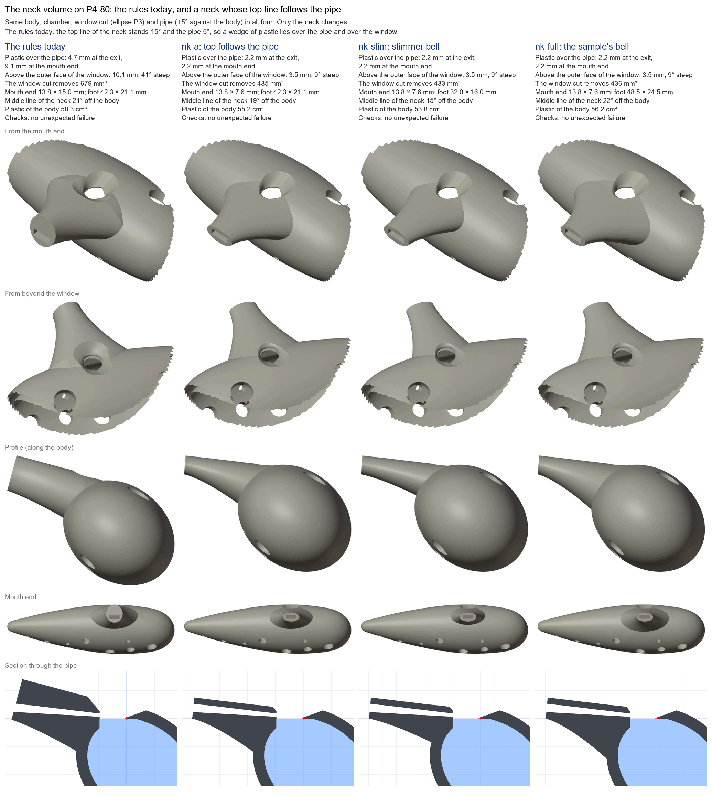

- **The following neck removes both things the owner named.** The window is a shallow dish at the foot of the neck again, as on the level neck the owner chose the cut on. Nothing stands over it but 3.5 mm at 9°.
- **The pipe and the voicing do not change.** `now` and `nk-a` have the same pipe, window, lip and ramp. Only the plastic around them differs.
- **The neck still stands.** Its middle line is 19° off the body in `nk-a`, against 21° today. The stance now comes from the bell under the pipe, as in the sample, and not from plastic over the pipe.
- **The bell sets the stance.** Slim foot: 15°. The sample's foot: 22°. With the slim foot the numbers of decision 6 hold as the sample has them: the neck stands 15° and the pipe lies 10° lower inside it.
- The body is 3.0 cm³ of plastic lighter with `nk-a` (55.2 against 58.3 cm³).
- The mouth end becomes flat, 13.8 × 7.6 mm, close to the sample's 15 × 8 mm.

### 4.2 The pipe angle (the neck follows)

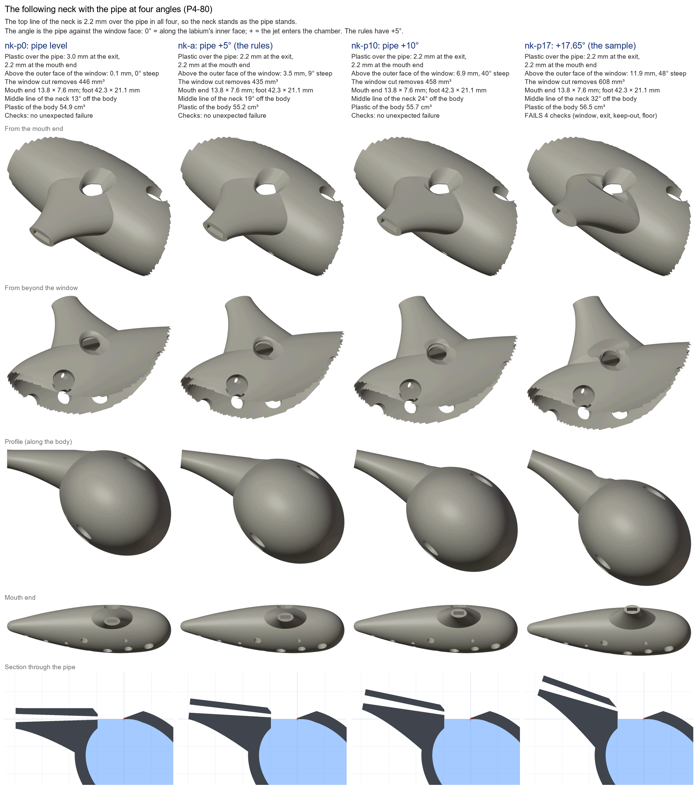

- 0°, +5° and +10° build and pass. At +10° the plastic behind the window is 40° steep seen from the rim, 5° inside the keep-out limit.
- **+17.65°, the sample's angle, does not build on a 4 mm wall.** At that angle the roof of the pipe is 4.1 mm above the inner plane where it meets the window, which is above the 4 mm outer face. The window then measures 9.08 mm long instead of 9.65 (61.15 mm² instead of 62.84), the exit no longer faces the lip, and the plastic behind the window is 48.5° steep. The sample can have this angle because its wall is 5.3 mm. Between the two trials (40° steep at +10°, 48.5° at +17.65°) the 45° keep-out limit lies near +14°; no body was built there.
- The angle is a voicing matter: it is the angle at which the jet meets the lip, and it is in the hash. The rules have +5°. These pictures say what the outside does at each angle, not which one sounds best.

### 4.3 The add-on's cut in the sample itself

Script: [sample_cut.py](sample_cut.py). The sample's own body and neck were joined, and the add-on's pipe, window, lip, ramp, dish and pocket were cut into them, at the sample's own angle (17.65°) and wall (5.3 mm). The pipe was made 40 mm long so that it comes out of the sample's longer neck. No check ran: it is a picture, not an instrument.

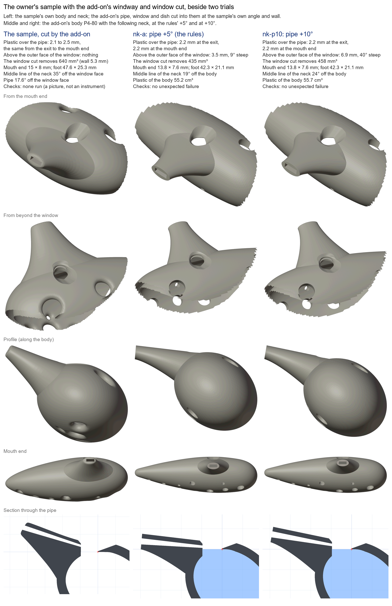

The cut goes in cleanly: the window is a dish in the body's wall at the foot of the neck, and the neck is not touched by it. This is the look that `nk-a` and `nk-p10` have and `now` does not.

## 5. What I recommend, and what is the owner's to say

1. **Replace the neck of the rules with the following neck** (`nk-a` as the starting point). It is the sample's construction, it removes the funnel, and it changes nothing in the pipe or the window.
2. **Foot size:** to my eye `nk-a` and `nk-slim` both work; `nk-slim` is the one that stands 15°, the stance of decision 6. This is a matter of look, and with the shell-edit build the neck is the user's to reshape anyway, so the base only has to be a good start.
3. **Pipe angle:** keep +5° unless the owner wants the neck to stand more than the bell can give. +10° passes but sits close to the keep-out limit. Anything like the sample's 17.65° needs a thicker wall at the window, which is a change of the voicing rules.

One detail to settle when this becomes a rule: on the following neck the thinnest plastic of the body is 1.24 mm, at the upper corners of the pipe at the mouth end. The owner's minimum around the pipe is 1.2 mm (2026-11-17); three printed walls are 1.32 mm. A mouth end 1 mm wider should give about 1.4 mm there (computed from the ellipse, not built).

## 6. Limits

- Pictures and geometry checks. Nothing here says how the neck changes the sound. A window at the bottom of a 10 mm funnel (`now`) is shaded more than one at the foot of the neck; that is an argument for the change, not a measured number.
- Only P4 at 80 cm³ was built. The Stage 1 stubs and the other bodies were not rebuilt with the following neck.
- `stub_pitch_deg` is in the voicing hash, so the trials have their own hashes (`nk-a`: `d374d90ae5b0`; the rules: `b4620fbf3d67`). Making the following neck the rule is a new rule version, and the stubs and stage bodies are regenerated then.
- The sample has no window, so where its lip lies is my reading: the point where the centre line of its wind cut meets the flat face. The angles and the plastic over the pipe do not depend on that point.
- A trial in which the foot of the neck narrows beyond the window was built and dropped: that part of the neck is under the skin already, and the body changed by 0.2 mm³.

## 7. Round 2: two bulb models, the top of the cut, and the neck thrown back (2026-11-18, later)

**Status: trials and pictures. Nothing was decided and no rule changed.**

The owner, after the sheets of sections 3 to 5:

> "I am still not all on board with the neck and voicing current cutout specifically the upper shelf cut of the voicing. I have gathered 2 stl, these wont be included in the analisis since i cannot vouch for their tunning yet, however they are playable an will allow you to visualize the neck positioning issue. the neck for bulb shaped ocarinas is thrown backward further, however also the cuttout, use as a reference of the top portion the top part of the ECAN3 or NBN"

The two files are `obj_1_Ocarina_Fixed.stl` ("Ocarina 12") and `obj_1_OcarinaDeluxe.stl` ("Deluxe"), read from the owner's Downloads folder and not copied. **They are used for shape and position only.** Nothing from them goes into the kernel or into any tuning comparison.

### 7.1 The two models in the frame of the body

Script: [refs_position.py](refs_position.py). Both models are teardrop bulbs about 135 to 140 mm long with a section of about 53 × 48 mm. The pictures are the body's own cross-section through the windway: the player is on the left, the finger deck is up, the cross is the lip. "Level" is the direction straight at the player. The points were read by hand on enlarged sections, to about 0.2 mm.

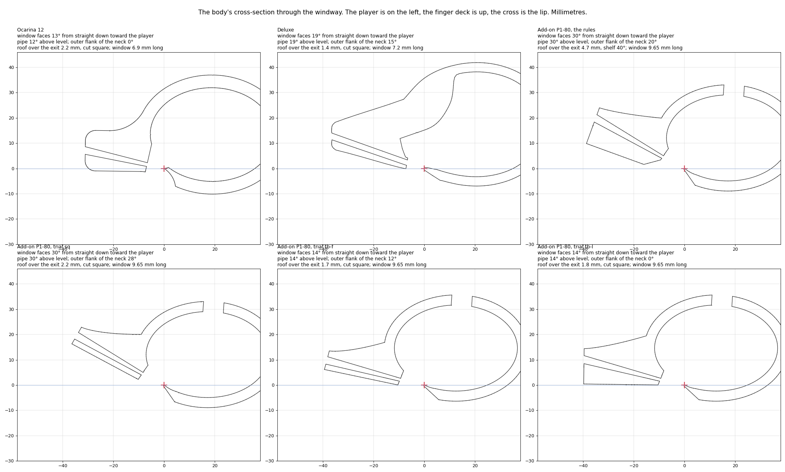

| | Ocarina 12 | Deluxe | Add-on P1-80, the rules | Add-on P4-80, the rules |
| --- | --- | --- | --- | --- |
| The window faces, from straight down toward the player | 13° | 19° | 30° | 32° |
| The pipe above level (the mouth end is toward the deck) | 12° | 19° | 30° | 32° |
| The outer flank of the neck above level | 0° | 15° | 20° | 22° |
| Roof over the windway exit | 2.2 mm, cut square | 1.4 mm, cut square | 4.7 mm, leaning back 40° | 4.7 mm, leaning back 40° |
| Window length, exit to lip | 6.9 mm | 7.2 mm | 9.65 mm | 9.65 mm |
| The jet against the chamber wall beyond the lip | enters by 9° | leaves by 9°: it runs along the middle of the labium wedge | enters by 5° | enters by 5° |
| Mouth end behind the lip, measured along the level | 31 mm | 37 mm | 34 mm | 34 mm |

"The window faces" is measured the same way on all four: square to the line from the middle of the exit to the lip.

Two things follow, and they are the owner's two points.

1. **None of the references has a shelf.** On both new models the roof over the exit is a thin plate, 1.4 and 2.2 mm, that ends in a face square to the pipe. The NBN is the same (a 1.2 mm plate, [Window_cutout.md](../Window_cutout/Window_cutout.md) section 2). The ECAN3 Eclipse has a taller wall there (6 mm), but it is upright too, with a rounded top edge. The add-on leans that wall back 40° and, on the neck of the rules, cuts it through 4.7 mm of plastic.
2. **Both models stand 11° to 18° more level than the add-on's bodies, neck and window together.** The add-on puts the voicing 45° around the body from the bottom toward the player on every preset, and lays the pipe along the body's surface there. So the window faces 30° from straight down and the pipe climbs 30° toward the deck. On the references the window faces 13° to 19° and the pipe climbs 12° to 19°: the whole voicing is turned toward the bottom, which throws the neck back, straight at the player.

On "Ocarina 12" the neck is a level tube and the pipe lies 12° steeper inside it: the neck hides the tilt. On "Deluxe" the outer flank of the neck follows the pipe (4° apart), as on the owner's own sample.

### 7.2 What the prototype can now do

| Setting | What it does | In the voicing hash |
| --- | --- | --- |
| `shelf_angle_deg=0` | The wall over the exit is cut square to the window face. No new code: the setting was there | yes |
| `port_angle_deg` | Where the voicing sits around the body (a preset value; 45 on every preset). 30 turns it toward the bottom | no (it is a body value) |
| `windway_pitch_deg` | +5 in the rules. +8 was used in the trials: under a 4 mm wall it leaves 1.7 mm of roof on the centre line at the exit and 1.3 mm over the corners of the pipe (the owner's minimum is 1.2 mm). At +10 the corners would have about 0.9 mm (computed, not built) | yes |
| `neck_cover_mm` with `stub_pitch_deg` above the windway pitch (new) | The neck's outer flank is straight at the neck's own angle, as on a tube, and the pipe is lowered inside it. Until now the flank could only follow the pipe | the pitch yes, the cover no |
| `neck_cover_exit_mm` (new) | Plastic over the pipe's roof at the exit, when it should be less than at the mouth end | no |

One rule was added to the prototype neck: its flank never stands above the outer face of the window at the exit plane. With a square cut any plastic there is left as a step at the back edge of the window, inside the outside keep-out (the first build of `sq` failed that check with a step of 0.06 mm, and `tb-l` with 0.16 mm).

### 7.3 The trials

Script: [throwback_trials.py](throwback_trials.py). Two bodies at 80 cm³: P1, the teardrop, which is the preset nearest to the two models, and P4, the seed. Five voicings each. Every check ran on the STL read back from disk; reports are `addon_checks/P1-80-*.md` and `addon_checks/P4-80-*.md`.

| Trial | Port | Pipe into the chamber | Neck | Top of the cut | Window faces | Pipe above level | Neck flank above level | Roof over the exit | The cut removes | Mouth end | P1-80 | P4-80 |
| --- | --- | --- | --- | --- | --- | --- | --- | --- | --- | --- | --- | --- |
| `now` | 45° | +5° | the rules | shelf 40° | 30° / 32° | 30° / 32° | 20° / 22° | 4.7 mm | 675 / 679 mm³ | 13.8 × 15.0 mm | passes | passes |
| `nk-a` | 45° | +5° | follows the pipe | shelf 40° | 30° / 32° | 30° / 32° | 28° / 31° | 2.2 mm | 428 / 435 mm³ | 13.8 × 7.6 mm | passes | passes |
| `sq` | 45° | +5° | follows the pipe | square | 30° / 32° | 30° / 32° | 28° / 31° | 2.2 mm | 422 / 428 mm³ | 13.8 × 7.6 mm | passes | passes |
| `tb-f` | 30° | +8° | follows the pipe | square | 14° / 16° | 14° / 16° | 12° / 14° | 1.7 mm | 425 / 431 mm³ | 13.8 × 7.6 mm | **fails `topology`** | **fails `hole_to_voicing`** |
| `tb-l` | 30° | +8° | level with the body | square | 14° / 16° | 14° / 16° | 0° / 0° | 1.8 mm | 428 / 433 mm³ | 13.8 × 14.0 / 15.1 mm | passes | **fails `hole_to_voicing`** |

Where two values are given, the first is P1 and the second P4. "Passes" means no unexpected failure. In every trial the window area is 62.83 mm² against 62.84, the lip 0.400 mm and the ramp 20.00°.

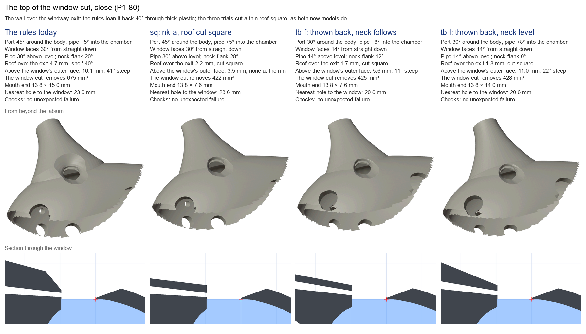

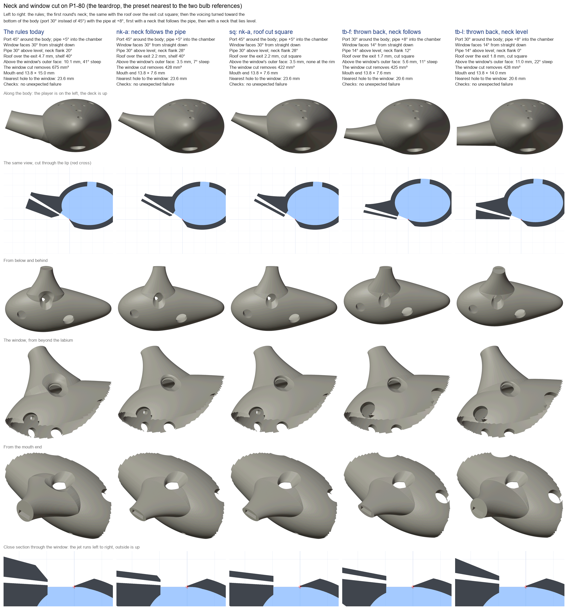

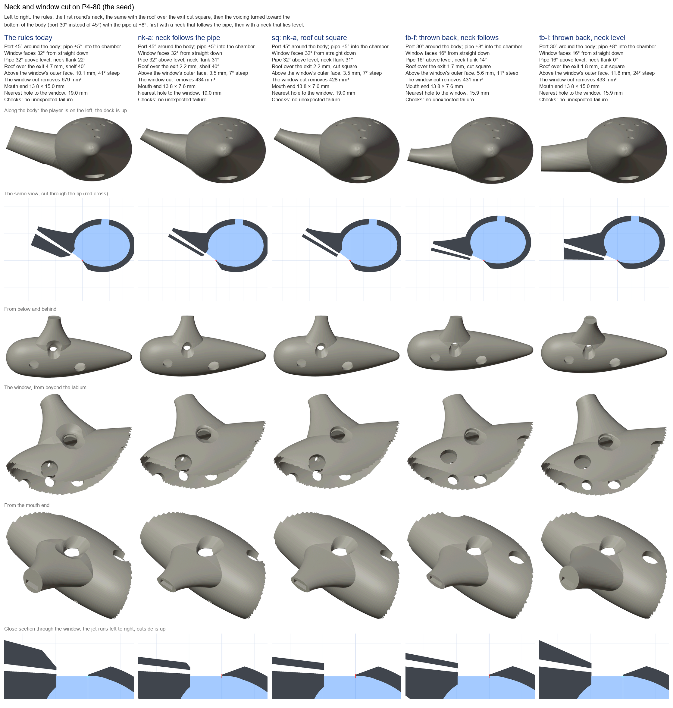

### 7.4 What the trials show

1. **The square roof works and costs nothing.** `sq` passes every check on both bodies. The cut removes about what it did with the shelf (422 against 428 mm³ on P1), because on a thin roof the shelf had little left to lean back. The shelf only mattered on the thick neck of the rules.
2. **On the teardrop the voicing can be thrown back as on the models.** `P1-80-tb-l` passes every check. Its section is close to "Ocarina 12": a level flank, the pipe 14° steeper inside it, the window facing 14° from straight down, a square roof of 1.8 mm.
3. **`P1-80-tb-f` is close to "Deluxe"** in section, and it fails one check: the finished mesh has one pair of triangles that pass through each other. That is a fault of the mesh, not of the shape. I did not look for its cause.
4. *(Corrected on 2026-11-19, section 9.3: this point was wrong. The left thumb hole never touched the neck; the check measured a box, not the neck. Both `tb` trials pass on P4.)* ~~On the seed the turn runs into the left thumb hole. At port 30° the foot of the neck touches the L thumb hole on P4.~~
5. **A level neck is thick at the mouth end.** The pipe dives 14° to 16° under the level flank over its 30 mm, so the mouth end is 13.8 × 14 to 15 mm with the slot near its lower edge. "Ocarina 12" has a round end of 15.5 mm, with a pipe of 25 mm.

### 7.5 What was not built, and limits

- **The rounded top edge of the ECAN3** and **the NBN's lower roof.** On the NBN the top of the neck at the window is lower than the body's surface beyond the lip. The add-on's neck keeps a flat pad of 4 mm around the whole window, so its roof cannot go below that face.
- **The shorter window.** Both models have a window about 7 mm long against the rule's 9.65 mm. The length is a voicing rule and was not touched.
- **A steeper jet.** "Ocarina 12" takes the jet in at about 9° and the owner's sample at 17.65°. Under a 4 mm wall the add-on's voicing reaches +8°.
- Port 30° was the only turn tried, and only on P1 and P4. No hole was moved. Nobody checked whether the thumbs still reach comfortably when the mouthpiece points level.
- The windway pitch and the shelf are in the voicing hash, so `sq`, `tb-f` and `tb-l` each have a hash of their own. The pictures say what the outside does. They do not say how +8° or the square roof change the sound.
- The two models were read by hand. Their tuning is not known and they were not used for anything acoustic.

### 7.6 What I recommend, and what is the owner's to say

1. **Drop the shelf: cut the roof square**, on the neck that follows the pipe. Every reference does it and the trials pass. This is one value of the voicing rules (`shelf_angle_deg = 0`).
2. **Turn the voicing toward the bottom on the bulb bodies**, about 15°, as in `tb-l` or `tb-f`. The port angle is then a value per body shape, not 45° for all. Whether the neck then lies level (as "Ocarina 12") or follows the pipe (as "Deluxe" and the owner's sample) is a matter of look, and of whether the base neck or the user shapes it.
3. *(Withdrawn, section 9.3: P4 needs no answer of its own.)*
4. Whether the pipe goes to +8° is a voicing question that pictures cannot settle. The neck can be thrown back by the port angle alone; the +8° adds 3° of it.

## 8. Round 3: the owner's choice, and the neck adjusted toward the Deluxe (2026-11-19)

**The owner's choice**, on the sheets of section 7, with a red line drawn along the deck side of the neck of `tb-f`:

> "tb-F but adjust the neck volume a little so in its along the body view its closer to the deluxe cross section. so technically the neck wouldn't follow the pipe also go with the roof cut square"

So three things are chosen: **the voicing thrown back as in `tb-f`** (port 30° on the teardrop, pipe +8°), **the roof over the exit cut square**, and **a neck whose deck side is fuller and straight**, as on the Deluxe. The side of the neck over the pipe stays as in `tb-f`; the other side no longer mirrors it, which is what "the neck wouldn't follow the pipe" means here. **Nothing is a rule yet**: the voicing rules and the presets are unchanged, and these are trial bodies.

### 8.1 What was changed in the prototype

| Setting | What it does |
| --- | --- |
| `neck_depth_exponent` | How the depth of the neck grows from the mouth end to the body. 1.4 (as before) gives a bell, hollow in profile; 1 gives a straight flank |
| `neck_width_exponent` | The same for the width (1.7 before). 1 makes the neck a cone in plan as well |
| `neck_floor_mm` | Plastic on the deck side of the pipe at the mouth end (2.4 mm before) |
| `neck_corner_cover_mm` | Each section of the neck is two half ellipses. The upper one is only as high as leaves this much plastic over the pipe's corners; the lower one takes the rest of the depth |

The last one was needed. A neck that grows deep with plain elliptical sections grows rounder over the pipe, and the first builds of this round stopped with 1.13 mm of plastic over the pipe's corners (the owner's minimum is 1.2 mm). With the two-part section the corners keep 1.30 mm and the neck is deep on the deck side only. None of these settings is in the voicing hash: the three trials below share the hash of `tb-f`.

### 8.2 The trials

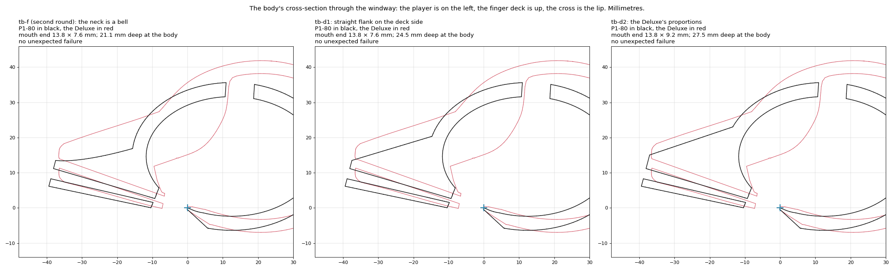

Each panel is the body's cross-section through the windway, the trial in black and the Deluxe in red, both placed on their lips at the same scale. The Deluxe is a larger body (its deck is 6 mm higher), so the bodies do not coincide; the line to compare is the deck side of the neck.

| Trial | Neck | Mouth end | At the body | Plastic of the body | Thinnest plastic | P1-80 | P4-80 |
| --- | --- | --- | --- | --- | --- | --- | --- |
| `tb-f` | the bell of section 7 | 13.8 × 7.6 mm | 42.3 × 21.1 mm | 51.0 cm³ | 1.23 mm | passes | passes |
| `tb-d1` | straight flank on the deck side, as the owner drew it | 13.8 × 7.6 mm | 42.3 × 24.5 mm | 51.8 cm³ | 1.25 mm | passes | passes |
| `tb-d2` | the Deluxe's proportions: a cone in profile and in plan, 4 mm of plastic on the deck side of the pipe at the mouth end | 13.8 × 9.2 mm | 42.3 × 27.5 mm | 53.8 cm³ | 1.38 mm | passes | passes |

*(Corrected on 2026-11-19, section 9.3. This table said that all three failed `hole_to_voicing` on P4, and it had two more rows, `tb-d1s` with a foot 32 mm wide and `tb-d1p` at port 35°, which existed only because of that failure. The failure was the check's, not the body's; the two trials were removed.)*

The plastic and the thinnest plastic are those of P1-80. In every trial the window is 62.83 mm² against 62.84, the roof over the exit is 1.7 mm and cut square, and the pipe is 14° above level on P1 and 16° on P4.

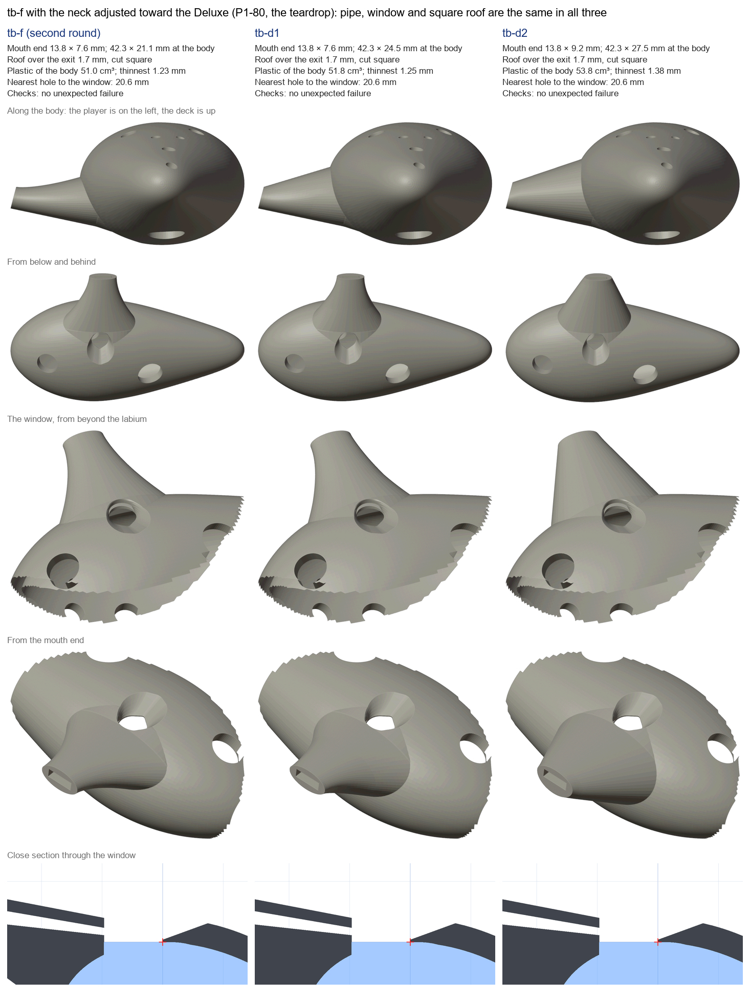

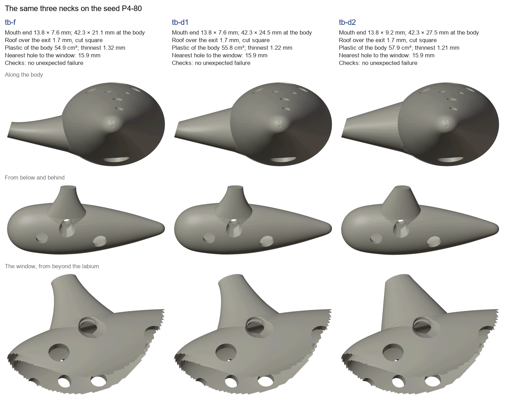

### 8.3 What the trials show

1. **`tb-d1` has the line the owner drew**: the deck side of the neck runs straight from the mouth end to the body and meets it 3.5 mm higher than the bell did. `tb-d2` is closer to the Deluxe itself: its flank is nearly parallel to the Deluxe's, and its mouth end is thicker.
2. **All three pass every check on the teardrop.**
3. *(Corrected on 2026-11-19, section 9.3: this point was wrong.)* ~~On the seed P4 the turn still meets the left thumb hole.~~ All three pass on P4 as well.

### 8.4 A mesh fault found on the way, and fixed

`P1-80-tb-f` failed `topology` in section 7 with one pair of crossing triangles, and `tb-d1` did the same here. The cause: where the pipe's roof meets the end face of the neck, a point of the end face lay on the edge of a long triangle of the pipe, off it by a few millionths of a millimetre. That is the spacing of the single-precision numbers an STL file stores (4e-6 mm at 40 mm). The two triangles touch along a line; they do not cross, and the test told them apart only by rounding. The mesh clean-up already removes such needles when they are lower than a nanometre; this one was a little higher. `meshutil.cleanup` now runs the same repair once more with the needle height set to the single-precision spacing (2e-5 mm), only on a mesh that would otherwise fail the check, and keeps the result only if fewer crossings are left. Both bodies pass now. A mesh that was clean before does not reach that code.

### 8.5 Open before this becomes a rule

1. **`tb-d1` or `tb-d2`** (or something between): the owner's to pick from the sheets.
2. **The port angle becomes a value per body.** 30° was tried on P1 and P4 only. P0, P2 and P3 were not built with it.
3. **The pipe at +8°** came with `tb-f`. It is a voicing value and is in the hash, so the Stage 1 stubs take it too.
4. *(Withdrawn, section 9.3.)*
5. The limits of section 7.5 still hold: nothing here says how the sound changes, and nothing was printed.

## 9. Rule version 3: `tb-d1` is the rule (2026-11-19)

**The owner chose `tb-d1`.** It is now the voicing of every body the add-on builds.

### 9.1 What changed

| Where | Before (rule version 2, 2026-11-18) | Now (rule version 3) |
| --- | --- | --- |
| `[voicing_rules]` `shelf_angle_deg` | 40° | **0°**: the wall over the windway exit is cut square |
| `[voicing_rules]` `stub_style`, `stub_pitch_deg` | `neck`, 15°: a bell whose roof line stood 15° off the window face | **`cone`, 8°**: the outer flank lies a thin roof over the pipe (2.2 mm at the mouth end, 1.7 mm at the exit), the deck side is straight, 2.78 × the window width deep at the body (24.5 mm at 80 cm³) |
| `[voicing_rules]` `windway_pitch_deg` | +5° | **+8°** |
| Cavity presets, `port_angle_deg` | 45° on every body | **30°** on P0, P1, P2, P3 and P4; the voicing stub S0 keeps 45° |
| Voicing hash at 80 cm³ | `b4620fbf3d67` | `312011ec9f0e` |

The shape of the cone neck is in `ocarina_addon/voicing_geo.py` (`CONE_*`, `neck_solid`); the kernel knows the style by name and hashes it. The prototype settings of sections 4 to 8 still exist for trials and are used by no preset. The trial scripts now name every value of rule version 2, so they still build the bodies of sections 4 to 8.

Two things came with `tb-d1` as it was pictured and are now rules. Both are easy to change, and both change the voicing hash or the body, so they are better settled before anything is printed:

- **The pipe at +8°** (it was +5°). The jet meets the lip 3° more steeply.
- **The port at 30° on every body**, P0, P2 and P3 included, although only P1 and P4 were in the pictures. All of them build and pass (section 9.2).

### 9.2 The stages, regenerated

| Stage | Result |
| --- | --- |
| 1, the seven voicing stubs | 6 of 7 have no unexpected failure. The optional 3 mm wall stub V-a3 fails `voicing_keepouts`, as it did before: under a 3 mm wall the pipe at +8° leaves no room for a roof below the outer face, so the roof keeps its 1.2 mm and stands above the face |
| 2, the eight round-1 bodies | no unexpected failure |
| 3, the seven round-2 bodies from the synthetic constants | no unexpected failure |

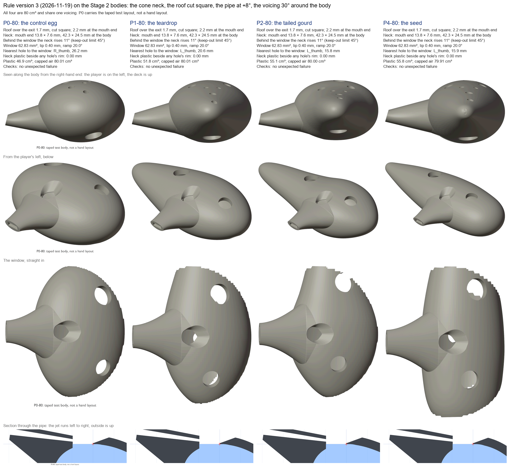

On every Stage 2 body the window is 62.83 mm² against 62.84 (46.47 and 81.14 mm² at 65 and 95 cm³, as their records say), the lip 0.40 mm, the ramp 20.0°, the roof over the exit 1.7 mm cut square, and the neck rises 11° behind the window (the keep-out limit is 45°).

### 9.3 A correction: the left thumb hole never touched the neck

Sections 7 and 8 said that on the seed P4 the foot of the neck touched the left thumb hole at port 30°, and that only a slimmer foot cleared it. **That was wrong, and it was my error to pass it on without measuring it.** The check `hole_to_voicing` took the mouthpiece to be a box as long as the block, as wide as its widest point and as high as the wall. For the box stub that is the stub. A neck is that wide only at its foot, so the box said where a neck might be, not where it is. The left thumb hole, 15.9 mm from the window, lay inside that box.

Measured on the finished meshes, the surface around the left thumb hole is plain skin on every body, with the 42 mm foot and with the 32 mm foot alike (it lies 0.1 to 2.2 mm below the hole's outer plane, which is the curve of the body).

The check now measures the body for a neck: around the rim of every hole, 0.5 mm outside it, how much plastic stands on the plain skin. On a plain wall that is 0.00 mm; beside the foot of the neck it reads 2.1 mm, and under the neck 13.8 mm (tried on purpose with a hole that does not exist). Anything above 0.3 mm counts as a touch. With it:

- every trial of sections 7 and 8 passes on P4 (`tb-f`, `tb-l`, `tb-d1`, `tb-d2`); the tables of those sections are corrected;
- the two trials that existed only because of the false failure (`tb-d1s`, the slimmer foot, and `tb-d1p`, port 35°) were removed;
- **P4 has the same neck as every other body.** No slimmer foot and no moved hole is needed;
- Stage 3 passes. With the box it failed on P1, P2 and P4 as soon as the round-2 thumb holes grew to 13 mm.

**An edited shell** (the shell-edit build). The first version of this measure compared the body with the plain skin of the chamber, so it took a user's boss, thicker deck or remeshed surface for the neck, and three of the five shell-edit trials failed. On an edited shell the measure now compares the user's shell with and without the user's neck along the same line; all five trials pass. A shell that comes in one piece with its neck cannot be measured this way; the check then tests the labium ramp only and says so.

One real trace of the hole being close: on P4 the capped air measured on the final mesh reads 79.91 cm³, 0.1 cm³ under the 80.01 cm³ of the air that was built. That measurement leaves out a box around the window, and a part of the left thumb hole's chimney now lies in it. The built air is right and the check passes (limit 0.5 %); the measurement is 0.12 % low on this body.

### 9.4 Two faults found on the way, and fixed

- **A step of 0.02 mm at the back edge of the window.** Where the flank of the neck met the outer face exactly on the exit plane, the mesh left a step of a few hundredths of a millimetre, and stub V-a35 (its pipe sits 0.15 mm higher) failed the keep-out with 0.021 mm. The flank now passes 0.05 mm under the face at the exit plane.
- **The needle at the mouth end** (section 8.4).

### 9.5 Tests

The tests that pinned rule version 2 were changed to rule version 3 (the hashes, the build of the record, the build that every stage body carries, and the thinnest plastic of a stage body: 1.15 mm, since the roof of the neck is 1.2 mm by rule). `python tools/run_tests.py` on 2026-11-19: kernel 133, plain 102, Blender 63 (1 skipped), extension 4, all pass.

### 9.6 Not done

- Nothing was printed, and nothing here says how the square roof, the +8° or the turn change the sound. Stub V-a against the plain stub V-af is still the measurement that tells.
- Nobody has held a body with the mouthpiece pointing level. The thumbs and the left thumb hole near the window (15.8 to 20.6 mm) are worth a look on the first print.
- The 3 mm window wall does not take this voicing (V-a3).
- The ECAN3's rounded top edge, the NBN's roof below the body's surface and a shorter window are still not built (section 7.5).

## Reproduce

```bash
python -I Analizes_ocarinas/Neck_volume/sample_frame.py "D:/Users/alexv/Desktop/ocarina-body+neck+wind cut.stl"
```

```bash
"C:\Program Files\Blender Foundation\Blender 5.1\blender.exe" -b --factory-startup --python Analizes_ocarinas/Neck_volume/neck_trials.py
```

```bash
"C:\Program Files\Blender Foundation\Blender 5.1\blender.exe" -b --factory-startup --python Analizes_ocarinas/Neck_volume/sample_cut.py
```

```bash
python Analizes_ocarinas/Neck_volume/sheet_neck.py
```

The second round (section 7):

```bash
"C:\Program Files\Blender Foundation\Blender 5.1\blender.exe" -b --factory-startup --python Analizes_ocarinas/Neck_volume/throwback_trials.py
```

```bash
python -I Analizes_ocarinas/Neck_volume/refs_position.py "D:/Users/alexv/Downloads/Ocarina+12_stls/obj_1_Ocarina_Fixed.stl" "D:/Users/alexv/Downloads/Deluxe+Ocarina_stls/obj_1_OcarinaDeluxe.stl"
```

```bash
python Analizes_ocarinas/Neck_volume/sheet_throwback.py
```

The third round (section 8) is built by the same `throwback_trials.py` (trials `tb-d1`, `tb-d2`):

```bash
python Analizes_ocarinas/Neck_volume/sheet_deluxe_overlay.py
```

The sheet of section 9 (after `headless.py -- stage2`):

```bash
python Analizes_ocarinas/Neck_volume/sheet_applied.py
```
