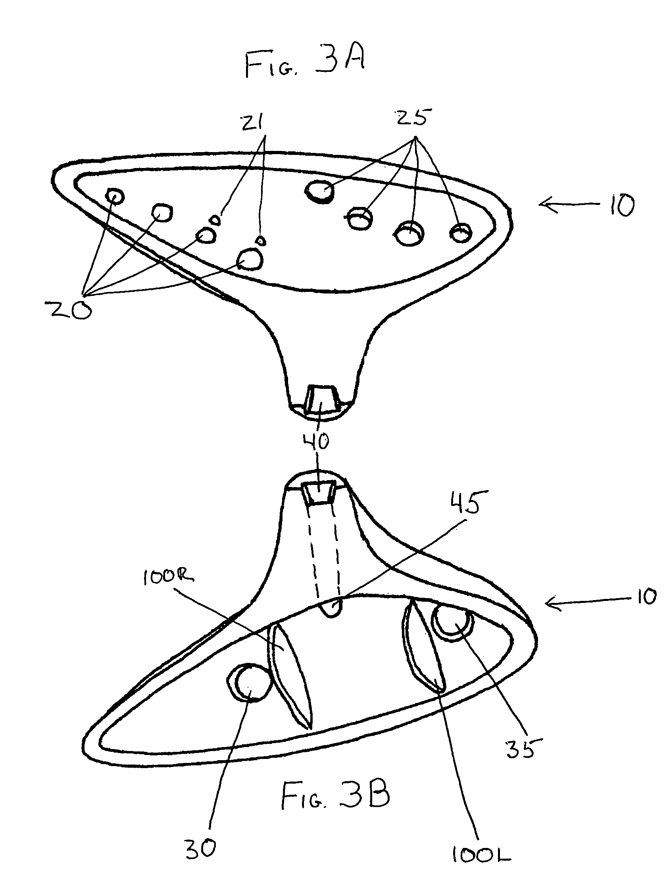
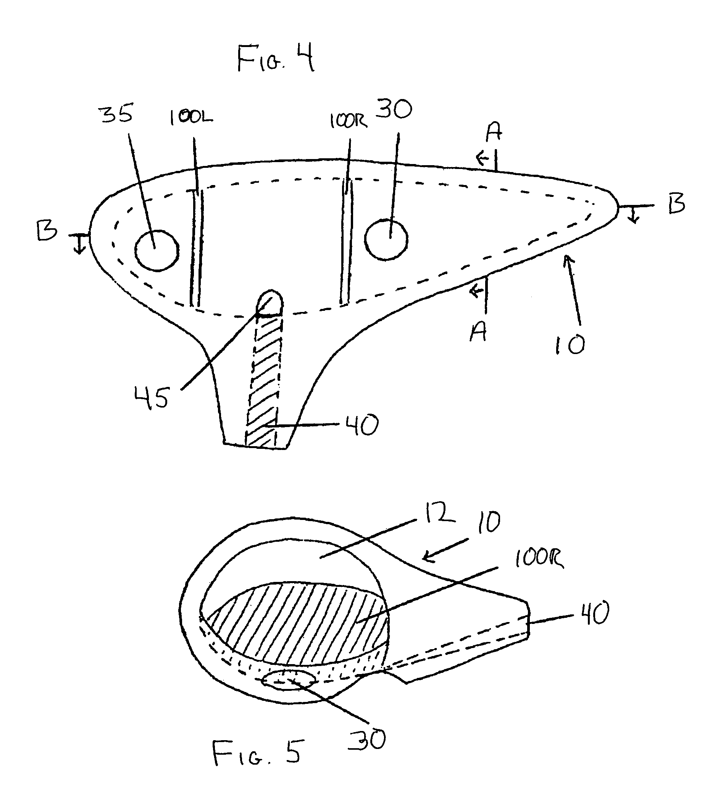
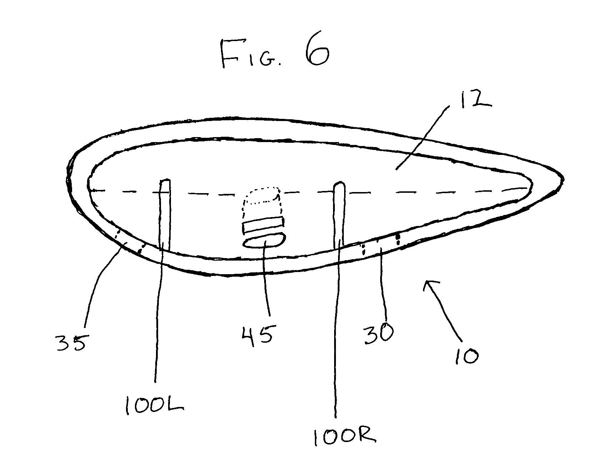
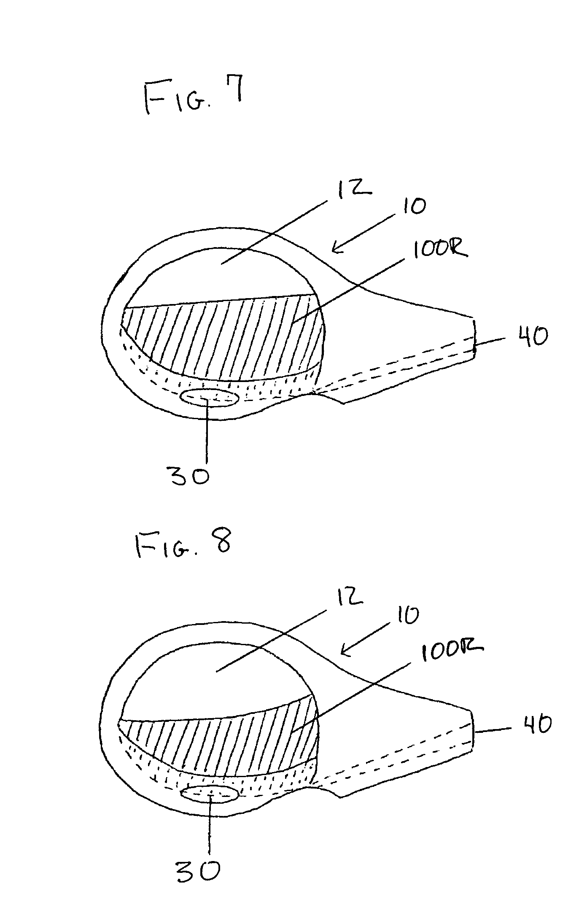

# US 7,799,980 B1 "Ocarina": partial partitions inside the chamber

**Status in this project: experimental, parked.** The owner pointed to this patent on 2026-11-16 as the better description of the internal walls seen in the Spencer workshop photos, and asked to keep it as an experiment for later, before advanced builds are explored. Nothing in the add-on, the presets or the stages uses it.

Source: [Google Patents, US7799980B1](https://patents.google.com/patent/US7799980B1/en), read on 2026-11-16. The drawings in `images/` are the patent's own sheets.

## 1. The record

| Item | Value |
| --- | --- |
| Title | Ocarina |
| Inventor | Norman Spencer Register. The name matches the maker of the Spencer ocarinas; I did not verify the link beyond the name and the workshop photos |
| Filed / granted | 2009-04-29 / 2010-09-21 |
| Status on Google Patents | **Expired – Fee Related.** Lapsed on 2014-09-21 for non-payment of the maintenance fee. Without the lapse it would have run to 2029 |
| Claims | 11. Two independent ones: claim 1 (at least one partial partition near a finger hole on the sound-hole side) and claim 7 (a sweet-potato ocarina with one partial partition between the sound hole and each of two thumb holes) |

The status line is what the database shows. It is not legal advice.

## 2. What the patent describes

In the patent's words the *sound hole* is the window, and the *voicing* is the windway and the window together.

- **The problem it names:** on a 10- or 12-hole transverse ocarina the tone weakens toward the top of the range, typically from the note where the first thumb hole opens. The high notes sound, but airy.
- **The device:** two partial walls inside the single chamber, on the thumb-hole side. Each stands between the window and one thumb hole.
- **Where:** close to the thumb hole, far from the window (claims 5 and 8: nearer the thumb hole than the window).
- **How high:** from the thumb-face side to a little above the mid-line of the chamber. The dependent claims put the area at 50 % or more of the chamber's cross-section at that place. A partition must never close the chamber off: air has to pass over and around it.
- **Shape of the top edge:** not important, by the patent. Convex (Fig. 5), straight and rising away from the windway (Fig. 7) or concave (Fig. 8).
- **Thumb holes:** the largest holes of the instrument (claims 6 and 11).
- **The inventor's explanation,** given as a belief: the partitions shield the voicing from the large open holes and keep the pressure in the chamber up. He adds that stiffening of the body may play a part, and that the result was found by trial, not by calculation.

| Fig. 3A / 3B: the two halves, opened | Fig. 4 / 5: plan and section A–A |
| --- | --- |
|  |  |

| Fig. 6: section B–B, seen from the far side | Fig. 7 / 8: other top edges |
| --- | --- |
|  |  |

Sheets [0](images/sheet_0_front_page_figure.png) and [1](images/sheet_1.png) hold the front-page figure and the prior-art figures 1 and 2.

## 3. The patent against the Spencer workshop photos

The Spencer report §7 read three pockets in the thumb-face half. **The walls between those pockets are the patent's partitions.**

| Feature | Patent | Workshop photos (Spencer report §7.1) |
| --- | --- | --- |
| Number and side | Two, on the thumb-hole side | Two walls, in the thumb-face half |
| Left partition | Between the window and the left thumb hole, nearer the thumb hole | At 0.18–0.21 of the length; left thumb hole at about 0.11, window at about 0.31–0.36. Nearer the thumb hole |
| Right partition | Between the window and the right thumb hole, nearer the thumb hole | At 0.42–0.44; right thumb hole at about 0.54. About midway |
| Height | A little above the mid-line; 50 % of the section or more | To the joint plane on the mould photo (12); lower and rounder on the open half (11) |
| Thumb holes | Larger than any finger hole | About 12 mm against 9.8 mm for the largest finger hole |

The photos add what the patent does not show: thick walls, each thumb hole at the bottom of its pocket with a lip of about 3 mm, and a solid tail in the thumb-face half.

## 4. What the add-on's tools say (a model)

[partition_check.py](partition_check.py) adds two partitions of several heights to the Spencer body model and solves three cases on a voxel grid. Output: [partition_check.md](partition_check.md).

| Partitions | Blocked share of the section | All holes closed: first cavity mode ÷ F6 | Thumb holes' conductance left | Both thumbs open: next mode ÷ F6 |
| --- | --- | --- | --- | --- |
| None | 0 % | 1.48 | 100 % | 1.63 |
| Half the depth of the thumb-face half | 28 % | 1.41 | 96–97 % | 1.58 |
| To the mid-line | 54 % | 1.24 | 90 % | 1.45 |
| 4 mm above the mid-line (the patent prefers "slightly above") | 71 % | 1.10 | 85 % | 1.34 |
| 8 mm above the mid-line | 87 % | 0.91 | 75 % | 1.18 |

Readings:

1. **A partition is a narrowing of the chamber.** At the patent's height it lowers the first standing wave of the closed chamber from 1.48 to 1.10–1.24 × F6. The add-on's desk check would mark that `needs_fem`.
2. **With the thumb holes open the margin is higher** (1.34–1.45), and the top notes are played with the thumb holes open. The closed-hole check is the harder case, as doc 06 §3.10 already says.
3. **A partition weakens the thumb hole behind it by 10–15 %.** The hole has to be that much stronger to reach the same note, which agrees with the patent's large thumb holes.
4. **None of this tests the patent's claim.** The claim is about tone when the large holes open: how well the air jet at the window keeps driving the chamber. The add-on has no model of that. The lumped model cannot see a partition at all, and the cavity-mode solver only sees its cost.

This corrects the Spencer report's first reading, which said the walls might be there for forming or strength. They are a deliberate acoustic device by the maker's own account. Whether they work as claimed can only be heard and measured on a print.

## 5. If it is explored later

Not planned, not built. A sketch of what an experiment would need:

| Item | Proposal |
| --- | --- |
| When | After Stages 2 and 3. Partitions change the thumb holes' effect, so they must not enter a body whose constants are being fitted |
| Bodies | One pair at 80 cm³ on the seed, same voicing: without partitions, and with two partitions to the mid-line |
| Parameters | Station of each partition (nearer the thumb hole than the window), blocked share of the section (50–70 %), thickness, top edge |
| What to measure | The notes with the thumb holes open: pitch, the pressure range over which each note holds, and the spectrum. The model expects those notes a little flat on the partitioned body |
| What to watch | The first cavity mode (1.36 × F6 on the seed without partitions) and whether the partitions print without supports inside the chamber |
| Related lever | A solid tail on the thumb-face half raises the closed-hole margin by 0.14 in the model (Spencer report §7.3). It could offset the cost of the partitions |

### 5.1 Explored on 2026-11-20 (the low-voicing experiment)

The owner reopened this on 2026-11-19 ("implement the inner wall due to the closenes to the thumb holes") and on 2026-11-20 chose low walls on both sides, then asked for a smooth inside after the clay photos. Both ways are built and measured in [Low_voicing.md](../Low_voicing/Low_voicing.md): slab walls in section 10, the ridge field (a thick thumb-face wall with pockets, as the clay has it) in section 11. The clay photos are read again for the shape of their surfaces in the [Spencer report](../Spencer_OoT_12h/Spencer_OoT_12h.md), section 7.4. Nothing was printed; what the walls do for the top notes is still untested.

## 6. Limits

- I read the patent on Google Patents only. The status is that page's.
- The model body is the Spencer outline with assumed wall depths; the open holes have no outer end correction and the window is closed. Only the comparisons between rows mean anything.
- The partitions of the model are flat slabs across the whole chamber. The real ones are curved and meet a rounded pocket.
