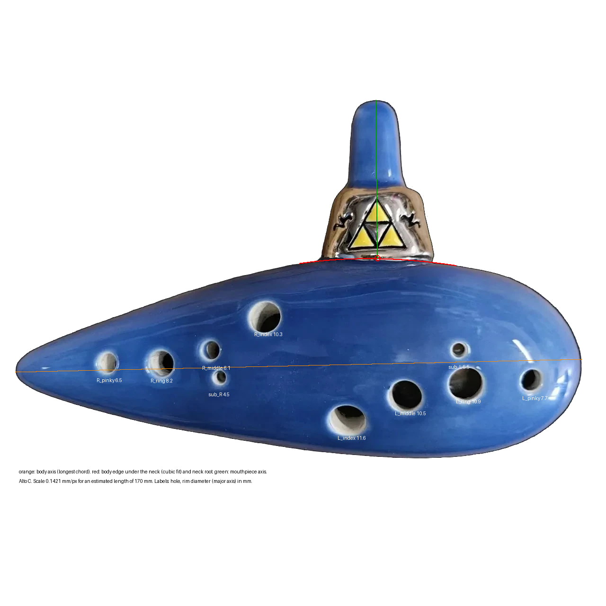
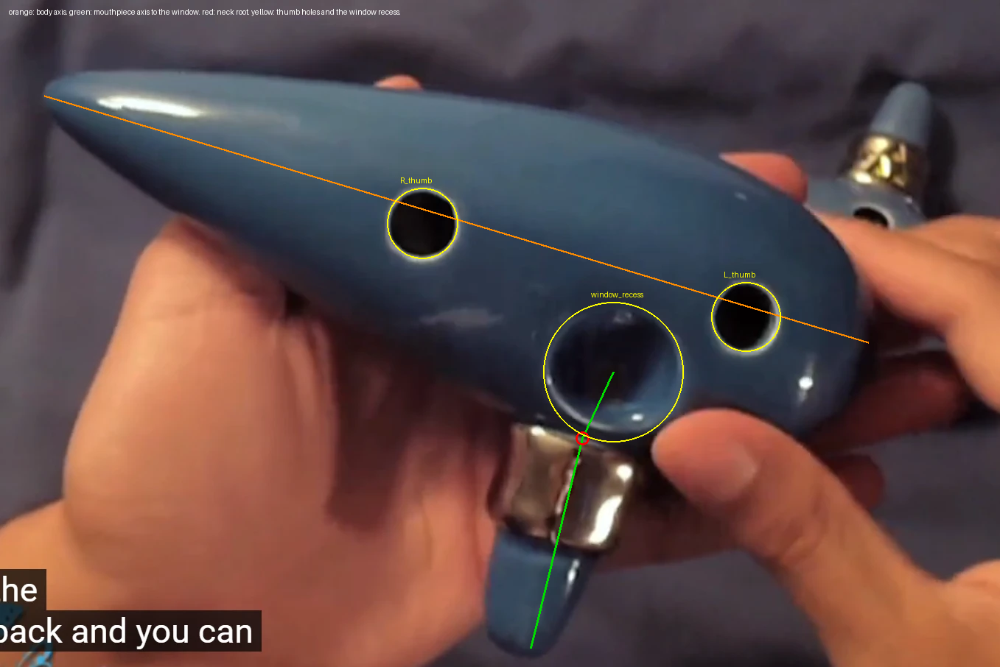

# Songbird "Ocarina of Time" 12-hole, Alto C and Tenor A: photo analysis

The maker sells one hand-made ceramic design, with the mouthpiece in line with the body, in two sizes:

| Model | Tuning | Size | Rating |
| --- | --- | --- | --- |
| **Ocarina of Time – 12-Hole Alto C** | Alto C, A4–F6 (maker) | **not stated by the maker** | 4.8 stars, 244 reviews on the maker's page |
| **Ocarina of Time 12-Hole Tenor A** | Lower than the Alto C: between alto C and bass (owner, 2026-11-16) | 8 in L × 3 in W × 2.25 in thickness, just under 1 lb (maker) | Tone 9, Tuning 9, Ergonomics 7, Aesthetic 10 by a professional player (owner's screenshot) |

This file was first written with every photo taken as the Tenor A. The owner corrected that on 2026-11-16, and the photos were sorted again (section 2). **The measured photo is the Alto C.** The first version applied the Tenor A's 8 in to it; every millimetre of that version was 20 % too large for the instrument in the picture. Fractions of the body length were not affected.

Reproduce the numbers with:

```bash
python Analizes_ocarinas/Songbird_OoT_12h/measure_songbird.py
```

Raw tables: [measure_output.md](measure_output.md). The studies that use them: [docs/07](../../docs/07-windway-and-body-shape.md), [ceramic_volume_check.md](../Windway_and_body_shape/ceramic_volume_check.md).

**Confidence key:** **M** = measured from pixels. **D** = derived. **A** = assumption.

## 1. Sources

Read on 2026-11-16: the maker's pages for the [Alto C](https://www.songbirdocarina.com/products/oot-12-hole-alto-c) and the [Tenor A](https://www.songbirdocarina.com/products/oot-12-hole-tenor), and for the [wooden chest](https://www.songbirdocarina.com/products/wooden-chest) (interior 7 1/8 in × 4 1/2 in × 3 1/2 in; "the 12-Hole OoT" fits). The range A4–F6 of the Alto C is the maker's text as quoted by a [catalogue site](https://part-ocarina.com/ocarina/the-ocarina-of-time-12-hole-in-alto-c-267); the maker's own page says "Key of Alto C" and "one octave and a sixth".

## 2. Photos, sorted by model

| File | Model | Why | Used for |
| --- | --- | --- | --- |
| [altoC_01_top_face_product.png](images/altoC_01_top_face_product.png) | Alto C | It is the main picture of the maker's Alto C page (`homepage-cutout-oot-12-hole-alto-c`) | **Outline, mouthpiece, 10 finger holes** |
| [altoC_02_in_wooden_chest.png](images/altoC_02_in_wooden_chest.png) | Alto C | On the Alto C page; the chest holds the Alto C | Size check |
| [altoC_03_oblique_with_lego.png](images/altoC_03_oblique_with_lego.png) | Alto C | Owner | Size check (rough) |
| [altoC_04_listing_oblique_lowres.png](images/altoC_04_listing_oblique_lowres.png) | Alto C | Owner (retail listing) | Not measured: 300 px |
| [altoC_05_video_thumb_face.png](images/altoC_05_video_thumb_face.png) | Alto C | Owner. A second ocarina in the background is ignored | **Thumb holes, window, mouthpiece direction** |
| [altoC_06_video_finger_face_held.png](images/altoC_06_video_finger_face_held.png), [altoC_07_video_finger_face_oblique.png](images/altoC_07_video_finger_face_oblique.png) | Alto C | Owner | Not measured: blurred |
| [tenorA_01_review_held_top_face.png](images/tenorA_01_review_held_top_face.png) | Tenor A | The review frame with the scores | Hole size against a hand, by eye |
| [tenorA_02_video_playing_grip.png](images/tenorA_02_video_playing_grip.png) | Tenor A | Same review | The far flank is deep and round |
| [unsorted_01_top_face_on_shelf.png](images/unsorted_01_top_face_on_shelf.png), [unsorted_02_top_face_oblique_basket.png](images/unsorted_02_top_face_oblique_basket.png) | not known | Owner: unclear | **Not used** |
| [altoC_08_annotated_top_face.png](images/altoC_08_annotated_top_face.png), [altoC_09_annotated_thumb_face.png](images/altoC_09_annotated_thumb_face.png) | – | Generated | – |




The Tenor A page shows its own photo, on a dark background. It is not in the repository. Read by eye in the browser, it shows the same hole pattern, the same width / length (about 0.34) and the same mouthpiece station (about 0.36) as the Alto C picture. So the two models are taken as **one design at two sizes** (**A**).

The yellow and blue ceramic photos in `Ergonomic_reference_12hole/images` (04 and 05) show this design. The blue one is the Alto C product picture at a lower resolution.

## 3. Method

- **Body axis** = the longest chord of the body outline without the mouthpiece. Everything is measured as a **fraction of the body length**.
- The mouthpiece is cut off along a cubic fitted to the body edge on both sides of the neck (the red line in the first annotated picture).
- **Holes** = regions inside the body that are not glaze blue: the unglazed rim and the dark bore together. *Rim* is the long axis of that region; the bore is about 1 mm less.
- **Thumb face:** one oblique video frame. Landmarks were read by eye. Stations are given as they appear and after a one-dimensional projective correction that puts the neck root where the finger-face picture has it. The truth lies between the two.
- The finger-face photo is a plan view of a body that is about 0.8 as thick as it is wide. Holes on the flanks (both index holes) sit further apart on the surface than in the plan.

## 4. The size of the Alto C

The maker states none. The evidence:

| Evidence | Body length | Weight |
| --- | --- | --- |
| It fits the maker's chest: interior 181 × 114 mm | **at most 181 mm**. The overall height, far edge to mouthpiece tip, is 0.634 of the length, so 114 mm of depth gives the same limit, 180 mm | hard upper limit |
| Retail listing quoted by the owner: 6 × 4.5 × 8 (in) | **Does not hold up as the size of the instrument.** The measured proportions are 1 : 0.63 : 0.28 (length : overall height : thickness). A 6 in body would be 6 × 3.8 × 1.7 in; an 8 in body is the Tenor A (8 × 5.1 × 2.25 in). The three numbers fit a shipping box of 8 × 6 × 4.5 in. Only the 4.5 in could be a real dimension: the overall height of a 7.1 in body | weak |
| Holes against outline at A4 ([ceramic_volume_check.md](../Windway_and_body_shape/ceramic_volume_check.md) §3) | The air volume the twelve holes need for A4 and the air the outline holds agree at **165–175 mm**, and are compatible from 152 to 181 mm | medium (**D**) |
| Tenor A ÷ pitch ratio | If the Tenor A is this design three semitones lower: 203.2 / 1.189 = **171 mm** | medium (**A**) |
| Hand layout | At 152 mm the right-hand finger pitch would be 14.3–14.6 mm, less than the width of two fingers side by side (doc 06 §3.4). At 170 mm it is 15.9–18.6 mm | medium |
| Thumb on the thumb-face frame, minifigure on photo 03 | 155–190 mm and 140–185 mm | weak |

**Used here: 170 mm, as an estimate (A). The evidence allows 152–181 mm.** Every millimetre below is for 170 mm and carries about ±7 %. The fractions do not depend on it.

## 5. Outline and mouthpiece (M)

| Item | Fraction of the body length | Alto C at 170 mm | Tenor A at 203.2 mm |
| --- | --- | --- | --- |
| Largest width, at station 0.34 | **0.351** | 60 mm | 71 mm (maker: 3 in = 76 mm) |
| Thickness | – | about 45–48 mm (**A**: same section as the Tenor A) | 57 mm (maker) |
| Thickness / width | – | – | 0.80 on the scaled outline; 0.75 by the maker's own rounded numbers |
| Mouthpiece neck root, from the bulb end | **0.356** | 60.5 mm | 72 mm |
| Mouthpiece tip above the body edge | 0.280 | 48 mm | 57 mm |
| Overall height, far edge to mouthpiece tip | 0.634 | 108 mm | 129 mm |
| Neck width at the body (band skirt) / cap width | 0.210 / 0.086 | 36 / 15 mm | 43 / 17 mm |
| Outline area / area of its convex hull | 0.999: no concave part | | |
| Mouthpiece axis against the body axis | 90° in this view | | |
| Width at 0.1 / 0.8 / 0.9 of the length, as a fraction of the largest | 0.79 / 0.54 / 0.35 | | |

The outline is one smooth convex curve from the blunt bulb end to a pointed tail, nearly symmetric about the axis (53 % of the largest width is on the player side). The mouthpiece leaves the player-side edge, square to the body.

## 6. Finger holes (M) and layout (D)

| Hole | Station | Across / length (+ = player) | Rim Ø / length | Rim Ø at 170 mm | Dark core at 170 mm |
| --- | --- | --- | --- | --- | --- |
| L pinky | 0.087 | −0.037 | 0.046 | 7.7 | 5.7 |
| L ring | 0.204 | −0.040 | 0.064 | 10.9 | 9.6 |
| sub L | 0.215 | +0.022 | 0.032 | 5.5 | 3.6 |
| L middle | 0.312 | −0.058 | 0.062 | 10.5 | 8.8 |
| L index | 0.415 | −0.099 | 0.068 | 11.6 | 7.4 |
| R index | 0.557 | +0.087 | 0.060 | 10.3 | 7.5 |
| R middle | 0.650 | +0.030 | 0.036 | 6.1 | 4.5 |
| sub R | 0.640 | −0.018 | 0.026 | 4.5 | 3.2 |
| R ring | 0.742 | +0.009 | 0.048 | 8.2 | 5.5 |
| R pinky | 0.838 | +0.012 | 0.038 | 6.5 | 2.5 |

Layout in the frame of the hands (`ocarina_addon/ergonomics.py`):

| Metric | Alto C at 170 mm | Tenor A at 203.2 mm (same design assumed) | Add-on limit (doc 06) |
| --- | --- | --- | --- |
| Angle between the two hand lines | −4.2° | −4.2° | within ±10° |
| Rows apart, across | **36 mm** | 44 mm | 18–28 mm |
| Index holes, along | +16.6 mm (no overlap of the hands) | +19.8 mm | −22 to +5 mm |
| Left pitches, pinky → index | 20.0 / 18.6 / 18.8 mm | 23.9 / 22.2 / 22.4 mm | 16.5–20.5 mm |
| Right pitches, pinky → index | 16.3 / 15.9 / 18.6 mm | 19.5 / 19.1 / 22.2 mm | 16.5–20.5 mm |
| Left span / right span | 56.8 / 49.4 mm | 67.9 / 59.0 mm | 50–60 mm |
| Left subhole | from L ring, 10.6 mm, 1° off the normal | 12.7 mm | 7–11 mm, within 20° |
| Right subhole | from R middle, 8.3 mm, 2° off the normal | 9.9 mm | 7–11 mm, within 20° |

Readings:

1. **One subhole per hand, straight forward of L ring and R middle**, within 2° of the hand line's normal. This is the rule the owner fixed on 2026-11-15.
2. **The two rows of holes are far apart across the body**: 0.21 of the body length, 36 mm at 170 mm, against 19–26 mm on the Miracle and the ECAN3 models. The left row runs along the far flank, the right row along the player flank.
3. **The hands do not overlap along the body.** The R index hole is 0.10 of the length tailward of the L index hole.
4. The left hand has the larger holes and the larger pitch, as on every other reference.

## 7. Thumb face of the Alto C (M, rough)

| Feature | Station as it appears | Corrected | Rim / body length | At 170 mm |
| --- | --- | --- | --- | --- |
| L thumb hole | 0.15 | 0.19 | 0.081 | 14 mm |
| Window recess | 0.27 | 0.34 | 0.163 | 28 mm across |
| R thumb hole | 0.54 | 0.61 | 0.082 | 14 mm |

- **The window is on the thumb face, on the mouthpiece axis, at the root of the mouthpiece.** It sits at the bottom of a round, cone-shaped recess about 28 mm across. The opening itself is in shadow and cannot be measured.
- The L thumb hole is bulb-ward of the window and the R thumb hole tailward, near the station of the R index and R middle holes. This is the order of the Miracle, the Spencer and both ECAN3 models.
- Both thumb rims are about 14 mm at 170 mm, larger than any finger hole.
- How far the mouthpiece drops out of the plane of the body cannot be read from this frame.

## 8. The Tenor A: notes on the size

The owner's interest: a pitch between alto C and bass, and a longer body, as a possible compromise for a longer ocarina. What the numbers say:

| Item | Tenor A | Source |
| --- | --- | --- |
| Outer size | 203 × 71–76 × 57 mm | maker; scaled outline |
| Scale against the Alto C | × 1.19 if the Alto C is 170 mm; 2^(3/12) = 1.189 is three semitones | **A** |
| Air volume | 176–237 cm³ | outline, maker's thickness, mass ([check](../Windway_and_body_shape/ceramic_volume_check.md) §2) |
| Lowest note the size fits | **about F♯4** (G4 to F4 within the error). A 12-hole in A has F♯4–D6 | holes against outline (**D**) |
| Finger pitch, left / right | 22–24 / 19–22 mm | scaled layout (**A**) |
| Hand span, left / right | 68 / 59 mm | scaled layout (**A**) |
| Finger-hole rims | 5–14 mm; four of them 12–14 mm | scaled layout (**A**) |
| Thumb-hole rims | about 16.5 mm | scaled from the Alto C frame (**A**) |

Readings for this project:

1. **A longer body is acoustically safe when the pitch drops with it.** If every dimension grows by 1.19 and the pitch falls by three semitones, the first cavity mode keeps its distance from the top note: both scale together. Growing a body at a fixed pitch does the opposite. The seed body of doc 07 has its first mode at 1.36 × F6 at 80 cm³; at 125 cm³ and the same pitch the same shape would be near 1.17.
2. **The price is in the hands.** At 1.19 the finger pitch passes 22 mm on the left hand, the left span reaches 68 mm, and four finger holes have rims of 12–14 mm. The reviewer's lowest score was ergonomics, 7. A body of this length with the hole positions kept in millimetres (the add-on's hand template) would not have this cost: the extra length becomes land past the pinky holes.
3. **The hole sizes are the open point.** Lower pitch and more air make every hole larger in the lumped model, and the left index and both thumbs are already over the pad limits at 80 cm³ (doc 04).
4. Nothing here was measured on a Tenor A. Its own photo is on the maker's page only. A tuner reading of its lowest note, and a plan photo with a ruler, would turn these notes into data.

The scope of the add-on is the 12-hole alto C. These notes are a record for a later decision, not a change of scope.

## 9. Limits

- The Alto C has one near-orthographic photo and one oblique thumb-face frame. Its length is an estimate.
- The Tenor A numbers are the Alto C design scaled; the only Tenor A measurements are the maker's three dimensions and its weight.
- Rim diameters are not bore diameters. The wall thickness is not visible on any photo.
