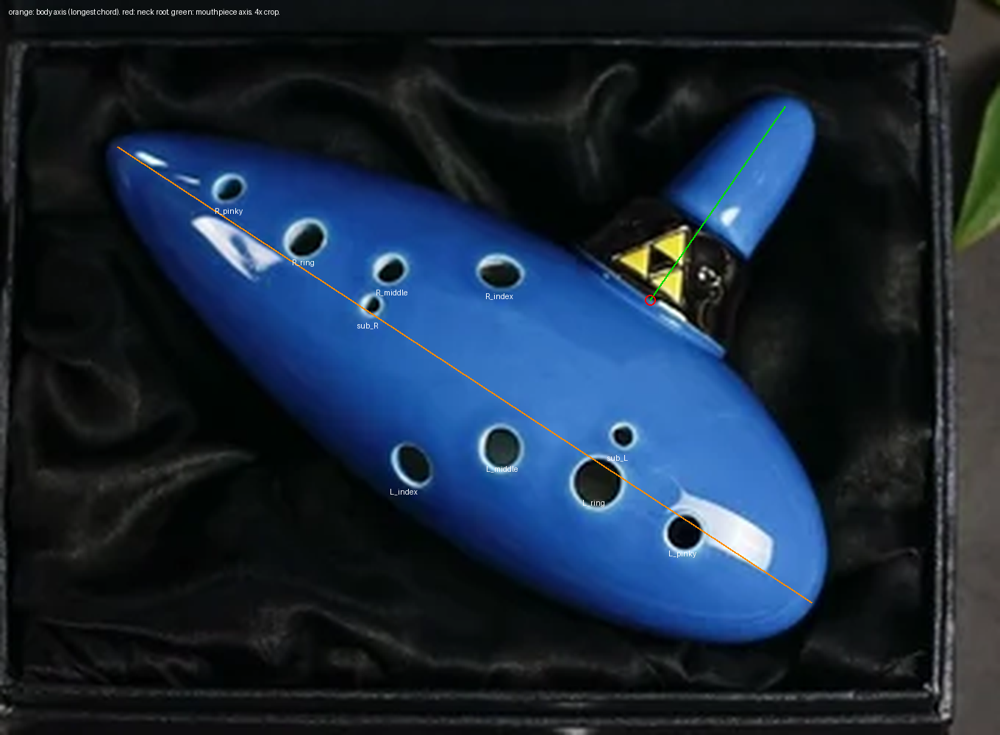
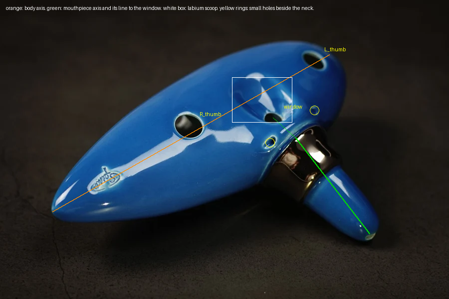
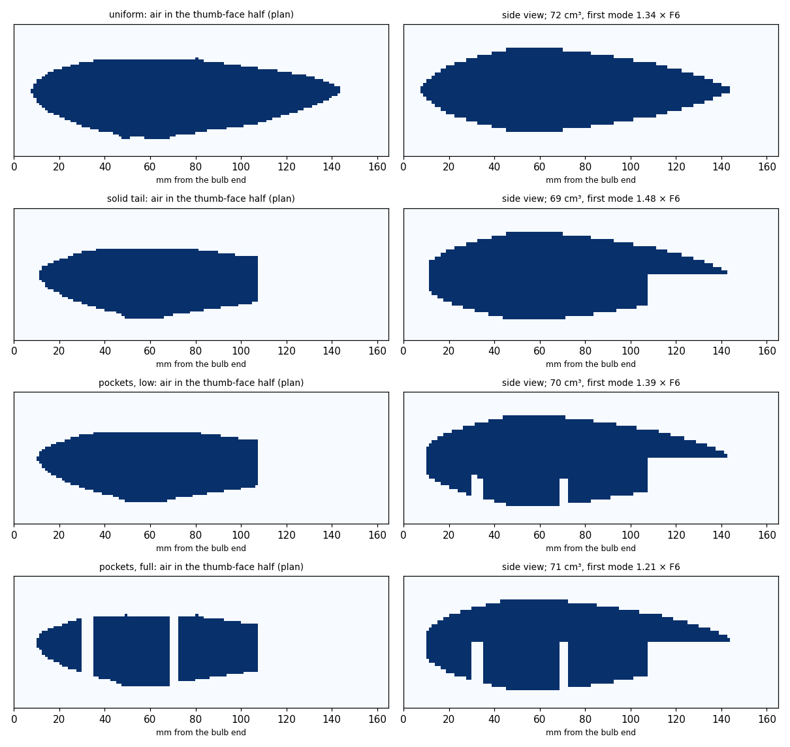

# Spencer "Special Edition Series – Ocarina of Time": photo analysis

A reference instrument: a hand-made ceramic 12-hole **alto C (A4–F6)** with the mouthpiece in line with the body, rated by a professional player at Tone 10, Tuning 10, Ergonomics 8, Aesthetic 10 (owner's screenshot, image 02). It was analysed from photos only. It is used for the **body outline**, the **position of the mouthpiece and the window**, and the **hole layout on both faces**.

Reproduce the numbers with:

```bash
python Analizes_ocarinas/Spencer_OoT_12h/measure_spencer.py
```

The raw tables are in [measure_output.md](measure_output.md). The cross-reference study is [docs/07](../../docs/07-windway-and-body-shape.md).

**Confidence key:** **M** = measured from pixels. **D** = derived. **A** = assumption. No photo is orthographic, so this analysis is rougher than the Miracle's and the Songbird's.

## 1. What the instrument is

From the [product page](https://spencerocarina.com/collections/frontpage/products/ocarina-of-time), read 2026-11-16:

| Item | Value |
| --- | --- |
| Tuning | "Tuned to C5 at 440 Hz"; 12 tone holes; range A4–F6 |
| Size | Length 16.5 cm; weight 330 g ("varies slightly") |
| Breath | "Comfortable breath pressure with a modest curve" |
| Subholes | Sold in two layouts: **Split** (one per hand) and **Single hand** (both on the right hand) |
| Material | Ceramic, sky-blue glaze, white-gold-plated ring |

## 2. Source images

| File | What it shows | Used for |
| --- | --- | --- |
| [01_video_playing_grip.png](images/01_video_playing_grip.png) | Playing grip from the front | The far flank is deep and round |
| [02_review_top_face_oblique.png](images/02_review_top_face_oblique.png) | Finger face, close and oblique, with the reviewer's scores | Layout check (split variant) |
| [03_top_face_in_box.png](images/03_top_face_in_box.png) | Finger face from above; **split** variant | **Outline, mouthpiece, hole stations (primary view)** |
| [04_back_face_oblique.png](images/04_back_face_oblique.png) | Thumb face, strongly oblique | **Thumb holes, window, mouthpiece direction** |
| [05_top_face_album_cover.png](images/05_top_face_album_cover.png) | Finger face, oblique; **single-hand** variant | Mouthpiece station, hole sizes |
| [06_top_face_with_songbook.png](images/06_top_face_with_songbook.png) | Finger face, oblique; **single-hand** variant | Mouthpiece station, hole sizes |
| [07_annotated_top_face_box.png](images/07_annotated_top_face_box.png), [08_annotated_back_face.png](images/08_annotated_back_face.png) | Generated | – |
| [09_edge_view_in_hands.png](images/09_edge_view_in_hands.png) | Seen from the mouthpiece end, held in two hands; a small scan | **Thickness** (§7) |
| [10_workshop_unfired_batch.png](images/10_workshop_unfired_batch.png) | A table of unfired instruments of several models (maker's post) | Not measured |
| [11_workshop_half_shell_inside.png](images/11_workshop_half_shell_inside.png) | The inside of a thumb-face half before joining (maker's post) | **Walls and pockets** (§7) |
| [12_workshop_press_moulds.png](images/12_workshop_press_moulds.png) | Both halves pressed in their plaster moulds (maker's post) | **Walls and pockets** (§7) |
| [13_cavity_model.png](images/13_cavity_model.png) | Generated by `internal_cavity_check.py` | – |




## 3. Method

- The body is the largest glaze-blue region of each photo. **Body axis** = its longest chord. **Scale** = 165 mm on that chord.
- Landmarks (hole seeds, the two ends of the band skirt, the mouthpiece tip) were read off the photos by eye; the code snaps each hole seed to the nearest dark opening.
- **Stations along the body are the reliable numbers.** Photo 03 was taken from above. The hole stations of the two oblique photos differ from it by 0.06 to 0.11, in opposite directions, and photo 03 lies midway within 0.01 for every hole. That is the parallax of holes that sit on a deck well above the outline, and it shows photo 03 is close to a straight-down view. The neck root sits on the outline and moves much less: 0.363, 0.378 and 0.383.
- Distances **across** the body depend on how the body is rolled in the box. They are marked "apparent".
- **Hole sizes** are the long axis of the unglazed opening. Photos 05 and 06 are larger; their local scale is set per hand so that their finger pitches equal those of photo 03 (**A**: the eight finger holes are in the same places on both variants). Treat sizes as ±15 %.
- **The thumb face** has one photo, taken from the tail end at a low angle. Its stations are given twice: as they appear, and after a one-dimensional projective correction that puts the neck root where photo 03 has it. The truth lies between.

## 4. Outline (M)

| Item | Value |
| --- | --- |
| Length | 165 mm (maker) |
| Largest apparent width | **57 mm at 0.30 of the length from the bulb end**; width / length **0.35** |
| Outline area / convex hull area | 0.98–0.99 on the three photos. The small deficit is the band skirt and the highlights, not a waist |
| Width at 0.1 / 0.8 / 0.9 of the length, as a fraction of the largest | 0.70 / 0.56 / 0.33 |
| Thickness | **About 45 mm; thickness / width about 0.79.** The edge view reads 35–45 mm, and only the top of that fits the mass and the holes (§7) |
| Chamber | **About 70 cm³ (65–80)**, where the holes, the mass and the thickness meet (§7). The holes alone give 67–101 cm³ |

The outline is the same family as the Songbird's: a smooth convex seed, blunt at the bulb end, pointed at the tail, with the same width / length.

## 5. Mouthpiece and window (M)

| Item | Value |
| --- | --- |
| Neck root | **0.36–0.38 of the length from the bulb end** on three photos (0.363 on photo 03) |
| Mouthpiece axis against the body axis, plan view | 87–98° on three photos: square within the error |
| Neck width at the body | about 36 mm |
| Window | **On the thumb face, on the mouthpiece axis.** The dark opening lies at the mouthpiece end of a scooped ramp about 30 × 20 mm; the ramp runs on, away from the mouthpiece, so the labium is on the far side of the opening |
| Window centre from the neck root | about 60 px on photo 04: roughly 16–20 mm in from the player-side edge |
| Window station | 0.25 as it appears, 0.40 corrected: at the mouthpiece station within this photo's error |
| Out of the plane | On photo 04 the body rests on the mouthpiece tip and on its far edge: the mouthpiece drops toward the thumb face |
| Two small holes beside the neck | One on each side of the windway line, on the thumb face. Probably for a cord (**A**). They are not tone holes |

## 6. Holes (M, rough) and layout (D)

Finger face, photo 03 (split variant). Sizes are means over the photos that show the hole clearly.

| Hole | From the bulb end, mm | Station | Rim Ø mm | Rim Ø / body length |
| --- | --- | --- | --- | --- |
| L pinky | 29.2 | 0.177 | 8.2 | 0.050 |
| L ring | 49.0 | 0.297 | 9.8 | 0.059 |
| sub L (split) | 49.8 | 0.302 | 4.1 | 0.025 |
| L middle | 68.7 | 0.416 | 8.7 | 0.053 |
| L index | 82.2 | 0.498 | 8.6 | 0.052 |
| R index | 87.7 | 0.531 | 9.2 | 0.056 |
| R middle | 106.2 | 0.644 | 5.8 | 0.035 |
| sub R (split) | 105.6 | 0.640 | 3.4 | 0.021 |
| R ring | 123.4 | 0.748 | 7.8 | 0.048 |
| R pinky | 141.8 | 0.860 | 4.9 | 0.030 |
| Single-hand variant: subhole beside R index / beside R middle | – | – | 5.7 / 4.1 | 0.035 / 0.025 |

Thumb face, photo 04:

| Feature | Station as it appears | Corrected | Reading |
| --- | --- | --- | --- |
| L thumb | 0.05 | 0.10 | Near the bulb end, bulb-ward of the window |
| Window | 0.25 | 0.40 | On the mouthpiece axis |
| R thumb | 0.49 | 0.66 | Near the R middle hole |
| Thumb hole size | – | – | About 12 ± 2 mm each. The left one looks smaller only because it is further from the camera |

Layout in the frame of the hands, photo 03:

| Metric | Value | Add-on limit (doc 06) |
| --- | --- | --- |
| Angle between the hand lines | +5.0° | within ±10° |
| Hand lines apart, across | **42 mm (apparent)** | 18–28 mm |
| Pinky to pinky | 113 mm | – |
| Left pitches, pinky → index | 19.8 / 20.3 / 19.6 mm | 16.5–20.5 mm |
| Right pitches, pinky → index | 18.4 / 17.7 / 21.8 mm | 16.5–20.5 mm |
| Left span / right span | 56.6 / 56.3 mm | 50–60 mm |
| Index holes: across / along | 42 (apparent) / −8 mm | 18–28 / −22 to +5 mm |
| Left subhole (split) | from L ring, 10.3 mm, 16° off the normal | 7–11 mm, within 20° |
| Right subhole (split) | from R middle, 7.5 mm, 11° off the normal | 7–11 mm, within 20° |

Readings:

1. **Split variant: one subhole per hand, forward of L ring and R middle**, 10.3 and 7.5 mm. The add-on uses 9.5 and 7.5 mm from the same two fingers.
2. **Single-hand variant: both subholes on the right hand, beside R index and R middle.** This is the layout of the Miracle (doc 06 §3.1). One maker sells both, with the eight finger holes unchanged.
3. **The two rows are far apart across**, as on the Songbird: about 35–42 mm against 19–26 mm on the Miracle and the ECAN3 models. A round body carries the rows on its flanks.
4. **Finger pitch 18–20 mm and spans of 56 mm** on an instrument scored 8 for ergonomics; the Songbird, with pitches of 19–24 mm at its real size, scored 7.
5. Hole sizes relative to the body are the same as the Songbird's to 25 % smaller, with the same pattern: the left-hand holes are the largest, R middle and R pinky the smallest finger holes.

## 7. Thickness, walls and the chamber (edge view and workshop photos)

Added on 2026-11-16 from four more photos of the owner's: one edge view and three pictures the maker posted from the workshop. **The workshop photos do not name the model.** The outline in them fits this instrument (pointed tail, mouthpiece at 0.35–0.40 of the length from the bulb end), so they are read as this design or a close relative, and only as fractions of the body length. Millimetres below are those fractions on a fired body of 165 mm.

### 7.1 What the photos show (M, by eye on enlarged crops)

| Photo | Reading |
| --- | --- |
| 09, edge view | Seen from the mouthpiece end. The body is 66 px thick. Scale from the instrument itself (bulb end to mouthpiece axis, 0.36–0.38 of the length): **35–40 mm**. Scale from the width of the fingers behind it: up to **45 mm**. The photo is 348 px wide |
| 12, finger-face half in its mould | The clay band at the joint plane is 0.025–0.075 of the body length wide: **4–12 mm**, typically 7 mm, thickest on the far side of the tail. End walls: 0.06 at the bulb end (9 mm), 0.08 at the tail (13 mm). The floor of the recess carries rounded marks at the stations of the finger holes; the photo does not show whether they are raised or sunk |
| 12, thumb-face half in its mould | **Hollow only in three pockets**: 0.04–0.18 (under the left thumb), 0.21–0.42 (under the window, beside the mouthpiece) and 0.44–0.65 (under the right thumb). The walls between them are 3–5 mm thick and reach the joint plane. **From 0.65 to the tail tip this half is solid clay** |
| 11, thumb-face half held open | The same three pockets, with lower, rounder ridges between them and a shallow trough running on into the tail. Scored joint band 0.12–0.16 of the local width: 6–8 mm. Each thumb hole sits at the bottom of a round pocket about 2.5 hole diameters across, and the lip of the hole is about a quarter of its diameter: **about 3 mm**. The window is at the root of the mouthpiece; the wooden stick that forms the windway shows through it |
| 10, unfired batch | Several models, no scale. Not measured. The bodies of this style are round in section |

Photos 11 and 12 differ in the height of the ridges and in the tail. They may be two moulds, or the same half before and after trimming.

### 7.2 Air volume (D)

Three rough inputs are set against each other in [ceramic_volume_check.md](../Windway_and_body_shape/ceramic_volume_check.md) §1:

| Route | Result |
| --- | --- |
| The twelve holes, lowest note A4 | 67–101 cm³ with chimneys of 5–6 mm; up to 118 cm³ if the chimneys are 3 mm |
| Outline × thickness − 330 g of fired clay | at most 31 cm³ at 35 mm and 53 cm³ at 40 mm; 39–75 cm³ at 45 mm; 52–88 cm³ at 48 mm |
| Where they meet | From 43.5 mm of thickness up; at 45 mm: **67–75 cm³** |

**Working value: about 70 cm³ of air (65–80) in a body about 45 mm thick (thickness / width 0.79).** The fired clay is then 124–150 cm³, about two thirds of the body. A shell of even thickness would have to be about 8 mm to hold that much clay; the photos show how it is distributed instead: a thick band at the joint, thin lips at the holes and a solid tail. The three inputs only just meet. A kitchen scale and a caliper on a real instrument would replace all of this.

### 7.3 The chamber and the first cavity mode (D, a model)

[internal_cavity_check.py](internal_cavity_check.py) builds the body from the measured outline at 45 mm and compares chambers of 70 cm³ with the add-on's cavity-mode solver (all holes closed). Output: [internal_cavity_check.md](internal_cavity_check.md).

| Chamber, 70 cm³ | Chamber length | First cavity mode ÷ F6 |
| --- | --- | --- |
| For comparison: a shell of 6 mm (101 cm³, 261 g at most) | 146 mm | 1.25 |
| Shell of even thickness, 8.25 mm | 136 mm | 1.34 |
| Thumb-face half solid past the last pocket | 131 mm | **1.48** |
| The same, with low ridges between the pockets (photo 11) | 132 mm | 1.39 |
| The same, with walls up to the joint plane (photo 12) | 134 mm | 1.21 |



Readings:

1. **The chamber is about 131–136 mm long in a body of 165 mm.** Thick walls and thick ends do this, and it lifts the first cavity mode from 1.25 to 1.34 × F6.
2. **The solid tail is the part that helps most**: + 0.14. It takes air out of the far end of the chamber, where the first standing wave has its pressure maximum.
3. **The walls between the pockets lower this margin.** Low ridges cost 0.09; walls up to the joint plane cost 0.27 and put the mode at 1.21 × F6. **They are a deliberate device: the partial partitions of US 7,799,980 B1** (inventor Norman Spencer Register; lapsed in 2014), which the owner pointed to later the same day. The patent places one between the window and each thumb hole, to keep the tone of the high notes when the thumb holes open. This closed-hole model cannot test that claim. See [US7799980_partitions.md](../Patent_US7799980/US7799980_partitions.md): experimental, parked.
4. The owner's reading is that this chamber stabilises the high notes. The model supports that for the thick walls and the solid tail, by the one measure the add-on has. It says nothing about tone, breath or the open-hole case.

Against the STL references: the ECAN3 Eclipse also has thick, uneven walls (median 6.2 mm; a quarter of the chamber surface has more than 9 mm behind it), and the ECAN3 Ocarina of Time has thin ones (median 2.8 mm). Neither has walls inside the chamber: their section area runs smoothly from end to end. Their first cavity modes are 1.27 and 1.19 × F6 (doc 06 §3.10).

Against the seed test body: its chamber is 132 mm long at 80 cm³ and its first mode is 1.36 × F6. **A printed seed with a 4 mm wall (140 mm outside) has about the chamber of this instrument (165 mm outside).**

### 7.4 The clay internals read again for smoothness (2026-11-20)

The owner sent photos 11 and 12 again on 2026-11-20 with a picture of the add-on's slab walls beside them, and asked to "take another look at the clay internals rather than the chart drawings" and to keep the inside of the chamber smooth. Read for the shape of the surfaces, not for stations:

| What the clay shows | What it means for a printed body |
| --- | --- |
| The thumb-face half is a thick slab of clay with **three scooped pockets**. Nothing in it is a wall that was added: the ridges between the pockets are what the scoop left standing | A thick thumb-face wall with pockets left in it, not slabs standing on a thin wall |
| The ridges are **broad and round**: about as wide at the foot as a thumb hole (10 to 12 mm), with no flat faces and no sharp inside corner | Sides that rise over several millimetres, a rounded top |
| Each thumb hole sits at the bottom of a **round funnel** about 2.5 hole diameters across; the hole's own lip is about 3 mm | The wall is thick, but the hole's chimney is short |
| The finger-face half (photo 12, upper mould) carries a **round dimple at every finger hole** on the inside | The same idea on the deck: thick wall, short chimneys |
| The pocket under the window is the largest and runs straight into the root of the mouthpiece | The chamber follows the neck's root |
| The tail of the thumb-face half is solid | Raises the first cavity mode (section 7.3) |

The owner's Blender reference of the same day (`Analizes_ocarinas/Low_voicing/ref_oot_blend/`) does the same in a printable model: a 5.3 mm wall, hollowed from inside to 1.3 to 2.3 mm at each hole. The trials that follow from this reading are the *ridge field* of the low-voicing record, [Low_voicing.md](../Low_voicing/Low_voicing.md) section 11. Copies of the two photos as the owner sent them: `Analizes_ocarinas/Low_voicing/reference_photos/spencer_04_half_shell_inside.png` and `spencer_05_press_moulds.png` (the same files as `images/11_…` and `images/12_…` here).

## 8. Limits

- No orthographic photo, no scale bar. One oblique photo of the thumb face.
- Hole sizes are rims at ±15 %; the thumb holes are worse.
- The walls are uneven (§7): 4–12 mm at the joint, about 3 mm at the thumb holes, solid in the tail of the thumb-face half. The wall at the finger holes is not known.
- The workshop photos do not name the model, and the edge view is 348 px wide. The thickness, the air volume and the chamber model all rest on them.
