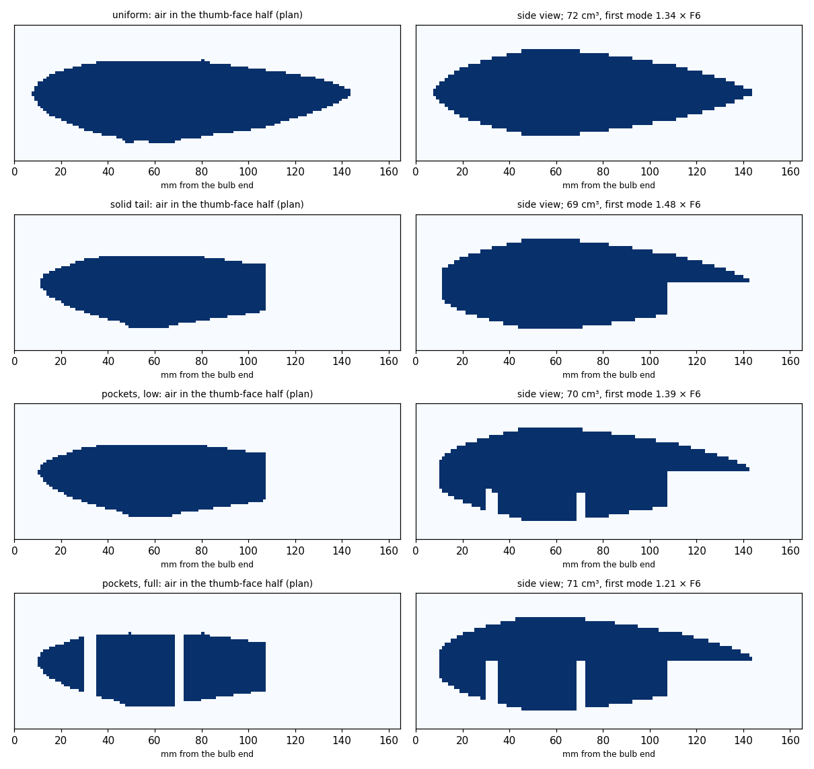

# Spencer OoT alto C: the pocketed chamber and the first cavity mode (generated by internal_cavity_check.py)

A voxel model (1.25 mm grid) of a body with the measured outline, 45 mm thick, elliptical sections; outer volume 194 cm³. Pockets of the thumb-face half, as fractions of the body length from the bulb end: 0.04–0.18, 0.21–0.42, 0.44–0.65. All holes and the window are closed. The pass line of the add-on's desk check is 1.3 × F6. The mass includes a mouthpiece of 45 g; the maker states 330 g.

## 1. With the walls as read on the photos

| Chamber | Walls: joint / finger face / pocket floor, mm | Air cm³ | Chamber length mm | First cavity mode, Hz | ÷ F6 | Mass at 1.9 / 2.3 g/cm³, g |
|---|---|---|---|---|---|---|
| uniform | 6.0 everywhere | 101 | 146 | 1746 | **1.25** | 223 / 261 |
| solid tail | 7 / 5 / 4 | 107 | 146 | 1864 | **1.33** | 211 / 246 |
| pockets, low | 7 / 5 / 4 | 104 | 146 | 1779 | **1.27** | 216 / 252 |
| pockets, full | 7 / 5 / 4 | 102 | 146 | 1575 | **1.13** | 221 / 257 |

These chambers hold about 105 cm³ and the body would weigh about 250 g. Both miss the instrument (about 70 cm³, 330 g): the real walls are thicker than the band at the joint suggests, or the pockets are shallower than assumed.

## 2. With the walls scaled so that the air is 70 cm³

| Chamber | Walls: joint / finger face / pocket floor, mm | Air cm³ | Chamber length mm | First cavity mode, Hz | ÷ F6 | Mass at 1.9 / 2.3 g/cm³, g |
|---|---|---|---|---|---|---|
| uniform | 8.25 everywhere | 72 | 136 | 1868 | **1.34** | 278 / 327 |
| solid tail | 11.2 / 8.0 / 6.4 | 69 | 131 | 2066 | **1.48** | 284 / 334 |
| pockets, low | 10.9 / 7.8 / 6.2 | 70 | 132 | 1946 | **1.39** | 281 / 331 |
| pockets, full | 10.5 / 7.5 / 6.0 | 71 | 134 | 1684 | **1.21** | 280 / 330 |

