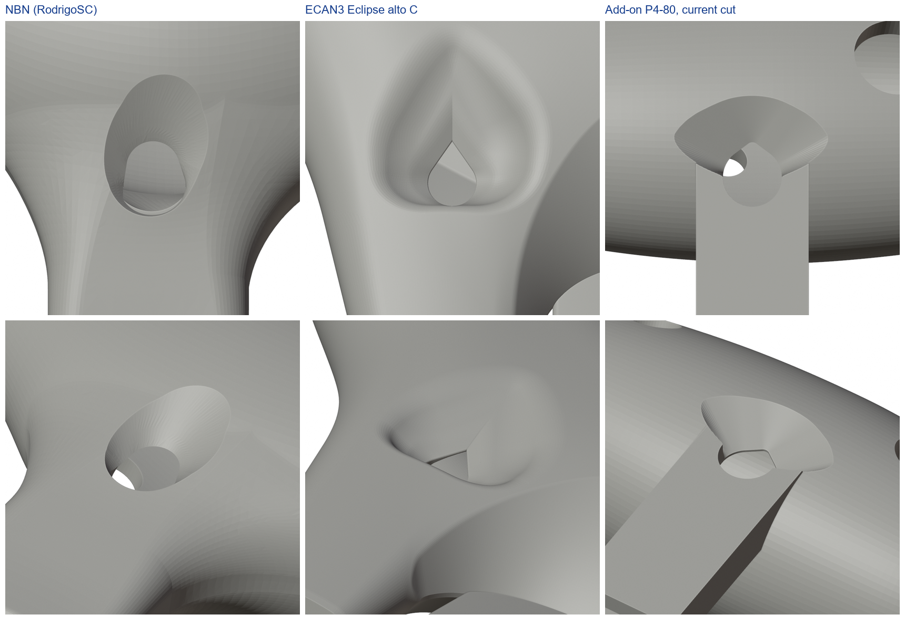
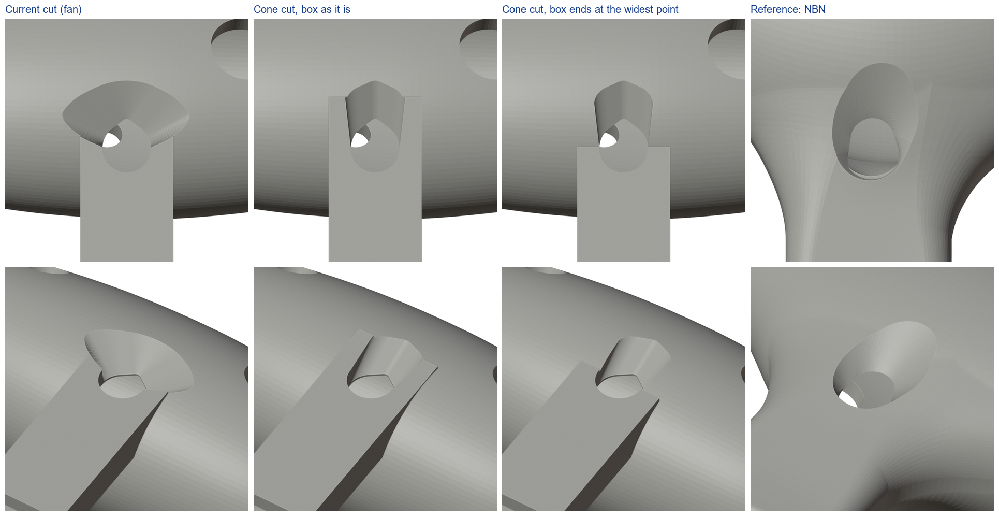
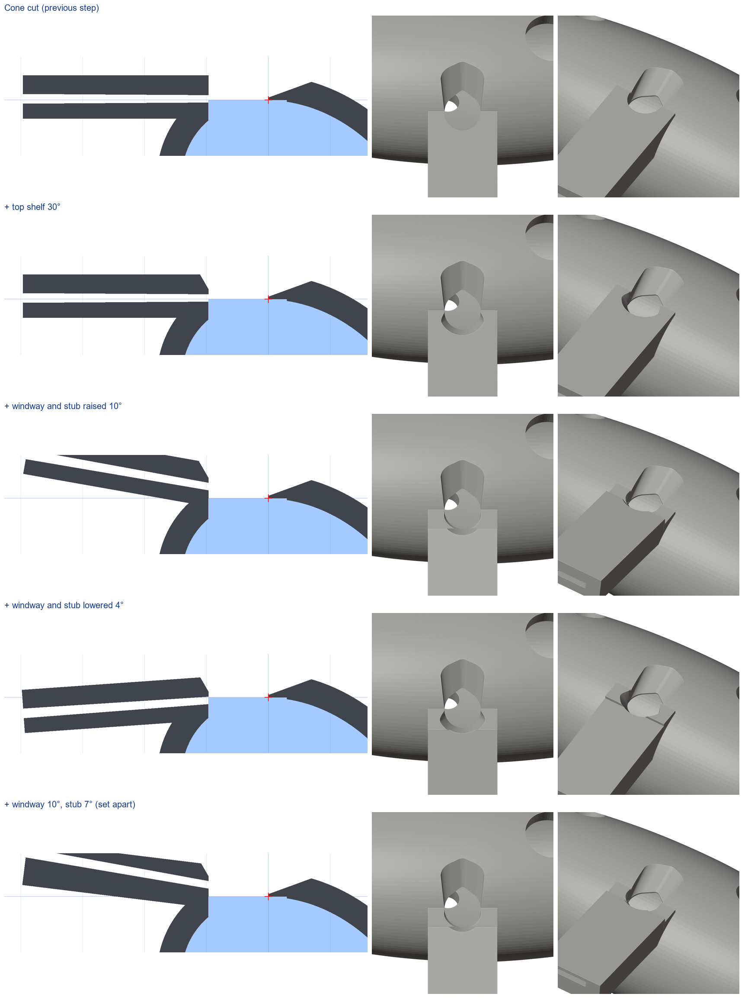
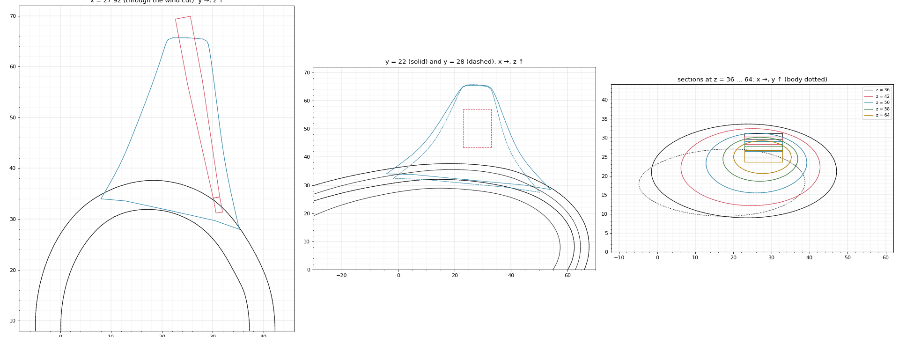
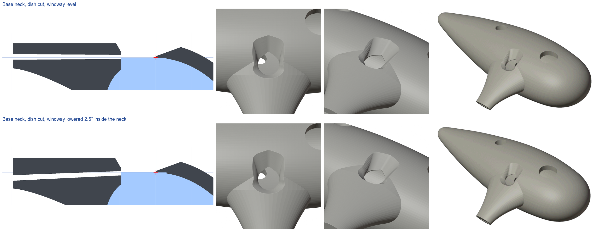
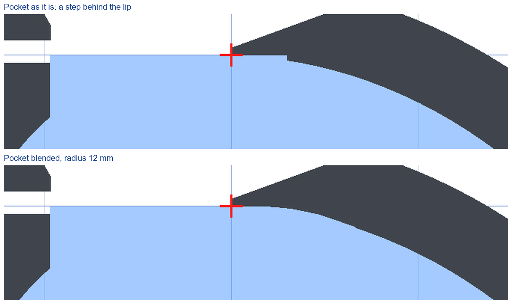
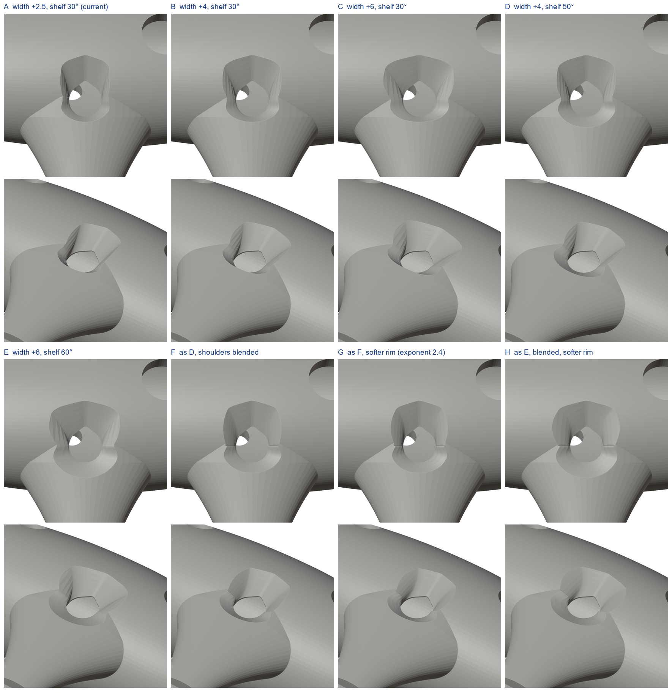
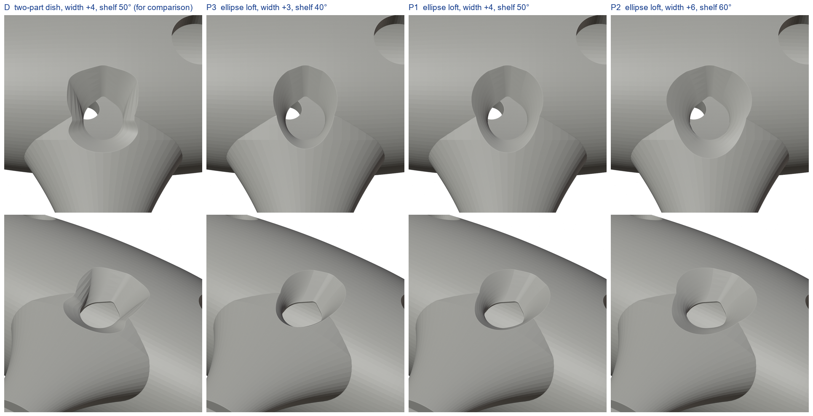
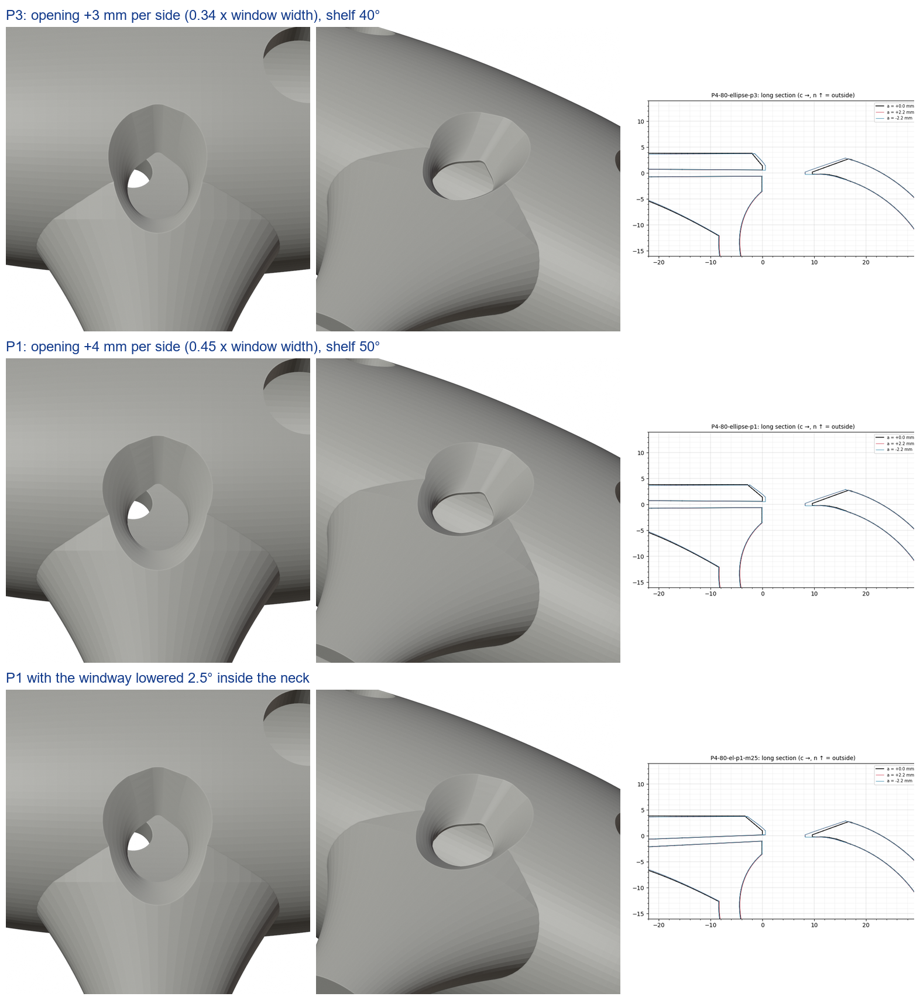
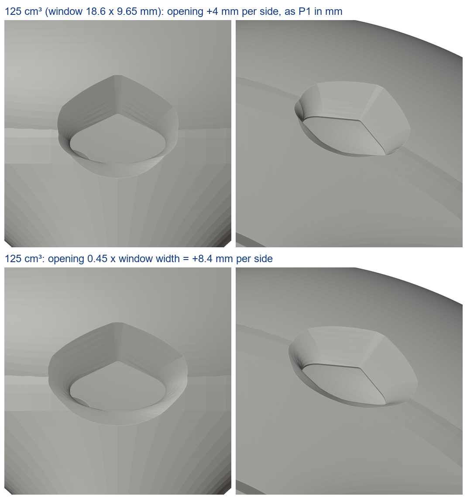

# The window cut-out: two reference models against the add-on

Written on 2026-11-17. The owner named the window section as the part of the generated bodies with the most room for improvement: it is seen from the outside, so it must be smooth, and it must work. Two STL models were reviewed to refine the approach.

**Sections 1 to 7 are the first review and proposal.** The owner found proposal A too wide: it breaks the look. **Section 8 is the refinement: a narrow cone cut, after the owner's idea, built as an experimental option and shown on two test bodies.** The default cut and the stage bodies are unchanged. **Section 12 is the owner's choice among the prototypes (the ellipse loft) and its validation.**

Reproduce with:

```bash
python Analizes_ocarinas/Window_cutout/measure_windows.py
```

```bash
"C:/Program Files/Blender Foundation/Blender 5.1/blender.exe" -b --factory-startup --python Analizes_ocarinas/Window_cutout/render_windows.py
```

## 1. The models

| Model | File | Notes |
| --- | --- | --- |
| NBN, by RodrigoSC | `NBN-with-holes.STL`, read from the owner's Downloads folder (not copied into the repository; its licence was not checked) | One closed body, 65 330 triangles, 153 × 112 × 44 mm, 66.9 cm³ of plastic. Its pitch and tuning are not known to me |
| ECAN3 Eclipse alto C | `Analizes_ocarinas/ECAN3_experimental/models/eclipse_12h_AC_assembly.stl` (the owner's `obj_1_Assembly.stl` is the same file, byte for byte in size) | Four bodies in one file; the windway floor is a separate insert. Published as tuned A4–F6 |
| Add-on P4-80 | `addon_out/P4-80/P4-80.stl` | The current cut, for comparison |

Every model is described in its own **window frame**: origin at the middle of the windway exit, **c** from the exit to the labium tip, **a** across, **n** out of the body. Which side is outside was settled by a ray cast from the middle of each window.



Sections: [NBN](images/sections_NBN.png), [Eclipse](images/sections_Eclipse.png), [P4-80](images/sections_P4-80.png).

## 2. Measurements

Read on the sections, to about ± 0.3 mm.

| Item | NBN | Eclipse | Add-on P4-80 |
| --- | --- | --- | --- |
| Windway length | 33 mm | 40 mm | 30 mm |
| Windway height, mouth end → exit | 4.5 → 2.35 mm | 3.7 → 1.0 mm | 1.56 → 1.20 mm |
| Windway width, mouth end → exit | 12.6 → 9.5 mm | 10 → 7 mm | 8.8 mm, constant |
| Windway line | Straight | Straight, then the last 3 mm turn 20° toward the labium | Straight |
| Window outline at the edge level | **U**: 9.5 mm wide, 11.3 mm long, a round end (R ≈ 4.7 mm) at the labium | **Teardrop**: round end Ø 7.2 mm at the exit, a point at the labium, 9.4 mm long | Teardrop: 8.81 mm wide, 9.65 mm long, round end at the exit |
| Labium edge | Blunt, about 1.1 mm; curved in plan | About 0.5 mm, rounded; a V in plan | 0.4 mm, a straight vertical land |
| Outer ramp against the jet | 25° | 11° for 4 mm, then along the jet | 20° |
| Inner face of the labium against the jet | 16°, on the same side: the jet enters the chamber at 16° to the wall | 11°, on the other side: a blade about 2.5 mm thick, symmetric about the jet | 0° for 3 mm (the flat ceiling of the pocket), then the chamber wall |
| Walls of the window, at its sides | Flare outward at about 35°; about 3 mm of wall | A lip about 1.5 mm deep with rounded edges, then a dish that opens at about 45° | Vertical, 4 mm deep |
| Wall above the exit, seen from outside | 1.2 mm: the windway floor is a thin plate | 6 mm, steep, with a rounded top edge (R ≈ 1 mm) | 3.1 mm, vertical, sharp |
| Ramp, seen from outside | A cone-shaped scoop 14–15 mm wide that runs out 10 mm behind the edge | A trough with a flat floor about 7 mm wide inside a heart-shaped dish about 16 × 25 mm; it fades out 15–20 mm behind the edge | A fan on the labium side only. It ends in a crest 6.9 mm behind the edge and 2.6 mm above it, where it meets the flat top of the block |
| What stands proud of the body | Nothing | Nothing | A box 16.8 mm wide, 1 to 1.5 mm proud at its sides, with vertical faces and sharp edges |

## 3. What the two references have in common

1. **The labium is the wall of the body, cut from outside.** Neither model adds a block around the window. The mouthpiece is a neck that grows out of the body, and it ends at the exit.
2. **The ramp is a scoop that is wider than the window** (1.5 to 2.3 times its width) and that runs out into the skin at a shallow angle. There is no crest and no step behind the labium.
3. **The sides of the window open outward.** A short lip (1.5–3 mm), then a flare of 35–45°. From outside the window reads as a dish, not as a hole with a ramp on one side.
4. **The edges that the eye meets are rounded or meet the skin at a shallow angle.** The only steep face is the one above the exit, which the jet needs.
5. **The jet does not run parallel to a flat face.** On the NBN it meets the wall at 16°. On the Eclipse the windway turns 20° at its end and the labium is a blade along the new direction.

They differ in the outline (a U against a teardrop) and in the labium (a thin wedge of the wall against a symmetric blade). The add-on's teardrop is the Eclipse's.

## 4. Where the add-on's cut falls short

| # | What is seen | Cause in `ocarina_addon/voicing_geo.py` |
| --- | --- | --- |
| 1 | A box stands on the body around the window | `block` is a plain box that reaches 4 mm beyond the labium (`BLOCK_FRONT_MM`) and gives the window a flat outer face |
| 2 | The ramp ends in a crest | The ramp rises at 20° from a labium that sits at the level of the chamber surface, so it climbs out of the wall and has to be stopped by the top of the block |
| 3 | The window is a deep hole with vertical walls | The throat is the outline pushed straight through 4 mm of wall |
| 4 | The ramp is a fan of flat facets on one side | The flare is applied only to outline normals within 60° of the jet, and goes to one ring at the top |
| 5 | Every edge is sharp | No ring of the cutter rounds an edge |

The functional core is sound and is not what is wrong here: the outline, the window length, the edge, the exit and the flat ceiling under the window come from the kernel's voicing record and measure as designed.

## 5. Proposed approach

### A. Dress the cut (withdrawn in part: steps A1 and A2 cut too wide, see section 8)

| Step | Change | From |
| --- | --- | --- |
| A1 | **A lip, then a dish.** The throat stays vertical for a land of about 1.5 mm above the inner plane. Above the land every side but the windway side flares: the labium side at the record's ramp angle, the sides at 40°, blended between the two | Eclipse lip 1.5 mm; flares 35–45° on both models |
| A2 | **The ramp becomes a trough cut from the body.** Its footprint is at least 1.6 times the window width, and the cutter runs on until it leaves the skin. With no block in the way the 20° ramp meets the curved skin about 9 mm behind the edge at a shallow angle | Both models |
| A3 | **No block downstream of the exit.** The added solid only covers the windway, as a rounded neck that ends in a steep face at the exit plane with a rounded top edge. The window face is the body's own skin | Both models |
| A4 | **Rounded rings.** Two or three extra rings on the cutter and on the neck give a radius of about 1 mm where a face meets the skin | Eclipse |
| A5 | **The kernel is told.** The throat is then 1.5 mm of land plus a flare, not 4 mm of straight wall, which raises the window's conductance. A new record value (the land height) enters the voicing hash, so the constants fitted on the stubs belong to this cut | – |

What does not change: the window outline and its area at the inner plane, the window length, the edge thickness, the windway, the pocket and the port position.

### B. Sink the labium (later, experimental)

Turn the voicing so that the jet meets the wall at 12–16°, as on the NBN. The labium then lies below the skin and the ramp is a scoop into the wall from the start. It changes the port frame, the pocket and the direction of the mouthpiece, and it needs its own checks.

### C. A blade labium (later, experimental)

The Eclipse's symmetric blade, with an inner face cut back at 11°. It needs an undercut on the chamber side and a windway that turns at its end.

## 6. Why the timing matters

The Stage 1 stubs fit the window constant η_w for each voicing, and the fitted value belongs to the geometry that was printed. A change of the throat after Stage 1 means printing the stubs again. **The cut should be settled before Stage 1.**

## 7. Limits

- Two models, one of unknown tuning. They show how a window can be shaped; they do not show that these shapes play better than the add-on's.
- The numbers were read on plane sections by eye. The frames were set by hand.
- Proposal A was not built. Its conductance change is not computed here.
- Print orientation was not considered. Flares of 45° or less print without supports in most orientations; a rounded neck may not.

## 8. Refinement: the cone cut (owner's idea, 2026-11-17)

### 8.1 The idea and what it needs

The owner's idea: cut the sharp window outline first, as a maker does in clay, then smooth the labium side with a second pass shaped as a cone, so that the cone fixes the ramp angle and leaves a sharp lip.

A cone keeps the lip sharp only where its surface passes through the window outline at the top of the lip. A separate ellipse would touch the teardrop at its tip and leave a thicker lip along the rest of the labium. So the cone here is drawn **through the window outline itself**:

- **Apex:** on the centre line, upstream of the window and below the inner plane.
- **Surface:** the straight lines from the apex through the outline at the top of the 0.4 mm lip. The lip keeps its thickness along the whole labium half.
- **Angle:** on the centre line the surface rises at the record's ramp angle (20°). Toward the sides it steepens a little, to 22.4° at the widest points of the window, because those points are nearer the apex.
- **Width:** one new value, `cone_widen_mm`, says how far each side opens at the outer face. It fixes the apex: at 1 mm the apex is 43.6 mm upstream of the labium tip and 15.5 mm below the inner plane.
- **Windway half:** untouched. From the exit to the widest points of the window the walls stay vertical.

The rim on the body is the window outline, enlarged and moved downstream. On the near-round window of the 80 cm³ bodies it is close to an ellipse with a small point.

### 8.2 Result on P4-80



| | Current cut (fan) | Cone cut, `cone_widen_mm = 1` |
| --- | --- | --- |
| Opening at a flat outer face, across | about 25 mm (2.8 × the window) | **10.8 mm** (1.23 × the window) |
| Ramp angle on the centre line, measured | 20.0° | 20.0° |
| Lip thickness, measured | 0.40 mm | 0.40 mm |
| Window area, length and width, measured | as the record | as the record |
| Plastic removed by the cut | more | less: the throat is closer to the straight 4 mm wall the kernel assumes |

Two test bodies, both with every check passing and the same 2 warnings as P4-80:

| Body | Build | What it shows |
| --- | --- | --- |
| `P4-80-cone` | `window_cut=cone cone_widen_mm=1` | The cone cut with the box as it is. The chute crosses the front edge of the box, which leaves a step |
| `P4-80-coneb` | the same, and `block_front_mm=-5.0` | The box ends at the widest point of the window. The labium half then sits in the body's own skin and the rim is one closed curve. **This is the cleaner of the two** |

Build them with:

```bash
"C:/Program Files/Blender Foundation/Blender 5.1/blender.exe" -b --factory-startup --python tools/geometry_check_variant.py -- P4 80 coneb window_cut=cone cone_widen_mm=1 block_front_mm=-5.0 --renders
```

### 8.3 What is still not smooth

1. **The mouthpiece box.** It is the largest remaining fault and it is not part of the window cut. A neck that grows out of the body, as on both references, is a separate piece of work.
2. **The rim is a crisp edge**, as on the NBN. A rounding pass (a radius of about 0.5–1 mm on the rim) is not built.
3. **The ramp ends 6.9 mm behind the lip** where it meets the falling skin. That is the same as before; it now reads as the end of a chute instead of a crest across a fan.

### 8.4 The ramp angle: what the two forum threads say

The owner supplied a summary with two bands (15–25° for clean high notes, 35–45° and more for stable low notes) and two threads of The Ocarina Network. I read the first thread and the first page of the second. **The two bands and their numbers are not in what I read**; the threads are qualitative:

- Several makers report that the ramp angle changes little over a wide range, and that the edge of the labium matters more than the ramp.
- What is said to matter is the angle between the ramp and the windway: best near zero, usually reached by angling the windway down. A steep ramp is said to hurt the high notes; a steeper, blunter labium to help the low ones.
- One maker notes that a very deep voicing is not ideal.

That agrees with the two STL models (the Eclipse's blade lies along its windway) and with the direction of the summary, and it does not contradict the add-on's 20°. The angle stays a value of the voicing record (15–25° allowed), and the cone cut takes it from there.

### 8.5 Status and open points

- `ocarina_addon/voicing_geo.py` has the option (`cut_style="cone"`), read from the preset values `window_cut`, `cone_widen_mm` and `block_front_mm`. **The default is the fan cut; no preset sets these values; the stage bodies are unchanged.**
- No test was added for the option. The two test bodies pass the add-on's own geometry checks.
- Open: whether the cone cut becomes the default; the value of `cone_widen_mm`; whether the box ends at the widest point; the rounding pass; the neck. The cut should be settled before Stage 1 (section 6).

## 9. The top shelf, the windway pitch and a stub set apart (owner's review of the cone tests, 2026-11-17)

The owner found the cone tests promising and asked for three things, with a see-through view of an instrument of his own, a sketch of the cone and a sketch of two voicings:

1. Take some of the top off: the cone has a second side, the *top shelf* or smoothing cut, above the windway exit.
2. Take the angle of the wind pipe into account, so that the pipe runs into the ramp smoothly. The pivot is the lip edge, so the entrance can be angled front to back and the jet keeps its aim.
3. Keep the outer geometry apart from the pipe cut-out, so that each can be adjusted, as in his picture.

A turn sideways is a different thing: it is a turn of the whole voicing, as on the Eclipse. It is not built.

### 9.1 What was built (experimental, all off by default)

| Setting | What it does | Default |
| --- | --- | --- |
| `shelf_angle_deg` | With the cone cut: the wall of the window above the windway exit is cut back at this angle from the normal. The cut is full within 60° of the upstream direction and fades to nothing at the widest points of the window, so the sides stay narrow | 0 (vertical) |
| `shelf_land_mm` | Plastic left above the windway roof at the exit before the shelf starts, so that the exit keeps a solid edge | 0.8 |
| `windway_pitch_deg` | Turns the windway cutter about the across axis through the lip edge. Positive: the mouth end is raised away from the body and the jet reaches the lip heading inward. Negative: the mouth end is lowered and the jet heads outward, along the ramp | 0 |
| `stub_pitch_deg` | The same turn for the outer stub. It follows the windway unless it is given | follows the windway |

In the owner's sketch the slope cut and the shelf cut are the two sides of one cone whose tip is set off from the lip. Here they are two surfaces of one cutter. The slope side keeps the far apex of section 8, which is what keeps it narrow and the lip sharp. The shelf side has its own angle. In the long section the two lines meet below the window, upstream of the lip: that point is the offset tip.

The stub is now a solid of its own when it is turned: it is cut off at the exit plane, and the flat pad around the window stays where it was. The checks and the capped-air measurement follow the turned windway.

### 9.2 Test bodies

All on P4 at 80 cm³ with `window_cut=cone cone_widen_mm=1 block_front_mm=-5.0 shelf_angle_deg=30`.



| Body | Extra settings | Result |
| --- | --- | --- |
| `P4-80-shelf` | – | Every check passes |
| `P4-80-p10` | `windway_pitch_deg=10` | One check fails: `voicing_keepouts`. The raised stub stands above the 45° flare the kernel keeps free outside the window (178 vertices). Everything else passes: the window, lip and windway measure as the record says, the capped air is 79.99 cm³, and there is 5.7 mm of plastic under the windway floor at the exit |
| `P4-80-m4` | `windway_pitch_deg=-4` | One check fails: `windway_floor_lip`. Only 0.49 mm of plastic is left under the windway floor at the exit (limit 0.8 mm) |
| `P4-80-p10s7` | `windway_pitch_deg=10 stub_pitch_deg=7` | As `P4-80-p10`: only the outside keep-out fails |

### 9.3 What the tests show

1. **The shelf works and stays narrow.** It takes the sharp top edge off the wall above the exit and leaves the exit itself alone.
2. **Raising the mouth end is free of trouble inside**, and it is the direction of the owner's own model and of the NBN. It makes the angle between the jet and the ramp larger (20° + the pitch), and the stub then breaks the outside keep-out rule. Whether that rule should bend for a raised mouthpiece is the owner's call.
3. **Lowering the mouth end is the direction that lines the ramp up with the windway** (the angle becomes 20° − the pitch), which is what the forum thread and the Eclipse describe. On this body it runs out of room at about 3°: the windway comes too close to the chamber just behind the exit. The Eclipse avoids this by turning only the last 3 mm of its windway.
4. **The box limits how far the stub and the pipe can differ**: about 4°, before the pipe leaves the box (2.4 mm of floor, 3.1 mm of roof over 30 mm). A first try with 8° and 14° failed for that reason. The owner's picture has a shaped neck with room around the pipe; the box has none.

### 9.4 Not built

- A shaped neck in place of the box. It is the largest remaining fault of the look and the thing that would let the pipe move freely inside the outer shape.
- A turn of the whole voicing sideways.
- A windway that turns only near its exit.
- A rounding pass on the rims.
- Tests for these options. The default build is unchanged and all four test suites pass.

## 10. The base neck, the hidden tilt and the dish (2026-11-17, after the owner's sample)

### 10.1 The owner's sample

`ocarina-body+neck+wind cut.stl`, read from the owner's Desktop (not copied). It holds three shapes: a body, a neck and a wind cut. Scripts: [sample_split.py](sample_split.py), [sample_sections.py](sample_sections.py).



*(Measured again on 2026-11-18 in the frame of the sample's own window: [Neck_volume.md](../Neck_volume/Neck_volume.md) section 2. The pipe stands 17.65° off the window face, the top line of the neck is parallel to the pipe, and the 10.6° below is against the neck's middle line. I built the neck of the rules as if it were against the top line, which was wrong.)*

| Item | Measured |
| --- | --- |
| Body | 135 × 48 × 60 mm, a shell about 5.5 mm thick, with a flat face inside where the labium will be |
| Neck | Ellipses stacked along its height: 15 × 8 mm at the tip, 20 × 10.5, 26.5 × 15.5, 36.5 × 20 and 48.5 × 24.5 mm at the body, 32 mm high. The flanks flare like a bell. The flank beside the pipe is almost straight |
| Wind cut | 10 mm wide throughout; 3.0 mm high for the first 13 mm, then tapering to 1.3 mm at the exit over 23 mm; a 3 mm extension beyond the exit |
| Pipe against the neck | The pipe leans 10.6° from the neck's own axis: seen from the lip, its entrance is lowered toward the body. **The neck hides that tilt** |
| Plastic between the pipe and the neck surface | **1.0 to 1.2 mm** along the pipe |
| Pipe against the labium's inner face | 16°. The neck as a whole stands about 27° off that face, so the jet still reaches the lip heading inward, as on the NBN |

### 10.2 The owner's rules from this round

1. **In practice only a lowered windway is used.** A raised one stays possible in the code, but it is not the working direction.
2. **The neck hides the tilt.** The outer neck does not turn with the pipe.
3. **1.2 mm of plastic between the pipe and the other surface is acceptable at the thinnest point.**
4. **The sideways flare of the window must not be removed altogether.** Some of it stays, so that the cut is a smooth dish (the Songbird's window was the example).
5. **A user may bring their own outer shell and neck.** The add-on then cuts the chamber, the holes and the voicing out of them.

### 10.3 What was built

| Setting | What it does | Default |
| --- | --- | --- |
| `stub_style=neck` | A base neck in place of the box: ellipses lofted along the windway, slim at the mouth end (2.5 mm of plastic beside the pipe) and flaring like a bell to 4.8 × the window width where it meets the body. Its roof-side line is level with the outer face at the window; past the widest point of the window it dives under the skin | `box` |
| the hidden tilt | With the neck, a lowered windway turns **inside** the neck. The mouth end of the neck is made just deep enough to keep 1.2 mm around the pipe. A raised windway cannot hide under a level roof line, so the neck follows that one unless `stub_pitch_deg` is given | – |
| the dish | The cone cut now opens sideways by `cone_widen_mm` at the outer face (default 2.5 mm, was 1), gently near the lip and faster near the surface. The windway half opens sideways too, above the shelf start. The labium side still passes through the window outline at the top of the lip and runs at the ramp angle | – |

### 10.4 Test bodies



| Body | Settings | Result |
| --- | --- | --- |
| `P4-80-neck` | `window_cut=cone shelf_angle_deg=30 stub_style=neck` | Every check passes |
| `P4-80-neck-m25` | the same, and `windway_pitch_deg=-2.5` | Every check passes. The outside is the same as `P4-80-neck`; 1.48 mm of plastic is left under the pipe at the exit |

In both, the window, the lip (0.40 mm), the ramp (20.0°) and the windway measure as the voicing record says, and no part stands above the outside keep-out.

### 10.5 How far the windway can be lowered

The neck is not the limit; the chamber is. Just behind the exit the pipe comes close to the chamber wall:

| Lowered by | Plastic under the pipe at the exit | Note |
| --- | --- | --- |
| 0° | 3.0 mm | – |
| 2.5° | 1.48 mm | passes |
| 3° | 1.05 mm | under the owner's 1.2 mm; the mesh also shows 2 self-intersections (not looked into) |
| 3.3° | 0.85 mm | the same |
| 4° (box stub) | 0.49 mm | fails the add-on's 0.8 mm check |

So on P4 at 80 cm³ the working range is **0 to about 2.7°**. The sample reaches 10.6° because its body wall is 5.5 mm thick with a flat face inside. More room here would need a thicker wall around the voicing, a different port position, or a windway that turns only near its exit.

### 10.6 A user's own shell and neck (not built)

The body builder already has the place for it: `OUTER_MESH_HOOK` in `ocarina_addon/body.py` receives the envelope (skin joined with the stub) and may return another. What is missing:

- A way to hand over a mesh (a Blender object or a file) and a rule for where it sits. The body's origin is the voicing port, and the lip edge is the pivot.
- Checks that the user's mesh encloses the chamber with enough wall everywhere, and the pipe with at least 1.2 mm.
- Hole cutters long enough to pass through a shell of uneven thickness.

### 10.7 Limits

- The neck is a base shape: flat mouth end, no rounding, a visible line where it meets the body.
- The dish still has a faint crease on each side at the widest point of the window, where the two halves of the cut meet.
- The test bodies of sections 8 and 9 were built before the dish change; their pictures show the earlier, narrower cut.
- No test was added for any of these settings. The default build is unchanged and all four test suites pass.

## 11. The step under the lip, and dish variations (2026-11-17; pictures only for the second part)

The owner put the own-shell path on hold and asked for two things.

### 11.1 The step inside, behind the lip

**What it was.** The chamber gets a flat ceiling under the window (the *pocket*), with a 3 mm margin beyond the labium. The chamber wall is curved, so at the end of that margin it has dropped away, and the pocket ended there in a small step: about 0.3 mm high, 3 mm behind the lip on the centre line. The owner pointed at it: a chamber is expected to be smooth inside (his example: the Spencer's window seen from inside).

**The option.** `pocket_blend_radius_mm` (0 = as before). With a radius, the ceiling stays flat for 1.5 mm beyond the labium and then falls away as a curve of that radius, so it meets the chamber wall at a few degrees instead of a step. The radius must be smaller than the chamber's own radius at the window (about 20 mm on P4; 12 was used).



Test body `P4-80-neck-smooth` (`pocket_blend_radius_mm=12`): every check passes; the window, lip, ramp and capped air measure as before.

Two things it does not change:

- The flat under the lip is now 1.5 mm long instead of 3 mm.
- The face below the windway exit, on the chamber side, is still a wall about 2 mm high. The Eclipse has the same face (5.5 mm).

### 11.2 Dish variations (pictures only; nothing here is validated)

All on P4-80 with the base neck and a level windway.



| | Sideways opening per side | Shelf | Extra |
| --- | --- | --- | --- |
| A | 2.5 mm | 30° | the cut of section 10 |
| B | 4 mm | 30° | – |
| C | 6 mm | 30° | – |
| D | 4 mm | 50° | – |
| E | 6 mm | 60° | – |
| F | 4 mm | 50° | the push along the jet fades in over 30° from the widest points |
| G | 4 mm | 50° | as F, and the sides open later (exponent 2.4) |
| H | 6 mm | 60° | as G |

My reading:

- **Wider and a steeper shelf both help** (A → D → E): the cut starts to read as a dish around the round end of the window.
- **None of A to H is smooth.** The cut is made of two halves, the labium side and the windway side, and they meet at the widest points of the window. That shows as a fold on each side in every picture.
- **F, G and H are worse, not better.** Fading the push in was my attempt to hide the fold; it left a straight seam instead. I would drop that setting.

### 11.3 Proposal: one surface, from the window outline to an ellipse

This is the owner's first wording of the idea, "a cone with an ellipse base", taken literally: the cut is lofted from the sharp window outline at the lip to an ellipse at the outer face. There are no two halves, so there is no fold.



- **Ellipse:** along the jet it reaches from the back edge of the shelf to the end of the ramp; across, it is the window width plus the sideways opening on each side.
- **Lip:** the labium half starts at the top of the lip, so the lip keeps its 0.4 mm.
- **Ramp:** 20° at the tip. Away from the centre line it steepens (about 26° at 60° off the axis), because the ellipse is nearer there.
- **Windway half:** starts at the shelf level, and the start height changes smoothly between the two halves.

| | Sideways opening per side | Shelf | Opening at the outer face |
| --- | --- | --- | --- |
| P3 | 3 mm | 40° | about 15 × 22 mm |
| P1 | 4 mm | 50° | about 17 × 22 mm |
| P2 | 6 mm | 60° | about 21 × 24 mm |

*(Section 12 replaces the next paragraph: the measurement was redone, and validation also found a real fault that this paragraph missed.)*

Built with `window_cut=ellipse`. **One check fails on all three, and it is the check that is wrong for this cut**: it measures the windway half of the window 0.4 mm above the windway roof, where this cut has already begun to open at the shoulders, and so reports a smaller area (54 against 62.8 mm²). At lip level the outline is unchanged. If this cut is chosen, that measurement has to be redone for it.

### 11.4 Should it be a setting?

My answer: **two settings, with a default**, not one fixed shape.

- *Sideways opening* and *shelf angle* change the look a great deal and the function little, and the right value depends on the body: a slim body has less skin around the window than a round one. A fixed value will be wrong on some body.
- I would give the opening as a share of the window width (3 mm on this window is 0.34 ×), so it follows the window from 65 to 125 cm³.
- To my eye P3 to P1 is the range to choose in: wide enough to read as one dish, narrow enough not to dominate the neck. That is a matter of taste and is the owner's to settle.
- The ramp angle stays in the voicing record. The flare exponent and the blend arc can stay constants.

### 11.5 Limits

- Nothing in 11.2 and 11.3 was tested beyond building; the owner asked for pictures first.
- On a printed part these cuts are a few millimetres across. A render at this size shows folds that a 0.4 mm nozzle may blur.
- The ellipse loft changes the throat more than the cone cut does, so the window constant fitted on the stubs would differ. Section 6 still holds: settle the cut before Stage 1.

## 12. The owner's choice: the ellipse loft, validated (2026-11-17)

**The owner's decision.** The ellipse loft is the more promising cut. The two-part dish gave rough sides in every variation, A to H. Of the ellipse tests, P1 and P3 look best.

So the loft was taken from pictures to a checked option. It is still experimental and off by default; no preset and no stage body uses it.

### 12.1 What validation found

Two faults, and one weak spot in the mesh clean-up. None of them showed in the pictures.

**1. The window check could not measure this cut.** It sliced the windway half of the window just above the windway roof. Next to the widest points this cut has already begun to open there, so no slice level shows the record's outline. The area is now measured as **the free opening seen straight in**: the points where a ray along the normal passes from outside into the chamber without touching plastic. That is the narrowest opening at every point. Only this cut uses the new measurement; the default cut is measured as before.

**2. On a wide window the loft leaned in over the window.** The new measurement showed it. On P0-125 the window is 18.6 mm wide and 9.65 mm long. Next to the widest points, on the windway side, each point of the surface slides along the jet toward the ellipse, and low in the wall that slide pointed into the window. The free opening was 120.2 mm² against the record's 123.5 (2.7 % too small). The cutter now removes the inward part of that move: no point crosses its own normal inward, and the wall stays upright where it would have leaned. With the rule the opening measures 123.55 mm². On the 80 cm³ window the rule changes at most 0.004 mm (P1) and 0.014 mm (P3), so the two chosen looks are as in the pictures.

**3. A lowered windway left needle triangles.** Where the side wall of the lowered windway meets the ceiling under the window, the Booleans left a row of triangles with almost no area, and the topology check failed (one degenerate triangle on P1, two overlapping pairs on P3, both at −2.5°). This is the fault seen before on the neck at −3° (section 10.5), not a fault of this cut. The clean-up now tries harder on a mesh that is not clean after its usual passes: more rounds of edge flips, and a needle is judged by its height. A mesh that was clean before does not reach this path.

Also removed: the setting `cone_shoulder_blend_deg` (variations F to H), and the picture bodies F, G, H and the first P1 to P3, whose reports carried the failure of point 1. The sheets of section 11 are kept as the record.

### 12.2 The checked bodies

All have the base neck and the blended pocket (`stub_style=neck pocket_blend_radius_mm=12 window_cut=ellipse`). **Every one passes every check**, apart from the pad limits that the notes expect on every body. The lip is 0.400 mm and the ramp 20.00° on all of them.

| Body | Opening per side | Shelf | Ellipse at the outer face | Window area, measured / record | Under the windway at the exit |
| --- | --- | --- | --- | --- | --- |
| `P4-80-ellipse-p3` (P3) | 3 mm | 40° | 14.8 × 21.6 mm | 62.84 / 62.84 mm² | 3.01 mm |
| `P4-80-ellipse-p1` (P1) | 4 mm | 50° | 16.8 × 22.4 mm | 62.86 / 62.84 | 3.01 mm |
| `P4-80-el-p3-m25` | 3 mm | 40° | windway lowered 2.5° | 62.84 / 62.84 | 1.48 mm |
| `P4-80-el-p1-m25` | 4 mm | 50° | windway lowered 2.5° | 62.85 / 62.84 | 1.48 mm |
| `P4-80-el-p1-m27` | 4 mm | 50° | windway lowered 2.7° | 62.85 / 62.84 | 1.29 mm |
| `P1-80-el-p1`, `P2-80-el-p1` | 4 mm | 50° | 16.7 × 22.4 mm | 62.86 / 62.84 | 2.48 / 2.98 mm |
| `P0-65-el-p3`, `P0-65-el-p1` | 2.4 / 3.1 mm | 40° / 50° | 11.7 / 13.2 mm wide | 46.47 / 46.47 | 2.48 mm |
| `P0-125-el-mm4` | 4 mm | 50° | 26.6 × 22.4 mm | 123.54 / 123.50 | 1.75 mm |
| `P0-125-el-p3`, `P0-125-el-p1` | 6.3 / 8.4 mm | 40° / 50° | 31.2 / 35.3 mm wide | 123.55 / 123.50 | 1.75 mm |



### 12.3 The opening: millimetres, not a share of the window width

In section 11.4 I suggested giving the sideways opening as a share of the window width. **I withdraw that.** On the 80 cm³ window the two rules are the same thing (4 mm is 0.45 of the width). At 125 cm³ the window is 18.6 mm wide, and the share rule opens 8.4 mm on each side: a dish 35 mm across.

What the opening has to do is bring the 4 mm wall down to the skin, and the wall is 4 mm at every volume. A fixed 3 to 4 mm does that with the same side slope everywhere. `cone_widen_share` is still in the code, beside `cone_widen_mm`, in case the owner wants to compare; I would remove it.



**The wide window is not solved.** On P0-125 the cut passes every check, but it does not look smooth with either rule: the window there is a wide wedge, and the loft shows facets from its tip and a fold at each of the widest points. The width of the window at the top of the ladder is an open question of its own (notes, C4). If the 125 cm³ body keeps that window, the loft needs more work for it.

### 12.4 Tests added (headless Blender suite)

Class `TestEllipseWindowCut`, on P4-80 with P1:

- no unexpected failure;
- window length, width and area, lip thickness, ramp angle, labium offset and windway exit equal the voicing record;
- the lip is 0.4 mm thick along the labium, not only at the tip (rays just behind the edge, within 60° of the jet);
- the ellipse at the outer face has the size asked for;
- on the wide window (P0-125) the cut passes with the no-overhang rule, and **the window check fails when the rule is switched off**: the check does notice a wall that leans in;
- no preset uses an experimental setting, and unknown values are refused.

### 12.5 Open, for the owner

1. **P1 or P3 as the default**, or the two settings left open between them (opening 3 to 4 mm, shelf 40° to 50°).
2. **Whether this cut replaces the default "fan" cut in the stage bodies**, and with it the neck and the blended pocket. The throat changes, so the window constant fitted on the Stage 1 stubs depends on it: this should be settled before the stubs are printed (section 6). A Stage 1 stub with this cut has not been built yet.
3. The setting names still say "cone" (`cone_widen_mm`, `cone_flare_exponent`) although the ellipse cut uses them. A rename is cheap now and awkward later.
4. Whether the two-part "cone" cut is removed from the code. It is kept for now, for comparison.

### 12.6 Limits

- These are geometry checks. They say the mesh has the window, lip and ramp of the record and is printable as a solid. They do not say how the dish changes the sound: the flare changes the end correction of the window, and nothing here computes or measures that.
- The lowered windway was checked at −2.5° and −2.7° on P4-80 only.
- P1-80 and P2-80 were checked with P1 only; the 65 and 125 cm³ bodies are the taped test body P0, not a hand layout.
- The ramp is 20° at the tip and steepens away from the centre line (about 26° at 60° off the axis, estimated from the geometry, not measured on the mesh). That is a property of this loft, not an error.

Reproduce the two sheets of this section (after the bodies are built with `tools/geometry_check_variant.py`):

```bash
python Analizes_ocarinas/Window_cutout/measure_windows.py P4-80-el P0-125
```

```bash
python Analizes_ocarinas/Window_cutout/sheet_ellipse.py
```

