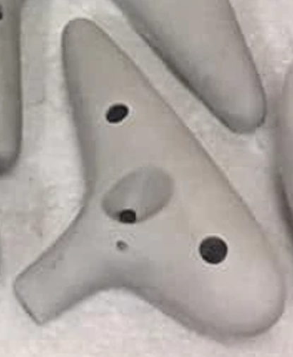
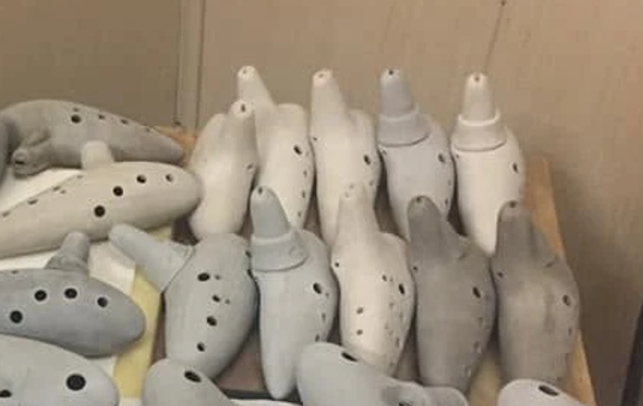
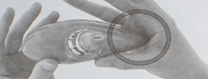
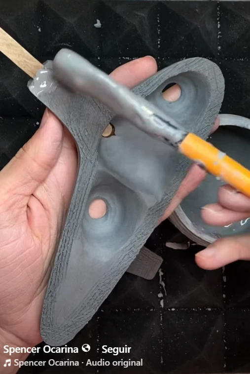

# Experimental lower voicing: handover

**Last updated 2026-11-19, end of the second session.** The low-voicing approach is studied, built and checked on an experiment branch. 25 trial bodies, two shell-edit bodies and two Stage 1 stubs all build. The only unexpected failures are six series 1 bodies built with the rule's foot of the neck below 30° (`hole_to_voicing`); the slimmer foot fixes every one, and every body with it passes. The owner has answered five questions (section 2). **Nothing was printed or played, and no rule, preset or add-on file was changed.** The experiment's new files were committed on the branch on 2026-11-20. The add-on's rule is still rule version 3 (port 30°, 30 mm pipe) in the main checkout.

The full record, with every table, finding and source, is [Low_voicing.md](Analizes_ocarinas/Low_voicing/Low_voicing.md). This file is the short way in.

**Update, later on 2026-11-19: the series 3 plan.** After this handover was rewritten, another session wrote [the series 3 plan](Analizes_ocarinas/Low_voicing/Plan_series3_balance_necks_blends.md) and the owner answered it (their words): "no printed tests on this experiment yet first we need to refine the implementation and implement the inner wall due to the closenes to the thumb holes, 3. yes the inner pocked must blend, 4. aprove this for further testing, 5. i believe this has not been explores". So: **no prints until the implementation is refined; inner walls are wanted** (read as the partial walls between the window and each thumb hole; this reopens decision 5 and the reading is not yet confirmed); the inner pocket must blend; the neck's outside may rise above the pipe; a root fuller on one side is still to be explored. The plan also found that the 29 mm foot of series 1 may be an effect of an older `hole_to_voicing` check in this frozen checkout (section 7). Nothing of series 3 was built when this was written. The rows below marked *(series 3)* follow these answers; the plan is the working document from here.

**Update, 2026-11-20: series 3 has started (step 0 and the first pass of the inner walls).** The owner said "Yes, start". Record: [Low_voicing.md](Analizes_ocarinas/Low_voicing/Low_voicing.md), section 10; sheets `sheet_s3_walls_P4.png` and `sheet_s3_walls_P1.png`; numbers in `tables_s3.md`. 26 more bodies, all passing. Nothing printed.

- **The base changed.** The add-on files of this checkout are now a copy of the main checkout of 2026-11-20, 01:02 (`refs/snapshots/low-voicing-base-s3`): rule version 3 finished, the corrected `hole_to_voicing`, no `neck_foot_width_mm`. Series 1 and 2 were built on the older copy (`refs/snapshots/low-voicing-base`) and were not rebuilt. What sections 7 and 9 below say about the frozen copy of 01:15 describes that older copy.
- **The 29 mm foot was not needed.** With the corrected check the rule's 42.3 mm foot passes at port 10° on P4 and P1: no plastic of the neck stands beside a thumb hole rim. The failures of series 1 came from the old check's box.
- **The inner pocket already blends** (the rule's 12 mm blend, all 125 directions, on every body). Inside pictures now show it.
- **Inner walls are built** by experiment code beside the trials (`Analizes_ocarinas/Low_voicing/inner_walls.py`, hooked in from outside; no add-on file changed). They cost cavity-mode margin and thumb-hole strength: both walls to the mid-line take the seed P4 from 1.37 to 1.16 × F6 and leave 76 to 84 % of the thumb holes' effect (a model); P1 keeps 1.37. A low wall (20 % of the section) keeps P4 at 1.32. On P4 the left wall has one place only (3.3 mm of room).
- **The owner's to say next:** the wall's height, one wall or two, and whether a thin slab or the broad ridge of the Spencer picture was meant (record, section 10.7). The thumb holes behind a wall are not yet sized for it.
- **Not started:** stages R (outside), A, B, C and D of the plan.

**Update, later on 2026-11-20: the owner's Blender reference, and a refined approach.** Record: [Low_voicing.md](Analizes_ocarinas/Low_voicing/Low_voicing.md), section 11; the reference's own analysis in `Analizes_ocarinas/Low_voicing/ref_oot_blend/`; sheets `sheet_s3_stance_P4.png`, `sheet_s3_blend_P4.png`, `sheet_s3_ridge_P4.png` / `_P1.png`, `sheet_s3_candidates.png`. 26 more bodies (52 in series 3), all passing. Nothing printed. The owner chose **both low walls** (`s3-w25`) and wrote that their decisions "fall second in this experiment" against the tests, the research and the look.

- **The reference** ("Ocarina of time Blender.blend", third-party, not in git, not the ECAN3 model): 191 cm³ of air at the size of the file; scaled × 0.75 it has our 80 cm³ and our 4.0 mm wall. Its window is on the thumb face, its pipe runs 4° into the chamber along the chamber wall and is long and slightly curved, its mouthpiece stands at mid-body, its neck is a bell that runs into the body, its wall is hollowed to 1.3 to 2.3 mm at every hole, and nothing stands in its chamber.
- **Our tests see its scale as off:** no window and no order of opening brings its twelve holes closer than 83 cents rms to a 13-note scale (two tuned ECAN3 instruments: 19 to 33). The shape is taken from it, not the holes.
- **Its stance with existing settings (`s3-r20p`): port 20°, pipe +4° (rule +8°), 57 mm.** The mouth end is then 2.2 mm below the middle of the body (control: 15.2 mm). This reopens port 10° and the 45 mm pipe; the owner has both on one sheet. It is a new voicing hash (`bc6b77560773`): its own Stage 1 stub.
- **The blend (`blend_fillet.py`, outside only, hooked in):** a rolling ball of 16 to 24 mm over the joined outside. `s3-ba` (24 mm toward the tail, 10 mm toward the bulb) is the reference's lopsided root. It keeps off every hole's rim and the window's keep-out.
- **A smooth inside, the ridge field (`inner_walls.py`):** a thick thumb-face wall with a funnel left around each thumb hole and the voicing's pocket kept free. It builds and looks like the clay, but on our hole layout no ridge can form between the left thumb hole and the window on P4 (3.3 mm of room), and it costs 9 to 20 cm³ of plastic.
- **Candidates:** `s3-cA` (the reference's stance, lopsided blend, the two low slab walls: cavity mode 1.31 on P4, 1.58 on P1) and `s3-cB` (the same with the ridge field: 1.26 / 1.52). Smooth twins: `s3-ba` (P4), `s3-c0` (P1).
- **Also changed on this branch:** two research documents outside this folder got a section each (`Analizes_ocarinas/Spencer_OoT_12h/Spencer_OoT_12h.md` 7.4, `Analizes_ocarinas/Patent_US7799980/US7799980_partitions.md` 5.1).
- **The owner's to say next** (record 11.7 to 11.9): 10° or 20°; walls, ridge field or a smooth chamber; whether the left thumb hole may move; and whether they will sculpt an outside to cut the chamber from.

**Update, still 2026-11-20: the owner approved port 20°, dropped the ridge field, and asked for the voicing inside the shell.** Record: [Low_voicing.md](Analizes_ocarinas/Low_voicing/Low_voicing.md), section 12; sheets `sheet_s3_shoulder_P4.png`, `sheet_s3_shoulder_presets.png`. Their words are quoted there.

- **Approved:** the stance of `s3-r20p` (port 20°, pipe +4°, 57 mm), the blend, the rule's voicing cut. **Dropped:** the ridge field. **Inside for now:** the two low slab walls (`s3-w25`).
- **The voicing shoulder (`voicing_shoulder.py`, hooked in, keys `voicing_shoulder_*`):** around the port's station the body reaches further toward the player, chamber and wall together, as on both references. On the seed: window 15.9 mm inside the edge (was 11.9), first cavity mode 1.42 (was 1.36), thumb holes 16.0 / 24.9 mm from the window (were 13.8 / 22.6). It passes on P0, P2, P3 and P4 at 9 mm; P1 takes 7 mm (9 mm is refused by the build's guard on the right pinky hole). P3 at the low voicing fails two checks without it and passes with it.
- **The shoulder wants port 25°** for a clean join with the neck (20° leaves a notch), and lets the pipe go back to 47 mm (`s3-h9s`: mouth end 34.4 mm beyond the body, hash `e052a79176fe`). The owner approved 20° without a shoulder; with one, 25° is the same stance on a wider body. Theirs to confirm.
- **For the owner to sculpt:** `Analizes_ocarinas/Low_voicing/sculpt/OCA_sculpt_base.blend` with `Sculpt_instructions.md`. `finish_sculpt.py` finishes an instrument from the saved sculpt and measures it against its base; tested on the untouched file.
- **Next to build:** the thick wall hollowed to short chimneys at the holes (the owner called it solid; it does not exist yet), then one dish through that wall.

## 1. The approach as it stands

| Part | Value | Status |
| --- | --- | --- |
| Port angle (where the voicing sits around the body, from the bottom toward the player) | **10°**, built at 11.2° (the port moves in 2.8° steps of the 128-segment chamber mesh). The window's middle lies 31 % of the width inside the player-side edge on the seed P4 (the Spencer: 30 to 33 %) | Owner's decision |
| Mouthpiece height | Level with the body, its middle 12 to 15 mm below the body's middle | Accepted by the owner |
| Pipe (windway) length | **45 mm** (rule: 30 mm). Voicing hash `40688a48d1c7` at 80 cm³. Mouth end 34.2 mm beyond the body's edge on P4 (the Spencer: about 35 mm) | Owner's decision; stub V-aw built |
| Foot of the neck | 29 mm wide on P4, 34 mm on P1 (rule: 32 and 42 mm). Below 30° the rule's foot touches the left thumb hole | Needed by the checks of this checkout; not asked. *(series 3)* May be an effect of the older `hole_to_voicing` check here; step 0 of the plan settles it |
| Thumb holes | Where the Miracle template puts them: on P4 at 10°, the left hole's edge 12.7 mm from the window and the right one's 21.4 mm (limit 10 mm) | Owner's decision |
| Inner walls (partitions) between the thumb holes and the window | None built. *(series 3)* Wanted: "implement the inner wall due to the closenes to the thumb holes" | Owner's decision; stage W of the plan (new code) |
| Dish around the window | The rule's ellipse cut, 19.5 × 14.8 mm, from the windway exit to 9.9 mm beyond the lip | Open (question 2 of section 6) |
| Mouthpiece tip | The rule's 13.8 × 7.6 mm, or round 13.8 × 13.8 mm (`neck_floor_mm = 8.6`, not hashed) | Built as a trial; not asked |

The body that carries exactly the decided values is **`lv-10fw` on P4** (series 1). The nearest to the Spencer's outside is `lv-10fwdnr` (P4 and P1), which adds the round tip and the 8 mm dish. The 8 mm dish is not recommended (section 3.2). No P1 body has the decided values without the dish: `P1:lv-10fw` was never built.

## 2. The owner's decisions

All on 2026-11-19, in the owner's words. None of them is a rule yet.

| # | Question | The owner's words | What it means |
| --- | --- | --- | --- |
| 1 | What "lower in the body" means | "the voicing is considerably lower, and pointing almost straight up like the 10 degree one" (with four Spencer pictures) | The voicing further around the body, onto the thumb face. Not a deeper recess |
| 2 | Is a mouthpiece 12 to 15 mm below mid-body acceptable? | "Yes, keep 10°" | Port 10°. No bent pipe, and no going back toward 30° for the sake of the mouthpiece |
| 3 | Un-park the 45 mm pipe for this approach? | "Yes, un-park it" | The 45 mm pipe belongs to the approach. Its stub is V-aw (section 3.3) |
| 4 | Move the thumb holes away from the window, as on the Spencer? | "Keep the template" | The holes stay. The Spencer's 35 to 40 mm is not followed |
| 5 | Partitions between the thumb holes and the window as an add-on feature? | "no" | No partitions. **Reopened later the same day** (row 6) |
| 6 | *(series 3)* Was anything printed; what comes first? | "no printed tests on this experiment yet first we need to refine the implementation and implement the inner wall due to the closenes to the thumb holes" | No prints until the implementation is refined. Inner walls wanted (stage W of the plan) |
| 7 | *(series 3)* Does the blend include the inside? | "yes the inner pocked must blend" | The pocket blend (12 mm, already in the rule and the hash) is shown and joined to the inner walls |
| 8 | *(series 3)* May the neck's outside rise above the pipe? | "aprove this for further testing" | Trials `s3-n7a` to `s3-n7c` of the plan |
| 9 | *(series 3)* A root fuller on one side? | "i believe this has not been explores" | To be explored: trials `s3-bs1` to `s3-bs3` |

Decisions 4 and 5 together left one acoustic risk open (section 4, first row); decision 6 answers it with inner walls, which the kernel does not model.

The two requests that started the work, for the record:

> "from the shell edit prototype branch i want you to test a different aproach, in this case i want to experiment with placing the voicing lower in the body like show on the back/thumb face of the spencer and songbird, adjust run experimental test for this aproach and report back with renders findings and if any of the researched thery would frown uppon on this aproach"

> "build a detailed hand off with the following and the pictures Experimental_lower_voicing_handover.md — lets further study this aproach, look at this images for the spencer, the voicing is considerably lower, and pointing almost straight up like the 10 degree one, analize the following pictures and run tests with this aproach"

## 3. What is built

Every body is built as `tools/geometry_check_variant.py` builds a variant, and every check runs on the STL read back from disk. The voicing solid, the window (62.83 mm²), the lip, the ramp and the first cavity mode (1.361 × F6 on P4, 1.63 on P1) are the same in every trial; only their place on the body changes.

### 3.1 Series 1: the port turned from 30° to 0° (P4 and P1)

Record: [Low_voicing.md](Analizes_ocarinas/Low_voicing/Low_voicing.md), sections 3 to 7. Sheets: [sheet_low_voicing_P4.png](Analizes_ocarinas/Low_voicing/sheet_low_voicing_P4.png), [sheet_thumb_face.png](Analizes_ocarinas/Low_voicing/sheet_thumb_face.png), [sheet_sections_overlay_P4.png](Analizes_ocarinas/Low_voicing/sheet_sections_overlay_P4.png).

| Port (P4, 30 mm pipe) | Window inside the player-side edge | Mouthpiece against the body's level | Mouth end beyond the edge | Left thumb hole edge to the window |
| --- | --- | --- | --- | --- |
| 30° (rule) | 7.9 mm (16 %) | 17° above | 24.2 mm | 15.9 mm |
| 20° | 11.9 mm (24 %) | 7° above | 21.8 mm | 13.8 mm |
| 10° | 15.2 mm (31 %) | 1° above | 19.2 mm | 12.7 mm |
| 0° | 19.7 mm (40 %) | 8° below | 14.7 mm | 12.0 mm |

- No new code is needed: the port angle is a preset value.
- Below 30° one check fails, `hole_to_voicing`: the left thumb hole touches the foot of the neck. The slimmer foot (trials `…f`) fixes it on both bodies.
- The 45 mm pipe (trials `…fw`) gives the mouthpiece back: 34 to 37 mm beyond the edge.
- The shell-edit build works at 10° ([shell_edit_low.py](Analizes_ocarinas/Low_voicing/shell_edit_low.py)): the plain base finishes as the one-step body, and a sculpted base finishes in 3 sizing rounds with no unexpected failure.

### 3.2 Series 2: after the Spencer pictures (nine bodies)

Record: [Low_voicing.md](Analizes_ocarinas/Low_voicing/Low_voicing.md), section 8. Sheet: [sheet_series2.png](Analizes_ocarinas/Low_voicing/sheet_series2.png).

| Trial | What changes | What it showed |
| --- | --- | --- |
| `lv-15f`, `lv-5f` | Port 15° and 5° | Built at 14.1° (29 %) and 5.6° (35 %). The Spencer's 30 to 33 % lies between 11.2° and 8.4°, so "10°" is already inside it. 5.6° hangs the neck 2.6 mm below the body, like 0° |
| `lv-5fw` | Port 5°, pipe 45 mm | Mouth end 32.0 mm beyond the edge and 19.6 mm below the body's middle |
| `lv-10fd` | `cone_widen_mm = 8` (hashed) | The key widens the dish **across** the jet only (24.8 × 19.5 mm against 14.8 × 19.5). The Spencer's dish is longer than wide, like the rule's, and about 1.4 times larger both ways. **Not recommended** |
| `lv-10fn` | `neck_base_depth_mm = 29` | Hardly visible |
| `lv-10fwdn` | Pipe 45, dish 8, foot 29 mm deep (P4 and P1) | Passes; mouth end 34.2 mm beyond the edge on P4 |
| `lv-10fwdnr` | The same and a round tip (`neck_floor_mm = 8.6`) (P4 and P1) | Passes. The tip's outside rises 3.1 mm. The nearest to the Spencer's outside |

**A geometric limit (my reasoning, not a source):** with the window this far around the body, a straight pipe that enters the chamber at +8° cannot start at mid-body. Putting the tip's middle there would take a tip about 38 mm deep. The owner accepted the low mouthpiece (decision 2).

### 3.3 The Stage 1 stub for the 45 mm pipe

Record: [Low_voicing.md](Analizes_ocarinas/Low_voicing/Low_voicing.md), section 9. Script: [stub_long_pipe.py](Analizes_ocarinas/Low_voicing/stub_long_pipe.py). Sheet: [sheet_stub_long_pipe.png](Analizes_ocarinas/Low_voicing/sheet_stub_long_pipe.png).

| Stub | Pipe | Voicing hash | Neck | Solid PLA | Predicted pitch | Checks |
| --- | --- | --- | --- | --- | --- | --- |
| V-a (rebuilt here; the same body as the main checkout's) | 30 mm | `312011ec9f0e` | 43.6 mm | 37 g | 787.1 Hz | 14 pass, no warning |
| **V-aw** | 45 mm | `40688a48d1c7` | 58.6 mm | 43 g | 787.1 Hz | 14 pass, no warning |

- V-aw is V-a with `[voicing_rules] windway_length_mm = 45` and nothing else (preset S0, 25 cm³, the 80 cm³ window, the build of rule version 3). A stub has no port angle, so V-aw serves the approach at any port.
- The kernel predicts the same pitch because the pipe length is not in its model (the stub pitch is c/(2π)·√(η_w·G_w/V), and G_w comes from the window). The printed pair is what tells whether it matters.
- Blank measurement file: `addon_out/lv-stubs/V-aw/V-aw_measurement.toml` (not in git, like every stub); `tools/stub_eta_w.py` reads it once filled.

## 4. What is still open

| Risk or gap | Why it is open | What answers it |
| --- | --- | --- |
| **Large open thumb holes near the window** may weaken the top notes (Heuer: holes away from the voicing; patent US 7,799,980 by the Spencer's maker) | The window moves toward both thumb holes (left 15.9 → 12.7 mm on P4). The Spencer has its holes 35 to 40 mm away *and* partitions; the owner chose neither (decisions 4 and 5) | *(series 3)* Inner walls (stage W of the plan) are the planned answer. Only a played body can say whether they are enough, and prints wait until the implementation is refined |
| **Breath with the 45 mm pipe** | Estimated laminar loss in the slot rises from 19 to 29 Pa at a 15 m/s jet. A 4.1 mm mouth end would bring it back, but the owner fixed the mouth end at 3.0 mm on 2026-11-18 | The printed V-a / V-aw pair |
| **η_w of the 45 mm voicing** | The kernel cannot say | The printed V-a / V-aw pair |
| **The capped-air check reads low** (79.75 to 79.77 cm³ against 80.01 built, limit 79.60) | Its box around the window takes in thumb-hole air. The rule body already reads −0.12 % | Narrow the box to the cut it covers before a lower port becomes a rule ([capped_air_cap_box.py](Analizes_ocarinas/Low_voicing/capped_air_cap_box.py)) |
| **P0, P2 and P3 not built at 10°** | Only P4 and P1 were tried. Each needs its own foot width | Build them before a rule |
| **The thumb beside the window** | With the window on the thumb face, the left thumb lies beside it for every note up to C6. No source gives a distance; this is my inference | A played body |

## 5. Next steps, in order

0. *(series 3)* **First, the plan:** [the series 3 plan](Analizes_ocarinas/Low_voicing/Plan_series3_balance_necks_blends.md), step 0 (is the 29 mm foot real?), then stages R, A, B, C, W and D. **No prints until it is done** (the owner, decision 6). The prints below come after its stage D.
1. **Print V-a and V-aw together** (Stage 1), fill both measurement files and run `python tools/stub_eta_w.py addon_out/lv-stubs/V-a/V-a_measurement.toml addon_out/lv-stubs/V-aw/V-aw_measurement.toml` (V-a's file is the same template as the main checkout's `addon_out/stage1/V-a/`). This answers η_w at 45 mm, whether it speaks, and the breath.
2. **The owner's remaining questions** (section 6).
3. **A played body for the thumb-hole risk:** a Stage 2 body at port 10° beside one at 30°, same everything else. The port angle is a value of every Stage 2 preset and the hole position factors depend on it, so it must be chosen before Stage 2 is printed for real.
4. **Only if the owner makes the approach the rule**, in the main checkout (check first that no other session is running there; see [parallel sessions](#7-traps)). These go together:
   - `port_angle_deg = 10` and a `neck_foot_width_mm` for each of P0 to P4 in `ocarina_addon/presets/cavity_presets.toml` (P0, P2 and P3 still need their foot widths found).
   - `windway_length_mm = 45` in `[voicing_rules]` of `params/alto_c_12hole.toml`. That changes every body. A 45 mm pipe for the low-voicing bodies only would need a new per-preset key: new code.
   - The round tip, if wanted, as a rule constant of the cone neck in `ocarina_addon/voicing_geo.py` (today it is the prototype setting `neck_floor_mm`).
   - The capped-air box narrowed (section 4).
   - A V-aw recipe in `ocarina_addon/stub.py`, or V-a's pipe changed.
   - Stages 1 to 3 regenerated, and `python kernel/synthetic.py --write-examples` (the synthetic calibration is keyed by the voicing hash; without it Stage 3 quietly re-solves the "printed" windows).
   - The four test suites, README, build notes and decisions record updated.

## 6. Open questions for the owner

1. What does the circle drawn in the hand picture (section 8.3) mark?
2. Is the dish worth new code (longer beyond the lip, about 28 × 20 mm like the Spencer's), or does the rule's 19.5 × 14.8 mm dish stay?
3. Is the round mouthpiece tip wanted?
4. Should the approach become the rule, and is the 45 mm pipe then for every body or only the low-voicing ones?
5. *(series 3)* Is "the inner wall" the partial walls between the window and each thumb hole? One wall or two? The plan's section 11 lists its defaults.

## 7. Traps

- **Do not merge this branch's add-on files over the main checkout.** They are a frozen copy of 2026-11-19 at about 01:15 (rule version 3 in progress; one kernel test, `test_changes_when_a_rule_constant_changes`, fails in this copy). *(series 3)* Its `checks_geo.py` differs from the main checkout's in 76 lines, and the main checkout has no `neck_foot_width_mm`: a check result here may differ from the main checkout's. Only `Analizes_ocarinas/Low_voicing/`, the `*-lv-*` and `V-aw` outputs and this file are new. No tracked file differs from `refs/snapshots/low-voicing-base`. The new files were committed on this branch on 2026-11-20 at the owner's request; the copy of the add-on files stays uncommitted (it is the snapshot).
- **Checkpoint rewinds do not undo Blender outputs.** At the start of the second session the series 2 rows were missing from `low_voicing_trials.py` and `table_low_voicing.py` while their bodies were on disk, and this file said "not built". All three files carried one time stamp. Compare the outputs with the scripts before trusting either. (The rows were restored and the bodies rebuilt; the two builds agree to the last stored digit.)
- **The port snaps to the chamber mesh** in 2.8° steps: 10 → 11.25°, 15 → 14.06°, 5 → 5.63°. The tables give both angles.
- **The add-on's `voicing.png` keeps only the faces within about 34 mm of the window.** A 45 mm neck is cut short there and shows its pipe walls as a false "block". Use the uncropped views or the STL.
- **Parallel sessions.** The owner runs several sessions in the main checkout. This branch exists because one was rewriting the add-on while the trials ran.
- **Shell working directory.** In this checkout a `cd` into a subfolder sticks between calls; give paths from the checkout root.
- **One link of the record works only in the main checkout.** `Analizes_ocarinas/Neck_volume/Neck_volume.md` is untracked there and was not copied into this checkout; the record cites it.

## 8. The four Spencer pictures

All measures are read by eye from gridded copies of oblique, low-resolution pictures. Treat them as rough. Gridded copies: `reference_photos/*_grid.png`, made by [photo_grid.py](Analizes_ocarinas/Low_voicing/photo_grid.py).

### 8.1 Thumb face of a fired body



| What | Reading | Against our trials |
| --- | --- | --- |
| Window, along the mouthpiece axis, from the player-side edge | About 65 px of a width of 196 to 216 px: **30 to 33 % of the width** | 10° (built 11.2°) has 31 % |
| Mouthpiece | Leaves the edge about square to the body's long axis, in the plane of the body | 10° is level (1° above) |
| Dish around the window | An oval about 105 × 75 px (about 28 × 20 mm if the body is 57 mm wide), roughly three thumb-hole diameters long. The window is at its mouthpiece end and the dish runs on beyond the lip | The rule's dish has the same arrangement (from the windway exit to 9.9 mm beyond the lip, 19.5 × 14.8 mm), about 1.4 times smaller both ways |
| Window opening | Smaller than a thumb hole (about 0.6 of one) | – |
| Thumb holes | One on each side of the window along the body, about 35 to 40 mm from it | Ours: 12.7 mm (left) and 21.4 mm (right) at 10°; kept by the owner |
| Small hole between the window and the mouthpiece root | About 43 px from the window, on the mouthpiece axis | Unknown purpose; not modelled |

### 8.2 Unfired bodies standing in a tray



- The mouthpiece is a round cone, about 1.2 times as long beyond the shoulder as its foot is wide, with a tip a little under half the foot: about 35 mm beyond the shoulder at a 29 mm foot. The 45 mm pipe gives 34 mm.
- Seen edge-on, the cone seems to stand near the middle of the body's thickness. Ours stays 12 to 15 mm below it (accepted, decision 2).
- Several bodies show a ring where the mouthpiece meets the body (a join made in the clay).

### 8.3 Hand holding a body, thumb face toward the viewer



The window is a slot at the centre of a round, ringed recess, near the middle of the visible width. A circle is drawn around the base of the right thumb and the palm. What the circle shows, and whether this is the same model as the other three, is open (section 6, question 1).

### 8.4 Inside of a thumb-face half



Already read as photo 11 in the [Spencer report](Analizes_ocarinas/Spencer_OoT_12h/Spencer_OoT_12h.md), section 7.

- The windway stick shows through the window at the root of the mouthpiece: the jet enters where the chamber begins.
- The half is hollow in three pockets, one under each thumb hole and one under the window, with ridges between them. These are the partitions of the maker's patent ([record](Analizes_ocarinas/Patent_US7799980/US7799980_partitions.md)). The owner does not want them in the add-on (decision 5).
- Each thumb hole sits at the bottom of a round funnel about 2.5 hole diameters across.

## 9. Where everything is, and how to run it

| What | Where |
| --- | --- |
| Checkout | `.claude/worktrees/low-voicing`, branch `low-voicing-experiment`, cut from `shell-edit-prototype` at `45b3486` plus a copy of its uncommitted work (`refs/snapshots/low-voicing-base`). Ignored through `.git/info/exclude`. The experiment's new files are committed on the branch (2026-11-20); the copy of the add-on files is not |
| Series 3 plan | [Plan_series3_balance_necks_blends.md](Analizes_ocarinas/Low_voicing/Plan_series3_balance_necks_blends.md) (nothing built when written) |
| Full record | [Low_voicing.md](Analizes_ocarinas/Low_voicing/Low_voicing.md); all numbers of all trials in [tables.md](Analizes_ocarinas/Low_voicing/tables.md) |
| Trials | [low_voicing_trials.py](Analizes_ocarinas/Low_voicing/low_voicing_trials.py) (the `TRIALS` table names all 16 trials); one JSON per body in `trials/`, merged in `low_voicing_trials.json` |
| Stubs | [stub_long_pipe.py](Analizes_ocarinas/Low_voicing/stub_long_pipe.py); numbers in `stubs/stubs.json`; V-a's report in `stubs/` |
| Check reports | `addon_checks/P4-80-lv-*.md`, `addon_checks/P1-80-lv-*.md`, `addon_checks/V-aw.md` |
| Pictures | `Analizes_ocarinas/Low_voicing/sheet_*.png`, `images/`, `addon_renders/<body>/` |
| The owner's pictures | `Analizes_ocarinas/Low_voicing/reference_photos/` |

From the root of this checkout (one body takes about 60 s):

```
"/c/Program Files/Blender Foundation/Blender 5.1/blender.exe" -b --factory-startup --python Analizes_ocarinas/Low_voicing/low_voicing_trials.py -- --only P4:lv-10fw
```

```
"/c/Program Files/Blender Foundation/Blender 5.1/blender.exe" -b --factory-startup --python Analizes_ocarinas/Low_voicing/stub_long_pipe.py
```

```
python Analizes_ocarinas/Low_voicing/table_low_voicing.py > Analizes_ocarinas/Low_voicing/tables.md
```

A new trial goes in `TRIALS` and in `ORDER` of `table_low_voicing.py`. The sheets: `sheet_low_voicing.py`, `sheet_sections_overlay.py`, `sheet_series2.py`, `sheet_stub_long_pipe.py`. The tip height: `tip_centre.py`. The full list of commands is at the end of the record.

## Update 2026-11-24 (series 3, fourth part): the owner's cone neck

The owner drafted a slim straight cone (25.4 mm at the body, 15.2 mm at the mouth end, level, the pipe diagonal inside) and a flat tube around the voicing, in the sculpt file (kept as `Analizes_ocarinas/Low_voicing/sculpt/OCA_sculpt_owner_draft_2026-11-24.blend`), and asked that the neck's outside can be angled and shifted a little without the internal cut. Built as `tandem_neck.py` (keys `neck_tilt_deg`, `neck_yaw_deg`, `neck_offset_mm`, `neck_tail_mm`), group `tandem` of `series3_trials.py`: 16 builds, all pass except P3 (fails at port 20° with any neck). Same voicing hash as `s3-r20p` throughout. Limits: tilt 6° with a 15.2 mm mouth end, 10° needs 19.2 mm; 3° sideways needs 20 mm across. Record: section 13 of `Low_voicing.md`. Nothing committed since `2893641`, nothing printed.

## Update 2026-11-25 (series 3, fifth part): the uneven wall and the ranking on the seed

The owner chose the cone tilted 6° with the slim tip. `uneven_wall.py` (keys `wall_front_less_mm`, `wall_back_more_mm`) draws the outside nearer the chamber on the deck and further on the thumb face, with a dish around the window; group `uneven`, 12 builds on P4. Limits on the seed: deck wall at least 3 mm (inward tubes crowd below), thumb-face wall at most 6 mm (capped air fails at 7). 3 / 5 mm and 3 / 6 mm pass. The thick back makes thumb holes larger (0.5 mm per mm) and does not change the cavity mode; its gain is the look. Ranking and table: section 14 of `Low_voicing.md`. Nothing committed since `2893641`, nothing printed.

---

# Handover of 2026-11-25: where the low-voicing experiment stands

Read this block first; the update blocks above it are the history. The full record is `Analizes_ocarinas/Low_voicing/Low_voicing.md` (sections 10 to 14.2 are series 3).

## 1. State in one paragraph

The voicing is on the thumb face. The working body is the seed P4 at 80 cm³, trial `s3-v1`: port 20°, pipe +4° into the chamber and 57 mm long, a slim straight cone neck (25.4 mm at the body, 15.2 mm at the mouth end) whose outside is tilted 6° toward the thumb face while the pipe stays put, and an uneven wall (3 mm on the deck, 5 mm on the thumb face). There is no dish: the window's ramp runs on as an oval scoop 22 × 17 mm, 1 mm deep, that begins at the window's upper edge (`s3-v0` is the same body without the scoop). It passes every check. Voicing hash `bc6b77560773`. **Nothing here is a rule and nothing is printed.** Committed and pushed to `low-voicing-experiment` on 2026-11-25.

## 2. The owner's decisions (in the owner's words where quoted)

| Date | Decision |
| --- | --- |
| 2026-11-20 | Port 20° approved ("I approve the 20 degree sugestion"); the blend, the chimney approach and the voicing cut "solid"; the ridge field dropped ("fall way out of the references"); the low slab walls stay as the inside until said otherwise |
| 2026-11-24 | Drafted a cone and a flat tube in the sculpt file; wants "the continuous shape to be kept if posible", the extra volume "better kept on tandem with the neck", the neck angled and shifted "without tilting the internal cut" |
| 2026-11-24 | "tilt 6 slimp tip looks best"; explore on the seed volume only; test an uneven wall "with the volume shifted to the front so the face holes are less thick and there is more play on the back" |
| 2026-11-25 | "carry forward 3/5 mm wall"; "the dish should not cut above the upper of the voicing window, that is what is causing the bad finish" |
| 2026-11-25 | "drop the dish just work on the window ramp shape to mirror this or the spencer" (with a game render and the blue ceramic: the window at the neck's end of one long oval scoop) |

Earlier decisions still in force: thumb holes stay on the template; no bent pipe; least wall 1.32 mm; no prints until the implementation is refined.

My readings that the owner has not confirmed: "continuous shape" means the plain body with no bulge of the chamber; "angling for ergonomics" means down toward the thumb face (built) or sideways (built, not chosen); "for visual balance the height of the thumb holes" and "the inner wall" (2026-11-20) were never explained.

## 3. What each piece of experiment code does

All of it is outside the add-on (hooks installed by `series3_trials.py`); no add-on file is changed.

| File (in `Analizes_ocarinas/Low_voicing/`) | What | Preset keys |
| --- | --- | --- |
| `series3_trials.py` | the runner: `TRIALS`, groups `base, walls, ref, ridge, blend, cand, shoulder, tandem, uneven` | – |
| `tandem_neck.py` | shears the neck's outside about a line 3 mm before the windway's exit; measures the plastic around the pipe and refuses under 1.2 mm | `neck_tilt_deg`, `neck_yaw_deg`, `neck_offset_mm`, `neck_tail_mm` |
| `uneven_wall.py` | the outside nearer the chamber on the deck, further on the thumb face, the dish at the window; finishes by the shell-edit build so every hole is sized for its own wall | `wall_front_less_mm`, `wall_back_more_mm`, `wall_ramp_oval_mm`, `wall_back_no_dish` |
| `voicing_shoulder.py` | a bulge of the chamber around the voicing (wall and outside follow) | `voicing_shoulder_mm`, `_tail_mm`, `_bulb_mm`, `_power` |
| `blend_fillet.py` | rolling-ball blend of the neck into the body (not applied on the uneven-wall path) | `neck_blend_mm`, `neck_blend_bulb_mm`, `neck_blend_hole_mm` |
| `inner_walls.py` | slab walls and the dropped ridge field | `inner_wall_*`, `inner_ridge_*` |
| `sheet_series3.py`, `table_series3.py` | the sheets (`sheet_s3_*.png`) and `tables_s3.md` | – |
| `sculpt/` | the sculpt file, its instructions, `finish_sculpt.py`, and the owner's draft `OCA_sculpt_owner_draft_2026-11-24.blend` | – |

Run one trial (from the root of this worktree, about 2 minutes a body, up to three at a time):

    PYTHONIOENCODING=utf-8 "/c/Program Files/Blender Foundation/Blender 5.1/blender.exe" -b --factory-startup --python Analizes_ocarinas/Low_voicing/series3_trials.py -- --only P4:s3-v1
    python Analizes_ocarinas/Low_voicing/sheet_series3.py

## 4. The limits found on the seed

- **Neck tilt:** 6° with the 15.2 mm mouth end and the 57 mm pipe; each further degree needs about 1 mm more at the mouth end (10° needs 19.2 mm). Sideways 3° needs a mouth end 20 mm across. A tilt hinged on the exit plane itself fails the window's keep-out.
- **Deck wall:** at least 3 mm. At 2.5 mm three small holes need inward tubes and two crowd each other (`inward_tubes`).
- **Thumb-face wall:** at most 6 mm. At 7 mm the capped air is 0.57 % short (`volume_capped_air`). Each extra millimetre makes the thumb holes about 0.5 mm larger.
- **Cavity mode:** 1.36 × F6 whatever the wall or the neck; the chamber shoulder raises it (1.40 at 5 mm, port 25°), the inner walls lower it (1.31).
- **P3** fails `hole_to_voicing` and `volume_capped_air` at port 20° with any neck; it passes with the shoulder at port 25°. **P1** refuses a 9 mm shoulder (7 mm passes).

## 5. Next steps, in order

1. **The owner looks at the oval ramp** (`Analizes_ocarinas/Low_voicing/sheet_s3_ramp_P4.png`): `s3-v1` (22 × 17 mm), `s3-v3` (28 × 18 mm), `s3-v2` (2 mm deep on a 6 mm back) or none (`s3-v0`). Change the size with `wall_ramp_oval_mm` in `series3_trials.py`; one build is 2 minutes.
2. **Short chimneys at the thumb holes.** Hollow the thick thumb-face wall from inside around each thumb hole, as the owner's Blender reference does (5.3 mm wall, 1.3 to 2.3 mm at the holes). How: in `uneven_wall.py`, cut a shallow round pocket into the chamber side of the wall at each thumb hole before the shell-edit build measures the walls, keep at least 1.32 mm, and let the build size the holes for the chimney left. Done looks like: thumb holes back near 10.8 / 12.7 mm on a 5 or 6 mm back, every check passing, the capped air inside 0.5 %. This is what allows a deeper scoop without larger thumb holes.
3. **The working body on P0, P1, P2 and P3.** Give the `s3-v1` row all five bodies (`ALL`). Expect P3 to fail `hole_to_voicing` at port 20° as it does with every neck; try port 25° with a 5 mm shoulder there (`s3-u6s` is the pattern), or ask the owner whether P3 may differ.
4. **The blend on the uneven-wall path.** `blend_fillet.py` is a hook of the plain build and does not run when the shell is given from outside. Call it on the joined shell and neck inside `uneven_wall.py` before `build_body`, then try an 8 mm ball on `s3-v1` (it added 0.38 cm³ on the even wall, `s3-t6b`).
5. **Ask the owner** about the readings in section 2 that are not confirmed, and whether the neck should also turn sideways (`s3-t6yt` and `s3-t6yb` are built and pass).
6. **Regenerate the sculpt file** (`sculpt/make_sculpt_file.py`) with the cone neck and the 3 / 5 mm wall if the owner wants to sculpt again; the file in `sculpt/` is the owner's draft of 2026-11-24 on the old base.
7. **Rebuild the older uneven rows** (`s3-u7`, `s3-u2`, `s3-u3`, `s3-u4`, `s3-u6s`, `s3-u6w`) only if their pictures are needed: they show the first round dish; their numbers do not depend on it.
8. **Prints**, only when the owner says the implementation is refined: first a voicing stub for hash `bc6b77560773` (pipe 57 mm, +4°), then the seed body. Hole sizes for walls other than 4 mm are from the model: no test print has measured them.
9. **Only after prints**: decide with the owner what becomes a rule or a preset setting in the add-on. Until then the add-on is not changed.

## 6. Cautions

- **Left out of the commit of 2026-11-25 on purpose:** `ref_oot_blend/images/` and the three sheets that show them (`sheet_s3_stance_P4.png`, `sheet_s3_blend_P4.png`, `sheet_s3_shoulder_P4.png`): they are pictures of the third-party model, whose licence is unknown. They are on this disk only; `sheet_series3.py` makes the sheets again. Also left out: `sculpt/*.blend1` and `addon_out/`.
- **Third-party model:** `ref_oot_blend/models/` is ignored by git and must stay out; its renders in `ref_oot_blend/images/` were left out by hand (see above); the owner may decide otherwise.
- **The add-on files in this worktree** are an uncommitted copy of the snapshot `refs/snapshots/low-voicing-base-s3`. Do not change, commit or merge them.
- **An interrupted run** can leave a row failing `cavity_mode_computed` ("no Python with numpy and scipy was found"). Build that row again.
- **Blender files from outside** are opened with `--factory-startup --disable-autoexec`.
