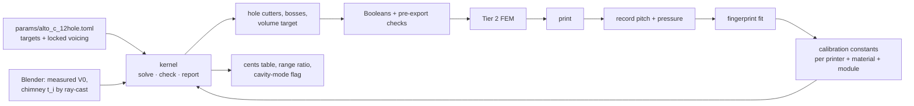

# 02 · Unified plan: parametric 3D-printed alto C ocarina

This plan merges the [build plan](../references/build-plan-original.md) (main document), the two Chris Heuer analyses ([Video #2 tolerances](../references/heuer-video2-alto-c-tolerances.md), [series overview](../references/heuer-series-overview.md)) and the extended research in [01 · Source review](01-source-review.md). The supporting math and computed numbers are in [03 · Parametric findings](03-parametric-findings.md). The parameter values live in [`params/alto_c_12hole.toml`](../params/alto_c_12hole.toml).

## Scope

| In scope | Out of scope until Phase 5 passes |
| --- | --- |
| Single-chamber **12-hole alto C**, A4..F6 (21 chromatic notes), 12-TET at A = 440 Hz | Multichamber designs |
| A **10-hole alto C** (C5..F6) as the first full instrument | Other sizes on Heuer's chart (#1, #2, #4 to #7) |
| A 3D-printed core (frozen voicing module plus chamber), with an optional sculpted shell | CFD of the jet |
| A pure-Python acoustic kernel, a TOML parameter set, a Blender add-on, Tier 2 FEM | Clay and wet-shrink workflows (Heuer's wet column is reference only) |

## Bottom line

The original architecture stands. Pitch depends only on chamber **volume** and the **conductances** of the openings, so the chamber and shell can be sculpted freely. The voicing (windway, window, labium) is a frozen, pre-validated module. Hole sizing runs where the shell thickness is known. The research changes four things:

1. **Window efficiency η_w is the dominant unknown.** Credible values span 0.5 to 1.0, which means a chamber of 34 to 69 cm³ for the same window. Nothing gets sculpted to a volume target until the calibration print has measured η_w.
2. **A 12-hole alto C is at the single-chamber range ceiling by arithmetic.** Σ G / η_wG_w = (F6/A4)² − 1 = 9.08 for any design. Build the 10-hole (6.13) first, use a small "soft" window (8.9 mm), and keep the chamber compact.
3. **Chamber shape is constrained after all.** It is not constrained for pitch, but for model validity. A chamber longer than about 75 mm at alto size puts the first cavity mode within reach of the top notes, and at that point the Helmholtz model is no longer enough.
4. **Accuracy is a repeatability problem.** Landing within ±15 cents (95 %) after calibration needs print-to-print scatter of volume plus window conductance at or below about 0.9 %. If the printer cannot hold that, design in a volume-trim plug.

## Amendments to the original plan

| # | Change | Why | Ref |
| --- | --- | --- | --- |
| A1 | Widen the η_w prior to 0.5–1.0 and gate all volume targets on Phase 2 | The plan's priors contradict each other, and the LES study implies 0.48–0.78 | [01 §1.2](01-source-review.md#12-issues-found-in-the-build-plan), [03 §6.1](03-parametric-findings.md#61-window-efficiency-the-largest-unknown) |
| A2 | Recast λ/3 as a chamber-shape rule: L_int ≤ 75 mm for Phase 3; FEM required beyond; hard stop at 95 mm | Most transverse alto shapes fail λ/3 | [03 §8](03-parametric-findings.md#8-lumped-model-validity-chamber-shape) |
| A3 | Window throat = neck, excluded from V0 | Avoids counting it twice | [03 §1](03-parametric-findings.md#1-notation-and-conventions) |
| A4 | Explicit subhole rule: inward bosses (sub2 needs a 9.3 mm chimney), or validated 1.9–2.6 mm holes | The solver output violates the 3 mm floor | [03 §6.2](03-parametric-findings.md#62-chimney-height-and-the-subhole-problem) |
| A5 | Windway exit height 1.20 mm (a whole number of layers) instead of 1.14 mm | Printability; still inside W/h 7–10 | [03 §3](03-parametric-findings.md#3-voicing-scaling-from-heuers-chart) |
| A6 | Window coupons at 8.9 / 9.3 / 9.65 mm, each with its own V0 | Resolves Heuer's "medium" against the plan's "soft"; window variants change V0 by about 5 % | [03 §6.3](03-parametric-findings.md#63-window-length-across-heuers-band) |
| A7 | Calibration fits by **error fingerprint** (uniform / decaying / stepped) and adds a repeatability test of three identical prints | Makes the fitted constants identifiable and measures the scatter budget | [03 §2](03-parametric-findings.md#identity-4-error-fingerprints-what-makes-calibration-identifiable), [§7](03-parametric-findings.md#7-sensitivities-and-tolerance-budget) |
| A8 | Breath model p = p₀·2^(α·n/12) with measured p₀ and α; St bands checked per note | Ties the "exponential breath curve" to jet physics | [03 §4](03-parametric-findings.md#4-jet-strouhal-and-the-breath-curve) |
| A9 | Drop the 130 cm³ workbook as a cross-check | It cannot reach A4 | [01 §1.2](01-source-review.md#12-issues-found-in-the-build-plan) |
| A10 | Print the sensitive low holes undersize and ream them | 0.1 mm moves those notes 6–11 cents | [03 §7](03-parametric-findings.md#7-sensitivities-and-tolerance-budget) |
| A11 (2026-11-17, follows up A1) | Expect η_w in **0.85–0.95** when planning; keep 0.90 as the prior; keep the calibration gate and the fitter unconstrained | The LES point behind A1's 0.5 lower bound is weak (its 880 Hz is the nominal note of a similar ocarina, not a measurement; a 5 ms run). Three real instruments give 0.86 (V0N3), 0.89 (Eclipse) and about 0.9 (Miracle). The baseline volume range narrows from 34–69 cm³ to about 58–65 cm³. A printed voicing may still land outside the band: the stubs measure it | [01 §5](01-source-review.md#5-second-source-review-2026-11-17-heuer-chart-re-read-les-paper-read-in-full), [03 §6.1](03-parametric-findings.md#61-window-efficiency-the-largest-unknown) |

## Architecture



1. **Kernel** ([`kernel/`](../kernel/)): equations, solver, constraint checks and calibration fitter. No Blender imports. Unit-tested.
2. **Parameter file** ([`params/`](../params/)): the single source of truth, read by the kernel and later by the add-on. Every value is tagged LOCKED, LINKED, CALIBRATE or TARGET.
3. **Voicing module**: one windway + window + labium solid, authored once to exact dimensions, validated by coupon, stored as a library asset with a vertex hash.
4. **Blender add-on**: places the module, measures volume, ray-casts chimney heights, calls the kernel, builds cutters and bosses, runs the exact Booleans and the pre-export checks.

## Parameter model

| Class | Members | Who changes it |
| --- | --- | --- |
| **LOCKED** (voicing module) | Window length, width, tip radius and shape; wall at window; windway height, width, length and taper; labium angle, edge thickness and offset; keep-out zones | Only a new module version, with a new coupon and calibration print |
| **LINKED** (re-solved live) | V0 target and measured V0, chimney height per hole, hole diameters, boss lengths, predicted cents | The kernel, on every edit |
| **CALIBRATE** | η_w, k, hole offset, volume factor, breath curve (p₀, α), St bands | The Phase 2 fit, stored per printer + material + module |
| **TARGET** | Key, A4 reference, temperament, design air temperature, fingering table | The designer |

### Voicing module v0 (alto C)

| Parameter | Value | Sweep / range | Source |
| --- | --- | --- | --- |
| Window length W (exit → labium) | **8.9 mm** | 8.9 / 9.3 / 9.65 on coupons; playable 8.89–10.41 | Heuer #3 C band; plan safeguard 1 |
| Window shape | Teardrop, 6.0 mm max width, 1.0 mm tip radius (37.0 mm²) | Measure the width and orientation on the reference | Pure Ocarinas (teardrop = pure timbre); Heuer video #5 (unverified) |
| Wall at window | 3.0 mm | 2.5–4 | Plan safeguard 3 (voicing neck) |
| Windway exit height h | **1.20 mm** | 1.14 (Heuer) – 1.2; whole layers | Heuer 0.045 in; amendment A5 |
| Windway width | = window max width (6.0 mm) | — | Plan |
| Windway length / taper | 30 mm, inlet/exit 1.3 | 20–40 mm | Plan |
| Labium ramp angle | 20° | 15–25° | Plan; Heuer video #3 (to verify) |
| Labium edge thickness | 0.4 mm | 0.3–0.5 | Plan; printer minimum |
| Labium offset from windway centreline | 0 mm | ±0.3 mm on coupons | Plan |
| Keep-out inside / outside | 10 mm / 45° flare | — | Plan |
| W/h | 7.4 | 7–10 | Heuer alto 8.4; plan |

## Roadmap

There are six phases. Each has a gate, and no phase starts until the previous gate passes. There are three physical print rounds before the 10-hole: references, coupons plus calibration body, and the plain instrument.

### Phase 0 · Kernel (started)

> **Status 2026-11-17.** Done since this list was written: the checks as functions (`kernel/checks.py`, commit `9eccda1`), automatic floor handling with inward tubes and pad-limit flags (`kernel/holes.py`, `9eccda1`), the fitter (`kernel/fitter.py`, `5ef484f`, extended in `3f217d3`), and the command lines `kernel/sizing.py` and `kernel/fit_measurements.py`. The fitter recovers synthetic constants within 1 % (`kernel/test_fitter.py`). **Still to do:** the fingering-chart solver for cross-fingered accidentals. The kernel has 125 tests.

- **Done:** `kernel/ocarina_kernel.py` with conductance, diameter inversion, teardrop area, polygon compensation, the chimney-volume fixed-point solver, prediction, the jet/breath model, air composition and Monte Carlo. `kernel/test_kernel.py` has 9 tests, all passing; round-trip error is 4×10⁻⁹ cents. `kernel/alto_c_study.py` regenerates every number in doc 03.
- **To do:**
  - fingering-chart solver (non-negative least squares in cents) for cross-fingered accidentals
  - automatic constraint handling (chimney extension or boss when d is below the floor; flag when d exceeds the pad limit)
  - fingerprint calibration fitter
  - cavity-mode and range-ratio checks as functions
  - CLI that writes the cents report
- **Gate:** round trip < 0.1 cent (passed). The least-squares solver must reproduce the linear solution, and the fitter must recover synthetic constants within 1 %.

### Phase 1 · References

- Pick 3–4 well-reviewed alto C STLs (10- and 12-hole). Check their licences before reusing any voicing geometry.
- Extract the air domain (manual capping first, then a voxel flood fill). Measure V0, the window (length, width, wall, area, orientation), the windway, the labium, each hole's area and chimney, and L_int.
- Print each reference unmodified. Record every fingering (FFT or autocorrelation, three takes each) and log blowing pressure with a manometer tee.
- **Derive:** implied η_w and k; p₀ and α of the breath curve; St at the lowest and highest notes; window area / V0^(2/3); c/(2L) ÷ f_top. Check the spectra for a fixed resonance that stays put across fingerings (a cavity mode).
- **Gate:** one η_w and one k per instrument fit its scale within 30 cents. Report the spread of η_w across references; it is the real prior.

### Phase 2 · Voicing module, coupons and calibration

- Author voicing module v0 from the best reference's ratios and the table above.
- **Coupons:** W ∈ {8.9, 9.3, 9.65} mm × labium offset ∈ {−0.2, 0, +0.2} mm, all at h = 1.20 mm, on a stub chamber. *(Update 2026-11-17: the test phase, doc 04 Stage 1, uses W = 9.65 mm and labium offsets −0.2 mm (default) with coupons 0 and −0.35 mm; never positive, following Heuer Videos #3, #6, #8.)* Pick the variant that speaks cleanly at both ends and overblows at least a semitone without screeching (Pure Ocarinas' playability test).
- **Calibration body:** a compact egg chamber with the chosen module and 5–6 holes of known size, from about 2.5 mm to 9 mm. Include one subhole-size hole and one hole on an inward boss. Print **three identical copies** to measure repeatability.
- **Fit** with the error fingerprints: uniform → volume factor; decaying with pitch → η_w; stepped → hole offset and k. Set up the Tier 2 FEM script and check it against the same prints.
- **Gate:** the calibrated model predicts every calibration-body note within 10 cents, and FEM agrees within 10 cents. Combined volume + window scatter is ≤ 0.9 %; if not, add the volume-trim plug to the design.

### Phase 3a · Plain 10-hole alto C (C5..F6)

- Compact egg chamber (≤ 2.2:1.5:1, L_int ≤ 75 mm), uniform 3 mm wall, holes straight from the kernel with the fitted constants. R_pinky and R_ring are printed 0.2 mm undersize.
- **Gate:** every note within 15 cents along the recorded breath curve with no filing except reaming the two undersize holes. Every note overblows at least a semitone cleanly. St stays inside the measured bands.

### Phase 3b · Plain 12-hole alto C (A4..F6)

- Same module, chamber 1.41× the 10-hole volume, subholes by rule R6 (bosses or validated small holes).
- **Gate:** all 21 chromatic notes play. Diatonic notes are within 15 cents, and the top notes are not airy at the measured curve. Refit the constants with the new data.

### Phase 4 · Blender add-on

> **Status 2026-11-17.** Built ahead of Phases 1–3 for the test phase (doc 04): checkpoints C0–C4 cover items 2 and 4–8 for generated test bodies (`ocarina_addon/`, notes in `prompts/addon-v1-notes.md`). Not built yet: the locked module asset (1), the live sculpt readout (3) and FEM export beyond the air mesh (9).

Build in this order:

1. module asset with locked vertices and a hash
2. reading the TOML parameters
3. live chamber volume with error in cents
4. hole empties that snap to the surface
5. chimney ray-cast
6. solve, cutters and bosses
7. exact Booleans with manifold and volume assertions
8. pre-export checks: volume within 0.5 %, module hash, hole land, spacing and floor, wall thickness, range ratio, c/(2L) ÷ f_top
9. FEM export

**Gate:** reproduces the Phase 3 hole sizes within 0.05 mm from the same inputs.

### Phase 5 · First stylised shell

- Sculpt the chamber and shell around the module, with the add-on holding volume and re-solving holes. Any chamber longer than 75 mm must pass Tier 2 FEM on the top three fingerings.
- **Gate:** all notes within 15 cents on the first print, or within 10 after one constant refit and reprint.

## Measurement and calibration protocol

| Item | Method |
| --- | --- |
| Pitch | Phone or USB microphone, 3 takes per fingering, FFT peak or autocorrelation in Python, cents against 12-TET |
| Pressure | Water manometer or pressure sensor teed into a mouthpiece tube; tune each note at its point on the breath curve |
| Conditions | Room temperature, humidity, warm-up time (play 1 minute before recording) |
| Fit | Weighted least squares in cents over the fingerprint basis; report each constant with its uncertainty |
| Log | Per print: printer, material, layer height, orientation, wall perimeters, sealing, constants, date. **The constants table is the project's main asset.** |

## Print practice

- Run the windway along the layer plane so its floor and ceiling are single layers. h = n × layer height.
- No supports touching the labium edge or the windway floor. Consider a separate glued mouthpiece insert, which also lets one validated insert serve many shells.
- FDM: at least 3 perimeters. Seal if the calibration body shows leakage (weak low note, flat pitch that improves after coating).
- SLA: tone holes double as drain holes. Check that no resin has cured in the windway. Compensate shrinkage through the volume factor.
- Print the sensitive holes undersize and ream them. Use 64-segment cutters or radius compensation.

## Open questions (decisions for the designer)

> **2026-11-17.** The current list of pending decisions lives in [`prompts/addon-v1-notes.md`](../prompts/addon-v1-notes.md), "Pending owner decisions". The table below is the original list; Q2 is answered.

| # | Question | Default until answered |
| --- | --- | --- |
| Q1 | Printer and material (FDM or SLA, which resin or filament)? | FDM PLA, 0.12 mm layers |
| Q2 | Teardrop width and orientation (does the round end face the labium or the windway)? | **Answered 2026-11-17:** the broad end faces the windway (Heuer Video #8 model, Miracle, ECAN3 V0N3); the width is solved from V0 by the kernel; tip radius 1.0 mm ([01 §5.5](01-source-review.md#55-video-8-frames-stored-in-referencesheuer-frames)) |
| Q3 | Fingering chart: the subhole convention, and cross-fingerings for accidentals | Common 12-hole layout (in the TOML) |
| Q4 | Design air temperature | 27 °C internal |
| Q5 | Source and licence of the reference voicing | Own module v0 authored from measured ratios |
| Q6 | Compact (Helmholtz-safe) or long and narrow (Pure Ocarinas' bypassing hypothesis) for later shells? | Compact; test the alternative after Phase 3b. A desk study of three walled ECAN3 designs found no passive bypass; see the experimental track ([ECAN3 §9](../Analizes_ocarinas/ECAN3_experimental/ECAN3_experimental.md#9-how-this-fits-the-unified-plan-experimental-track)) |
| Q7 | 10-hole first? | Yes (R1) |

## Risks

| Risk | Effect | Mitigation |
| --- | --- | --- |
| η_w far from the prior | Whole scale off by tens of cents or more | Phase 2 before any volume target (A1) |
| Print scatter > 0.9 % | Misses the ±15-cent goal | Repeatability test; volume-trim plug |
| Airy top notes on the 12-hole | Unplayable F6/E6 | Soft window, voicing neck, compact chamber, 10-hole first |
| Leaky FDM walls | Flat, weak lows | 3+ perimeters, sealing, calibration-body check |
| Mesh Boolean failure | Corrupt cavity or holes | Exact solver, manifold assertion, volume-delta assertion |
| Voicing changed by sculpting | Lost calibration | Locked asset with vertex hash, sculpt mask |
| Cavity mode near the top notes | Lumped model wrong on E6/F6 | L_int rule, Tier 2 FEM |

## Repository map

```
README.md                       start here, how to run, status
prompts/addon-v1-notes.md       hand-over between sessions: status, next step, APIs, pending owner decisions
prompts/*.md (others)           historical session prompts (C0–C2, C2b–C4)
docs/01-source-review.md        what the sources say, what holds; Heuer video review and verdicts (§5–§6)
docs/02-unified-plan.md         this plan
docs/03-parametric-findings.md  equations, identities, computed tables, design rules R1..R14
docs/04-testing-phase.md        volume ladder and shape test: stages, gates, filament budget
docs/generated/study-output.md  raw output of kernel/alto_c_study.py
params/alto_c_12hole.toml       parameter set (LOCKED / LINKED / CALIBRATE / TARGET) and the test-phase rules
kernel/                         acoustic kernel, voicing rules, hole sizing, checks, measurement format, fitter (stdlib only)
kernel/alto_c_study.py          regenerates every number in doc 03
kernel/test_*.py                unit tests (python -m unittest discover -s kernel)
ocarina_addon/                  Blender 5.1 extension: cavity presets, voicing, holes, wall, Booleans, checks, export
tools/geometry_check*.py        Blender check script that measures the exported STL files
addon_checks/                   its reports (stale until rerun; see addon_checks/README.md)
measurements/                   measurement template and SYNTHETIC example files
calibration/                    SYNTHETIC fitted-constants example
references/                     the three input documents (unchanged) and Heuer video frames (references/heuer-frames/)
Analizes_ocarinas/Miracle_M/    photo analysis of a Miracle AO10-AC (reference instrument)
Analizes_ocarinas/ECAN3_experimental/  experimental track: chamber walls, bypassing, cell-network model (not main line)
```
