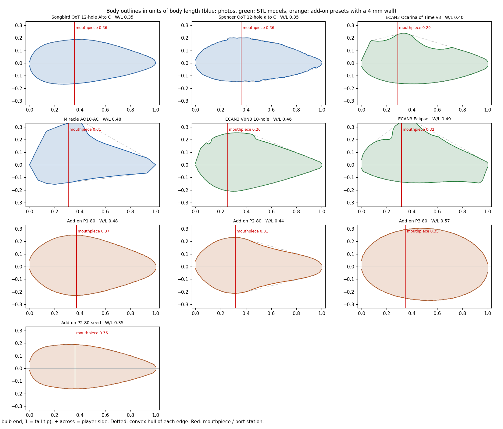
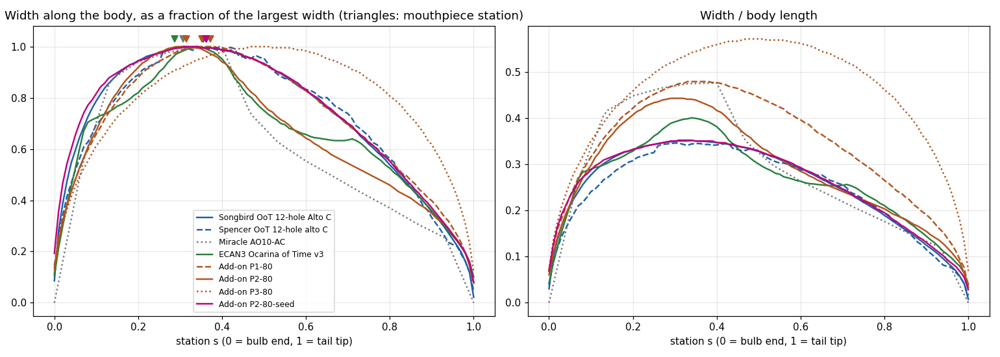

# 07 — The base shapes challenged, and where the windway sits on the body

Written on 2026-11-16, after checkpoint C6. The owner supplied photos of two well-rated ceramic 12-hole ocarinas with the mouthpiece in line with the body (Songbird, Spencer) and asked three things: where the windway sits along the body on every reference, whether the base shapes P0–P3 hold up against these bodies, and to add both instruments to the hole analysis. Tilt of the mouthpiece is a lower priority: it is a preference of the player.

Everything below is a finding or a proposal. **No preset, no layout rule and no limit was changed.** One tool gained an option (section 6), and one test body was built with it.

**Corrected later on 2026-11-16.** The first version read every Songbird photo as the "Tenor A" and applied its 8 in to the measured picture. The owner sorted the photos: the maker sells one design in two sizes, and **the measured picture is the Alto C**, whose size the maker does not state. Fractions of the body length (stations, width / length, the fitted seed body) did not change. The Songbird millimetres did: they are now given for an estimated Alto C length of 170 mm, and the Tenor A appears as the same design at 203 mm. What to do with the body library after this study is in [08](08-stage2-body-library.md).

## 1. Bottom line

1. **The windway is already in the right place along the body.** On the two ceramic references the mouthpiece meets the body at **0.36 of the body length from the bulb end** (0.356 and 0.36–0.38). On the Miracle and the three ECAN3 models the windway ends at 0.29–0.32. The add-on presets sit at 0.31 (P2), 0.35 (P3) and 0.37 (P1). Against the holes the result is the same: the mouthpiece is within 9 mm of the L middle hole on the ceramic references and the Miracle, and within 6 mm on P1 and P2.
2. **A position reference for the mouthpiece now exists** (section 3.3): station 0.36 for a body of this style, the layout centre 18–25 mm tailward of it, the window on the thumb face on the mouthpiece axis, the mouthpiece square to the body.
3. **P2's cavity has a waist, and neither ceramic reference has one.** P2 is concave by 2.0 mm on both sides in the plan view and by 1.2 mm along the deck. The Songbird outline is convex everywhere (0.3 mm, the pixel noise); so is the Spencer's. P1 and P3 are convex too.
4. **All four presets are too stubby next to these bodies.** Width / length of the outer body: 0.35 for both ceramic references, 0.44 for P2, 0.48 for P1, 0.57 for P3. At equal volume a body of the ceramic proportions is 140 mm long outside, against 133 mm (P2) and 118 mm (P1).
5. **The ceramic bodies are rounder in section**: thickness / width about 0.8, against 0.68–0.74 for the presets and 0.53–0.56 for the flat ECAN3 prints.
6. **A test body with the Songbird outline clears most of P2's warnings.** `P2-80-seed` is the P2 preset with station values fitted to the Songbird outline. It has no waist, the L pinky hole leans 13° toward the end instead of 29°, the land past both pinky holes is over 10 mm, and its computed first cavity mode is 1.36 × F6 (pass; P2 has 1.40). It keeps two of P2's five warnings (section 3.6).
7. **Both ceramic references would warn on the add-on's hand checks**: their two rows of holes are 36–42 mm apart across the body, against the 18–28 mm limit taken from the Miracle and the ECAN3 models (section 3.7).
8. **The Songbird is one design in two sizes** (section 3.8). The Alto C is about 170 mm long by four indirect checks (152–181 mm allowed); the retail figure 6 × 4.5 × 8 does not describe the instrument. The Tenor A, 203 mm, fits a lowest note of about F♯4. The outline and the positions used here are fractions of the body length, so the conclusions do not depend on either size.

## 2. Evidence used

| Source | What it gives | Where |
| --- | --- | --- |
| Songbird OoT 12-hole Alto C (and Tenor A, the same design larger) | Near-orthographic finger face of the Alto C: outline, mouthpiece, 10 holes; one oblique frame of its thumb face. Alto C length estimated at 170 mm; Tenor A 203 mm by the maker | [Songbird_OoT_12h.md](../Analizes_ocarinas/Songbird_OoT_12h/Songbird_OoT_12h.md) |
| Spencer OoT alto C (A4–F6) | Four oblique photos, both subhole variants, one photo of the thumb face. Scale from the maker's 165 mm | [Spencer_OoT_12h.md](../Analizes_ocarinas/Spencer_OoT_12h/Spencer_OoT_12h.md) |
| ECAN3 Ocarina of Time, Eclipse, V0N3 (STL) | The windway channel traced through the voxel models; outline, cavity and thickness | local voxel caches (not committed) |
| Miracle AO10-AC | Stub axis, window, holes | [Miracle_M.md](../Analizes_ocarinas/Miracle_M/Miracle_M.md) |
| Add-on bodies P1, P2, P3 at 80 cm³ | Cavity formula, built hole centres | `ocarina_addon/presets/cavity_presets.toml`, `addon_checks/*.json` |
| Cross-reference script | Every table of section 3 | [measure_body_windway.py](../Analizes_ocarinas/Windway_and_body_shape/measure_body_windway.py), output [measure_output.md](../Analizes_ocarinas/Windway_and_body_shape/measure_output.md) |
| Volume and thickness check | Section 3.5 and 3.8 | [ceramic_volume_check.md](../Analizes_ocarinas/Windway_and_body_shape/ceramic_volume_check.md) |

The fourth STL in the reference folder (the owner's 10-hole rough volume) is an empty file, as doc 06 found. The two ceramic photos already in `Ergonomic_reference_12hole/images` (yellow and blue) show the Songbird design; the blue one is the Songbird product photo at a lower resolution.

**The frame.** Plan view of the finger face. The *body axis* is the longest chord of the body outline without the mouthpiece. A *station* is the position along it, as a fraction of the body length: 0 at the bulb (left-hand) end, 1 at the tail tip. The *neck root* is the point where the mouthpiece axis meets the body outline.



## 3. Findings

### 3.1 The mouthpiece along the body

| Instrument | Body length | Neck root | Windway exit | Window | Mouthpiece against the body axis |
| --- | --- | --- | --- | --- | --- |
| Songbird Alto C (photo) | about 170 mm (estimate) | **0.356** | – | 0.27–0.34 (thumb-face frame, rough) | 90° |
| Spencer (3 photos) | 165 mm | **0.36–0.38** | – | on the mouthpiece axis | 87–98° |
| Miracle (photo) | 150 mm | 0.307 | – | 0.322 | 90° (stub hangs down) |
| ECAN3 Ocarina of Time (STL) | 140 mm | 0.288 | 0.291 | 0.364 (centre of the whole opening) | 114° |
| ECAN3 Eclipse (STL) | 137 mm | 0.316 | 0.316 | 0.348 | 113° |
| ECAN3 V0N3, 10 holes (STL) | 129 mm | 0.256 | 0.305 | 0.313 | 120° |
| Add-on P1-80 | 118 mm | **0.373** | same point | same point | 89° |
| Add-on P2-80 | 133 mm | **0.315** | same point | same point | 89° |
| Add-on P3-80 | 102 mm | **0.351** | same point | same point | 91° |

On the add-on bodies the neck root, the windway exit and the window are one point in this view, the voicing port, and the windway runs square to the body. The preset value `port_u` is measured along the cavity spine (P1 0.36, P2 0.30, P3 0.34); with the 4 mm wall it becomes the station in the table.

- **Two groups.** The ceramic bodies with a square mouthpiece: 0.36. The Miracle and the ECAN3 prints: the windway ends at 0.29–0.32. The ECAN3 mouthpieces lean 23–30° toward the left hand, so their neck root is further toward the bulb than their windway exit.
- **The presets lie inside the range of the references.** P2, modelled on the Miracle, matches the Miracle within 0.01. P1 matches the ceramic bodies within 0.02.
- The Spencer value holds on three photos taken from three directions (0.363, 0.378, 0.383).

### 3.2 The mouthpiece against the holes

Stations of the hole centres on the same axis:

| Instrument | L pinky | L ring | L middle | L index | R index | R pinky | Mouthpiece | Mouthpiece − L middle | Layout centre − mouthpiece |
| --- | --- | --- | --- | --- | --- | --- | --- | --- | --- |
| Songbird Alto C (170 mm) | 0.087 | 0.204 | 0.312 | 0.415 | 0.557 | 0.838 | 0.356 | +7.4 mm | +22.1 mm (13 % of the length) |
| Spencer | 0.177 | 0.297 | 0.416 | 0.498 | 0.531 | 0.860 | 0.363 | −8.8 mm | +25.0 mm (15 %) |
| Miracle | 0.087 | 0.201 | 0.315 | 0.412 | 0.447 | 0.781 | 0.307 | −1.3 mm | +18.4 mm (12 %) |
| ECAN3 Ocarina of Time | 0.133 | 0.262 | 0.389 | 0.514 | 0.512 | 0.895 | 0.288 | −14.2 mm | +31.5 mm (23 %) |
| ECAN3 Eclipse | 0.156 | 0.293 | 0.426 | 0.554 | 0.477 | 0.877 | 0.316 | −15.0 mm | +27.2 mm (20 %) |
| Add-on P1-80 | 0.085 | 0.216 | 0.359 | 0.480 | 0.528 | 0.938 | 0.373 | +1.6 mm | +15.5 mm (13 %) |
| Add-on P2-80 | 0.107 | 0.227 | 0.356 | 0.461 | 0.502 | 0.874 | 0.315 | −5.4 mm | +22.1 mm (17 %) |
| Add-on P3-80 | 0.127 | 0.287 | 0.453 | 0.600 | 0.424 | 0.900 | 0.351 | −10.3 mm | +16.4 mm (16 %) |

*Layout centre* is the point halfway between the two index holes, the quantity behind the preset value `layout_centre_from_port_mm` (16 mm on P1 and P3, 23 mm on P2). The Spencer hole stations carry about ±0.03. The Songbird millimetres are for its estimated length.

- **The mouthpiece sits at the L middle hole, give or take half a finger pitch**, on the ceramic references and the Miracle (−8.8 to +7.4 mm). P1 and P2 are inside that band.
- **The layout centre is 18–25 mm tailward of the mouthpiece** on the same three references, 12–15 % of the body length. P2's 22 mm is inside; P1 and P3, at 15.5 and 16.4 mm, are just under the lowest reference in millimetres and inside in per cent.
- The ECAN3 models put the mouthpiece a further 6–10 mm toward the bulb. This goes with their leaning mouthpiece.

### 3.3 A position reference for the mouthpiece

For a body of the ceramic style (in-line mouthpiece, square to the body):

| Quantity | Reference value | Add-on now |
| --- | --- | --- |
| Neck root, station from the bulb end | **0.36** (0.356–0.383) | 0.31–0.37 |
| The same as `port_u` of a fitted cavity with a 4 mm wall | **0.35–0.36** | 0.30–0.36 |
| Layout centre, tailward of the mouthpiece | 18–25 mm; 12–15 % of the body length | 15.5–22 mm; 13–17 % |
| Mouthpiece against the L middle hole, along the body | within ±9 mm | −10 to +2 mm |
| Mouthpiece axis against the body axis, plan view | 90° (87–98° on the Spencer photos) | 89–91° |
| Window | on the thumb face, on the mouthpiece axis (Spencer, Songbird Alto C, Miracle, all three STL models). Songbird: at the bottom of a round recess about 0.16 of the body length across, at the root of the mouthpiece. Spencer: at the mouthpiece end of an elongated scoop | on the lower player-side quadrant, at the port |
| Window, in from the player-side edge of the body | ECAN3: the windway ends 7–11 mm inside the outline. Spencer: the window centre is roughly 16–20 mm inside | the port is about 11 mm inside the outer edge on P2 |
| Neck width at the body | 36 mm (Spencer; Songbird Alto C at 170 mm), 0.21 of the body length | stub 16.8 mm wide (window width + 8 mm) |
| Mouthpiece length beyond the body edge | 0.28 of the body length on the Songbird: 48 mm at 170 mm | – |
| Windway length, tip to exit | 31–40 mm (ECAN3 models); 30–32 mm (Miracle) | 30 mm |

**Tilt.** In the plan view both ceramic mouthpieces are square to the body. The three ECAN3 mouthpieces lean 23–30°: the tail swings away from the player. Out of the plane, the Spencer mouthpiece drops toward the thumb face (on the thumb-face photo the body rests on the mouthpiece tip and its far edge); the Songbird's lies close to the plane of the body on its product photo, and its thumb-face frame does not show more. The add-on stub points 34° up from the plane of the body. None of this was measured to better than a reading by eye, and all of it is the free choice the owner named.

**The windway inside the ECAN3 models** (the channel was traced through the voxel models, [picture](../Analizes_ocarinas/Windway_and_body_shape/images/03_ecan3_windway.png)): 31–40 mm long, 12–17 mm wide and 4–5 mm high at the lips. The Ocarina of Time and Eclipse channels narrow to under 2 mm wide at the last traced slice, where the channel opens into the window, so their exit width cannot be read this way; the V0N3 channel ends 11.4 mm wide and 0.9 mm high. The exit lies 4–8 mm from the mid-thickness of the body, toward the thumb face.

### 3.4 The outline: smooth on the references, waisted on P2

*Concave depth* is the largest gap between one edge of the outline and the convex hull of that edge. Zero means the edge is convex everywhere.

| Body | Outer width / length | Station of the largest width | Concave depth, player side / far side | Deck, side view |
| --- | --- | --- | --- | --- |
| Songbird Alto C | **0.351** | 0.34 | **0.2 / 0.1 mm** | – |
| Spencer | **0.346** | 0.30 | 1.8 / 1.8 mm (band skirt and highlights) | – |
| ECAN3 Ocarina of Time | 0.400 | 0.34 | 8.0 / 0.2 mm | – |
| ECAN3 V0N3 | 0.464 | 0.32 | 3.2 / 0.2 mm | – |
| Miracle (from its table) | 0.476 | 0.40 | 12.5 / 1.5 mm | – |
| Add-on P1-80 | 0.479 | 0.34 | 0.3 / 0.3 mm | 0.0 mm |
| **Add-on P2-80** | 0.443 | 0.31 | **2.1 / 2.0 mm** at 0.58 | **1.2 mm** |
| Add-on P3-80 | 0.571 | 0.47 | 0.3 / 0.2 mm | 0.0 mm |
| Test body P2-80-seed | 0.352 | 0.31 | 0.3 / 0.2 mm | 0.0 mm |



- **The owner's observation is right, and it is specific to P2.** P2's width stations fall from 0.43 to 0.30 between the third and fourth station. That makes a waist on both sides of the plan view and a dip of 1.2 mm along the deck, at 0.58 of the length, between the two hands. The holes are cut into this surface.
- **Where the references are concave, it is on the player side only.** The Miracle and the ECAN3 Ocarina of Time have a deep hollow behind the mouthpiece (8–12 mm) and a far edge that is convex within 1.5 mm. The far edge is where the left-hand holes sit. P2 is the only body here with a waist on the far side.
- **The two ceramic bodies have no hollow at all.** They are one convex curve, blunt at the bulb end and pointed at the tail: the width at 0.9 of the length is a third of the largest width.
- P1 is already a smooth teardrop. Its fault is its length (doc 06 §3.6), not its outline.

### 3.5 Proportions and depth

| Body | Outer length × width × thickness, mm | Thickness / width | Source of the thickness |
| --- | --- | --- | --- |
| Songbird Tenor A | 203 × 71–76 × 57 | **0.75–0.80** | the maker's 2.25 in over the maker's 3 in (0.75), or over the scaled outline (0.80) |
| Songbird Alto C | about 170 × 60 × 45–48 | as the Tenor A (assumed) | length estimated; same design |
| Spencer | 165 × 57 × about 45 | **about 0.8** | edge-view photo (35–45 mm), bounded below by the holes and the mass (below, and 3.9) |
| ECAN3 Ocarina of Time | 140 × 56 × 31.5 | 0.56 | voxel model |
| ECAN3 V0N3 | 129 × 60 × 31.8 | 0.53 | voxel model |
| Add-on P1-80 | 118 × 56.5 × 42.0 | 0.74 | preset |
| Add-on P2-80 | 133 × 58.8 × 41.6 | 0.71 | preset |
| Add-on P3-80 | 102 × 58.3 × 39.4 | 0.68 | preset |
| Test body P2-80-seed | 140 × 49.3 × 39.4 | 0.80 | fitted |

**How the Spencer's depth was found.** Three rough inputs were set against each other ([ceramic_volume_check.md](../Analizes_ocarinas/Windway_and_body_shape/ceramic_volume_check.md) §1). The twelve holes give 67–101 cm³ by the range identity of doc 03 (A4–F6 is stated by the maker). The outline with a thickness, minus 330 g of fired clay, gives the air by a second route. An edge-view photo, added later the same day, reads 35–45 mm of thickness. The two volume routes meet only from 43.5 mm up, so the body is at the top of the photo reading: about 45 mm, thickness / width 0.79, with about 70 cm³ of air. The first pass, without the edge view, gave 0.8–0.9. The Songbird Tenor A's ratio is 0.75 by the maker's own rounded numbers and 0.80 on the scaled outline, so the two ceramic designs now agree. Two things support a round section independently: the photos taken from three directions show the Spencer's holes sitting high above the outline (the parallax in its report), and both grip photos show a deep, round far flank.

So the references split by how they are made. The ceramic bodies are round and slender. The ECAN3 prints are flat and wide. The presets are in between, and shorter than both.

### 3.6 The reference outline as a test body

The preset model (7 width stations, 7 height stations) was fitted to each reference outline, taken as the outer skin of a printed body with a 4 mm wall and scaled until the cavity holds 78.1 cm³, the cavity mesh of an 80 cm³ body.

| Fitted to | Outer length | Cavity spine | Cavity width × height | Fit error, rms / max |
| --- | --- | --- | --- | --- |
| Songbird outline (thickness / width 0.80) | 140.1 mm | 131.9 mm | 41.2 × 31.4 mm | 0.15 / 0.61 mm |
| Spencer (0.80 assumed) | 143.2 mm | 134.9 mm | 41.5 × 31.6 mm | 0.48 / 1.24 mm |
| ECAN3 Ocarina of Time (its own thickness) | 157.2 mm | 148.5 mm | 54.9 × 27.4 mm | 0.69 / 1.94 mm |

The two ceramic outlines give the same body within 3 mm. The station values are in [measure_output.md](../Analizes_ocarinas/Windway_and_body_shape/measure_output.md) §6. The model follows the Songbird outline to 0.15 mm, so no change to the cavity formula is needed to make this shape.

The Songbird fit was built and checked as `P2-80-seed`: the P2 preset with those station values, `exponent = 2.0`, `port_u = 0.35` and `layout_centre_from_port_mm = 20`. The hole template, the subhole rule and every limit are P2's.

```bash
blender -b --factory-startup --python tools/geometry_check_variant.py -- P2 80 seed width=0.5110,0.3839,0.3314,0.2869,0.2345,0.1773,0.1028 height=0.3761,0.2914,0.2524,0.2178,0.1748,0.1260,0.0491 exponent=2.0 port_u=0.35 layout_centre_from_port_mm=20 --renders
```

Report: [addon_checks/P2-80-seed.md](../addon_checks/P2-80-seed.md). Views: [sheet_views.png](../addon_renders/P2-80-seed/sheet_views.png).

| Measured on the built body | P1-80 | P2-80 | P2-80-seed | Limit |
| --- | --- | --- | --- | --- |
| Hard checks | no unexpected failure | no unexpected failure | no unexpected failure | – |
| Warnings | 4 | 5 | **2** | – |
| First cavity mode (computed) | 1.63 × F6 | 1.40 × F6 | **1.36 × F6** | pass at 1.3 |
| c/(2L), reported only | 1.13 × F6 | 0.99 × F6 | 0.94 × F6 | – |
| Land past the L pinky / R pinky hole edge | 5.2 / 4.8 mm | 9.4 / 12.4 mm | **15.2 / 11.6 mm** | at least 10 mm |
| L pinky lean toward the bulb end | 38° | 29° | **13°** | up to 20° |
| Largest lean toward an end | 38° | 29° | 19° (R pinky) | up to 20° |
| Left hand span | 48.9 mm (warn) | 48.9 mm (warn) | 50.1 mm | 50–60 mm |
| L middle to L index | – | 16.4 mm (warn) | 16.2 mm (warn) | 16.5–20.5 mm |
| R pinky lean away from the hand | – | 7° (warn) | 10° (warn) | up to 5° |
| Smallest edge gap between holes | – | 3.63 mm | 3.63 mm | at least 3.4 mm |
| Nearest hole edge to the window | – | 18.7 mm | 18.1 mm | at least 10 mm |
| Thinnest plastic away from the voicing | – | 3.80 mm | 3.60 mm | – |
| Mouthpiece station | 0.373 | 0.315 | 0.361 | reference 0.36 |

What it shows:

- **The lean of the L pinky hole, which doc 06 left as the one job for an outer body or a P4, goes away with the shape.** The bulb end of the seed is blunt and long, so the pinky hole sits on a flatter part of it.
- **The cavity mode stays above the 1.3 line**, by a smaller margin than P2: 1.36 against 1.40. The cavity is 7 mm longer than P2's. This is the cost of the slender shape, and it is the number to watch if the body is made longer still.
- The two warnings that remain are P2's own: the 35 % sideways limit that shortens the middle-to-index distance (open problem 17), and the R pinky lean. The narrow tail makes the second one 3° worse.
- **The tail is narrow.** At the R pinky hole the cavity is 12.4 mm wide and 8.2 mm high (P2: 14.0 × 9.2 mm). The Miracle analysis found that holes on a narrow tail need more area than the lumped model gives. The position factors of Stage 2 would have to carry that.
- The warnings were not a target. The station values come from the fit alone, and the port and layout values from section 3.3.

### 3.7 The two ceramic layouts, front and back

Both instruments are now in the hole analysis with their own reports. Against the layouts doc 06 used:

| Layout | Scale | Rows apart, across | Finger pitch, left / right | Left subhole | Right subhole | Subhole layout |
| --- | --- | --- | --- | --- | --- | --- |
| Miracle | catalogue | 24.0 mm | 14.5–17.2 / 15.5–17.6 mm | from R index, 8.7 mm | from R middle, 7.3 mm | both on the right hand |
| ECAN3 Ocarina of Time | CAD | 19.2 mm | 18 mm | from L ring, 9.1 mm | from R middle, 7.5 mm | one per hand |
| ECAN3 Eclipse | CAD | 26.4 mm | 19–20 mm | from L ring, 10.0 mm | from R middle, 8.5 mm | one per hand |
| **Songbird Alto C**, at 170 mm | estimated length | **36.4 mm** | 18.6–20.0 / 15.9–18.6 mm | from L ring, 10.6 mm, 1° off the normal | from R middle, 8.3 mm, 2° | one per hand |
| **Songbird Tenor A**, the same design at 203 mm (assumed) | maker's length | 43.6 mm | 22.2–23.9 / 19.1–22.2 mm | 12.7 mm | 9.9 mm | one per hand |
| **Spencer**, split variant | maker's length | 42 mm (apparent) | 19.6–20.3 / 17.7–21.8 mm | from L ring, 10.3 mm, 16° | from R middle, 7.5 mm, 11° | one per hand |
| **Spencer**, single-hand variant | – | – | same finger holes | beside R index | beside R middle | both on the right hand |

- **The subhole rule holds on two more instruments**: one per hand, forward of L ring and R middle, along the normal of the hand line. On the two alto C instruments the distances are 10.3–10.6 and 7.5–8.3 mm; the add-on uses 9.5 and 7.5 mm.
- **One maker sells both subhole layouts on the same eight finger holes.** So the choice between "one per hand" and "both on the right hand" does not move the finger holes.
- **The rows are 36–42 mm apart across on the two alto C instruments, against the limit of 18–28 mm.** Both layouts would warn on `ergo_hand_offset` and on the *across* part of `ergo_index_meet`. The Songbird Alto C at 170 mm also warns on two right-hand pitches (15.9 and 16.3 mm), on the right span (49.4 mm) and on the index holes along the body (+16.6 mm: its hands do not overlap); the Spencer on one pitch (21.8 mm) and on the arch of the left hand (8.5 mm). These are plan-view numbers on bodies that are 0.8 as thick as they are wide: the left row lies on the far flank and the right row on the player flank. The limit came from flatter bodies.
- **Thumb face (one oblique photo each, rough):** on both instruments the L thumb hole is bulb-ward of the window, the window is on the mouthpiece axis, and the R thumb hole is tailward of it, near the R index and R middle holes. Stations, corrected: Songbird Alto C 0.19 / 0.34 / 0.61, Spencer 0.10 / 0.40 / 0.66 (L thumb / window / R thumb). This is the order of the Miracle and of both ECAN3 models. Thumb-hole rims are about 14 mm on the Songbird Alto C at 170 mm and about 12 ± 2 mm on the Spencer. The Spencer has two small holes beside the neck on the thumb face, probably for a cord.
- **Relative hole sizes** follow the pattern of every other reference: the left-hand holes are the largest, R middle and R pinky the smallest finger holes.

### 3.8 The two Songbird models

The maker sells this design twice: an **Alto C** (A4–F6, no size stated) and a **Tenor A** (8 in × 3 in × 2.25 in, just under 1 lb, no range stated). The photo measured here is the main picture of the Alto C page. The Tenor A page has its own photo; read by eye it shows the same hole pattern, the same width / length and the same mouthpiece station. So the two are taken as one design at two sizes. The details and the sorted photo list are in the [Songbird report](../Analizes_ocarinas/Songbird_OoT_12h/Songbird_OoT_12h.md).

| Question | Answer | How |
| --- | --- | --- |
| How long is the Alto C? | **About 170 mm; 152–181 mm allowed** | It fits the maker's chest (181 × 114 mm inside). Its holes and its outline give the same air volume at A4 for 165–175 mm. The Tenor A divided by three semitones is 171 mm. At 152 mm its right-hand finger pitch would be 14.3–14.6 mm |
| Does the retail figure 6 × 4.5 × 8 (in) hold up? | **No, not as the instrument** | The measured proportions are 1 : 0.63 : 0.28 (length : overall height : thickness). No order of the three numbers fits them. They fit a box of 8 × 6 × 4.5 in |
| What pitch does the Tenor A's size fit? | **A lowest note of about F♯4** (G4 to F4 within the error) | 176–237 cm³ of air by its outline, thickness and mass; twelve holes of the scaled size with A4 as the lowest note would go with 122–147 cm³ |

The owner's reading, a pitch between alto C and bass, agrees with the last row. Nothing was measured on a Tenor A beyond the maker's dimensions and weight. The Songbird report §8 has the notes on what a body of that size means for this project: a longer body is acoustically safe when the pitch drops with it, and the price is larger finger pitches and larger holes.

### 3.9 The Spencer's chamber: thick walls, pockets and a solid tail

Added on 2026-11-16 from one edge view and three workshop pictures the maker posted (the [Spencer report](../Analizes_ocarinas/Spencer_OoT_12h/Spencer_OoT_12h.md) §7). The workshop pictures do not name the model; they are read as this design, in fractions of the body length.

- **The walls are thick and uneven.** 4–12 mm at the joint plane, about 3 mm at the lip of a thumb hole. The thumb-face half is hollow only in three pockets (under each thumb hole and under the window), and solid from 0.65 of the length to the tail tip.
- **Air volume: about 70 cm³ (65–80)**, where the holes, the 330 g and the thickness meet. About two thirds of the body is clay.
- **The chamber is about 131–136 mm long in a body of 165 mm.** A model of it, solved with the add-on's cavity-mode solver, puts the first mode at 1.34 × F6 for an even shell, 1.48 with the solid tail, 1.39 with low ridges between the pockets and 1.21 with walls up to the joint plane. A 6 mm shell on the same body would hold 101 cm³ and sit at 1.25.
- So the thick walls and the solid tail raise the margin the add-on checks. The walls between the pockets lower it.
- **Those walls are the partial partitions of US 7,799,980 B1** (inventor Norman Spencer Register; listed as expired, lapsed in 2014). The patent puts one between the window and each thumb hole, nearer the thumb hole, rising a little above the mid-line, to keep the tone of the top notes when the thumb holes open. On the body model a partition of that height weakens the thumb hole behind it by 10–15 % and puts the closed-hole mode at 1.10–1.24 × F6; with both thumb holes open the next mode is at 1.34–1.45. The add-on has no model of the claim itself. The owner keeps it as an experiment for later: [US7799980_partitions.md](../Analizes_ocarinas/Patent_US7799980/US7799980_partitions.md).
- Neither ECAN3 chamber has walls inside it. The Eclipse has thick, uneven walls (median 6.2 mm); the Ocarina of Time has thin ones (2.8 mm).

**What it means here.** The seed test body has a chamber 132 mm long at 80 cm³, with its first mode at 1.36 × F6. Printed with a 4 mm wall it is 140 mm long outside. It already has about the chamber of the Spencer; the ceramic body is longer because its walls are thicker. A printed body stretched to 165 mm with a thin wall would not be the same instrument: its chamber would be about 146 mm long and the margin would fall to about 1.25. Filling the tail is a lever the add-on does not have. Nothing was changed.

## 4. Proposals

Each needs an owner decision. None was applied.

| # | Item | Now | Proposed | Why |
| --- | --- | --- | --- | --- |
| 1 | The mouthpiece station | `port_u` 0.36 / 0.30 / 0.34 on P1 / P2 / P3 | **Keep.** For a body of the ceramic style use 0.35 | 3.1–3.3 |
| 2 | `layout_centre_from_port_mm` | 16 (P1, P3), 23 (P2) | Keep. 18–25 mm is the range of the references | 3.2 |
| 3 | A smooth, slender body | Not in the set. P4 was left open (doc 06) | **Add the seed as the P4 candidate**, with the values of `P2-80-seed`, or replace P2 by it | 3.4–3.6 |
| 4 | P2's waist | 2.0 mm in the plan, 1.2 mm on the deck | If P2 stays as the Miracle-like body: leave it, since it is the shape under test. If P2 is meant as the ergonomic body: the seed does that job better | 3.4, 3.6 |
| 5 | Thickness / width | 0.68–0.74 | The seed uses 0.80 (cavity 0.76). A flatter seed (0.6–0.7) is a separate variant to try | 3.5 |
| 6 | `ergo_hand_offset`, `ergo_index_meet` | 18–28 mm across | No change proposed. Report that two well-rated round alto C bodies have 36–42 mm, and decide after a hand check | 3.7 |
| 7 | The mouthpiece stub | A plain box 16.8 mm wide | When it is shaped: a neck of 36–43 mm at the body, square to it | 3.3 |

On proposal 3: Stage 2 freezes the hole layout on its first print (doc 04 D10). Adding a body before that costs one print. Replacing P2 loses the body that was modelled on the Miracle.

## 5. Questions for the owner

1. Should the seed join Stage 2 as a fifth body, replace P2, or wait? **Answered on 2026-11-16: the owner wants the seed in.** Which of the present bodies stay is worked out in [08](08-stage2-body-library.md).
2. If it joins: round like the ceramic bodies (thickness / width 0.80), or flatter? **Round, saved for now on 2026-11-16; built as preset `P4` on 2026-11-17.**
3. A ruler on a Songbird Alto C, or a tuner on a Tenor A, would settle the two estimates of section 3.8. Neither is needed for the add-on.
4. The hand rows of both ceramic bodies are wider apart than the limit. Leave the limit, or widen it for round bodies?

## 6. What changed in the repository

- New analyses: `Analizes_ocarinas/Songbird_OoT_12h/` (photos named by model: `altoC_`, `tenorA_`, `unsorted_`), `Analizes_ocarinas/Spencer_OoT_12h/`, `Analizes_ocarinas/Windway_and_body_shape/` (scripts, generated tables, pictures, the owner's photos).
- `tools/geometry_check_variant.py` accepts a comma-separated list as an override value, so the station values can be overridden.
- Later the same day: `Analizes_ocarinas/Patent_US7799980/` (the patent's drawings, a summary, `partition_check.py`); four more Spencer photos, `Analizes_ocarinas/Spencer_OoT_12h/internal_cavity_check.py` and its output, and a reworked §1 of `ceramic_volume_check.py` (section 3.9).
- Two test bodies: `addon_checks/P2-80-seed.md` and `.json`, `addon_renders/P2-80-seed/`; and the flatter `P2-80-seedflat`, built for [08](08-stage2-body-library.md).
- No preset, kernel, layout rule, limit or test was changed.

## 7. Limits of this pass

- Two ceramic designs, each from photos. The Songbird Alto C has one good view and one oblique frame of its thumb face. The Spencer has no orthographic view at all; its stations along the body are sound, its distances across are apparent, its thumb face is rough.
- The Spencer scale is the maker's rounded length (±3 %). The Songbird Alto C length is an estimate (170 mm, 152–181 mm allowed), so its millimetres carry about ±7 %. Two photos whose model is not known were left out. Hole sizes are the unglazed rims, about 1 mm more than the bore.
- "Well rated" rests on one reviewer's scores, from the owner's screenshots. Nobody on this project has played either instrument.
- The thickness of the Spencer rests on one small edge-view photo and on the maker's mass. Its air volume and its chamber model (3.9) rest on that and on workshop photos that do not name the model. The thickness of the Songbird is the maker's number for the Tenor A, carried to the Alto C on the assumption of one design.
- The fit takes a ceramic outer outline as the outer skin of a printed body with a uniform 4 mm wall. The ceramic bodies have thicker walls (the Spencer about 8 mm on average by its mass, and unevenly), so their real cavities are slimmer and shorter than the fitted one.
- The seed body was checked by the add-on's desk checks only. Its cavity mode was computed with closed holes (doc 06 §3.10). Nothing was printed.
- The ECAN3 windway was traced as enclosed air in horizontal slices; the last slices before the window are partial, so the exit width of two models could not be read.
- The STL rows need the local voxel caches. Without them the script leaves those rows out.
